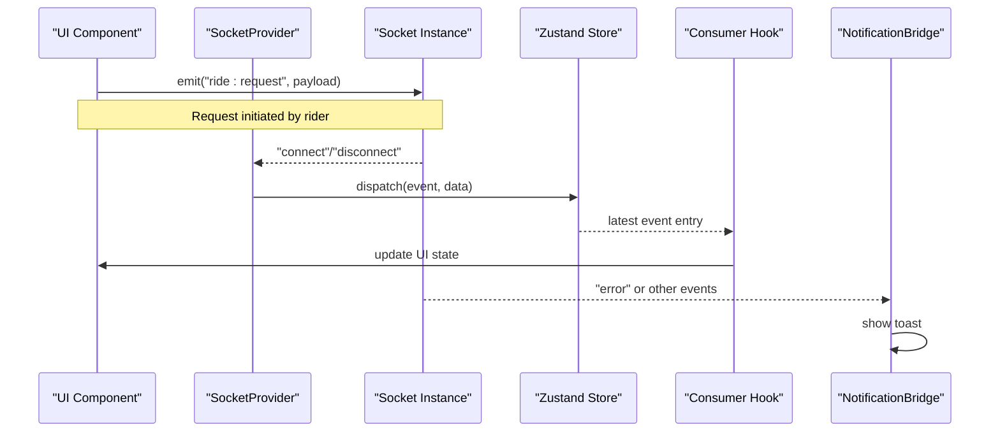
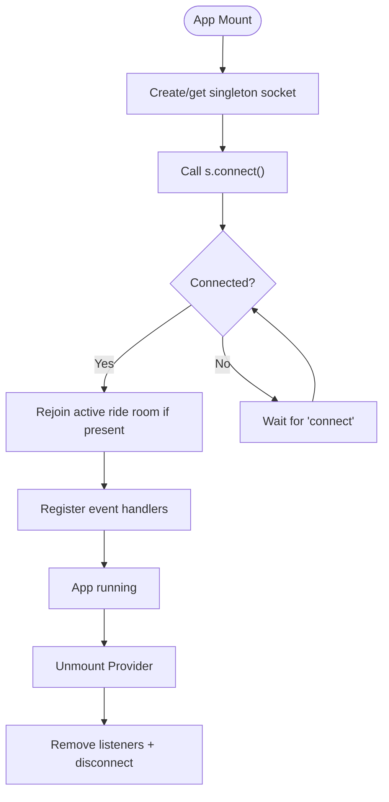
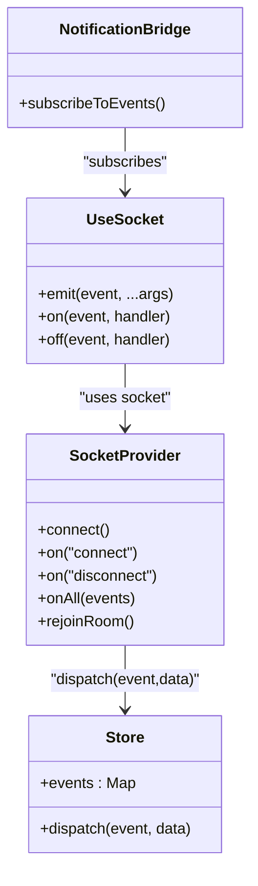
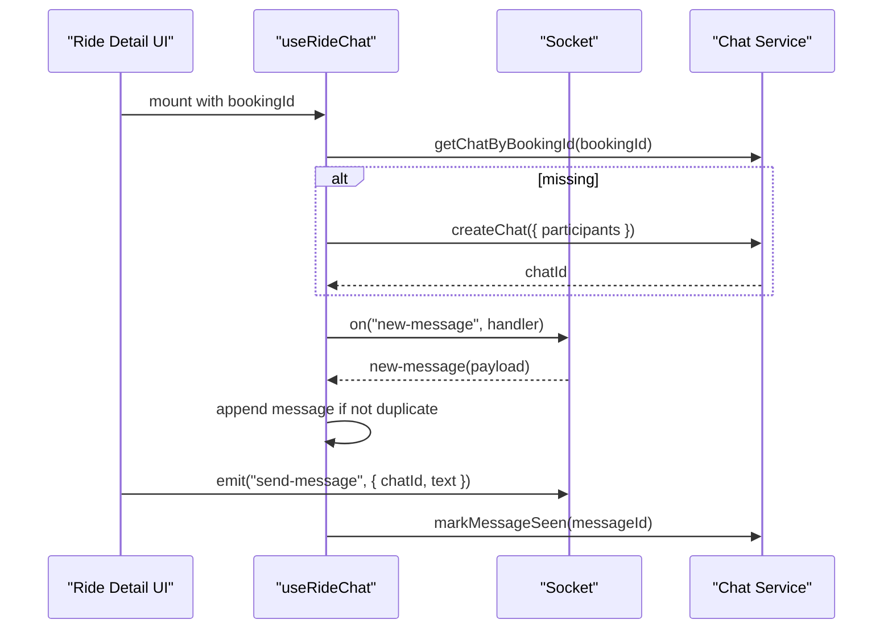
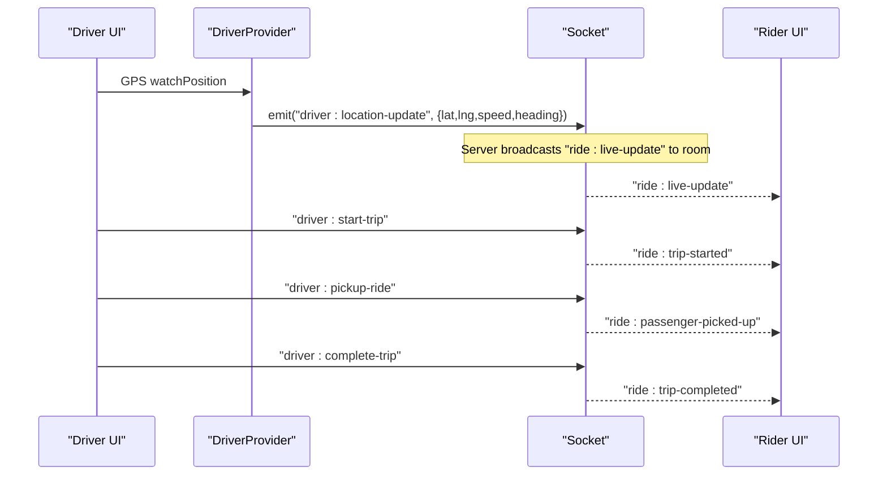
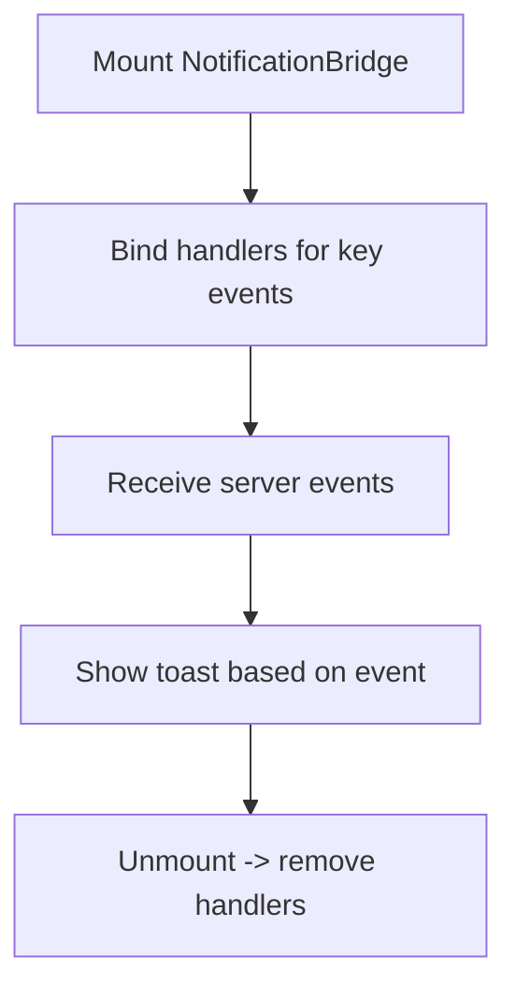
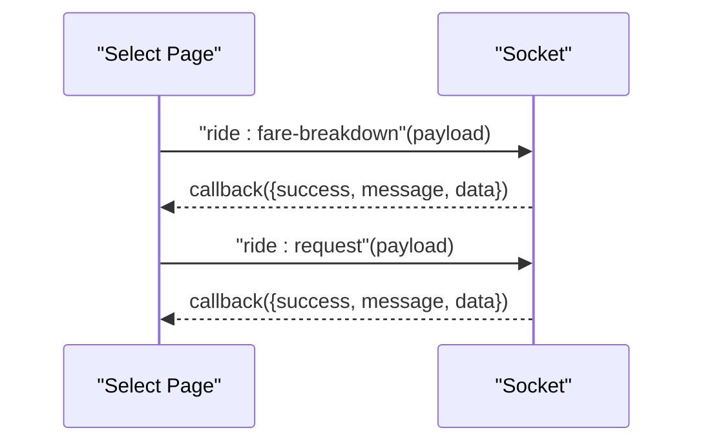
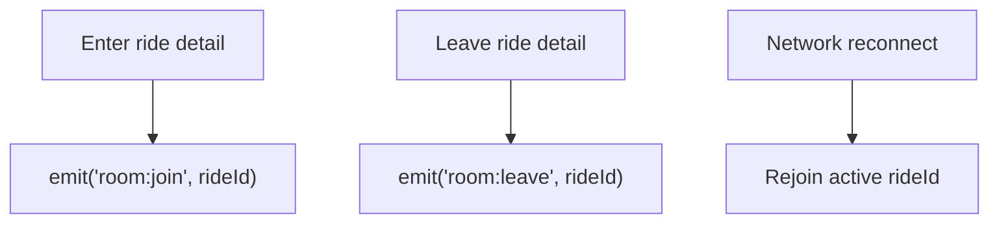
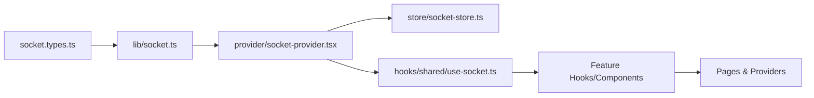

# Socket.io Real-time Communication

<cite>
**Referenced Files in This Document**
- [socket.ts](file://src/lib/socket.ts)
- [socket-provider.tsx](file://src/provider/socket-provider.tsx)
- [use-socket.ts](file://src/hooks/shared/use-socket.ts)
- [socket-store.ts](file://src/store/socket-store.ts)
- [socket.types.ts](file://src/types/socket.types.ts)
- [use-ride-chat.ts](file://src/hooks/shared/use-ride-chat.ts)
- [chat.service.ts](file://src/services/chat.service.ts)
- [notification-bridge.tsx](file://src/provider/notification-bridge.tsx)
- [driver-provider.tsx](file://src/app/driver/driver-provider.tsx)
- [select page.tsx](file://src/app/(view)/book/select/page.tsx)
- [driver ride page.tsx](file://src/app/driver/(view)/my-rides/[id]/page.tsx)
</cite>

## Table of Contents
1. Introduction
2. Project Structure
3. Core Components
4. Architecture Overview
5. Detailed Component Analysis
6. Dependency Analysis
7. Performance Considerations
8. Troubleshooting Guide
9. Conclusion

## Introduction
This document explains the client-side real-time communication layer built with Socket.io for a ride-sharing application. It covers connection management, event-driven architecture, message routing between clients and server, chat functionality, ride status updates, live notifications, and patterns for custom features. It also includes guidance on debugging WebSocket connections and scaling considerations for high-concurrency scenarios.

## Project Structure
The real-time layer is implemented entirely on the client side using socket.io-client. The key building blocks are:
- A singleton socket factory that configures transport, credentials, and authentication token injection.
- A React provider that manages lifecycle (connect/disconnect), centralizes event subscriptions, and reattaches to active rooms after reconnects.
- Typed hooks for emitting events and subscribing to server events.
- A global store that dispatches incoming events into a typed state map for UI consumption.
- Feature-specific integrations for chat, driver location broadcasting, and ride control flows.

```mermaid
graph TB
subgraph "Client"
SP["SocketProvider<br/>(lifecycle + central listeners)"]
H1["useSocket / useSocketEvent<br/>(typed emit/on/off)"]
ST["Zustand Store<br/>(events map)"]
NB["NotificationBridge<br/>(toast UI)"]
DC["DriverProvider<br/>(GPS + driver events)"]
RC["RideChat Hook<br/>(chat sync)"]
UI1["Booking Select Page<br/>(ride request/fare)"]
UI2["Driver Ride Page<br/>(trip control)"]
end
S["Socket.io Client<br/>(singleton)"]
SRV["Server (Socket.io)"]
SP --> S
SP --> ST
SP --> |rejoin room| S
H1 --> S
NB --> S
DC --> S
RC --> S
UI1 --> S
UI2 --> S
S <- --> SRV
```

**Diagram sources**
- [socket-provider.tsx:66-108](file://src/provider/socket-provider.tsx#L66-L108)
- [use-socket.ts:12-39](file://src/hooks/shared/use-socket.ts#L12-L39)
- [socket-store.ts:19-25](file://src/store/socket-store.ts#L19-L25)
- [notification-bridge.tsx:13-57](file://src/provider/notification-bridge.tsx#L13-L57)
- [driver-provider.tsx:29-136](file://src/app/driver/driver-provider.tsx#L29-L136)
- [use-ride-chat.ts:17-115](file://src/hooks/shared/use-ride-chat.ts#L17-L115)
- [select page.tsx:620-689](file://src/app/(view)/book/select/page.tsx#L620-L689)
- [driver ride page.tsx:120-194](file://src/app/driver/(view)/my-rides/[id]/page.tsx#L120-L194)

**Section sources**
- [socket.ts:23-42](file://src/lib/socket.ts#L23-L42)
- [socket-provider.tsx:66-108](file://src/provider/socket-provider.tsx#L66-L108)
- [use-socket.ts:12-39](file://src/hooks/shared/use-socket.ts#L12-L39)
- [socket-store.ts:19-25](file://src/store/socket-store.ts#L19-L25)

## Core Components
- Singleton socket factory: Creates a single socket instance with configured transports, credentials, and auth token extraction from cookies. Provides connect/disconnect helpers.
- SocketProvider: Connects the socket, sets up a centralized listener map for all known events, persists room membership across reconnects, and exposes context.
- useSocket and useSocketEvent: Typed wrappers around emit/on/off and a convenience hook to subscribe for component lifetime.
- Zustand store: Centralized event bus that stores the latest payload per event type with timestamps for UI consumers.
- NotificationBridge: Subscribes to important events and surfaces user-facing toast notifications.
- DriverProvider: Emits driver availability and location updates; listens for new ride requests.
- RideChat hook: Lazily creates or fetches a 1:1 chat for a booking, subscribes to new messages, and marks messages as seen.
- Booking select page and driver ride page: Example usage of ride request, fare breakdown, and trip control via socket events.

**Section sources**
- [socket.ts:23-42](file://src/lib/socket.ts#L23-L42)
- [socket-provider.tsx:66-108](file://src/provider/socket-provider.tsx#L66-L108)
- [use-socket.ts:12-39](file://src/hooks/shared/use-socket.ts#L12-L39)
- [socket-store.ts:19-25](file://src/store/socket-store.ts#L19-L25)
- [notification-bridge.tsx:13-57](file://src/provider/notification-bridge.tsx#L13-L57)
- [driver-provider.tsx:29-136](file://src/app/driver/driver-provider.tsx#L29-L136)
- [use-ride-chat.ts:17-115](file://src/hooks/shared/use-ride-chat.ts#L17-L115)
- [select page.tsx:620-689](file://src/app/(view)/book/select/page.tsx#L620-L689)
- [driver ride page.tsx:120-194](file://src/app/driver/(view)/my-rides/[id]/page.tsx#L120-L194)

## Architecture Overview
The client uses a layered approach:
- Transport layer: socket.io-client with fallback transports and cookie-based auth.
- Lifecycle layer: SocketProvider connects/disconnects and reattaches to rooms.
- Event layer: Centralized subscription map dispatches events into a typed store.
- Feature layers: Hooks and components consume events and emit domain-specific actions.



**Diagram sources**
- [socket-provider.tsx:71-108](file://src/provider/socket-provider.tsx#L71-L108)
- [use-socket.ts:12-39](file://src/hooks/shared/use-socket.ts#L12-L39)
- [socket-store.ts:19-25](file://src/store/socket-store.ts#L19-L25)
- [notification-bridge.tsx:13-57](file://src/provider/notification-bridge.tsx#L13-L57)
- [select page.tsx:663-689](file://src/app/(view)/book/select/page.tsx#L663-L689)

## Detailed Component Analysis

### Connection Management and Room Reattachment
- The singleton socket is created with autoConnect disabled, credentials enabled, and both websocket and polling transports. Auth token is read from cookies before connecting.
- SocketProvider calls connect() once, tracks connected state, and re-joins the last active ride room upon any connect event.
- On unmount, it removes all listeners and disconnects the socket.



**Diagram sources**
- [socket.ts:23-42](file://src/lib/socket.ts#L23-L42)
- [socket-provider.tsx:71-108](file://src/provider/socket-provider.tsx#L71-L108)

**Section sources**
- [socket.ts:23-42](file://src/lib/socket.ts#L23-L42)
- [socket-provider.tsx:71-108](file://src/provider/socket-provider.tsx#L71-L108)

### Event-Driven Architecture and Message Routing
- All known server-to-client events are enumerated and centrally subscribed by SocketProvider. Each incoming event is dispatched into the Zustand store under a typed key.
- Consumers can either:
  - Use useSocketEvent to subscribe directly to an event within a component’s lifecycle.
  - Read the latest event payload from the store via useSocketEvent(event).
- The notification bridge demonstrates feature-level subscriptions for user feedback.



**Diagram sources**
- [socket-provider.tsx:89-108](file://src/provider/socket-provider.tsx#L89-L108)
- [socket-store.ts:19-25](file://src/store/socket-store.ts#L19-L25)
- [use-socket.ts:12-39](file://src/hooks/shared/use-socket.ts#L12-L39)
- [notification-bridge.tsx:13-57](file://src/provider/notification-bridge.tsx#L13-L57)

**Section sources**
- [socket-provider.tsx:89-108](file://src/provider/socket-provider.tsx#L89-L108)
- [socket-store.ts:19-25](file://src/store/socket-store.ts#L19-L25)
- [use-socket.ts:12-39](file://src/hooks/shared/use-socket.ts#L12-L39)
- [notification-bridge.tsx:13-57](file://src/provider/notification-bridge.tsx#L13-L57)

### Chat Functionality (Real-time Messages)
- The ride chat hook lazily fetches or creates a 1:1 chat for a booking, then subscribes to "new-message" to append messages in real time.
- It marks messages as seen when viewed and emits "send-message" to send new text.
- HTTP service methods handle persistence and list retrieval.



**Diagram sources**
- [use-ride-chat.ts:17-115](file://src/hooks/shared/use-ride-chat.ts#L17-L115)
- [chat.service.ts:11-49](file://src/services/chat.service.ts#L11-L49)
- [socket.types.ts:164-171](file://src/types/socket.types.ts#L164-L171)
- [socket.types.ts:114-142](file://src/types/socket.types.ts#L114-L142)

**Section sources**
- [use-ride-chat.ts:17-115](file://src/hooks/shared/use-ride-chat.ts#L17-L115)
- [chat.service.ts:11-49](file://src/services/chat.service.ts#L11-L49)
- [socket.types.ts:164-171](file://src/types/socket.types.ts#L164-L171)
- [socket.types.ts:114-142](file://src/types/socket.types.ts#L114-L142)

### Ride Status Updates and Live Location
- Drivers broadcast their location via "driver:location-update". The server relays this as "ride:live-update" to passengers in the ride room.
- Drivers manage trip lifecycle through explicit events like start-trip, pickup, drop-off, and complete-trip.
- Riders receive status changes such as driver accepted, arrived, started, completed, and cancellations.



**Diagram sources**
- [driver-provider.tsx:106-136](file://src/app/driver/driver-provider.tsx#L106-L136)
- [driver ride page.tsx:141-194](file://src/app/driver/(view)/my-rides/[id]/page.tsx#L141-L194)
- [socket.types.ts:52-83](file://src/types/socket.types.ts#L52-L83)
- [socket.types.ts:186-217](file://src/types/socket.types.ts#L186-L217)

**Section sources**
- [driver-provider.tsx:106-136](file://src/app/driver/driver-provider.tsx#L106-L136)
- [driver ride page.tsx:141-194](file://src/app/driver/(view)/my-rides/[id]/page.tsx#L141-L194)
- [socket.types.ts:52-83](file://src/types/socket.types.ts#L52-L83)
- [socket.types.ts:186-217](file://src/types/socket.types.ts#L186-L217)

### Live Notifications
- The notification bridge subscribes to a curated set of events and shows toasts for user awareness (e.g., driver accepted, cancelled, rating received).
- It cleans up listeners on unmount to avoid leaks.



**Diagram sources**
- [notification-bridge.tsx:13-57](file://src/provider/notification-bridge.tsx#L13-L57)

**Section sources**
- [notification-bridge.tsx:13-57](file://src/provider/notification-bridge.tsx#L13-L57)

### Rider Booking Flow (Fare Breakdown and Request)
- The booking select page emits "ride:fare-breakdown" to compute pricing and "ride:request" to submit a ride request. Both accept server callbacks for success/error handling.



**Diagram sources**
- [select page.tsx:620-689](file://src/app/(view)/book/select/page.tsx#L620-L689)
- [socket.types.ts:267-295](file://src/types/socket.types.ts#L267-L295)

**Section sources**
- [select page.tsx:620-689](file://src/app/(view)/book/select/page.tsx#L620-L689)
- [socket.types.ts:267-295](file://src/types/socket.types.ts#L267-L295)

### Room Management
- Clients join/leave ride-specific rooms to scope live updates (e.g., "ride:live-update").
- SocketProvider automatically re-joins the active ride room after reconnects using persisted session state.



**Diagram sources**
- [socket-provider.tsx:76-83](file://src/provider/socket-provider.tsx#L76-L83)
- [driver ride page.tsx:120-129](file://src/app/driver/(view)/my-rides/[id]/page.tsx#L120-L129)
- [socket.types.ts:165-167](file://src/types/socket.types.ts#L165-L167)

**Section sources**
- [socket-provider.tsx:76-83](file://src/provider/socket-provider.tsx#L76-L83)
- [driver ride page.tsx:120-129](file://src/app/driver/(view)/my-rides/[id]/page.tsx#L120-L129)
- [socket.types.ts:165-167](file://src/types/socket.types.ts#L165-L167)

## Dependency Analysis
- socket.ts depends on socket.io-client and types for typing.
- socket-provider.tsx composes getSocket(), destroySocket(), and the Zustand store to orchestrate lifecycle and event dispatch.
- use-socket.ts provides typed wrappers around the underlying socket instance.
- Feature providers/hooks depend on use-socket and/or the store for specific behaviors.



**Diagram sources**
- [socket.types.ts:1-304](file://src/types/socket.types.ts#L1-304)
- [socket.ts:1-49](file://src/lib/socket.ts#L1-L49)
- [socket-provider.tsx:1-122](file://src/provider/socket-provider.tsx#L1-L122)
- [use-socket.ts:1-57](file://src/hooks/shared/use-socket.ts#L1-L57)
- [socket-store.ts:1-34](file://src/store/socket-store.ts#L1-L34)

**Section sources**
- [socket.types.ts:1-304](file://src/types/socket.types.ts#L1-304)
- [socket.ts:1-49](file://src/lib/socket.ts#L1-L49)
- [socket-provider.tsx:1-122](file://src/provider/socket-provider.tsx#L1-L122)
- [use-socket.ts:1-57](file://src/hooks/shared/use-socket.ts#L1-L57)
- [socket-store.ts:1-34](file://src/store/socket-store.ts#L1-L34)

## Performance Considerations
- Location updates:
  - DriverProvider includes commented production logic to gate emissions by distance using haversine distance, reducing bandwidth and server load.
  - Current testing interval emits every second; switch to distance-gated emission in production.
- Transports and retries:
  - socket.io-client is configured with ["websocket", "polling"] and withCredentials true. Built-in reconnection is handled by socket.io-client; consider tuning retry parameters on the server if needed.
- Room scoping:
  - Use rooms to limit broadcast scope and reduce unnecessary processing on the server and clients.
- UI batching:
  - Centralized event dispatch into a store avoids redundant subscriptions and simplifies memoization in consumers.

[No sources needed since this section provides general guidance]

## Troubleshooting Guide
- Debugging WebSocket traffic:
  - The socket factory logs all incoming and outgoing events to the console for easy inspection.
- Common issues:
  - Missing auth token: Ensure the cookie name matches what getToken reads and that cookies are available in the browser context.
  - Room not receiving updates: Verify the client has emitted "room:join" with the correct rideId and that the server acknowledges it.
  - Duplicate messages: In chat, ensure deduplication by message ID before appending.
- Error handling:
  - The server may emit a generic "error" event; the notification bridge displays these as toasts.
  - For request/response flows (e.g., fare breakdown, booking), always handle the callback’s success flag and display user-friendly messages.

**Section sources**
- [socket.ts:34-39](file://src/lib/socket.ts#L34-L39)
- [notification-bridge.tsx:44-57](file://src/provider/notification-bridge.tsx#L44-L57)
- [select page.tsx:620-689](file://src/app/(view)/book/select/page.tsx#L620-L689)

## Conclusion
The client-side real-time layer leverages a clean separation of concerns: a singleton socket, a lifecycle-aware provider, typed hooks, and a centralized event store. This design supports scalable event routing, clear room scoping, and straightforward integration points for features like chat, live location, and notifications. With proper production tuning (distance-gated location updates, robust error handling, and room management), the system is well-positioned for high-concurrency scenarios.