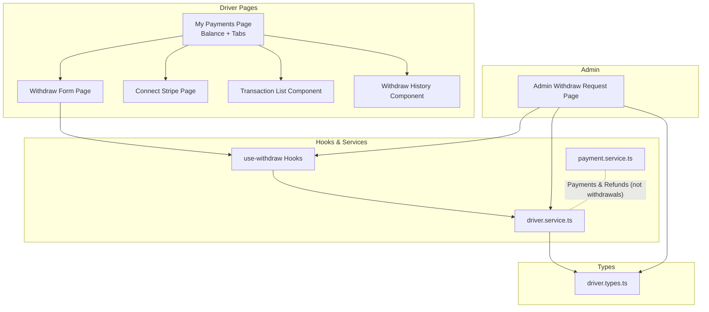
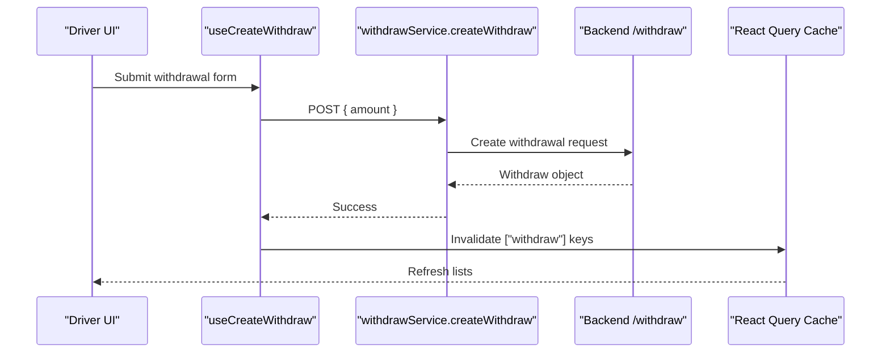
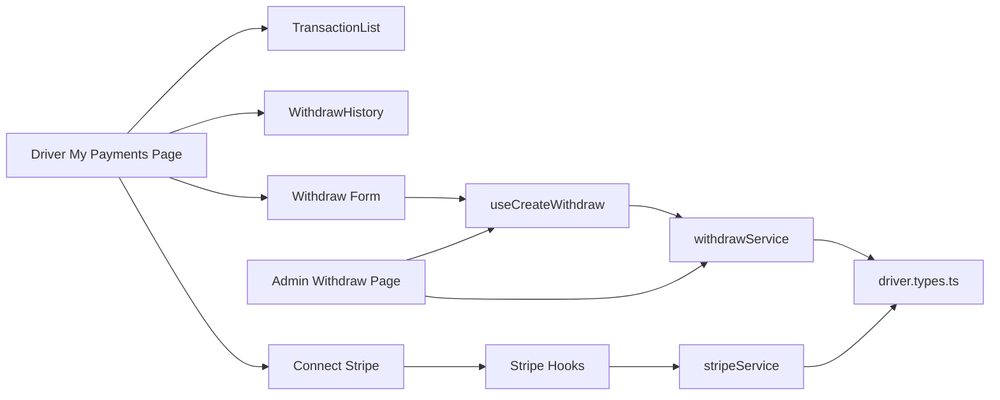
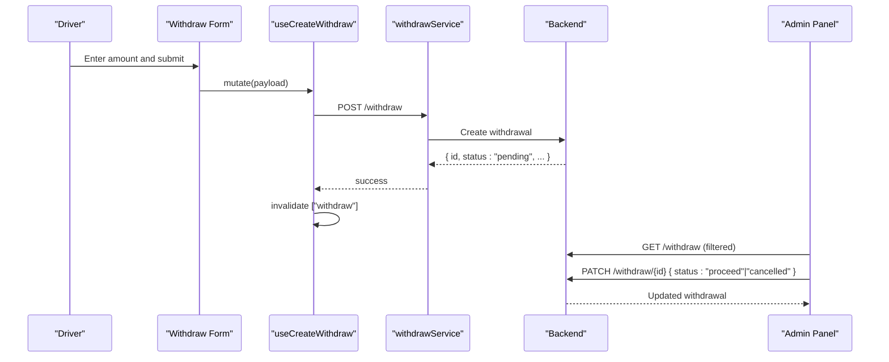

# Driver Wallet & Withdrawals

<cite>
**Referenced Files in This Document**
- [page.tsx](file://src/app/driver/(view)/my-payments/page.tsx)
- [withdraw-page.tsx](file://src/app/driver/(view)/my-payments/withdraw/page.tsx)
- [connect-stripe-page.tsx](file://src/app/driver/(view)/my-payments/connect-stripe/page.tsx)
- [transaction-list.tsx](file://src/app/driver/(view)/my-payments/_components/transaction-list.tsx)
- [withdraw-history.tsx](file://src/app/driver/(view)/my-payments/_components/withdraw-history.tsx)
- [use-withdraw.ts](file://src/hooks/driver/use-withdraw.ts)
- [driver.service.ts](file://src/services/driver.service.ts)
- [payment.service.ts](file://src/services/payment.service.ts)
- [driver.types.ts](file://src/types/driver.types.ts)
- [admin-withdraw-request.tsx](file://src/app/admin/(view)/withdraw-request/page.tsx)
</cite>

## Table of Contents
1. [Introduction](#introduction)
2. [Project Structure](#project-structure)
3. [Core Components](#core-components)
4. [Architecture Overview](#architecture-overview)
5. [Detailed Component Analysis](#detailed-component-analysis)
6. [Dependency Analysis](#dependency-analysis)
7. [Performance Considerations](#performance-considerations)
8. [Troubleshooting Guide](#troubleshooting-guide)
9. [Conclusion](#conclusion)
10. [Appendices](#appendices)

## Introduction
This document explains the driver wallet and withdrawal system implemented in the frontend client. It covers:
- How driver balances are displayed and where they should be sourced from
- Transaction history and withdrawal history UI components
- The end-to-end withdrawal request lifecycle (create, list, approve/reject, status transitions)
- Stripe account connection flows for payouts
- Where to implement backend logic for minimum balance checks, processing fees, payout scheduling, webhook handling, and reconciliation

The codebase provides a robust client-side foundation with React Query hooks, typed payloads, and admin controls. Backend endpoints are referenced via service methods but not implemented here.

## Project Structure
The wallet and withdrawals feature spans driver-facing pages, shared hooks, services, types, and an admin management page.

**Diagram sources**
- [page.tsx](file://src/app/driver/(view)/my-payments/page.tsx#L1-L94)
- [withdraw-page.tsx](file://src/app/driver/(view)/my-payments/withdraw/page.tsx#L1-L98)
- [connect-stripe-page.tsx](file://src/app/driver/(view)/my-payments/connect-stripe/page.tsx#L1-L73)
- [transaction-list.tsx](file://src/app/driver/(view)/my-payments/_components/transaction-list.tsx#L1-L58)
- [withdraw-history.tsx](file://src/app/driver/(view)/my-payments/_components/withdraw-history.tsx#L1-L60)
- [use-withdraw.ts:1-50](file://src/hooks/driver/use-withdraw.ts#L1-L50)
- [driver.service.ts:1-97](file://src/services/driver.service.ts#L1-L97)
- [payment.service.ts:1-72](file://src/services/payment.service.ts#L1-L72)
- [driver.types.ts:1-129](file://src/types/driver.types.ts#L1-L129)
- [admin-withdraw-request.tsx](file://src/app/admin/(view)/withdraw-request/page.tsx#L1-L648)

**Section sources**
- [page.tsx](file://src/app/driver/(view)/my-payments/page.tsx#L1-L94)
- [withdraw-page.tsx](file://src/app/driver/(view)/my-payments/withdraw/page.tsx#L1-L98)
- [connect-stripe-page.tsx](file://src/app/driver/(view)/my-payments/connect-stripe/page.tsx#L1-L73)
- [transaction-list.tsx](file://src/app/driver/(view)/my-payments/_components/transaction-list.tsx#L1-L58)
- [withdraw-history.tsx](file://src/app/driver/(view)/my-payments/_components/withdraw-history.tsx#L1-L60)
- [use-withdraw.ts:1-50](file://src/hooks/driver/use-withdraw.ts#L1-L50)
- [driver.service.ts:1-97](file://src/services/driver.service.ts#L1-L97)
- [payment.service.ts:1-72](file://src/services/payment.service.ts#L1-L72)
- [driver.types.ts:1-129](file://src/types/driver.types.ts#L1-L129)
- [admin-withdraw-request.tsx](file://src/app/admin/(view)/withdraw-request/page.tsx#L1-L648)

## Core Components
- My Payments dashboard: Displays current balance (placeholder), tabs for transactions and withdrawal history, and action buttons to connect Stripe or request a withdrawal.
- Withdraw form: Collects amount and card details; currently stubbed with console logging.
- Connect Stripe: Provides two flows—new Stripe onboarding and connecting an existing Stripe account ID.
- Transaction list and withdrawal history: Present mock data today; intended to be wired to API responses.
- Admin withdraw management: Full CRUD-like workflow to filter, view details, approve (proceed), and cancel pending withdrawals.

Key implementation notes:
- Balance is currently a local constant and must be replaced by an API-backed value.
- Stripe connection state is also a placeholder boolean; use the Stripe hooks to check connection and account status.
- Withdrawal creation uses a typed payload and invalidates queries to refresh lists.

**Section sources**
- [page.tsx](file://src/app/driver/(view)/my-payments/page.tsx#L16-L21)
- [withdraw-page.tsx](file://src/app/driver/(view)/my-payments/withdraw/page.tsx#L11-L24)
- [connect-stripe-page.tsx](file://src/app/driver/(view)/my-payments/connect-stripe/page.tsx#L14-L22)
- [transaction-list.tsx](file://src/app/driver/(view)/my-payments/_components/transaction-list.tsx#L15-L22)
- [withdraw-history.tsx](file://src/app/driver/(view)/my-payments/_components/withdraw-history.tsx#L14-L21)
- [use-withdraw.ts:13-19](file://src/hooks/driver/use-withdraw.ts#L13-L19)

## Architecture Overview
The client architecture separates concerns into pages, hooks, services, and types. Withdrawal operations flow through React Query hooks that call service methods which issue HTTP requests to backend endpoints.

**Diagram sources**
- [use-withdraw.ts:13-19](file://src/hooks/driver/use-withdraw.ts#L13-L19)
- [driver.service.ts:67-69](file://src/services/driver.service.ts#L67-L69)

## Detailed Component Analysis

### Driver My Payments Dashboard
Responsibilities:
- Show driver balance (placeholder)
- Provide tabs for transaction and withdrawal history
- Route to Connect Stripe if not connected, otherwise to Withdraw form

Implementation highlights:
- Balance and Stripe connection flags are placeholders and should be replaced with API calls.
- Navigation depends on Stripe connection state.

**Section sources**
- [page.tsx](file://src/app/driver/(view)/my-payments/page.tsx#L16-L21)
- [page.tsx](file://src/app/driver/(view)/my-payments/page.tsx#L64-L88)

### Withdraw Form
Responsibilities:
- Capture amount and card holder/number fields
- Validate inputs before submission
- Call create withdrawal endpoint

Current state:
- Uses local constants for balance and validation
- Submits via console.log placeholder; needs integration with useCreateWithdraw

Recommended changes:
- Replace balance with API-backed value
- Integrate useCreateWithdraw hook
- Enforce minimum withdrawal amount and fee rules on the server side; mirror constraints on the client for UX

**Section sources**
- [withdraw-page.tsx](file://src/app/driver/(view)/my-payments/withdraw/page.tsx#L11-L24)
- [use-withdraw.ts:13-19](file://src/hooks/driver/use-withdraw.ts#L13-L19)
- [driver.service.ts:67-69](file://src/services/driver.service.ts#L67-L69)

### Connect Stripe
Responsibilities:
- New Stripe onboarding flow
- Connect existing Stripe account by ID

Current state:
- Placeholder handlers; no actual API calls yet
- Should use stripeService.connectStripe() and stripeService.connectExisting()

Integration points:
- Use Stripe hooks to check connection and account status
- Redirect to returned URL for new onboarding

**Section sources**
- [connect-stripe-page.tsx](file://src/app/driver/(view)/my-payments/connect-stripe/page.tsx#L14-L22)
- [driver.service.ts:50-65](file://src/services/driver.service.ts#L50-L65)

### Transaction List and Withdraw History
Responsibilities:
- Render transaction entries and withdrawal history items
- Display amounts, dates, and statuses

Current state:
- Mock data arrays
- Needs wiring to real APIs (e.g., payment history and withdrawal lists)

**Section sources**
- [transaction-list.tsx](file://src/app/driver/(view)/my-payments/_components/transaction-list.tsx#L15-L22)
- [withdraw-history.tsx](file://src/app/driver/(view)/my-payments/_components/withdraw-history.tsx#L14-L21)

### Admin Withdraw Management
Responsibilities:
- List all withdrawals with filters (search, date range, amount range)
- View details including user info, timestamps, Stripe transfer ID, and notes
- Approve (proceed) or cancel pending withdrawals
- Pagination and export actions

Workflow:
- Fetches via useAllWithdraws
- Actions via useChangeWithdrawStatus
- Status badges reflect pending/proceed/completed/cancelled

**Section sources**
- [admin-withdraw-request.tsx](file://src/app/admin/(view)/withdraw-request/page.tsx#L1-L648)
- [use-withdraw.ts:28-33](file://src/hooks/driver/use-withdraw.ts#L28-L33)
- [use-withdraw.ts:43-49](file://src/hooks/driver/use-withdraw.ts#L43-L49)
- [driver.service.ts:76-96](file://src/services/driver.service.ts#L76-L96)

### Data Models and Types
Key types used across the feature:
- WithdrawStatus: pending | proceed | completed | cancelled
- Withdraw: core entity with user, amount, status, timestamps, optional Stripe transfer ID, note
- CreateWithdrawPayload: amount
- ChangeWithdrawStatusPayload: status (proceed | cancelled)
- GetWithdrawsQuery: filtering and pagination parameters
- StripeStatus: connected, accountId, chargesEnabled, payoutsEnabled

These types ensure consistent contracts between UI, hooks, and services.

**Section sources**
- [driver.types.ts:65-74](file://src/types/driver.types.ts#L65-L74)
- [driver.types.ts:76-117](file://src/types/driver.types.ts#L76-L117)

## Dependency Analysis
Client-side dependencies:
- Pages depend on hooks for data fetching and mutations
- Hooks depend on services for HTTP calls
- Services depend on typed models for request/response shapes
- Admin page depends on the same hooks and services as driver pages for consistency

**Diagram sources**
- [page.tsx](file://src/app/driver/(view)/my-payments/page.tsx#L1-L94)
- [withdraw-page.tsx](file://src/app/driver/(view)/my-payments/withdraw/page.tsx#L1-L98)
- [connect-stripe-page.tsx](file://src/app/driver/(view)/my-payments/connect-stripe/page.tsx#L1-L73)
- [transaction-list.tsx](file://src/app/driver/(view)/my-payments/_components/transaction-list.tsx#L1-L58)
- [withdraw-history.tsx](file://src/app/driver/(view)/my-payments/_components/withdraw-history.tsx#L1-L60)
- [use-withdraw.ts:1-50](file://src/hooks/driver/use-withdraw.ts#L1-L50)
- [driver.service.ts:1-97](file://src/services/driver.service.ts#L1-L97)
- [driver.types.ts:1-129](file://src/types/driver.types.ts#L1-L129)
- [admin-withdraw-request.tsx](file://src/app/admin/(view)/withdraw-request/page.tsx#L1-L648)

**Section sources**
- [use-withdraw.ts:1-50](file://src/hooks/driver/use-withdraw.ts#L1-L50)
- [driver.service.ts:1-97](file://src/services/driver.service.ts#L1-L97)
- [driver.types.ts:1-129](file://src/types/driver.types.ts#L1-L129)

## Performance Considerations
- Use React Query caching and invalidation to avoid unnecessary refetches after mutations.
- Paginate large withdrawal lists using query parameters (page, limit).
- Debounce search input and reset page to 1 when filters change.
- Avoid heavy computations in render loops; memoize derived values where needed.
- Prefer server-side validation and enforcement for business rules (minimum balance, fees) to prevent redundant client-side checks.

[No sources needed since this section provides general guidance]

## Troubleshooting Guide
Common issues and resolutions:
- Balance shows incorrect value: Replace placeholder constant with API-backed balance. Ensure the correct endpoint is called and cached properly.
- Withdraw button disabled unexpectedly: Verify required fields are filled and amount does not exceed available balance. Add clear error messages.
- Stripe connection not detected: Use Stripe hooks to fetch connection and account status; handle redirects for new onboarding.
- Admin cannot change status: Confirm the request is in pending state and the mutation succeeds; check network errors and response shape.

Operational tips:
- Always invalidate relevant query keys after mutations to keep UI in sync.
- Log detailed error contexts for failed API calls and surface user-friendly messages.

**Section sources**
- [page.tsx](file://src/app/driver/(view)/my-payments/page.tsx#L16-L21)
- [withdraw-page.tsx](file://src/app/driver/(view)/my-payments/withdraw/page.tsx#L11-L24)
- [use-withdraw.ts:13-19](file://src/hooks/driver/use-withdraw.ts#L13-L19)
- [use-withdraw.ts:43-49](file://src/hooks/driver/use-withdraw.ts#L43-L49)

## Conclusion
The frontend provides a solid structure for driver wallet and withdrawal workflows. To complete the feature:
- Wire up balance and Stripe connection states to APIs
- Implement withdrawal form submission using useCreateWithdraw
- Enforce business rules on the backend (minimum balance, fees, scheduling)
- Add webhook handling for Stripe payout events and reconcile statuses accordingly

[No sources needed since this section summarizes without analyzing specific files]

## Appendices

### Withdrawal Flow Sequence

**Diagram sources**
- [withdraw-page.tsx](file://src/app/driver/(view)/my-payments/withdraw/page.tsx#L21-L24)
- [use-withdraw.ts:13-19](file://src/hooks/driver/use-withdraw.ts#L13-L19)
- [driver.service.ts:67-96](file://src/services/driver.service.ts#L67-L96)
- [admin-withdraw-request.tsx](file://src/app/admin/(view)/withdraw-request/page.tsx#L113-L214)

### Business Rules and Constraints
- Minimum balance requirement: Enforced server-side; mirror constraints on client for better UX.
- Processing fees: Deducted server-side; display net payout to drivers.
- Payout scheduling: Controlled by backend; admin can set proceedAt and completedAt timestamps.
- Status transitions: pending → proceed → completed or cancelled.

**Section sources**
- [driver.types.ts:76-98](file://src/types/driver.types.ts#L76-L98)
- [driver.types.ts:104-106](file://src/types/driver.types.ts#L104-L106)

### Webhook Handling and Reconciliation
- No webhook handler is present in the frontend. Implement a secure backend endpoint to receive Stripe payout events.
- On successful payout, update withdrawal status to completed and record stripeTransferId.
- For failures or disputes, transition to cancelled or add notes for manual review.
- Periodic reconciliation jobs should compare internal records with Stripe ledger and flag discrepancies.

[No sources needed since this section provides general guidance]