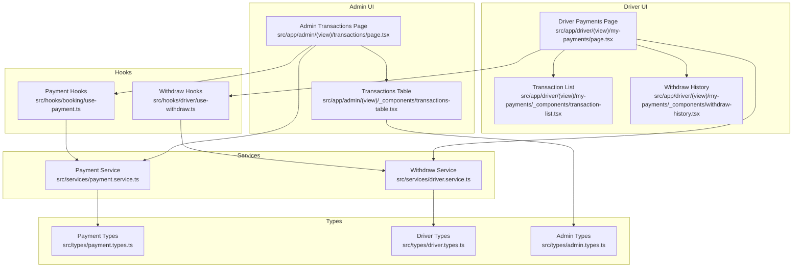
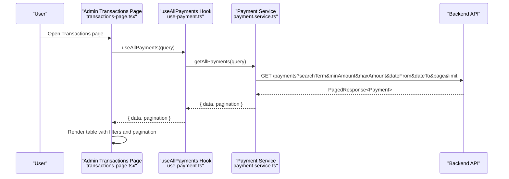
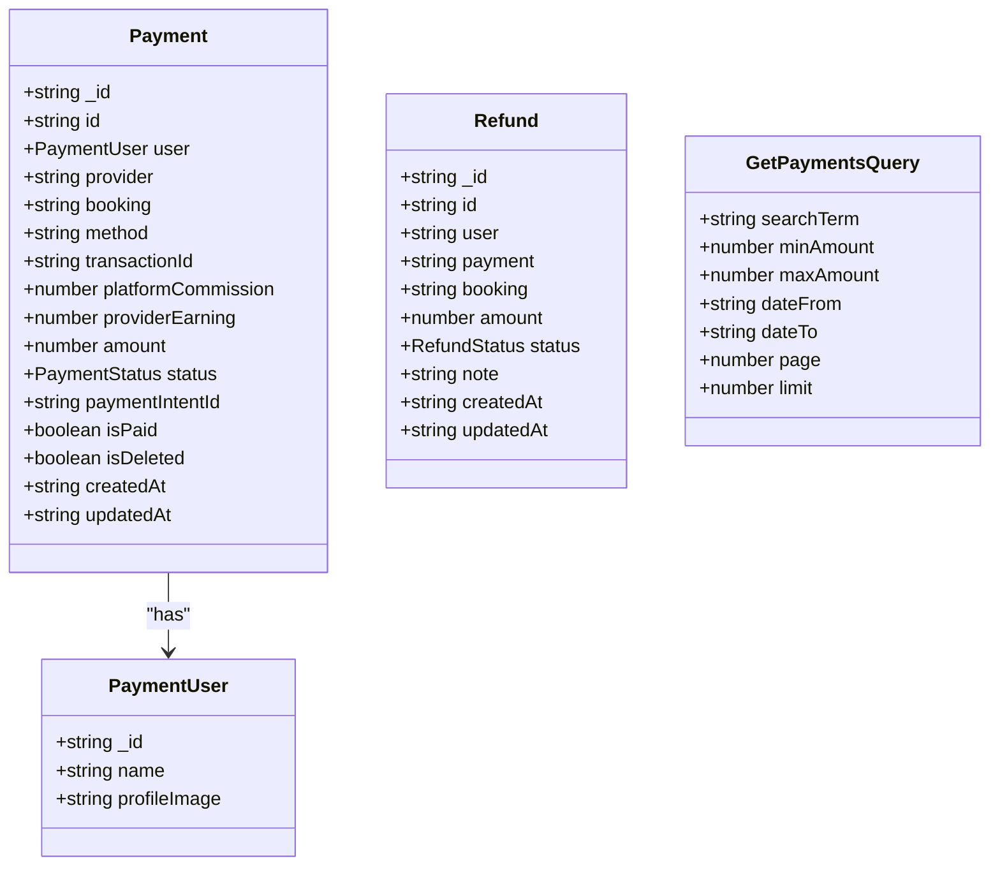
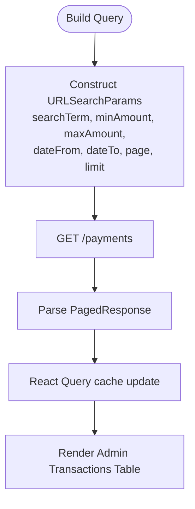
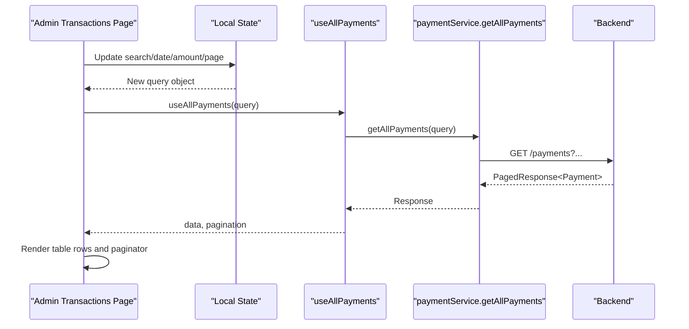
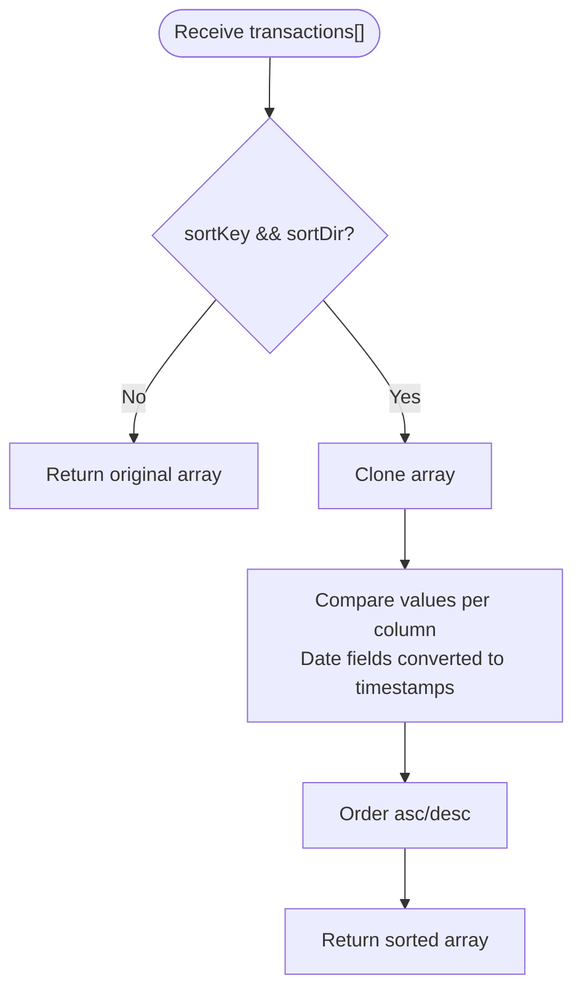
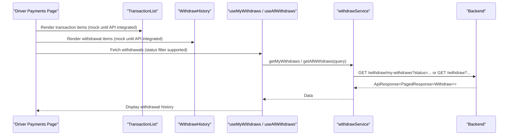
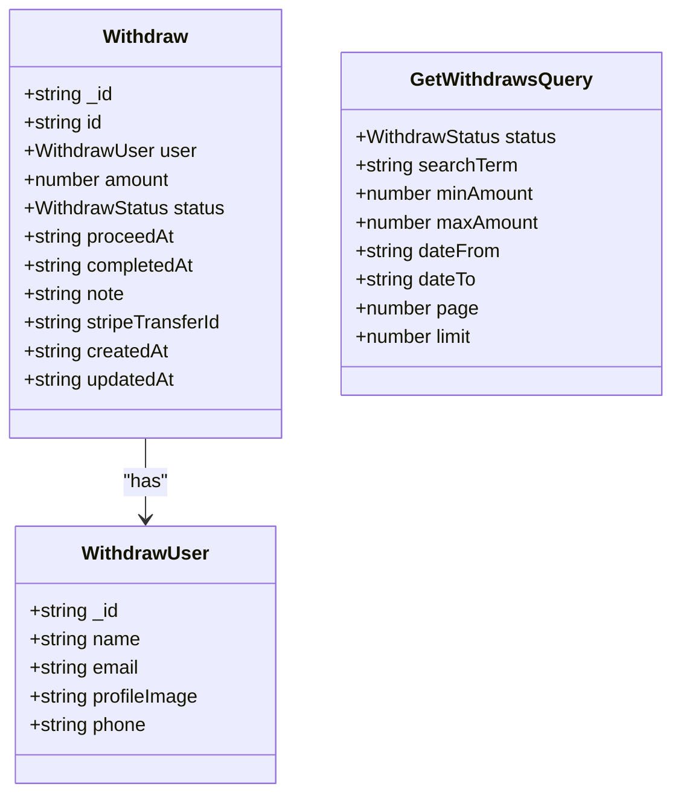
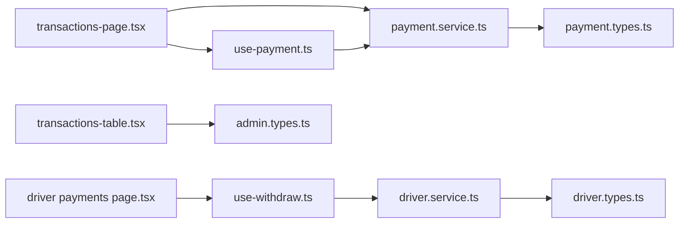

# Transaction History & Records

<cite>
**Referenced Files in This Document**
- [page.tsx](file://src/app/driver/(view)/my-payments/page.tsx)
- [transaction-list.tsx](file://src/app/driver/(view)/my-payments/_components/transaction-list.tsx)
- [withdraw-history.tsx](file://src/app/driver/(view)/my-payments/_components/withdraw-history.tsx)
- [payment.service.ts](file://src/services/payment.service.ts)
- [use-payment.ts](file://src/hooks/booking/use-payment.ts)
- [payment.types.ts](file://src/types/payment.types.ts)
- [driver.service.ts](file://src/services/driver.service.ts)
- [use-withdraw.ts](file://src/hooks/driver/use-withdraw.ts)
- [driver.types.ts](file://src/types/driver.types.ts)
- [transactions-page.tsx](file://src/app/admin/(view)/transactions/page.tsx)
- [transactions-table.tsx](file://src/app/admin/(view)/_components/transactions-table.tsx)
- [admin.types.ts](file://src/types/admin.types.ts)
</cite>

## Table of Contents
1. [Introduction](#introduction)
2. [Project Structure](#project-structure)
3. [Core Components](#core-components)
4. [Architecture Overview](#architecture-overview)
5. [Detailed Component Analysis](#detailed-component-analysis)
6. [Dependency Analysis](#dependency-analysis)
7. [Performance Considerations](#performance-considerations)
8. [Troubleshooting Guide](#troubleshooting-guide)
9. [Conclusion](#conclusion)
10. [Appendices](#appendices)

## Introduction
This document explains how financial transactions and related records are recorded, stored, and retrieved for drivers in the application. It covers transaction types (earnings via payments, withdrawals, refunds), filtering and search capabilities, pagination and sorting patterns, reconciliation and audit trails, reporting features, data retention policies, and performance optimization strategies for large datasets.

The system is implemented as a Next.js client that consumes REST endpoints through typed services and React Query hooks. The admin UI provides comprehensive transaction listing with filters and pagination, while the driver UI shows earnings history and withdrawal requests.

## Project Structure
Transaction-related functionality spans several layers:
- Driver-facing pages and components for viewing earnings and withdrawal history
- Admin pages and tables for managing all payments and withdrawals
- Services that call backend endpoints
- Hooks that integrate with React Query for caching and mutations
- TypeScript types defining request/response shapes

**Diagram sources**
- [page.tsx](file://src/app/driver/(view)/my-payments/page.tsx#L1-L94)
- [transaction-list.tsx](file://src/app/driver/(view)/my-payments/_components/transaction-list.tsx#L1-L58)
- [withdraw-history.tsx](file://src/app/driver/(view)/my-payments/_components/withdraw-history.tsx#L1-L60)
- [transactions-page.tsx](file://src/app/admin/(view)/transactions/page.tsx#L1-L500)
- [transactions-table.tsx](file://src/app/admin/(view)/_components/transactions-table.tsx#L1-L225)
- [use-payment.ts:1-122](file://src/hooks/booking/use-payment.ts#L1-L122)
- [use-withdraw.ts:1-50](file://src/hooks/driver/use-withdraw.ts#L1-L50)
- [payment.service.ts:1-72](file://src/services/payment.service.ts#L1-L72)
- [driver.service.ts:1-97](file://src/services/driver.service.ts#L1-L97)
- [payment.types.ts:1-95](file://src/types/payment.types.ts#L1-L95)
- [driver.types.ts:1-129](file://src/types/driver.types.ts#L1-L129)
- [admin.types.ts:1-62](file://src/types/admin.types.ts#L1-L62)

**Section sources**
- [page.tsx](file://src/app/driver/(view)/my-payments/page.tsx#L1-L94)
- [transaction-list.tsx](file://src/app/driver/(view)/my-payments/_components/transaction-list.tsx#L1-L58)
- [withdraw-history.tsx](file://src/app/driver/(view)/my-payments/_components/withdraw-history.tsx#L1-L60)
- [transactions-page.tsx](file://src/app/admin/(view)/transactions/page.tsx#L1-L500)
- [transactions-table.tsx](file://src/app/admin/(view)/_components/transactions-table.tsx#L1-L225)
- [use-payment.ts:1-122](file://src/hooks/booking/use-payment.ts#L1-L122)
- [use-withdraw.ts:1-50](file://src/hooks/driver/use-withdraw.ts#L1-L50)
- [payment.service.ts:1-72](file://src/services/payment.service.ts#L1-L72)
- [driver.service.ts:1-97](file://src/services/driver.service.ts#L1-L97)
- [payment.types.ts:1-95](file://src/types/payment.types.ts#L1-L95)
- [driver.types.ts:1-129](file://src/types/driver.types.ts#L1-L129)
- [admin.types.ts:1-62](file://src/types/admin.types.ts#L1-L62)

## Core Components
- Driver My Payments page: Displays balance placeholder, tabs for transactions and withdrawals, and actions to connect Stripe or request withdrawal.
- Transaction list component: Renders a list of earnings entries with booking ID, date/time, and amount. Currently uses mock data; marked for API integration.
- Withdraw history component: Shows withdrawal requests with status badges and amounts. Also currently uses mock data.
- Admin transactions page: Full-featured table with search, amount range filter, date range picker, pagination, selection, and download button. Uses payment service hooks.
- Admin transactions table: Reusable table with sortable columns and row selection.

Key responsibilities:
- Data fetching and caching via React Query hooks
- Filtering and pagination parameters construction
- Rendering lists and tables with user-friendly formatting
- Status display and action buttons where applicable

**Section sources**
- [page.tsx](file://src/app/driver/(view)/my-payments/page.tsx#L1-L94)
- [transaction-list.tsx](file://src/app/driver/(view)/my-payments/_components/transaction-list.tsx#L1-L58)
- [withdraw-history.tsx](file://src/app/driver/(view)/my-payments/_components/withdraw-history.tsx#L1-L60)
- [transactions-page.tsx](file://src/app/admin/(view)/transactions/page.tsx#L1-L500)
- [transactions-table.tsx](file://src/app/admin/(view)/_components/transactions-table.tsx#L1-L225)

## Architecture Overview
The architecture follows a clear separation between UI, hooks, services, and types:
- UI components consume hooks
- Hooks call services
- Services build HTTP requests using a shared API client
- Types define payloads and responses

**Diagram sources**
- [transactions-page.tsx](file://src/app/admin/(view)/transactions/page.tsx#L145-L170)
- [use-payment.ts:42-47](file://src/hooks/booking/use-payment.ts#L42-L47)
- [payment.service.ts:27-38](file://src/services/payment.service.ts#L27-L38)

## Detailed Component Analysis

### Payment Model and Query Interface
- Payment entity includes identifiers, user reference, provider, booking link, method, transactionId, platformCommission, providerEarning, amount, status, timestamps, and flags.
- Refund entity includes identifiers, user, payment, booking, amount, status, optional note, and timestamps.
- GetPaymentsQuery supports search term, min/max amount, date range, and pagination.

**Diagram sources**
- [payment.types.ts:1-95](file://src/types/payment.types.ts#L1-L95)

**Section sources**
- [payment.types.ts:1-95](file://src/types/payment.types.ts#L1-L95)

### Payment Service and Hooks
- paymentService.getAllPayments builds query parameters and returns a paged response.
- useAllPayments wraps this service with React Query, enabling caching and refetching.
- Additional hooks support checkout, confirm payment, refunds, and card management.

**Diagram sources**
- [payment.service.ts:27-38](file://src/services/payment.service.ts#L27-L38)
- [use-payment.ts:42-47](file://src/hooks/booking/use-payment.ts#L42-L47)

**Section sources**
- [payment.service.ts:1-72](file://src/services/payment.service.ts#L1-L72)
- [use-payment.ts:1-122](file://src/hooks/booking/use-payment.ts#L1-L122)

### Admin Transactions Page
- Implements search input, amount range slider, date range picker, pagination controls, and selection.
- Constructs GetPaymentsQuery from local state and passes it to useAllPayments.
- Displays results in a table with status badges and formatted dates.

**Diagram sources**
- [transactions-page.tsx](file://src/app/admin/(view)/transactions/page.tsx#L145-L170)
- [payment.service.ts:27-38](file://src/services/payment.service.ts#L27-L38)

**Section sources**
- [transactions-page.tsx](file://src/app/admin/(view)/transactions/page.tsx#L1-L500)

### Admin Transactions Table
- Provides column headers with sort toggles and icons.
- Sorts data locally by selected key and direction, handling date fields specially.
- Supports multi-row selection and “select all” behavior.

**Diagram sources**
- [transactions-table.tsx](file://src/app/admin/(view)/_components/transactions-table.tsx#L91-L108)

**Section sources**
- [transactions-table.tsx](file://src/app/admin/(view)/_components/transactions-table.tsx#L1-L225)

### Driver Earnings and Withdrawals
- Driver payments page shows tabs for transactions and withdrawals, with placeholders for balance and Stripe connection status.
- Transaction list and withdraw history components render mock data and are marked for API integration.
- Withdrawal flow integrates with driver service hooks for creating and managing withdrawals.

**Diagram sources**
- [page.tsx](file://src/app/driver/(view)/my-payments/page.tsx#L1-L94)
- [transaction-list.tsx](file://src/app/driver/(view)/my-payments/_components/transaction-list.tsx#L1-L58)
- [withdraw-history.tsx](file://src/app/driver/(view)/my-payments/_components/withdraw-history.tsx#L1-L60)
- [use-withdraw.ts:21-33](file://src/hooks/driver/use-withdraw.ts#L21-L33)
- [driver.service.ts:67-96](file://src/services/driver.service.ts#L67-L96)

**Section sources**
- [page.tsx](file://src/app/driver/(view)/my-payments/page.tsx#L1-L94)
- [transaction-list.tsx](file://src/app/driver/(view)/my-payments/_components/transaction-list.tsx#L1-L58)
- [withdraw-history.tsx](file://src/app/driver/(view)/my-payments/_components/withdraw-history.tsx#L1-L60)
- [use-withdraw.ts:1-50](file://src/hooks/driver/use-withdraw.ts#L1-L50)
- [driver.service.ts:67-96](file://src/services/driver.service.ts#L67-L96)

### Withdrawal Model and Query Interface
- Withdraw entity includes identifiers, user, amount, status, timestamps, optional notes, and Stripe transfer ID.
- GetWithdrawsQuery supports status, search term, amount range, date range, and pagination.

**Diagram sources**
- [driver.types.ts:76-117](file://src/types/driver.types.ts#L76-L117)

**Section sources**
- [driver.types.ts:76-117](file://src/types/driver.types.ts#L76-L117)

## Dependency Analysis
- UI components depend on hooks for data access and mutations.
- Hooks depend on services for HTTP calls.
- Services depend on shared API client and types for payload/response contracts.
- Admin table depends on admin types for rendering meta transactions.

**Diagram sources**
- [transactions-page.tsx](file://src/app/admin/(view)/transactions/page.tsx#L1-L500)
- [use-payment.ts:1-122](file://src/hooks/booking/use-payment.ts#L1-L122)
- [payment.service.ts:1-72](file://src/services/payment.service.ts#L1-L72)
- [payment.types.ts:1-95](file://src/types/payment.types.ts#L1-L95)
- [page.tsx](file://src/app/driver/(view)/my-payments/page.tsx#L1-L94)
- [use-withdraw.ts:1-50](file://src/hooks/driver/use-withdraw.ts#L1-L50)
- [driver.service.ts:1-97](file://src/services/driver.service.ts#L1-L97)
- [driver.types.ts:1-129](file://src/types/driver.types.ts#L1-L129)
- [transactions-table.tsx](file://src/app/admin/(view)/_components/transactions-table.tsx#L1-L225)
- [admin.types.ts:1-62](file://src/types/admin.types.ts#L1-L62)

**Section sources**
- [transactions-page.tsx](file://src/app/admin/(view)/transactions/page.tsx#L1-L500)
- [use-payment.ts:1-122](file://src/hooks/booking/use-payment.ts#L1-L122)
- [payment.service.ts:1-72](file://src/services/payment.service.ts#L1-L72)
- [payment.types.ts:1-95](file://src/types/payment.types.ts#L1-L95)
- [page.tsx](file://src/app/driver/(view)/my-payments/page.tsx#L1-L94)
- [use-withdraw.ts:1-50](file://src/hooks/driver/use-withdraw.ts#L1-L50)
- [driver.service.ts:1-97](file://src/services/driver.service.ts#L1-L97)
- [driver.types.ts:1-129](file://src/types/driver.types.ts#L1-L129)
- [transactions-table.tsx](file://src/app/admin/(view)/_components/transactions-table.tsx#L1-L225)
- [admin.types.ts:1-62](file://src/types/admin.types.ts#L1-L62)

## Performance Considerations
- Server-side pagination: Use page and limit parameters to reduce payload size. Both payment and withdrawal services support pagination.
- Efficient filtering: Apply server-side filters (searchTerm, minAmount, maxAmount, dateFrom, dateTo) to minimize client processing.
- Caching: React Query caches responses keyed by query objects; avoid unnecessary refetches by stabilizing query keys.
- Local sorting vs server sorting: Current admin table sorts locally; consider moving sorting to the server for large datasets.
- Date formatting: Format dates on the client only when rendering; avoid heavy computations during list updates.
- Selection state: Reset selections on page changes to prevent memory growth.

[No sources needed since this section provides general guidance]

## Troubleshooting Guide
- Missing API integration in driver views: Transaction list and withdraw history components are marked with TODO comments indicating they should be replaced with API fetches. Ensure these components are wired to use hooks and services before production.
- Filter not applied: Verify that query parameters are correctly constructed and passed to services. For example, ensure searchTerm, amount ranges, and date ranges are included only when active.
- Pagination mismatch: Confirm that page and limit are synchronized across UI state and query keys. Resetting selections on page change prevents stale states.
- Sorting anomalies: When sorting by date, ensure timestamps are computed consistently. The current implementation converts date strings to timestamps for comparison.

**Section sources**
- [transaction-list.tsx](file://src/app/driver/(view)/my-payments/_components/transaction-list.tsx#L15-L22)
- [withdraw-history.tsx](file://src/app/driver/(view)/my-payments/_components/withdraw-history.tsx#L14-L21)
- [transactions-page.tsx](file://src/app/admin/(view)/transactions/page.tsx#L145-L170)
- [transactions-table.tsx](file://src/app/admin/(view)/_components/transactions-table.tsx#L91-L108)

## Conclusion
The application provides robust transaction history and record management for both drivers and administrators. Drivers can view earnings and withdrawal histories, while admins can search, filter, sort, and paginate through all payments and withdrawals. The codebase separates concerns cleanly with hooks and services, and types enforce consistent contracts. Future enhancements should focus on integrating live APIs into driver components, implementing server-side sorting, and adding export/reporting features aligned with compliance requirements.

[No sources needed since this section summarizes without analyzing specific files]

## Appendices

### Transaction Types Summary
- Earnings: Represented by Payment records with status transitions including pending, completed, refunded. Includes platform commission and provider earning breakdowns.
- Withdrawals: Represented by Withdraw records with statuses pending, proceed, completed, cancelled. Include Stripe transfer IDs for reconciliation.
- Refunds: Represented by Refund records linked to payments, with statuses pending, underReview, confirmed, rejected.

**Section sources**
- [payment.types.ts:1-95](file://src/types/payment.types.ts#L1-L95)
- [driver.types.ts:76-117](file://src/types/driver.types.ts#L76-L117)

### Filtering and Search Capabilities
- Payments: searchTerm, minAmount, maxAmount, dateFrom, dateTo, page, limit.
- Withdrawals: status, searchTerm, minAmount, maxAmount, dateFrom, dateTo, page, limit.

**Section sources**
- [payment.types.ts:64-72](file://src/types/payment.types.ts#L64-L72)
- [driver.types.ts:108-117](file://src/types/driver.types.ts#L108-L117)

### Data Retention Policies
- Transactional data may be retained for accounting and legal purposes. Personal data retention aligns with legal obligations and dispute resolution needs. Inactive accounts may be anonymized or deleted after a defined period unless required otherwise.

**Section sources**
- [terms.tsx:84-154](file://src/components/core/privacy-pages/terms.tsx#L84-L154)