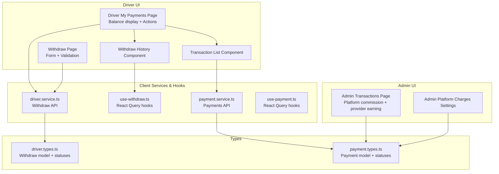
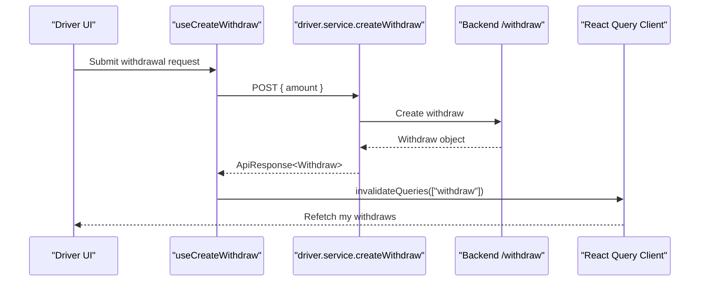
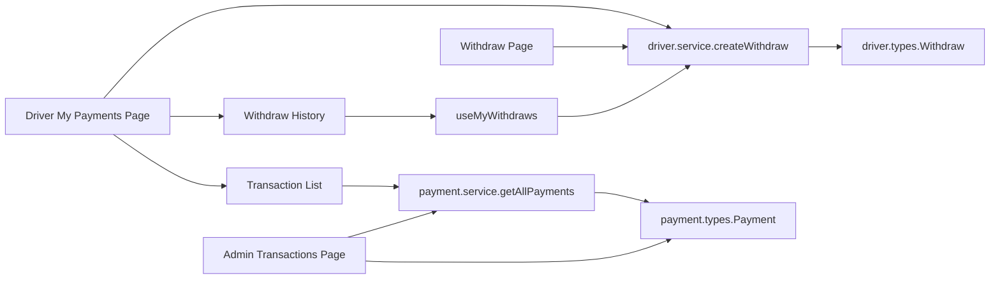

# Wallet Balance Management

<cite>
**Referenced Files in This Document**
- [src/app/driver/(view)/my-payments/page.tsx](file://src/app/driver/(view)/my-payments/page.tsx)
- [src/app/driver/(view)/my-payments/withdraw/page.tsx](file://src/app/driver/(view)/my-payments/withdraw/page.tsx)
- [src/app/driver/(view)/my-payments/_components/transaction-list.tsx](file://src/app/driver/(view)/my-payments/_components/transaction-list.tsx)
- [src/app/driver/(view)/my-payments/_components/withdraw-history.tsx](file://src/app/driver/(view)/my-payments/_components/withdraw-history.tsx)
- [src/services/driver.service.ts](file://src/services/driver.service.ts)
- [src/hooks/driver/use-withdraw.ts](file://src/hooks/driver/use-withdraw.ts)
- [src/types/driver.types.ts](file://src/types/driver.types.ts)
- [src/services/payment.service.ts](file://src/services/payment.service.ts)
- [src/hooks/booking/use-payment.ts](file://src/hooks/booking/use-payment.ts)
- [src/types/payment.types.ts](file://src/types/payment.types.ts)
- [src/app/admin/(view)/transactions/page.tsx](file://src/app/admin/(view)/transactions/page.tsx)
- [src/app/admin/(view)/settings/platform-charges/page.tsx](file://src/app/admin/(view)/settings/platform-charges/page.tsx)
</cite>

## Table of Contents
1. [Introduction](#introduction)
2. [Project Structure](#project-structure)
3. [Core Components](#core-components)
4. [Architecture Overview](#architecture-overview)
5. [Detailed Component Analysis](#detailed-component-analysis)
6. [Dependency Analysis](#dependency-analysis)
7. [Performance Considerations](#performance-considerations)
8. [Troubleshooting Guide](#troubleshooting-guide)
9. [Conclusion](#conclusion)

## Introduction
This document explains the driver wallet balance management system as implemented in the frontend client. It covers how balances are displayed, how withdrawals are requested and tracked, and how payments and platform charges are represented. It also provides guidance for implementing real-time updates, validation during withdrawal requests, history tracking, and patterns to ensure consistency and atomicity when handling concurrent balance changes.

## Project Structure
The wallet-related functionality is primarily located under the driver “My Payments” area and supported by services and hooks that communicate with backend endpoints for payments and withdrawals.

**Diagram sources**
- [src/app/driver/(view)/my-payments/page.tsx](file://src/app/driver/(view)/my-payments/page.tsx#L1-L94)
- [src/app/driver/(view)/my-payments/withdraw/page.tsx](file://src/app/driver/(view)/my-payments/withdraw/page.tsx#L1-L98)
- [src/app/driver/(view)/my-payments/_components/transaction-list.tsx](file://src/app/driver/(view)/my-payments/_components/transaction-list.tsx#L1-L58)
- [src/app/driver/(view)/my-payments/_components/withdraw-history.tsx](file://src/app/driver/(view)/my-payments/_components/withdraw-history.tsx#L29-L59)
- [src/services/driver.service.ts:67-96](file://src/services/driver.service.ts#L67-L96)
- [src/hooks/driver/use-withdraw.ts:1-50](file://src/hooks/driver/use-withdraw.ts#L1-L50)
- [src/services/payment.service.ts:1-72](file://src/services/payment.service.ts#L1-L72)
- [src/hooks/booking/use-payment.ts:1-122](file://src/hooks/booking/use-payment.ts#L1-L122)
- [src/types/driver.types.ts:76-117](file://src/types/driver.types.ts#L76-L117)
- [src/types/payment.types.ts:1-95](file://src/types/payment.types.ts#L1-L95)
- [src/app/admin/(view)/transactions/page.tsx](file://src/app/admin/(view)/transactions/page.tsx#L1-L200)
- [src/app/admin/(view)/settings/platform-charges/page.tsx](file://src/app/admin/(view)/settings/platform-charges/page.tsx#L150-L168)

**Section sources**
- [src/app/driver/(view)/my-payments/page.tsx:1-94](file://src/app/driver/(view)/my-payments/page.tsx#L1-L94)
- [src/app/driver/(view)/my-payments/withdraw/page.tsx:1-98](file://src/app/driver/(view)/my-payments/withdraw/page.tsx#L1-L98)
- [src/app/driver/(view)/my-payments/_components/transaction-list.tsx:1-58](file://src/app/driver/(view)/my-payments/_components/transaction-list.tsx#L1-L58)
- [src/app/driver/(view)/my-payments/_components/withdraw-history.tsx:29-59](file://src/app/driver/(view)/my-payments/_components/withdraw-history.tsx#L29-L59)
- [src/services/driver.service.ts:67-96](file://src/services/driver.service.ts#L67-L96)
- [src/hooks/driver/use-withdraw.ts:1-50](file://src/hooks/driver/use-withdraw.ts#L1-L50)
- [src/services/payment.service.ts:1-72](file://src/services/payment.service.ts#L1-L72)
- [src/hooks/booking/use-payment.ts:1-122](file://src/hooks/booking/use-payment.ts#L1-L122)
- [src/types/driver.types.ts:76-117](file://src/types/driver.types.ts#L76-L117)
- [src/types/payment.types.ts:1-95](file://src/types/payment.types.ts#L1-L95)
- [src/app/admin/(view)/transactions/page.tsx:1-200](file://src/app/admin/(view)/transactions/page.tsx#L1-L200)
- [src/app/admin/(view)/settings/platform-charges/page.tsx:150-168](file://src/app/admin/(view)/settings/platform-charges/page.tsx#L150-L168)

## Core Components
- Driver My Payments page: Displays a placeholder balance and navigation to withdraw or connect Stripe. The balance is currently a local constant and marked for replacement with an API-backed value.
- Withdraw page: Provides a form to request a withdrawal with basic client-side validation (non-empty fields and numeric range). Submission is not yet wired to the backend.
- Transaction list component: Renders a list of transactions with booking ID, date/time, and amount. Currently uses mock data.
- Withdraw history component: Shows past withdrawal requests with status badges and amounts.
- Services and hooks:
  - driver.service.ts exposes endpoints for creating and listing withdrawals.
  - use-withdraw.ts wraps these calls with React Query for caching and invalidation.
  - payment.service.ts exposes payment endpoints including checkout, confirmation, refunds, and admin queries.
  - use-payment.ts provides React Query hooks for payments and cards.
- Types:
  - driver.types.ts defines Withdraw model and statuses used across the app.
  - payment.types.ts defines Payment model including platformCommission and providerEarning fields, plus statuses.

Key responsibilities:
- Display current balance and actions.
- Validate withdrawal inputs on the client.
- Persist withdrawal requests via API.
- Show transaction and withdrawal histories.
- Provide admin views for payments and platform charges.

**Section sources**
- [src/app/driver/(view)/my-payments/page.tsx:16-31](file://src/app/driver/(view)/my-payments/page.tsx#L16-L31)
- [src/app/driver/(view)/my-payments/withdraw/page.tsx:11-24](file://src/app/driver/(view)/my-payments/withdraw/page.tsx#L11-L24)
- [src/app/driver/(view)/my-payments/_components/transaction-list.tsx:15-22](file://src/app/driver/(view)/my-payments/_components/transaction-list.tsx#L15-L22)
- [src/app/driver/(view)/my-payments/_components/withdraw-history.tsx:29-59](file://src/app/driver/(view)/my-payments/_components/withdraw-history.tsx#L29-L59)
- [src/services/driver.service.ts:67-96](file://src/services/driver.service.ts#L67-L96)
- [src/hooks/driver/use-withdraw.ts:13-19](file://src/hooks/driver/use-withdraw.ts#L13-L19)
- [src/services/payment.service.ts:16-57](file://src/services/payment.service.ts#L16-L57)
- [src/hooks/booking/use-payment.ts:23-33](file://src/hooks/booking/use-payment.ts#L23-L33)
- [src/types/driver.types.ts:76-117](file://src/types/driver.types.ts#L76-L117)
- [src/types/payment.types.ts:11-28](file://src/types/payment.types.ts#L11-L28)

## Architecture Overview
The wallet flow centers around three main areas:
- Balance display and actions in the driver UI.
- Withdrawal lifecycle: create, list, and status change.
- Payment records and platform charges visible in admin.

**Diagram sources**
- [src/hooks/driver/use-withdraw.ts:13-19](file://src/hooks/driver/use-withdraw.ts#L13-L19)
- [src/services/driver.service.ts:67-69](file://src/services/driver.service.ts#L67-L69)

## Detailed Component Analysis

### Driver My Payments Page
Responsibilities:
- Render current balance (placeholder).
- Provide tabs for transactions and withdrawal history.
- Navigate to withdraw or Stripe connection based on account status.

Implementation notes:
- Balance is a local constant and should be replaced with an API-backed value.
- Stripe connection state is a local constant and should be fetched from the backend.

**Section sources**
- [src/app/driver/(view)/my-payments/page.tsx:16-31](file://src/app/driver/(view)/my-payments/page.tsx#L16-L31)
- [src/app/driver/(view)/my-payments/page.tsx:63-88](file://src/app/driver/(view)/my-payments/page.tsx#L63-L88)

### Withdraw Page
Responsibilities:
- Collect withdrawal amount, card holder name, and card number.
- Enforce client-side validation (required fields, numeric range up to available balance).
- Wire submission to the backend endpoint.

Validation logic:
- Required fields: amount, cardHolder, cardNumber.
- Numeric constraints: min 1, max equals current balance.

Submission:
- Placeholder handler logs values; replace with mutation call using useCreateWithdraw.

**Section sources**
- [src/app/driver/(view)/my-payments/withdraw/page.tsx:11-24](file://src/app/driver/(view)/my-payments/withdraw/page.tsx#L11-L24)
- [src/app/driver/(view)/my-payments/withdraw/page.tsx:38-51](file://src/app/driver/(view)/my-payments/withdraw/page.tsx#L38-L51)
- [src/app/driver/(view)/my-payments/withdraw/page.tsx:77-84](file://src/app/driver/(view)/my-payments/withdraw/page.tsx#L77-L84)

### Transaction List Component
Responsibilities:
- Display recent transactions with booking ID, date/time, and amount.
- Replace mock data with live data from payment endpoints.

Integration points:
- Use payment service hooks to fetch transactions and render them.

**Section sources**
- [src/app/driver/(view)/my-payments/_components/transaction-list.tsx:15-22](file://src/app/driver/(view)/my-payments/_components/transaction-list.tsx#L15-L22)
- [src/services/payment.service.ts:27-38](file://src/services/payment.service.ts#L27-L38)
- [src/hooks/booking/use-payment.ts:42-47](file://src/hooks/booking/use-payment.ts#L42-L47)

### Withdraw History Component
Responsibilities:
- Show historical withdrawal requests with status and amount.
- Integrate with useMyWithdraws to reflect latest statuses.

Status rendering:
- Uses a mapping to style status badges.

**Section sources**
- [src/app/driver/(view)/my-payments/_components/withdraw-history.tsx:29-59](file://src/app/driver/(view)/my-payments/_components/withdraw-history.tsx#L29-L59)
- [src/hooks/driver/use-withdraw.ts:21-26](file://src/hooks/driver/use-withdraw.ts#L21-L26)
- [src/types/driver.types.ts:76-98](file://src/types/driver.types.ts#L76-98)

### Withdraw Service and Hooks
Responsibilities:
- Expose endpoints for creating and querying withdrawals.
- Provide React Query hooks for caching and invalidation.

Key flows:
- Create withdraw: POST /withdraw.
- Get my withdraws: GET /withdraw/my-withdraws?status=...
- Admin get all withdraws: GET /withdraw with filters.
- Change withdraw status: PATCH /withdraw/:id.

Invalidation strategy:
- After mutations, invalidate query keys to refetch lists and details.

**Section sources**
- [src/services/driver.service.ts:67-96](file://src/services/driver.service.ts#L67-L96)
- [src/hooks/driver/use-withdraw.ts:13-19](file://src/hooks/driver/use-withdraw.ts#L13-L19)
- [src/hooks/driver/use-withdraw.ts:21-26](file://src/hooks/driver/use-withdraw.ts#L21-L26)
- [src/hooks/driver/use-withdraw.ts:28-33](file://src/hooks/driver/use-withdraw.ts#L28-L33)
- [src/hooks/driver/use-withdraw.ts:43-49](file://src/hooks/driver/use-withdraw.ts#L43-L49)

### Payment Service and Hooks
Responsibilities:
- Manage payment lifecycle: checkout, confirm, refunds, and admin queries.
- Provide React Query hooks for payments and cards.

Relevant endpoints:
- Checkout: POST /payments/checkout
- Confirm payment: POST /payments/confirm-payment
- Refunds: GET/PATCH/DELETE /refunds/*
- Admin payments: GET /payments with filters

**Section sources**
- [src/services/payment.service.ts:16-57](file://src/services/payment.service.ts#L16-L57)
- [src/hooks/booking/use-payment.ts:23-33](file://src/hooks/booking/use-payment.ts#L23-L33)
- [src/hooks/booking/use-payment.ts:42-47](file://src/hooks/booking/use-payment.ts#L42-L47)
- [src/hooks/booking/use-payment.ts:57-63](file://src/hooks/booking/use-payment.ts#L57-L63)

### Data Models and Statuses
Withdraw model:
- Fields include user, amount, status, timestamps, and optional Stripe transfer ID.
- Statuses: pending, proceed, completed, cancelled.

Payment model:
- Includes platformCommission and providerEarning fields, which represent split amounts per transaction.
- Statuses: pending, completed, refunded.

**Section sources**
- [src/types/driver.types.ts:76-117](file://src/types/driver.types.ts#L76-117)
- [src/types/payment.types.ts:11-28](file://src/types/payment.types.ts#L11-L28)

### Admin Transactions View
Responsibilities:
- Display payments with platform commission and provider earnings columns.
- Support filtering by search term, amount range, and dates.

Integration:
- Uses payment service hooks to fetch paginated results.

**Section sources**
- [src/app/admin/(view)/transactions/page.tsx:145-200](file://src/app/admin/(view)/transactions/page.tsx#L145-L200)
- [src/app/admin/(view)/transactions/page.tsx:431-456](file://src/app/admin/(view)/transactions/page.tsx#L431-L456)

### Platform Charges Configuration
Responsibilities:
- Configure platform commission percentage and other ride-related charges.

Impact on wallet:
- Platform commission affects the split between platform and provider earnings per payment.

**Section sources**
- [src/app/admin/(view)/settings/platform-charges/page.tsx:150-168](file://src/app/admin/(view)/settings/platform-charges/page.tsx#L150-L168)

## Dependency Analysis
The following diagram shows key dependencies among components, services, hooks, and types.

**Diagram sources**
- [src/app/driver/(view)/my-payments/page.tsx:1-94](file://src/app/driver/(view)/my-payments/page.tsx#L1-L94)
- [src/app/driver/(view)/my-payments/_components/transaction-list.tsx:1-58](file://src/app/driver/(view)/my-payments/_components/transaction-list.tsx#L1-L58)
- [src/app/driver/(view)/my-payments/_components/withdraw-history.tsx:29-59](file://src/app/driver/(view)/my-payments/_components/withdraw-history.tsx#L29-L59)
- [src/services/driver.service.ts:67-96](file://src/services/driver.service.ts#L67-L96)
- [src/services/payment.service.ts:27-38](file://src/services/payment.service.ts#L27-L38)
- [src/hooks/driver/use-withdraw.ts:21-26](file://src/hooks/driver/use-withdraw.ts#L21-L26)
- [src/types/driver.types.ts:76-117](file://src/types/driver.types.ts#L76-117)
- [src/types/payment.types.ts:11-28](file://src/types/payment.types.ts#L11-L28)
- [src/app/admin/(view)/transactions/page.tsx:145-200](file://src/app/admin/(view)/transactions/page.tsx#L145-L200)

**Section sources**
- [src/app/driver/(view)/my-payments/page.tsx:1-94](file://src/app/driver/(view)/my-payments/page.tsx#L1-L94)
- [src/app/driver/(view)/my-payments/_components/transaction-list.tsx:1-58](file://src/app/driver/(view)/my-payments/_components/transaction-list.tsx#L1-L58)
- [src/app/driver/(view)/my-payments/_components/withdraw-history.tsx:29-59](file://src/app/driver/(view)/my-payments/_components/withdraw-history.tsx#L29-L59)
- [src/services/driver.service.ts:67-96](file://src/services/driver.service.ts#L67-L96)
- [src/services/payment.service.ts:27-38](file://src/services/payment.service.ts#L27-L38)
- [src/hooks/driver/use-withdraw.ts:21-26](file://src/hooks/driver/use-withdraw.ts#L21-L26)
- [src/types/driver.types.ts:76-117](file://src/types/driver.types.ts#L76-117)
- [src/types/payment.types.ts:11-28](file://src/types/payment.types.ts#L11-L28)
- [src/app/admin/(view)/transactions/page.tsx:145-200](file://src/app/admin/(view)/transactions/page.tsx#L145-L200)

## Performance Considerations
- Prefer server-side pagination and filtering for large datasets (already present in admin payments and withdrawals).
- Use React Query caching and invalidation to avoid unnecessary re-renders and network calls.
- Debounce search inputs and filter changes where applicable.
- Avoid recalculating derived values on every render; memoize computations if needed.

[No sources needed since this section provides general guidance]

## Troubleshooting Guide
Common issues and resolutions:
- Balance not updating:
  - Ensure the balance is fetched from an API and invalidated after relevant mutations.
  - Replace placeholder constants with dynamic data.
- Withdrawals not appearing:
  - Verify useMyWithdraws is called with correct query keys and that invalidation occurs after creation.
- Stripe connection gating:
  - Replace local boolean flags with actual Stripe connection checks before enabling withdraw actions.
- Validation errors:
  - Confirm client-side constraints align with backend rules (e.g., minimum withdrawal amount, maximum equal to balance).

**Section sources**
- [src/app/driver/(view)/my-payments/page.tsx:16-31](file://src/app/driver/(view)/my-payments/page.tsx#L16-L31)
- [src/hooks/driver/use-withdraw.ts:13-19](file://src/hooks/driver/use-withdraw.ts#L13-L19)
- [src/app/driver/(view)/my-payments/withdraw/page.tsx:11-24](file://src/app/driver/(view)/my-payments/withdraw/page.tsx#L11-L24)

## Conclusion
The frontend implements a clear separation between UI, services, hooks, and types for wallet balance management. While placeholders remain for balance and Stripe connectivity, the structure supports integration with backend APIs for payments and withdrawals. By wiring real data sources, enforcing robust validation, and leveraging React Query for synchronization, the system can provide accurate, consistent, and responsive wallet experiences.

[No sources needed since this section summarizes without analyzing specific files]