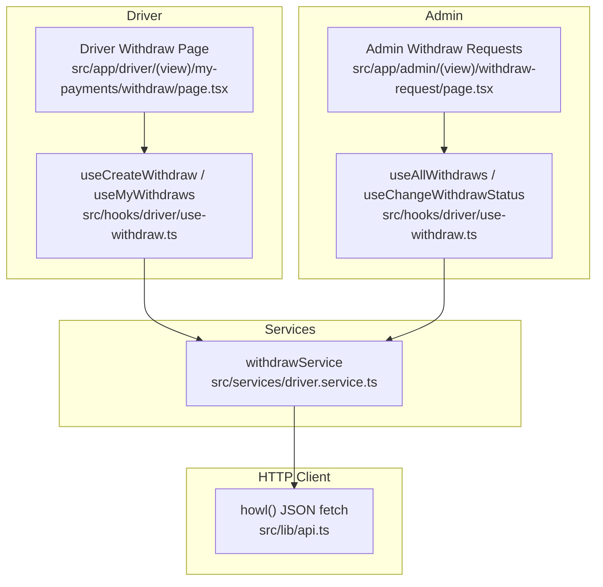
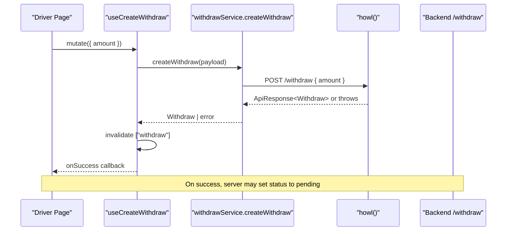
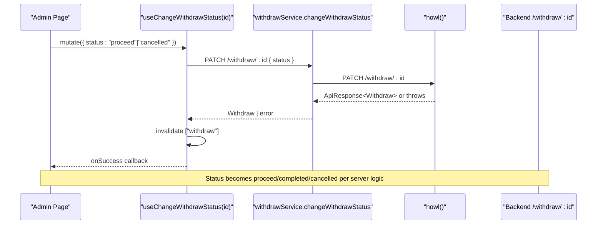
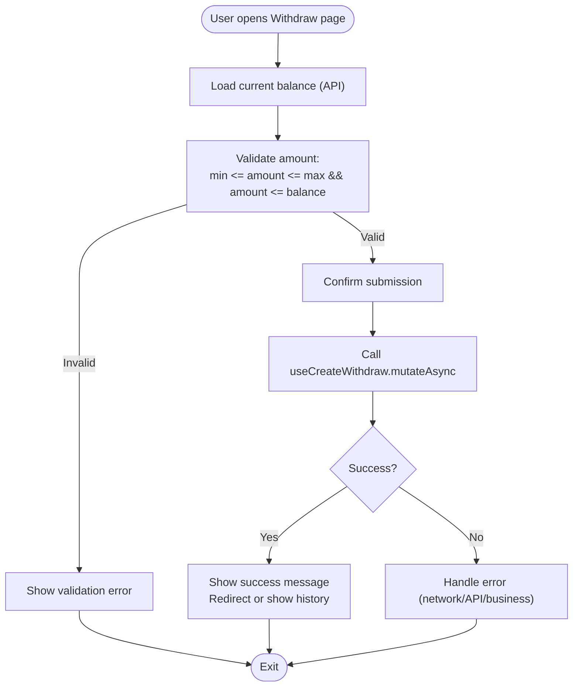
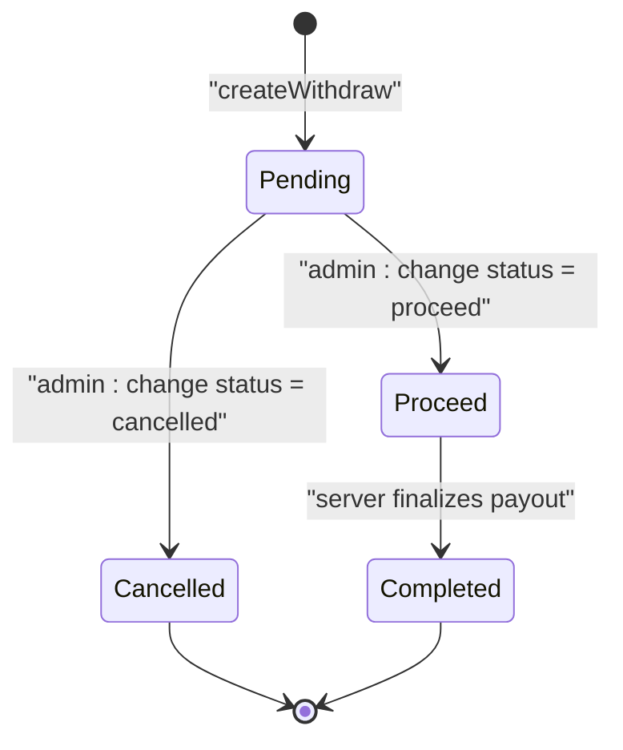
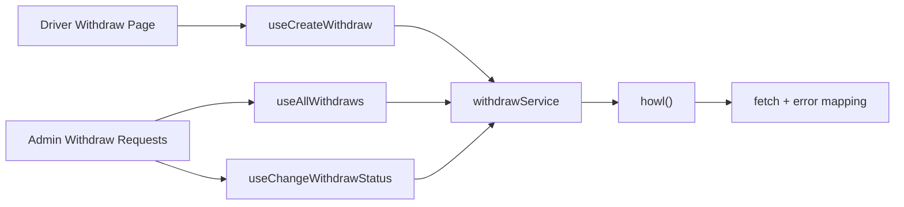

# Withdrawal Request Processing

<cite>
**Referenced Files in This Document**
- [page.tsx](file://src/app/driver/(view)/my-payments/withdraw/page.tsx)
- [use-withdraw.ts](file://src/hooks/driver/use-withdraw.ts)
- [driver.service.ts](file://src/services/driver.service.ts)
- [api.ts](file://src/lib/api.ts)
- [driver.types.ts](file://src/types/driver.types.ts)
- [base.ts](file://src/types/base.ts)
- [page.tsx](file://src/app/admin/(view)/withdraw-request/page.tsx)
- [API-INTEGRATION.md](file://API-INTEGRATION.md)
</cite>

## Table of Contents
1. [Introduction](#introduction)
2. [Project Structure](#project-structure)
3. [Core Components](#core-components)
4. [Architecture Overview](#architecture-overview)
5. [Detailed Component Analysis](#detailed-component-analysis)
6. [Dependency Analysis](#dependency-analysis)
7. [Performance Considerations](#performance-considerations)
8. [Troubleshooting Guide](#troubleshooting-guide)
9. [Conclusion](#conclusion)

## Introduction
This document explains the withdrawal request processing workflow across the driver and admin interfaces. It covers:
- The end-to-end flow from withdrawal creation to completion or failure
- Form validation, minimum balance checks, and fee calculation considerations
- Withdrawal status lifecycle and transitions (pending, proceed, completed, cancelled)
- Examples for implementing forms with amount validation, limits, restrictions, and user feedback
- Error handling strategies for insufficient funds, network failures, and API errors

The implementation uses a layered architecture:
- UI pages/components
- React Query hooks
- Service layer functions
- HTTP client wrapper
- Backend endpoints (documented via integration guide)

## Project Structure
Withdrawal-related code is organized by role:
- Driver side: create withdrawals and view history
- Admin side: review requests, change status (proceed/cancel), and list/filter all requests

**Diagram sources**
- [page.tsx](file://src/app/driver/(view)/my-payments/withdraw/page.tsx#L1-L98)
- [use-withdraw.ts:1-50](file://src/hooks/driver/use-withdraw.ts#L1-L50)
- [driver.service.ts:67-96](file://src/services/driver.service.ts#L67-L96)
- [api.ts:23-73](file://src/lib/api.ts#L23-L73)
- [page.tsx](file://src/app/admin/(view)/withdraw-request/page.tsx#L1-L648)

**Section sources**
- [page.tsx](file://src/app/driver/(view)/my-payments/withdraw/page.tsx#L1-L98)
- [use-withdraw.ts:1-50](file://src/hooks/driver/use-withdraw.ts#L1-L50)
- [driver.service.ts:67-96](file://src/services/driver.service.ts#L67-L96)
- [api.ts:23-73](file://src/lib/api.ts#L23-L73)
- [page.tsx](file://src/app/admin/(view)/withdraw-request/page.tsx#L1-L648)

## Core Components
- Driver Withdraw Page: collects amount and card details; currently stubbed for submission; shows available balance.
- Admin Withdraw Requests: lists all requests, filters by date/amount, opens detail dialog, changes status to proceed or cancel.
- Hooks: provide mutations and queries for creating withdrawals, listing them, and changing statuses.
- Services: call backend endpoints for withdraw operations.
- HTTP Client: centralizes token injection, error mapping, and response parsing.

Key responsibilities:
- Driver page: form inputs, basic enable/disable logic, placeholder submit handler.
- Admin page: pagination, filtering, confirmation dialogs, status updates.
- Hooks: cache invalidation on success, query keys for data consistency.
- Services: build URLs and payloads, delegate to howl().
- API client: throw standardized errors on non-ok responses.

**Section sources**
- [page.tsx](file://src/app/driver/(view)/my-payments/withdraw/page.tsx#L14-L98)
- [page.tsx](file://src/app/admin/(view)/withdraw-request/page.tsx#L218-L648)
- [use-withdraw.ts:13-49](file://src/hooks/driver/use-withdraw.ts#L13-L49)
- [driver.service.ts:67-96](file://src/services/driver.service.ts#L67-L96)
- [api.ts:23-73](file://src/lib/api.ts#L23-L73)

## Architecture Overview
End-to-end withdrawal flow:

Admin status transition flow:

**Diagram sources**
- [use-withdraw.ts:13-49](file://src/hooks/driver/use-withdraw.ts#L13-L49)
- [driver.service.ts:67-96](file://src/services/driver.service.ts#L67-L96)
- [api.ts:23-73](file://src/lib/api.ts#L23-L73)
- [page.tsx](file://src/app/admin/(view)/withdraw-request/page.tsx#L112-L214)

## Detailed Component Analysis

### Driver Withdraw Form
- Inputs: amount, card holder name, card number.
- Validation:
  - HTML min/max constraints are used for amount input.
  - Submit button disabled until all fields are non-empty.
- Balance display: static value shown; should be replaced with live balance from API.
- Submission: currently logs payload; needs to call useCreateWithdraw mutation.

Implementation guidance:
- Replace placeholder submit with useCreateWithdraw.mutateAsync.
- Show loading state using hook’s isPending.
- Display success/error messages using toast/alert components.
- Enforce business rules before calling API:
  - Minimum withdrawal amount
  - Maximum withdrawal amount (<= available balance)
  - Fee calculation (if applicable)
  - KYC/Stripe connection check

**Diagram sources**
- [page.tsx](file://src/app/driver/(view)/my-payments/withdraw/page.tsx#L14-L98)
- [use-withdraw.ts:13-19](file://src/hooks/driver/use-withdraw.ts#L13-L19)
- [driver.service.ts:67-69](file://src/services/driver.service.ts#L67-L69)
- [api.ts:42-73](file://src/lib/api.ts#L42-L73)

**Section sources**
- [page.tsx](file://src/app/driver/(view)/my-payments/withdraw/page.tsx#L14-L98)
- [use-withdraw.ts:13-19](file://src/hooks/driver/use-withdraw.ts#L13-L19)
- [driver.service.ts:67-69](file://src/services/driver.service.ts#L67-L69)
- [api.ts:42-73](file://src/lib/api.ts#L42-L73)

### Admin Withdraw Requests Management
- Lists all withdrawal requests with search, date range, and amount range filters.
- Detail dialog shows request info and status badge.
- Actions:
  - Approve (proceed): triggers confirm dialog then calls useChangeWithdrawStatus with status "proceed".
  - Reject (cancel): calls useChangeWithdrawStatus with status "cancelled".
- Pagination controls and filter indicators.

State transitions visible in UI:
- pending -> proceed (admin action)
- pending -> cancelled (admin action)
- proceed -> completed (server-side finalization)
- cancelled -> terminal

**Diagram sources**
- [driver.types.ts:76-98](file://src/types/driver.types.ts#L76-L98)
- [page.tsx](file://src/app/admin/(view)/withdraw-request/page.tsx#L112-L214)
- [use-withdraw.ts:43-49](file://src/hooks/driver/use-withdraw.ts#L43-L49)
- [driver.service.ts:94-96](file://src/services/driver.service.ts#L94-L96)

**Section sources**
- [page.tsx](file://src/app/admin/(view)/withdraw-request/page.tsx#L218-L648)
- [use-withdraw.ts:28-49](file://src/hooks/driver/use-withdraw.ts#L28-L49)
- [driver.types.ts:76-98](file://src/types/driver.types.ts#L76-L98)

### Data Models and Types
- WithdrawStatus: "pending" | "proceed" | "completed" | "cancelled"
- Withdraw: includes id, user, amount, status, timestamps, optional stripeTransferId and note
- CreateWithdrawPayload: amount only
- ChangeWithdrawStatusPayload: status "proceed" | "cancelled"
- PagedResponse: supports pagination for admin list

These types define the contract between frontend and backend and drive UI behavior.

**Section sources**
- [driver.types.ts:76-117](file://src/types/driver.types.ts#L76-L117)
- [base.ts:8-18](file://src/types/base.ts#L8-L18)

### API Integration Points
- POST /withdraw — create withdrawal request
- GET /withdraw/my-withdraws — list driver’s withdrawals
- GET /withdraw — admin list with filters and pagination
- GET /withdraw/:id — admin get by id
- PATCH /withdraw/:id — admin change status

These endpoints are documented in the integration guide and implemented in services.

**Section sources**
- [API-INTEGRATION.md:252-263](file://API-INTEGRATION.md#L252-L263)
- [driver.service.ts:67-96](file://src/services/driver.service.ts#L67-L96)

## Dependency Analysis
High-level dependency graph:

Coupling and cohesion:
- Pages depend on hooks for data and mutations.
- Hooks depend on service functions.
- Services depend on the HTTP client.
- Clear separation of concerns improves testability and maintainability.

Potential circular dependencies: none observed.

External integrations:
- Stripe domain endpoints exist for account connection and payouts; withdrawal likely relies on Stripe transfers (indicated by stripeTransferId field).

**Diagram sources**
- [page.tsx](file://src/app/driver/(view)/my-payments/withdraw/page.tsx#L1-L98)
- [page.tsx](file://src/app/admin/(view)/withdraw-request/page.tsx#L1-L648)
- [use-withdraw.ts:1-50](file://src/hooks/driver/use-withdraw.ts#L1-L50)
- [driver.service.ts:67-96](file://src/services/driver.service.ts#L67-L96)
- [api.ts:23-73](file://src/lib/api.ts#L23-L73)

**Section sources**
- [use-withdraw.ts:1-50](file://src/hooks/driver/use-withdraw.ts#L1-L50)
- [driver.service.ts:67-96](file://src/services/driver.service.ts#L67-L96)
- [api.ts:23-73](file://src/lib/api.ts#L23-L73)

## Performance Considerations
- Use query keys to scope cache and avoid unnecessary refetches.
- Invalidate caches after successful mutations to keep UI consistent.
- Debounce search and filter inputs if needed to reduce API calls.
- Paginate admin list and limit result size.
- Avoid re-rendering heavy components by memoizing derived values.

[No sources needed since this section provides general guidance]

## Troubleshooting Guide
Common issues and remedies:
- Insufficient funds:
  - Validate amount against balance before submitting.
  - If backend rejects due to balance, surface the message to the user.
- Network failures:
  - howl() throws an Error with message from response or fallback text.
  - Catch errors in mutation callbacks and show user-friendly alerts.
- API errors:
  - Non-ok responses are converted to Error objects with message extraction.
  - Log error details for debugging while masking sensitive info from users.
- Stripe connectivity:
  - Ensure driver has connected Stripe account before allowing withdrawals.
  - Check Stripe status endpoints prior to enabling withdraw actions.

Recommended error handling pattern:
- Wrap mutation calls in try/catch or onError handlers.
- Normalize error messages for display.
- Provide retry options where appropriate.

**Section sources**
- [api.ts:42-73](file://src/lib/api.ts#L42-L73)
- [use-withdraw.ts:13-49](file://src/hooks/driver/use-withdraw.ts#L13-L49)
- [driver.service.ts:67-96](file://src/services/driver.service.ts#L67-L96)

## Conclusion
The withdrawal workflow is structured around clear layers: UI pages, React Query hooks, service functions, and a centralized HTTP client. The driver initiates withdrawals, while admins manage lifecycle through status changes. Robust validation, caching, and error handling ensure a reliable experience. Future enhancements include integrating real-time balance, enforcing business rules (minimums, fees, limits), and connecting to Stripe for actual payouts.

[No sources needed since this section summarizes without analyzing specific files]