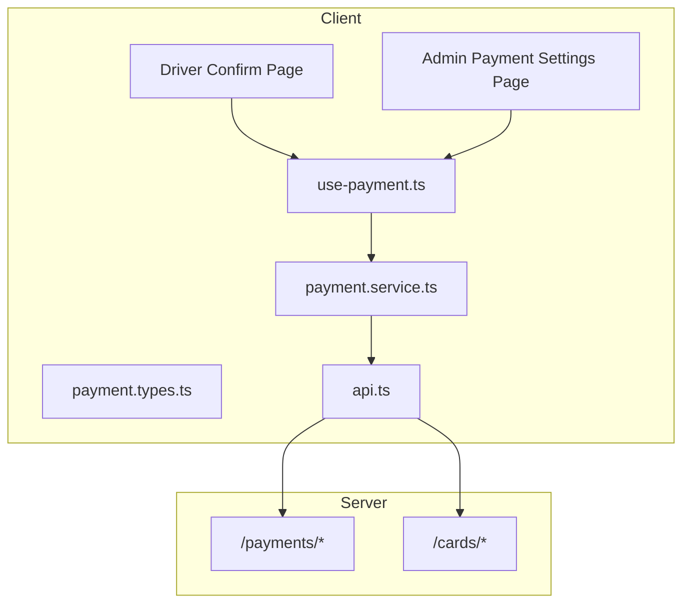
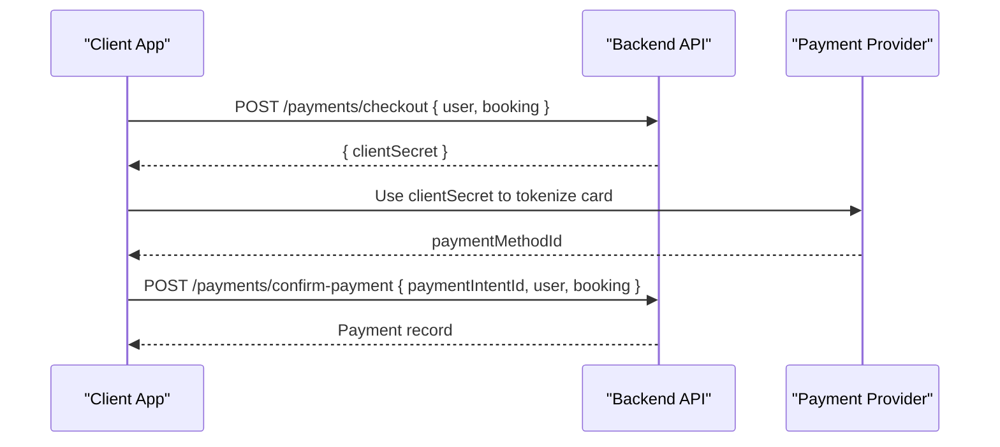
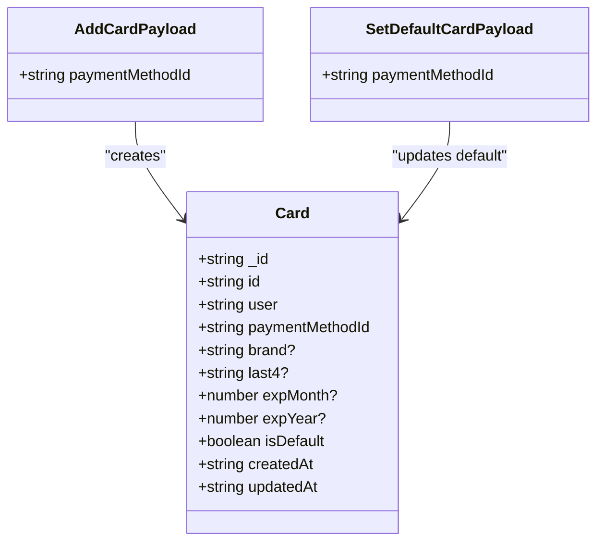
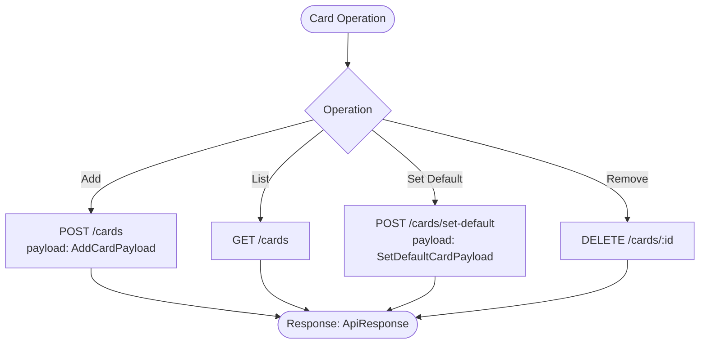
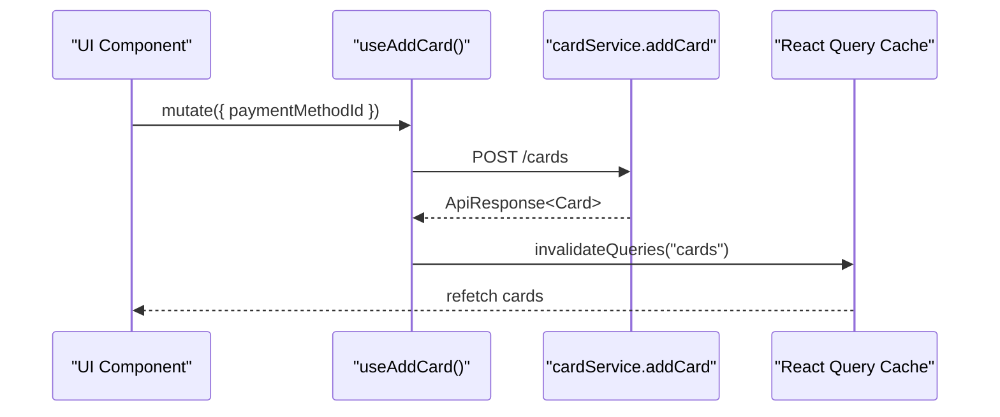
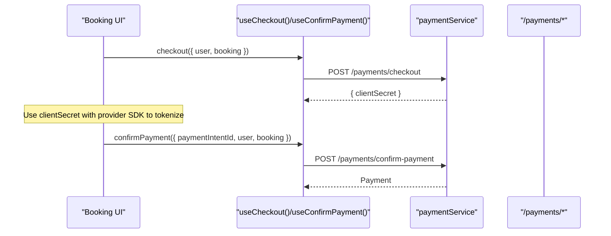
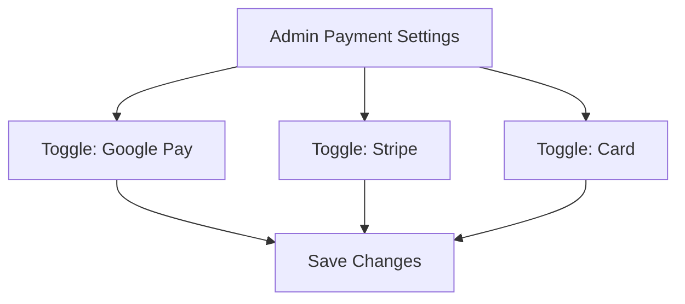
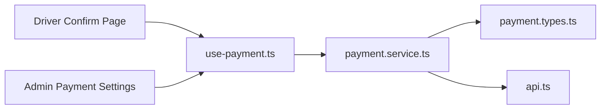

# Card Management & Payment Methods

<cite>
**Referenced Files in This Document**
- [payment.service.ts](file://src/services/payment.service.ts)
- [use-payment.ts](file://src/hooks/booking/use-payment.ts)
- [payment.types.ts](file://src/types/payment.types.ts)
- [api.ts](file://src/lib/api.ts)
- [page.tsx (driver confirm)](file://src/app/driver/(view)/confirm/page.tsx)
- [page.tsx (admin payment settings)](file://src/app/admin/(view)/settings/payment/page.tsx)
</cite>

## Table of Contents
1. [Introduction](#introduction)
2. [Project Structure](#project-structure)
3. [Core Components](#core-components)
4. [Architecture Overview](#architecture-overview)
5. [Detailed Component Analysis](#detailed-component-analysis)
6. [Dependency Analysis](#dependency-analysis)
7. [Performance Considerations](#performance-considerations)
8. [Troubleshooting Guide](#troubleshooting-guide)
9. [Conclusion](#conclusion)
10. [Appendices](#appendices)

## Introduction
This document explains how card and payment method management is implemented in the application, focusing on:
- Adding new cards
- Setting a default payment method
- Managing saved payment information
- Card validation, tokenization, and secure storage practices
- Removing cards and updating preferences
- Handling expired cards
- End-to-end flows for adding cards and processing payments
- Security considerations for sensitive payment data

The current implementation uses a server-side tokenization model where the client never handles raw card numbers. Instead, it receives a paymentMethodId from a trusted provider and persists only non-sensitive metadata.

## Project Structure
Card and payment functionality spans services, hooks, types, and UI pages:
- Services define API endpoints for payments and cards
- React Query hooks encapsulate data fetching and mutations
- Types define payloads and models for payments and cards
- UI pages provide placeholders for future Stripe integration and admin toggles for payment methods

**Diagram sources**
- [page.tsx (driver confirm)](file://src/app/driver/(view)/confirm/page.tsx#L73-L84)
- [page.tsx (admin payment settings)](file://src/app/admin/(view)/settings/payment/page.tsx#L1-L52)
- [use-payment.ts:1-122](file://src/hooks/booking/use-payment.ts#L1-L122)
- [payment.service.ts:1-72](file://src/services/payment.service.ts#L1-L72)
- [payment.types.ts:1-95](file://src/types/payment.types.ts#L1-L95)
- [api.ts:1-106](file://src/lib/api.ts#L1-L106)

**Section sources**
- [payment.service.ts:16-71](file://src/services/payment.service.ts#L16-L71)
- [use-payment.ts:15-121](file://src/hooks/booking/use-payment.ts#L15-L121)
- [payment.types.ts:74-94](file://src/types/payment.types.ts#L74-L94)
- [api.ts:23-73](file://src/lib/api.ts#L23-L73)

## Core Components
- Payment service: Provides checkout and confirmation endpoints, plus admin queries and refunds.
- Card service: Adds cards, lists them, sets default, and removes cards.
- React Query hooks: Encapsulate all card and payment operations with automatic cache invalidation.
- Types: Define Card, AddCardPayload, SetDefaultCardPayload, Payment, CheckoutPayload, ConfirmPaymentPayload, and related enums.
- API layer: Centralized fetch wrapper that attaches Bearer tokens and normalizes responses.

Key responsibilities:
- Tokenization occurs off-client; clients receive a paymentMethodId to persist.
- Only safe card metadata (brand, last4, expiry month/year) is stored.
- Default card selection is managed via a dedicated endpoint.

**Section sources**
- [payment.service.ts:16-71](file://src/services/payment.service.ts#L16-L71)
- [use-payment.ts:23-121](file://src/hooks/booking/use-payment.ts#L23-L121)
- [payment.types.ts:74-94](file://src/types/payment.types.ts#L74-L94)
- [api.ts:23-73](file://src/lib/api.ts#L23-L73)

## Architecture Overview
The system follows a tokenization-first architecture:
- The client requests a checkout intent from the backend.
- The backend returns a clientSecret used by a trusted payment provider SDK to tokenize card details securely.
- The client sends back a paymentMethodId to confirm the payment.
- Saved cards are persisted using the provider’s paymentMethodId, not raw PANs.

**Diagram sources**
- [payment.service.ts:17-21](file://src/services/payment.service.ts#L17-L21)
- [use-payment.ts:23-33](file://src/hooks/booking/use-payment.ts#L23-L33)
- [payment.types.ts:30-39](file://src/types/payment.types.ts#L30-L39)

## Detailed Component Analysis

### Card Model and Payloads
The Card type stores only non-sensitive metadata returned by the provider or backend:
- Identifiers: _id, id, user
- Provider reference: paymentMethodId
- Display info: brand, last4, expMonth, expYear
- Preference: isDefault
- Timestamps: createdAt, updatedAt

AddCardPayload and SetDefaultCardPayload carry only the provider’s paymentMethodId.

**Diagram sources**
- [payment.types.ts:74-94](file://src/types/payment.types.ts#L74-L94)

**Section sources**
- [payment.types.ts:74-94](file://src/types/payment.types.ts#L74-L94)

### Card Service Endpoints
The cardService exposes:
- addCard(payload): POST /cards
- getCards(): GET /cards
- setDefaultCard(payload): POST /cards/set-default
- removeCard(id): DELETE /cards/:id

These endpoints accept and return the types defined above.

**Diagram sources**
- [payment.service.ts:59-71](file://src/services/payment.service.ts#L59-L71)
- [payment.types.ts:88-94](file://src/types/payment.types.ts#L88-L94)

**Section sources**
- [payment.service.ts:59-71](file://src/services/payment.service.ts#L59-L71)

### React Query Hooks for Cards
Hooks wrap the cardService and automatically invalidate the cards list after mutations:
- useCards(): fetches all cards
- useAddCard(): adds a card and refreshes the list
- useSetDefaultCard(): updates default and refreshes the list
- useRemoveCard(): deletes a card and refreshes the list

**Diagram sources**
- [use-payment.ts:99-105](file://src/hooks/booking/use-payment.ts#L99-L105)
- [use-payment.ts:92-97](file://src/hooks/booking/use-payment.ts#L92-L97)
- [use-payment.ts:107-113](file://src/hooks/booking/use-payment.ts#L107-L113)
- [use-payment.ts:115-121](file://src/hooks/booking/use-payment.ts#L115-L121)

**Section sources**
- [use-payment.ts:92-121](file://src/hooks/booking/use-payment.ts#L92-L121)

### Payment Flow (Checkout and Confirmation)
The payment flow separates creation of a payment intent from confirmation:
- Checkout creates an intent and returns a clientSecret
- Confirmation completes the payment using the provider’s paymentMethodId

**Diagram sources**
- [payment.service.ts:17-21](file://src/services/payment.service.ts#L17-L21)
- [use-payment.ts:23-33](file://src/hooks/booking/use-payment.ts#L23-L33)
- [payment.types.ts:30-39](file://src/types/payment.types.ts#L30-L39)

**Section sources**
- [payment.service.ts:17-21](file://src/services/payment.service.ts#L17-L21)
- [use-payment.ts:23-33](file://src/hooks/booking/use-payment.ts#L23-L33)
- [payment.types.ts:30-39](file://src/types/payment.types.ts#L30-L39)

### Admin Payment Method Toggles
The admin page provides toggles for enabling/disabling payment methods such as Google Pay, Stripe, and Card. This is a configuration surface and does not directly manage user cards.

**Diagram sources**
- [page.tsx (admin payment settings)](file://src/app/admin/(view)/settings/payment/page.tsx#L9-L49)

**Section sources**
- [page.tsx (admin payment settings)](file://src/app/admin/(view)/settings/payment/page.tsx#L1-L52)

### Driver Confirm Page Placeholder
The driver confirm page includes a placeholder indicating where Stripe integration will be added for selecting a preferred payment method.

**Section sources**
- [page.tsx (driver confirm)](file://src/app/driver/(view)/confirm/page.tsx#L73-L84)

## Dependency Analysis
The following diagram shows how components depend on each other:

**Diagram sources**
- [page.tsx (driver confirm)](file://src/app/driver/(view)/confirm/page.tsx#L73-L84)
- [page.tsx (admin payment settings)](file://src/app/admin/(view)/settings/payment/page.tsx#L1-L52)
- [use-payment.ts:1-122](file://src/hooks/booking/use-payment.ts#L1-L122)
- [payment.service.ts:1-72](file://src/services/payment.service.ts#L1-L72)
- [payment.types.ts:1-95](file://src/types/payment.types.ts#L1-L95)
- [api.ts:1-106](file://src/lib/api.ts#L1-L106)

**Section sources**
- [use-payment.ts:1-122](file://src/hooks/booking/use-payment.ts#L1-L122)
- [payment.service.ts:1-72](file://src/services/payment.service.ts#L1-L72)
- [payment.types.ts:1-95](file://src/types/payment.types.ts#L1-L95)
- [api.ts:1-106](file://src/lib/api.ts#L1-L106)

## Performance Considerations
- Use React Query caching for cards and payments to avoid redundant network calls.
- Invalidate only affected query keys after mutations (already implemented).
- Prefer listing cards once per session and reusing the cached result.
- Debounce any heavy UI interactions around card selection if needed.

[No sources needed since this section provides general guidance]

## Troubleshooting Guide
Common issues and resolutions:
- Authentication failures: Ensure the Authorization header is present. The API layer reads a token from cookies and attaches it automatically. If requests fail with 401/403, verify the token cookie exists and is valid.
- Network errors: The API wrapper throws descriptive errors when responses are not OK. Inspect the error message thrown by the hook’s mutation function.
- Missing paymentMethodId: Adding a card requires a valid paymentMethodId from the provider. Validate that tokenization completed successfully before calling addCard.
- Expired cards: The Card model includes expMonth and expYear. On the UI, check these fields against the current date and prompt users to update or replace expired cards.
- Default card conflicts: When setting a new default, ensure previous defaults are cleared server-side. The setDefaultCard endpoint should handle this atomically.

Security best practices:
- Never collect or store raw card numbers on the client. Always use a trusted provider SDK to obtain a paymentMethodId.
- Store only non-sensitive metadata (brand, last4, expiry month/year).
- Transmit only tokens and IDs over HTTPS.
- Avoid logging sensitive identifiers like paymentMethodId in client logs.

**Section sources**
- [api.ts:23-73](file://src/lib/api.ts#L23-L73)
- [payment.types.ts:74-86](file://src/types/payment.types.ts#L74-L86)

## Conclusion
The application implements a secure, tokenization-first approach to card and payment management. Clients interact with a minimal set of endpoints and rely on a trusted provider to handle sensitive data. The React Query hooks provide a clean interface for adding, listing, setting defaults, and removing cards, while the API layer centralizes authentication and response handling. Future work should complete the Stripe integration in the driver confirm page and implement robust client-side validation and UX for expired cards.

[No sources needed since this section summarizes without analyzing specific files]

## Appendices

### Example Flows

#### Add New Card Flow
1. User enters card details into the provider’s secure UI (e.g., Stripe Elements).
2. Provider returns a paymentMethodId.
3. Call useAddCard with payload { paymentMethodId }.
4. Server persists the card and returns metadata (brand, last4, expMonth, expYear, isDefault).
5. React Query invalidates the cards list and UI updates.

**Section sources**
- [use-payment.ts:99-105](file://src/hooks/booking/use-payment.ts#L99-L105)
- [payment.service.ts:59-61](file://src/services/payment.service.ts#L59-L61)
- [payment.types.ts:88-90](file://src/types/payment.types.ts#L88-L90)

#### Set Default Payment Method
1. User selects a saved card as default.
2. Call useSetDefaultCard with payload { paymentMethodId }.
3. Server updates the default flag and returns the updated card.
4. React Query invalidates the cards list and UI reflects the change.

**Section sources**
- [use-payment.ts:107-113](file://src/hooks/booking/use-payment.ts#L107-L113)
- [payment.service.ts:66-67](file://src/services/payment.service.ts#L66-L67)
- [payment.types.ts:92-94](file://src/types/payment.types.ts#L92-L94)

#### Remove Card
1. User chooses to remove a saved card.
2. Call useRemoveCard with the card’s id.
3. Server deletes the card and returns success.
4. React Query invalidates the cards list and UI updates.

**Section sources**
- [use-payment.ts:115-121](file://src/hooks/booking/use-payment.ts#L115-L121)
- [payment.service.ts:69-70](file://src/services/payment.service.ts#L69-L70)

#### Handle Expired Cards
- Check expMonth and expYear on the Card object.
- If expired, disable usage and prompt the user to add a new card.
- Optionally hide expired cards from quick selection.

**Section sources**
- [payment.types.ts:74-86](file://src/types/payment.types.ts#L74-L86)