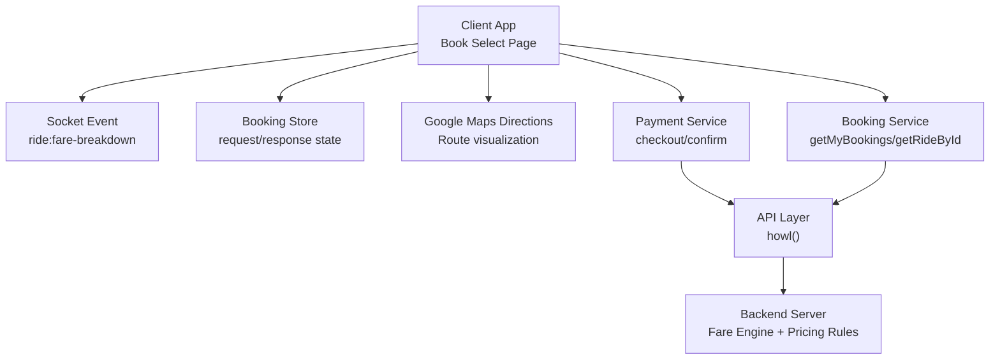
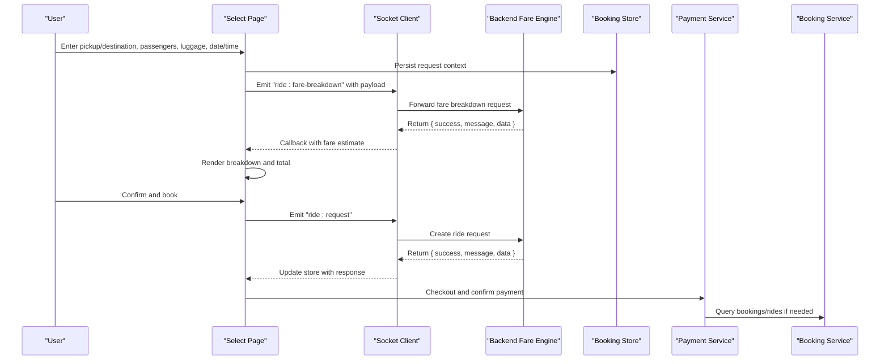
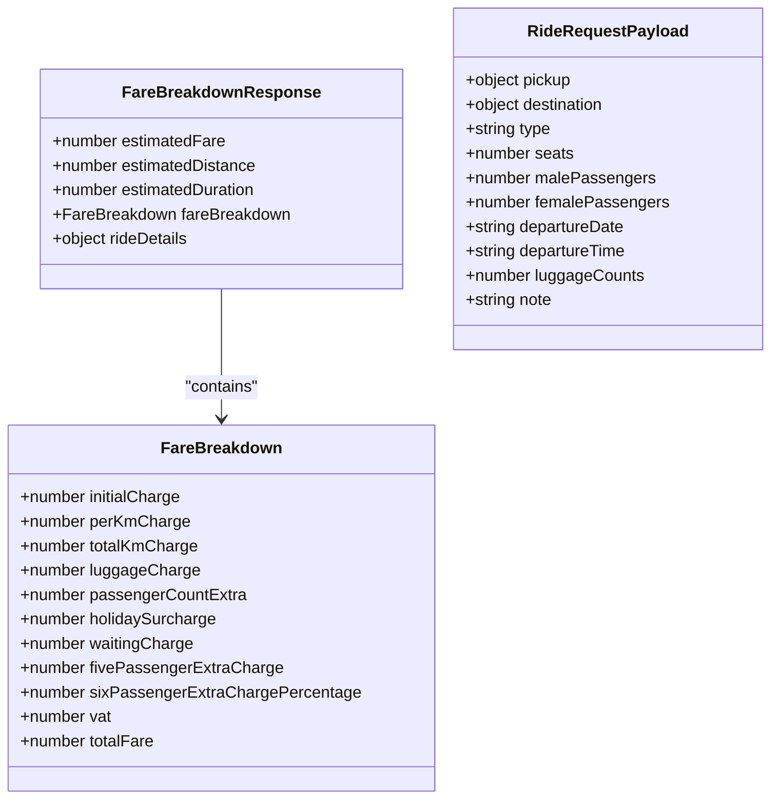
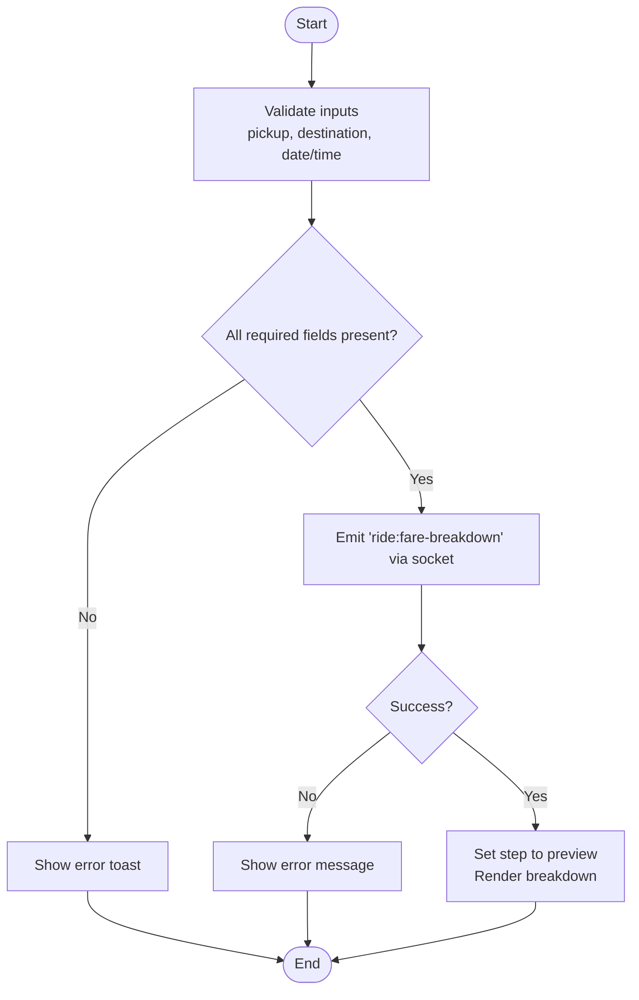
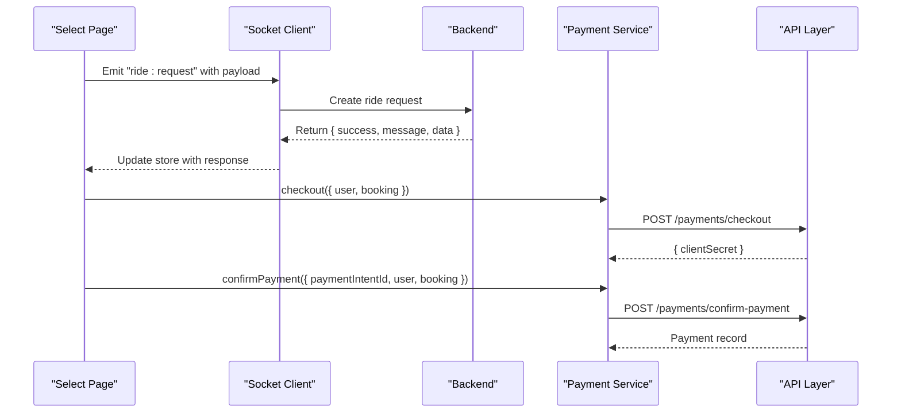
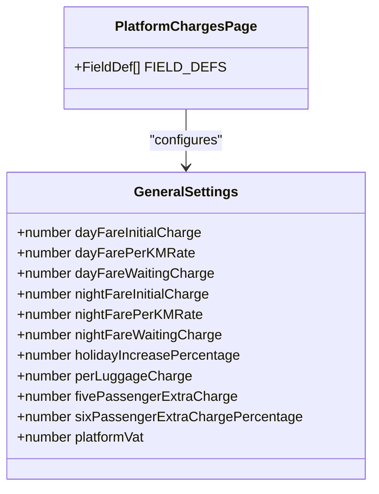
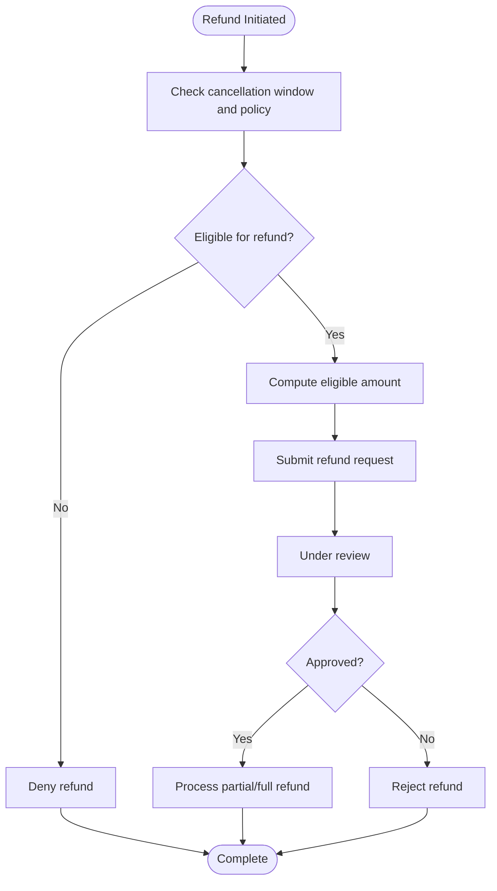
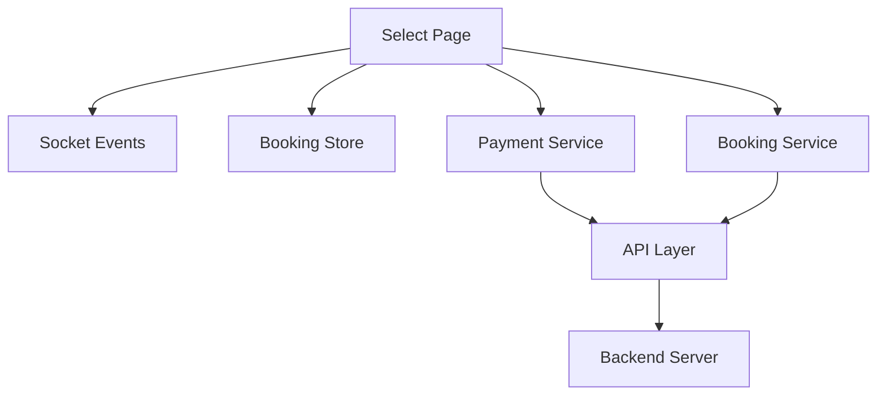

# Fare Calculation Engine

<cite>
**Referenced Files in This Document**
- [select/page.tsx](file://src/app/(view)/book/select/page.tsx)
- [types/ride.types.ts](file://src/types/ride.types.ts)
- [types/booking.types.ts](file://src/types/booking.types.ts)
- [types/payment.types.ts](file://src/types/payment.types.ts)
- [services/booking.service.ts](file://src/services/booking.service.ts)
- [services/payment.service.ts](file://src/services/payment.service.ts)
- [lib/api.ts](file://src/lib/api.ts)
- [admin/settings/platform-charges/page.tsx](file://src/app/admin/(view)/settings/platform-charges/page.tsx)
- [types/settings.types.ts](file://src/types/settings.types.ts)
- [store/booking-store.ts](file://src/store/booking-store.ts)
</cite>

## Table of Contents
1. [Introduction](#introduction)
2. [Project Structure](#project-structure)
3. [Core Components](#core-components)
4. [Architecture Overview](#architecture-overview)
5. [Detailed Component Analysis](#detailed-component-analysis)
6. [Dependency Analysis](#dependency-analysis)
7. [Performance Considerations](#performance-considerations)
8. [Troubleshooting Guide](#troubleshooting-guide)
9. [Conclusion](#conclusion)
10. [Appendices](#appendices)

## Introduction
This document explains the fare calculation engine as implemented in the frontend and its integration with backend services for dynamic pricing, distance-based calculations, and surcharges. It covers:
- How fare estimates are requested and displayed
- The structure of fare breakdowns and pricing factors (distance, time, demand indicators)
- Discount and surcharge application logic surfaced by the system
- Integration points with booking and payment flows
- Examples of scenarios and edge cases such as route changes, cancellations, and partial refunds

The core algorithmic details (e.g., exact surge multipliers or per-km rates) are computed on the server; the frontend consumes structured responses and renders them to users.

## Project Structure
The fare-related flow spans UI pages, types, stores, and service modules:
- Booking selection page requests a fare estimate via socket and displays a detailed breakdown
- Types define the shape of fare breakdowns and ride data
- Services provide REST endpoints for bookings and payments
- Admin settings expose configurable pricing parameters used by the backend

**Diagram sources**
- [select/page.tsx](file://src/app/(view)/book/select/page.tsx#L622-L649)
- [store/booking-store.ts:1-28](file://src/store/booking-store.ts#L1-L28)
- [services/payment.service.ts:16-57](file://src/services/payment.service.ts#L16-L57)
- [services/booking.service.ts:13-44](file://src/services/booking.service.ts#L13-L44)
- [lib/api.ts:23-73](file://src/lib/api.ts#L23-L73)

**Section sources**
- [select/page.tsx](file://src/app/(view)/book/select/page.tsx#L1-L800)
- [types/ride.types.ts:83-161](file://src/types/ride.types.ts#L83-L161)
- [types/booking.types.ts:106-166](file://src/types/booking.types.ts#L106-L166)
- [services/booking.service.ts:13-44](file://src/services/booking.service.ts#L13-L44)
- [services/payment.service.ts:16-57](file://src/services/payment.service.ts#L16-L57)
- [lib/api.ts:23-73](file://src/lib/api.ts#L23-L73)

## Core Components
- Fare Breakdown Model: A structured object that includes initial charge, per-km and total km charges, luggage charge, passenger extra charges, holiday surcharge, waiting charge, VAT, and total fare.
- Ride Request Payload: Inputs sent to compute fare including pickup/destination coordinates, type, passenger counts, date/time, luggage count, and optional note.
- Fare Estimate Response: Contains estimated distance, duration, and the full breakdown.
- Booking and Payment Integration: After previewing the estimate, the client can submit a ride request and later proceed to checkout and confirm payment.

Key responsibilities:
- Collect inputs and validate presence of required fields
- Emit a fare breakdown request over socket
- Render the breakdown and totals
- Proceed to booking and payment flows

**Section sources**
- [types/ride.types.ts:83-161](file://src/types/ride.types.ts#L83-L161)
- [select/page.tsx](file://src/app/(view)/book/select/page.tsx#L622-L649)

## Architecture Overview
The fare estimation workflow is event-driven via sockets between the client and server. The client sends a fare breakdown request with route and passenger details, receives a structured response, and then proceeds to book the ride and initiate payment.

**Diagram sources**
- [select/page.tsx](file://src/app/(view)/book/select/page.tsx#L622-L689)
- [store/booking-store.ts:1-28](file://src/store/booking-store.ts#L1-L28)
- [services/payment.service.ts:16-57](file://src/services/payment.service.ts#L16-L57)
- [services/booking.service.ts:13-44](file://src/services/booking.service.ts#L13-L44)

## Detailed Component Analysis

### Fare Breakdown Data Model
The fare breakdown model defines all line items that contribute to the final price. These include base charges, distance-based charges, luggage fees, passenger surcharges, holiday adjustments, waiting charges, and VAT. The total fare aggregates these components.

**Diagram sources**
- [types/ride.types.ts:83-161](file://src/types/ride.types.ts#L83-L161)

**Section sources**
- [types/ride.types.ts:83-161](file://src/types/ride.types.ts#L83-L161)

### Fare Estimation Flow (Socket-Based)
The client emits a fare breakdown request with route and passenger details. The server responds with an estimate including distance, duration, and a complete breakdown. The UI validates inputs before requesting and handles errors gracefully.

**Diagram sources**
- [select/page.tsx](file://src/app/(view)/book/select/page.tsx#L611-L649)

**Section sources**
- [select/page.tsx](file://src/app/(view)/book/select/page.tsx#L611-L649)

### Booking and Payment Integration
After previewing the estimate, the user can book the ride. The client emits a ride request via socket and updates local state. Payment is initiated through the payment service using checkout and confirm-payment endpoints.

**Diagram sources**
- [select/page.tsx](file://src/app/(view)/book/select/page.tsx#L652-L689)
- [services/payment.service.ts:16-22](file://src/services/payment.service.ts#L16-L22)
- [lib/api.ts:23-73](file://src/lib/api.ts#L23-L73)

**Section sources**
- [select/page.tsx](file://src/app/(view)/book/select/page.tsx#L652-L689)
- [services/payment.service.ts:16-22](file://src/services/payment.service.ts#L16-L22)
- [lib/api.ts:23-73](file://src/lib/api.ts#L23-L73)

### Pricing Factors and Configuration
Pricing factors visible in the breakdown include:
- Initial charge
- Distance-based charge (per-km rate applied to estimated distance)
- Luggage charge
- Passenger extra charges (for larger groups)
- Holiday surcharge
- Waiting charge
- VAT

Admin settings expose configuration keys for day/night fares, per-km rates, waiting charges, holiday increase percentage, luggage charges, passenger extra charges, and platform VAT. These values drive the backend’s fare computation.

**Diagram sources**
- [types/settings.types.ts:1-26](file://src/types/settings.types.ts#L1-L26)
- [admin/settings/platform-charges/page.tsx](file://src/app/admin/(view)/settings/platform-charges/page.tsx#L23-L149)

**Section sources**
- [types/settings.types.ts:1-26](file://src/types/settings.types.ts#L1-L26)
- [admin/settings/platform-charges/page.tsx](file://src/app/admin/(view)/settings/platform-charges/page.tsx#L23-L149)

### Currency Handling
Currency symbols are rendered in the UI when displaying fare lines and totals. The backend provides numeric amounts; formatting is handled at the presentation layer.

Examples:
- Displaying initial charge, distance charge, luggage, VAT, and total fare with currency symbol
- Consistent use of two decimal places for monetary values

**Section sources**
- [select/page.tsx](file://src/app/(view)/book/select/page.tsx#L380-L410)
- [select/page.tsx](file://src/app/(view)/book/select/page.tsx#L516-L545)

### Examples of Pricing Scenarios
- Short trip with minimal luggage: low initial charge, small distance charge, negligible luggage fee, standard VAT
- Long trip with multiple passengers and luggage: higher distance charge, possible passenger extra charges, increased luggage charge, holiday surcharge may apply depending on date/time
- Night rides: different initial and per-km rates compared to day rides (driven by configuration)

These scenarios are reflected in the breakdown fields and totals returned by the server.

[No sources needed since this section provides general guidance]

### Edge Cases: Route Changes, Cancellations, Partial Refunds
- Route changes: If the route changes after booking, the backend should recalculate fare and update the estimate. The UI should re-request fare breakdown and reflect new totals.
- Cancellations: Booking status changes and cancellation reasons are tracked. Refund eligibility depends on configured windows and thresholds.
- Partial refunds: The refund flow supports partial amounts and statuses. The admin interface allows changing refund status and notes.

**Diagram sources**
- [services/payment.service.ts:43-57](file://src/services/payment.service.ts#L43-L57)
- [types/payment.types.ts:41-62](file://src/types/payment.types.ts#L41-L62)

**Section sources**
- [services/payment.service.ts:43-57](file://src/services/payment.service.ts#L43-L57)
- [types/payment.types.ts:41-62](file://src/types/payment.types.ts#L41-L62)

## Dependency Analysis
The fare calculation flow depends on:
- UI components for input collection and display
- Socket events for real-time fare estimation and ride request handling
- Services for REST operations related to bookings and payments
- API layer for HTTP calls with token handling and JSON parsing

**Diagram sources**
- [select/page.tsx](file://src/app/(view)/book/select/page.tsx#L622-L689)
- [store/booking-store.ts:1-28](file://src/store/booking-store.ts#L1-L28)
- [services/payment.service.ts:16-57](file://src/services/payment.service.ts#L16-L57)
- [services/booking.service.ts:13-44](file://src/services/booking.service.ts#L13-L44)
- [lib/api.ts:23-73](file://src/lib/api.ts#L23-L73)

**Section sources**
- [select/page.tsx](file://src/app/(view)/book/select/page.tsx#L622-L689)
- [store/booking-store.ts:1-28](file://src/store/booking-store.ts#L1-L28)
- [services/payment.service.ts:16-57](file://src/services/payment.service.ts#L16-L57)
- [services/booking.service.ts:13-44](file://src/services/booking.service.ts#L13-L44)
- [lib/api.ts:23-73](file://src/lib/api.ts#L23-L73)

## Performance Considerations
- Debounce fare breakdown requests if inputs change frequently during typing
- Cache recent fare estimates to avoid redundant computations
- Use optimistic UI updates for booking confirmation while awaiting server acknowledgment
- Ensure Google Maps directions calls are guarded against invalid coordinates and network failures

[No sources needed since this section provides general guidance]

## Troubleshooting Guide
Common issues and resolutions:
- Missing inputs: Validate pickup, destination, date, and time before emitting requests
- Network errors: The API layer throws descriptive errors; surface them to users via toasts
- Socket timeouts: Implement retry logic and fallback messages for fare breakdown requests
- Payment failures: Inspect payment intent IDs and ensure correct user and booking references

**Section sources**
- [lib/api.ts:42-73](file://src/lib/api.ts#L42-L73)
- [select/page.tsx](file://src/app/(view)/book/select/page.tsx#L611-L649)

## Conclusion
The fare calculation engine integrates tightly with the booking and payment systems. The frontend collects inputs, requests a structured fare breakdown via socket, and presents transparent pricing details. The backend applies configurable rules for distance, time, demand, and surcharges. Robust validation, clear error handling, and comprehensive breakdowns support a reliable user experience.

[No sources needed since this section summarizes without analyzing specific files]

## Appendices

### Key Data Structures Summary
- FareBreakdown: All line items contributing to total fare
- FareBreakdownResponse: Estimated metrics and breakdown
- RideRequestPayload: Inputs for fare computation
- Booking and Payment types: Structures for booking lifecycle and payment processing

**Section sources**
- [types/ride.types.ts:83-161](file://src/types/ride.types.ts#L83-L161)
- [types/booking.types.ts:106-166](file://src/types/booking.types.ts#L106-L166)
- [types/payment.types.ts:11-57](file://src/types/payment.types.ts#L11-L57)