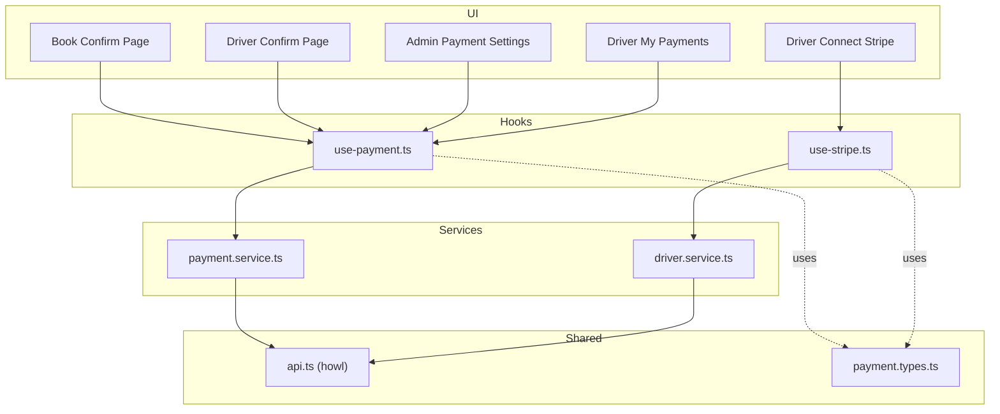
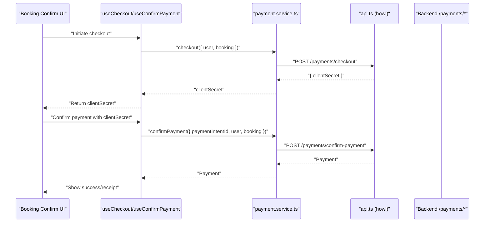
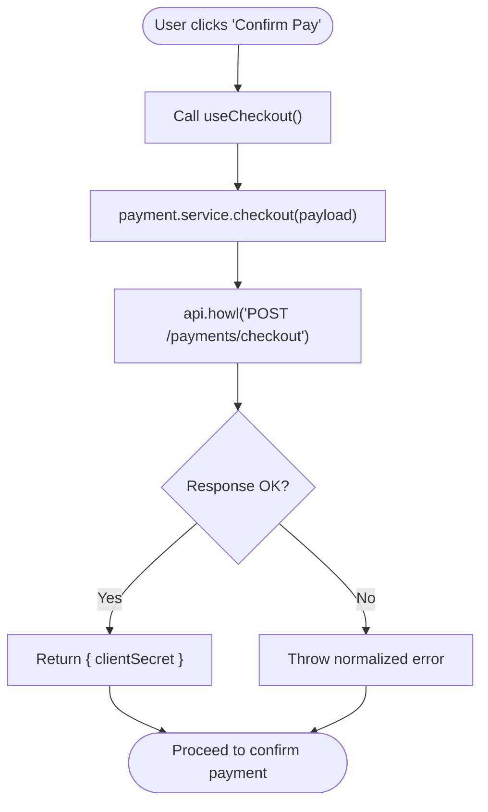
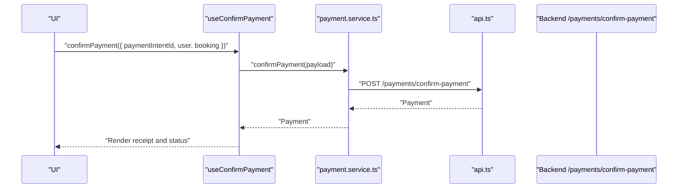
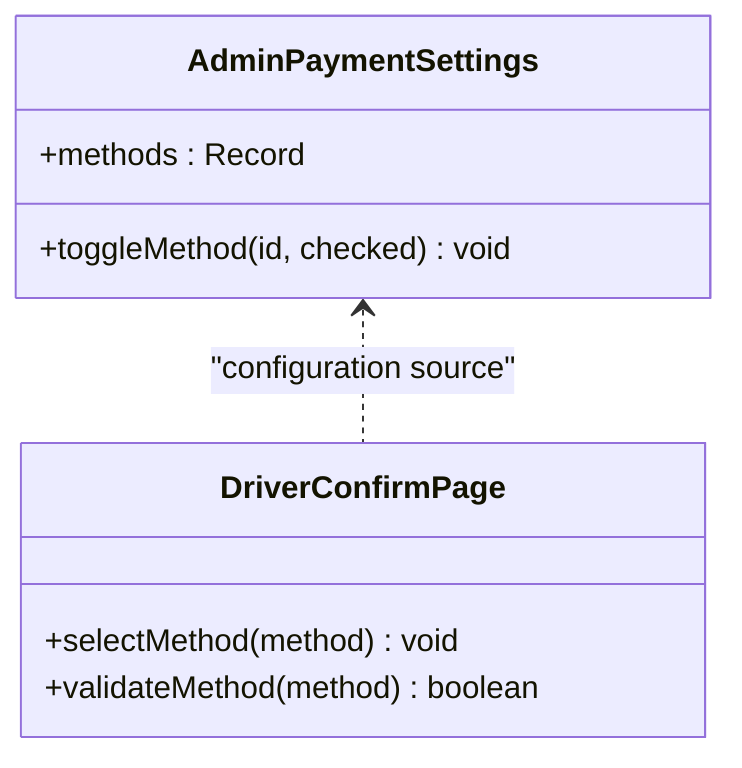
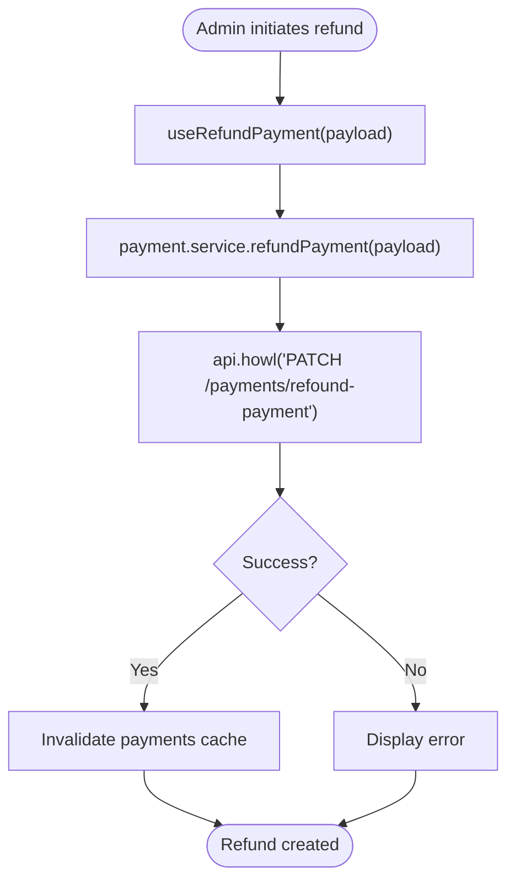
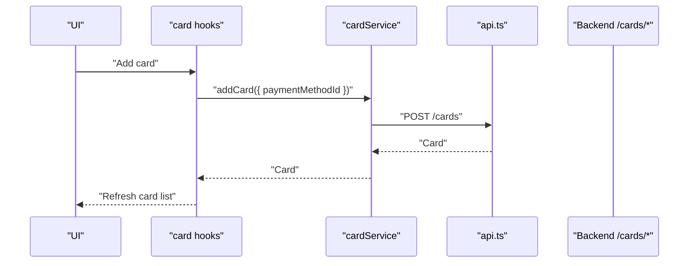
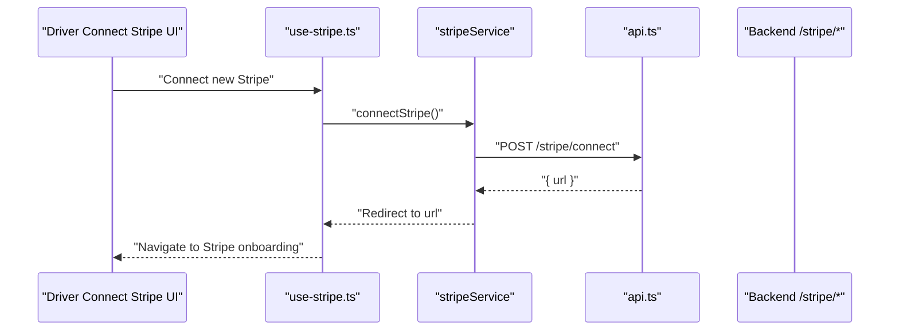
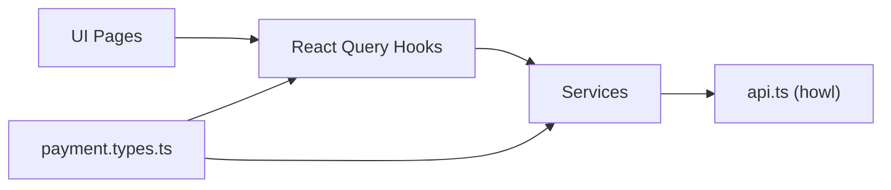

# Payment Collection & Processing

<cite>
**Referenced Files in This Document**
- [payment.service.ts](file://src/services/payment.service.ts)
- [use-payment.ts](file://src/hooks/booking/use-payment.ts)
- [payment.types.ts](file://src/types/payment.types.ts)
- [api.ts](file://src/lib/api.ts)
- [confirm page (book)](file://src/app/(view)/book/confirm/page.tsx)
- [driver confirm page](file://src/app/driver/(view)/confirm/page.tsx)
- [admin payment settings](file://src/app/admin/(view)/settings/payment/page.tsx)
- [driver my-payments page](file://src/app/driver/(view)/my-payments/page.tsx)
- [driver connect-stripe page](file://src/app/driver/(view)/my-payments/connect-stripe/page.tsx)
- [driver stripe hooks](file://src/hooks/driver/use-stripe.ts)
- [driver service](file://src/services/driver.service.ts)
</cite>

## Table of Contents
1. Introduction
2. Project Structure
3. Core Components
4. Architecture Overview
5. Detailed Component Analysis
6. Dependency Analysis
7. Performance Considerations
8. Troubleshooting Guide
9. Conclusion

## Introduction
This document explains the payment collection workflows for the application, focusing on:
- Checkout initiation and client secret generation
- Payment method validation and confirmation
- Transaction processing and status tracking
- Refunds and receipts
- Error handling, retries, and PCI DSS considerations

The codebase provides a clear separation between UI, hooks, services, and types, with HTTP calls centralized through a shared API helper. The checkout flow is designed around a two-step process: create a payment intent via a server endpoint that returns a client secret, then confirm the payment using that secret.

## Project Structure
Payment-related functionality spans several layers:
- UI pages for booking confirmation and driver payments
- React Query hooks to orchestrate mutations and queries
- Service layer functions that call backend endpoints
- Shared API helper for request/response handling
- Type definitions for payloads and responses

**Diagram sources**
- [confirm page (book)](file://src/app/(view)/book/confirm/page.tsx)
- [driver confirm page](file://src/app/driver/(view)/confirm/page.tsx)
- [admin payment settings](file://src/app/admin/(view)/settings/payment/page.tsx)
- [driver my-payments page](file://src/app/driver/(view)/my-payments/page.tsx)
- [driver connect-stripe page](file://src/app/driver/(view)/my-payments/connect-stripe/page.tsx)
- [use-payment.ts](file://src/hooks/booking/use-payment.ts)
- [driver stripe hooks](file://src/hooks/driver/use-stripe.ts)
- [payment.service.ts](file://src/services/payment.service.ts)
- [driver service](file://src/services/driver.service.ts)
- [api.ts](file://src/lib/api.ts)
- [payment.types.ts](file://src/types/payment.types.ts)

**Section sources**
- [payment.service.ts](file://src/services/payment.service.ts)
- [use-payment.ts](file://src/hooks/booking/use-payment.ts)
- [payment.types.ts](file://src/types/payment.types.ts)
- [api.ts](file://src/lib/api.ts)
- [confirm page (book)](file://src/app/(view)/book/confirm/page.tsx)
- [driver confirm page](file://src/app/driver/(view)/confirm/page.tsx)
- [admin payment settings](file://src/app/admin/(view)/settings/payment/page.tsx)
- [driver my-payments page](file://src/app/driver/(view)/my-payments/page.tsx)
- [driver connect-stripe page](file://src/app/driver/(view)/my-payments/connect-stripe/page.tsx)
- [driver stripe hooks](file://src/hooks/driver/use-stripe.ts)
- [driver service](file://src/services/driver.service.ts)

## Core Components
- Services
  - payment.service.ts: Defines endpoints for checkout, confirm-payment, refunds, and card management.
  - driver.service.ts: Provides Stripe connection and account status endpoints used by drivers.
- Hooks
  - use-payment.ts: Wraps payment and refund operations as React Query mutations/queries.
  - use-stripe.ts: Manages Stripe connection checks and flows for drivers.
- Types
  - payment.types.ts: Defines payloads and response shapes for payments, refunds, cards, and statuses.
- API Helper
  - api.ts: Centralized fetch wrapper with token injection and error normalization.

Key responsibilities:
- Client secret generation: POST /payments/checkout returns a clientSecret for the frontend to confirm.
- Payment confirmation: POST /payments/confirm-payment finalizes the transaction and returns a Payment object.
- Card management: Add, list, set default, and remove saved cards.
- Refund lifecycle: Create, list, update status, and delete refunds.
- Driver Stripe integration: Check connection, get account status, connect/disconnect accounts.

**Section sources**
- [payment.service.ts](file://src/services/payment.service.ts)
- [use-payment.ts](file://src/hooks/booking/use-payment.ts)
- [payment.types.ts](file://src/types/payment.types.ts)
- [driver.service.ts](file://src/services/driver.service.ts)
- [api.ts](file://src/lib/api.ts)

## Architecture Overview
The payment architecture follows a layered approach:
- UI triggers actions (e.g., “Confirm Pay”)
- Hooks execute mutations via services
- Services call backend endpoints through the shared API helper
- Backend processes with a payment provider (Stripe), returning structured responses

**Diagram sources**
- [use-payment.ts](file://src/hooks/booking/use-payment.ts)
- [payment.service.ts](file://src/services/payment.service.ts)
- [api.ts](file://src/lib/api.ts)
- [confirm page (book)](file://src/app/(view)/book/confirm/page.tsx)

## Detailed Component Analysis

### Checkout Flow (Client Secret Generation)
- Entry points: Booking confirm page and driver confirm page present payment options and initiate checkout.
- Mutation: useCheckout calls paymentService.checkout with user and booking identifiers.
- Endpoint: POST /payments/checkout returns a clientSecret used by the frontend to confirm payment.
- Data model: CheckoutPayload includes user and booking references.

**Diagram sources**
- [use-payment.ts](file://src/hooks/booking/use-payment.ts)
- [payment.service.ts](file://src/services/payment.service.ts)
- [api.ts](file://src/lib/api.ts)
- [confirm page (book)](file://src/app/(view)/book/confirm/page.tsx)

**Section sources**
- [use-payment.ts](file://src/hooks/booking/use-payment.ts)
- [payment.service.ts](file://src/services/payment.service.ts)
- [payment.types.ts](file://src/types/payment.types.ts)
- [confirm page (book)](file://src/app/(view)/book/confirm/page.tsx)

### Payment Confirmation
- Mutation: useConfirmPayment calls paymentService.confirmPayment with paymentIntentId, user, and booking.
- Endpoint: POST /payments/confirm-payment returns a Payment object including status and transaction details.
- UI: After confirmation, show success state and receipt information.

**Diagram sources**
- [use-payment.ts](file://src/hooks/booking/use-payment.ts)
- [payment.service.ts](file://src/services/payment.service.ts)
- [api.ts](file://src/lib/api.ts)

**Section sources**
- [use-payment.ts](file://src/hooks/booking/use-payment.ts)
- [payment.service.ts](file://src/services/payment.service.ts)
- [payment.types.ts](file://src/types/payment.types.ts)

### Payment Method Validation and Configuration
- Admin settings page allows toggling enabled payment methods (Google Pay, Stripe, Card).
- Driver confirm page indicates where payment method selection and validation would occur.
- Note: Actual validation logic is not implemented in the UI; placeholders indicate future integration.

**Diagram sources**
- [admin payment settings](file://src/app/admin/(view)/settings/payment/page.tsx)
- [driver confirm page](file://src/app/driver/(view)/confirm/page.tsx)

**Section sources**
- [admin payment settings](file://src/app/admin/(view)/settings/payment/page.tsx)
- [driver confirm page](file://src/app/driver/(view)/confirm/page.tsx)

### Refunds and Receipts
- Refund creation: mutation useRefundPayment calls PATCH /payments/refound-payment with intendId and amount.
- Refund listing: query useAllRefunds and useRefundById retrieve refund records.
- Refund status change: mutation useChangeRefundStatus updates refund status.
- Receipt: Payment object returned from confirm-payment contains fields such as transactionId and status, suitable for receipt display.

**Diagram sources**
- [use-payment.ts](file://src/hooks/booking/use-payment.ts)
- [payment.service.ts](file://src/services/payment.service.ts)
- [api.ts](file://src/lib/api.ts)

**Section sources**
- [use-payment.ts](file://src/hooks/booking/use-payment.ts)
- [payment.service.ts](file://src/services/payment.service.ts)
- [payment.types.ts](file://src/types/payment.types.ts)

### Saved Cards Management
- Add card: useAddCard calls POST /cards with paymentMethodId.
- List cards: useCards calls GET /cards.
- Set default: useSetDefaultCard calls POST /cards/set-default.
- Remove card: useRemoveCard calls DELETE /cards/:id.

**Diagram sources**
- [use-payment.ts](file://src/hooks/booking/use-payment.ts)
- [payment.service.ts](file://src/services/payment.service.ts)
- [api.ts](file://src/lib/api.ts)

**Section sources**
- [use-payment.ts](file://src/hooks/booking/use-payment.ts)
- [payment.service.ts](file://src/services/payment.service.ts)
- [payment.types.ts](file://src/types/payment.types.ts)

### Driver Stripe Integration
- Connection check: useStripeConnectionCheck calls GET /stripe/check-connection.
- Account status: useStripeAccountStatus calls GET /stripe/account-status.
- Connect new: useConnectStripe calls POST /stripe/connect and redirects to onboarding URL.
- Connect existing: useConnectExistingStripe calls POST /stripe/connect-existing with accountId.
- Disconnect: useDisconnectStripe calls DELETE /stripe/disconnect.

**Diagram sources**
- [driver stripe hooks](file://src/hooks/driver/use-stripe.ts)
- [driver service](file://src/services/driver.service.ts)
- [api.ts](file://src/lib/api.ts)
- [driver connect-stripe page](file://src/app/driver/(view)/my-payments/connect-stripe/page.tsx)

**Section sources**
- [driver stripe hooks](file://src/hooks/driver/use-stripe.ts)
- [driver service](file://src/services/driver.service.ts)
- [driver connect-stripe page](file://src/app/driver/(view)/my-payments/connect-stripe/page.tsx)

## Dependency Analysis
- UI components depend on hooks for data fetching and mutations.
- Hooks depend on services for endpoint calls.
- Services depend on the shared API helper for HTTP requests.
- Types are consumed across hooks and services for payload and response contracts.

**Diagram sources**
- [use-payment.ts](file://src/hooks/booking/use-payment.ts)
- [payment.service.ts](file://src/services/payment.service.ts)
- [api.ts](file://src/lib/api.ts)
- [payment.types.ts](file://src/types/payment.types.ts)

**Section sources**
- [use-payment.ts](file://src/hooks/booking/use-payment.ts)
- [payment.service.ts](file://src/services/payment.service.ts)
- [api.ts](file://src/lib/api.ts)
- [payment.types.ts](file://src/types/payment.types.ts)

## Performance Considerations
- Use React Query caching and invalidation to minimize redundant network calls.
- Prefer pagination and filtering for admin payment lists to reduce payload sizes.
- Avoid storing sensitive payment data in local storage or cookies; rely on secure tokens and short-lived client secrets.
- Debounce search inputs when querying large datasets.
- Implement optimistic updates judiciously for non-critical UI states only.

[No sources needed since this section provides general guidance]

## Troubleshooting Guide
Common issues and strategies:
- Network errors: The API helper normalizes errors and throws messages extracted from JSON responses. Inspect thrown Error messages and log request context.
- Authentication failures: Ensure the token cookie is present; howl injects Authorization header automatically if available.
- Invalid payloads: Validate CheckoutPayload and ConfirmPaymentPayload before calling services.
- Refund inconsistencies: After creating a refund, invalidate related queries to refresh UI state.
- Stripe connection problems: Use connection check and account status endpoints to diagnose connectivity and enablement flags.

Operational tips:
- Wrap mutations with try/catch in UI to surface user-friendly messages.
- Use React Query’s retry options for transient network errors.
- Log paymentIntentId and transactionId for traceability during support cases.

**Section sources**
- [api.ts](file://src/lib/api.ts)
- [use-payment.ts](file://src/hooks/booking/use-payment.ts)
- [driver stripe hooks](file://src/hooks/driver/use-stripe.ts)

## Conclusion
The payment system is structured around a clean separation of concerns: UI, hooks, services, and a shared API helper. The core checkout flow relies on a two-step process—creating a client secret and confirming the payment—while supporting refunds, saved cards, and driver Stripe integration. Robust error handling and caching patterns improve reliability and performance. Future work should implement actual payment method validation and finalize Stripe UI integrations on the confirm pages.

[No sources needed since this section summarizes without analyzing specific files]