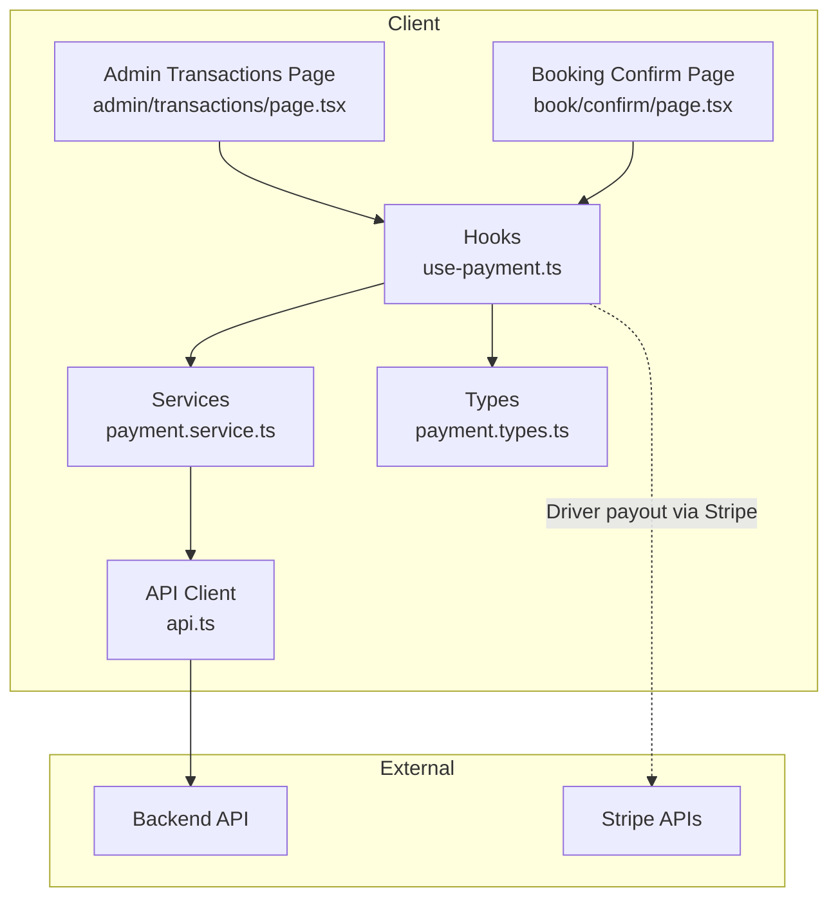
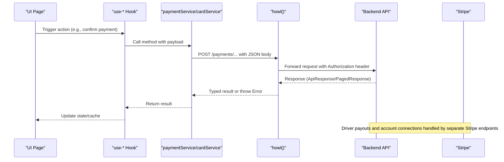
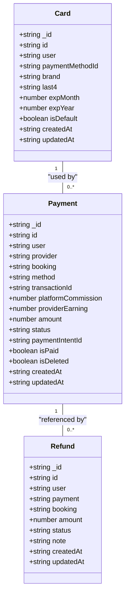
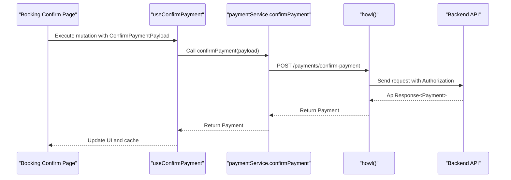
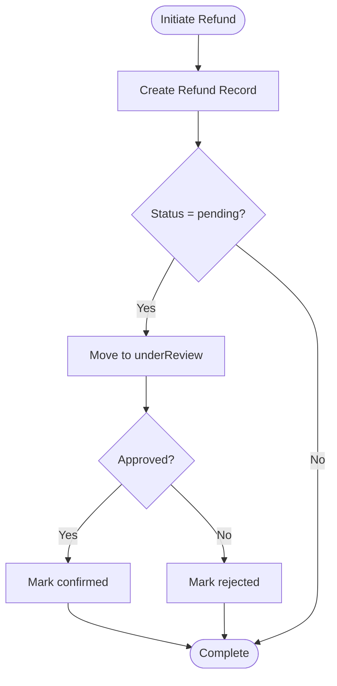
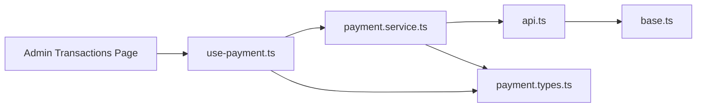

# Payment Processing & Transactions

<cite>
**Referenced Files in This Document**
- [payment.service.ts](file://src/services/payment.service.ts)
- [payment.types.ts](file://src/types/payment.types.ts)
- [use-payment.ts](file://src/hooks/booking/use-payment.ts)
- [api.ts](file://src/lib/api.ts)
- [driver.service.ts](file://src/services/driver.service.ts)
- [use-stripe.ts](file://src/hooks/driver/use-stripe.ts)
- [page.tsx (admin transactions)](file://src/app/admin/(view)/transactions/page.tsx)
- [page.tsx (book confirm)](file://src/app/(view)/book/confirm/page.tsx)
- [base.ts](file://src/types/base.ts)
</cite>

## Table of Contents
1. [Introduction](#introduction)
2. [Project Structure](#project-structure)
3. [Core Components](#core-components)
4. [Architecture Overview](#architecture-overview)
5. [Detailed Component Analysis](#detailed-component-analysis)
6. [Dependency Analysis](#dependency-analysis)
7. [Performance Considerations](#performance-considerations)
8. [Troubleshooting Guide](#troubleshooting-guide)
9. [Security and PCI DSS Compliance](#security-and-pci-dss-compliance)
10. [Conclusion](#conclusion)

## Introduction
This document explains the payment processing workflows implemented in the application, focusing on fare calculation inputs, payment collection, transaction management, and payment status tracking. It covers the client-side service layer architecture, request/response schemas, error handling patterns, integration points with Stripe for driver payouts, and how the booking system participates in payment flows. It also provides guidance for handling failures, retries, refunds, and security considerations aligned with PCI DSS best practices.

## Project Structure
The payment-related code is organized into:
- Services: HTTP clients that call backend endpoints
- Hooks: React Query wrappers to manage data fetching and mutations
- Types: Shared TypeScript interfaces for payloads and responses
- UI Pages: Admin transaction listing and booking confirmation flow

**Diagram sources**
- [use-payment.ts](file://src/hooks/booking/use-payment.ts)
- [payment.service.ts](file://src/services/payment.service.ts)
- [payment.types.ts](file://src/types/payment.types.ts)
- [api.ts](file://src/lib/api.ts)
- [page.tsx (admin transactions)](file://src/app/admin/(view)/transactions/page.tsx)
- [page.tsx (book confirm)](file://src/app/(view)/book/confirm/page.tsx)

**Section sources**
- [payment.service.ts](file://src/services/payment.service.ts)
- [use-payment.ts](file://src/hooks/booking/use-payment.ts)
- [payment.types.ts](file://src/types/payment.types.ts)
- [api.ts](file://src/lib/api.ts)
- [page.tsx (admin transactions)](file://src/app/admin/(view)/transactions/page.tsx)
- [page.tsx (book confirm)](file://src/app/(view)/book/confirm/page.tsx)

## Core Components
- Payment Service Layer
  - Endpoints: checkout, confirmPayment, getMyRefunds, getAllPayments, getPaymentById, refundPayment, getAllRefunds, getRefundById, changeRefundStatus, deleteRefund
  - Card Management: addCard, getCards, setDefaultCard, removeCard
- React Query Hooks
  - useCheckout, useConfirmPayment, useAllPayments, usePaymentById, useRefundPayment, useAllRefunds, useRefundById, useChangeRefundStatus
  - Card hooks: useCards, useAddCard, useSetDefaultCard, useRemoveCard
- Request/Response Schemas
  - Payment, Refund, Card entities and their payload types
  - Pagination envelope PagedResponse and Paginator
- API Transport
  - howl function handles JSON requests, token injection from cookies, and error normalization

Key responsibilities:
- Prepare typed requests and parse responses
- Manage query keys and cache invalidation
- Provide consistent error propagation to UI layers

**Section sources**
- [payment.service.ts](file://src/services/payment.service.ts)
- [use-payment.ts](file://src/hooks/booking/use-payment.ts)
- [payment.types.ts](file://src/types/payment.types.ts)
- [base.ts](file://src/types/base.ts)
- [api.ts](file://src/lib/api.ts)

## Architecture Overview
The payment architecture follows a layered approach:
- UI pages trigger actions via hooks
- Hooks call services
- Services use a shared fetch wrapper to call backend endpoints
- Backend orchestrates payments and integrates with Stripe for payouts

**Diagram sources**
- [use-payment.ts](file://src/hooks/booking/use-payment.ts)
- [payment.service.ts](file://src/services/payment.service.ts)
- [api.ts](file://src/lib/api.ts)

## Detailed Component Analysis

### Payment Service Layer
Responsibilities:
- Encapsulate all payment and card endpoints
- Build query parameters for admin filters
- Return strongly-typed results using ApiResponse and PagedResponse envelopes

Notable methods:
- Checkout and confirm payment flows
- Refund lifecycle operations
- Card CRUD and default selection

Error handling:
- Errors thrown by the transport are surfaced to callers; UI should handle them at hook level

**Section sources**
- [payment.service.ts](file://src/services/payment.service.ts)
- [base.ts](file://src/types/base.ts)

### React Query Hooks
Responsibilities:
- Wrap service calls with caching and invalidation
- Provide stable query keys for selective refetching
- Centralize mutation success callbacks to refresh related lists

Examples:
- useCheckout, useConfirmPayment for payment initiation and confirmation
- useAllPayments, usePaymentById for admin and detail views
- useRefundPayment, useChangeRefundStatus for refund operations
- Card hooks for managing saved payment methods

Cache invalidation:
- After refund or card mutations, invalidate relevant query keys to keep UI in sync

**Section sources**
- [use-payment.ts](file://src/hooks/booking/use-payment.ts)

### Data Models and Schemas
Entities:
- Payment: includes user, provider, booking reference, amount, commission splits, status, timestamps
- Refund: includes amount, status, note, and references to payment and booking
- Card: stores paymentMethodId and metadata like brand and last4

Payloads:
- CheckoutPayload, ConfirmPaymentPayload, RefundPaymentPayload
- ChangeRefundStatusPayload, AddCardPayload, SetDefaultCardPayload
- GetPaymentsQuery for filtering and pagination

Pagination:
- PagedResponse with pagination metadata
- Paginator used for some list endpoints

**Section sources**
- [payment.types.ts](file://src/types/payment.types.ts)
- [base.ts](file://src/types/base.ts)

### API Transport and Authentication
Transport:
- howl builds URLs, sets headers, injects Authorization Bearer token from cookie, serializes JSON bodies
- prowl supports FormData uploads (not used by payment endpoints)

Error handling:
- Non-ok responses attempt to parse JSON message; otherwise fallback to status text
- All errors thrown as Error instances for uniform handling

Authentication:
- Token read from cookie named token; if present, Authorization header is added automatically

**Section sources**
- [api.ts](file://src/lib/api.ts)

### Admin Transactions Page
Features:
- Search by term
- Filter by amount range and date range
- Paginated table with selection and download button
- Displays transactionId, date, customer, method, commission, driver earning, amount, and status

Data binding:
- Uses useAllPayments hook with dynamic query object
- Renders pagination controls and row selections

**Section sources**
- [page.tsx (admin transactions)](file://src/app/admin/(view)/transactions/page.tsx)
- [use-payment.ts](file://src/hooks/booking/use-payment.ts)

### Booking Confirmation Flow
Current state:
- UI placeholder indicates where Stripe integration will be added
- Includes terms acceptance and summary details

Integration notes:
- The page is intended to initiate checkout and confirm payment
- Actual implementation should call useCheckout and useConfirmPayment hooks

**Section sources**
- [page.tsx (book confirm)](file://src/app/(view)/book/confirm/page.tsx)
- [use-payment.ts](file://src/hooks/booking/use-payment.ts)

### Driver Stripe Integration
Purpose:
- Connect/disconnect Stripe accounts and check connection/account status
- Used by drivers to enable payouts

Endpoints:
- Check connection, get account status, connect, connect existing, disconnect

Hooks:
- useStripeConnectionCheck, useStripeAccountStatus, useConnectStripe, useConnectExistingStripe, useDisconnectStripe

**Section sources**
- [driver.service.ts](file://src/services/driver.service.ts)
- [use-stripe.ts](file://src/hooks/driver/use-stripe.ts)

### Class Diagram: Entities and Relationships

**Diagram sources**
- [payment.types.ts](file://src/types/payment.types.ts)

### Sequence Diagram: Payment Confirmation Flow

**Diagram sources**
- [use-payment.ts](file://src/hooks/booking/use-payment.ts)
- [payment.service.ts](file://src/services/payment.service.ts)
- [api.ts](file://src/lib/api.ts)

### Flowchart: Refund Lifecycle

**Diagram sources**
- [payment.types.ts](file://src/types/payment.types.ts)
- [use-payment.ts](file://src/hooks/booking/use-payment.ts)

## Dependency Analysis
High-level dependencies:
- Hooks depend on services
- Services depend on the shared API transport
- UI pages depend on hooks
- Types are consumed across hooks and services

**Diagram sources**
- [page.tsx (admin transactions)](file://src/app/admin/(view)/transactions/page.tsx)
- [use-payment.ts](file://src/hooks/booking/use-payment.ts)
- [payment.service.ts](file://src/services/payment.service.ts)
- [payment.types.ts](file://src/types/payment.types.ts)
- [api.ts](file://src/lib/api.ts)
- [base.ts](file://src/types/base.ts)

**Section sources**
- [use-payment.ts](file://src/hooks/booking/use-payment.ts)
- [payment.service.ts](file://src/services/payment.service.ts)
- [payment.types.ts](file://src/types/payment.types.ts)
- [api.ts](file://src/lib/api.ts)
- [base.ts](file://src/types/base.ts)
- [page.tsx (admin transactions)](file://src/app/admin/(view)/transactions/page.tsx)

## Performance Considerations
- Use query keys strategically to minimize unnecessary refetches
- Leverage pagination and server-side filters to reduce payload sizes
- Avoid redundant network calls by sharing hooks across components
- Debounce search input before triggering queries when applicable
- Prefer optimistic updates for non-critical UI changes and reconcile on success

[No sources needed since this section provides general guidance]

## Troubleshooting Guide
Common issues and resolutions:
- Network errors: The transport throws Error instances with messages derived from server responses; inspect the error message and consider retry logic for transient failures
- Authentication failures: Ensure the token cookie is present and valid; missing tokens cause authorization errors
- Invalid payloads: Validate fields against schema types before sending requests
- Cache inconsistencies: Invalidate specific query keys after mutations to reflect updated states

Operational tips:
- Log endpoint paths and payloads during development
- Use React Query devtools to inspect cache and network activity
- For refunds, verify status transitions and ensure subsequent queries are invalidated

**Section sources**
- [api.ts](file://src/lib/api.ts)
- [use-payment.ts](file://src/hooks/booking/use-payment.ts)

## Security and PCI DSS Compliance
Guidelines based on current implementation:
- Do not handle raw card numbers or CVV on the frontend; rely on provider tokens (e.g., paymentMethodId) stored securely by the payment provider
- Always transmit over HTTPS; the transport uses secure headers and credentials
- Keep sensitive identifiers out of logs and analytics
- Enforce least privilege access for admin endpoints and validate roles server-side
- Implement rate limiting and fraud checks on the backend
- Store only minimal necessary metadata (brand, last4) for cards

[No sources needed since this section provides general guidance]

## Conclusion
The payment subsystem is structured around clear separation of concerns: typed models, thin service layer, and React Query hooks for state management. The admin interface provides robust querying and display capabilities, while the booking confirmation page is prepared for Stripe integration. Driver payouts are integrated through dedicated Stripe endpoints. Following the outlined error handling, performance, and security recommendations will help maintain a reliable and compliant payment experience.