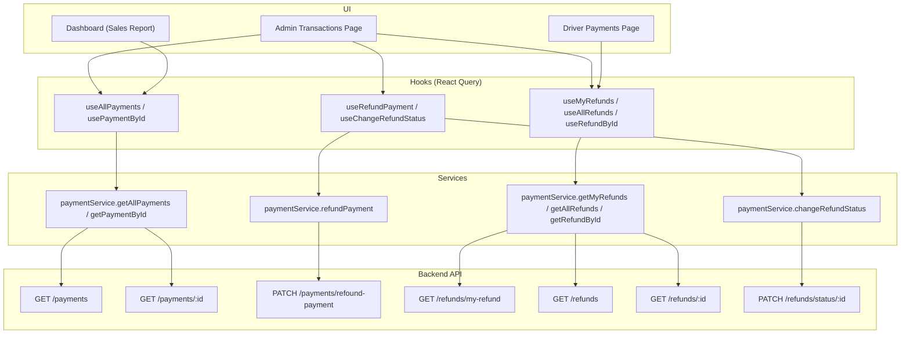
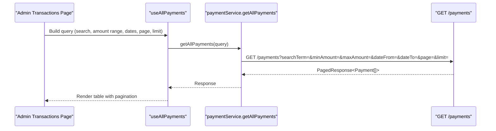
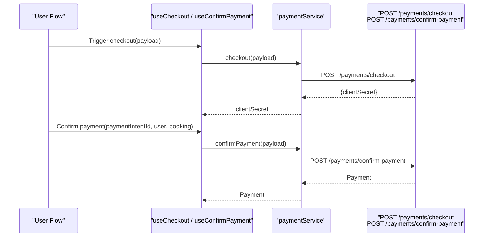
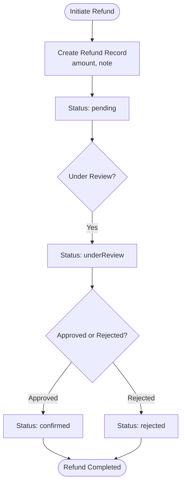
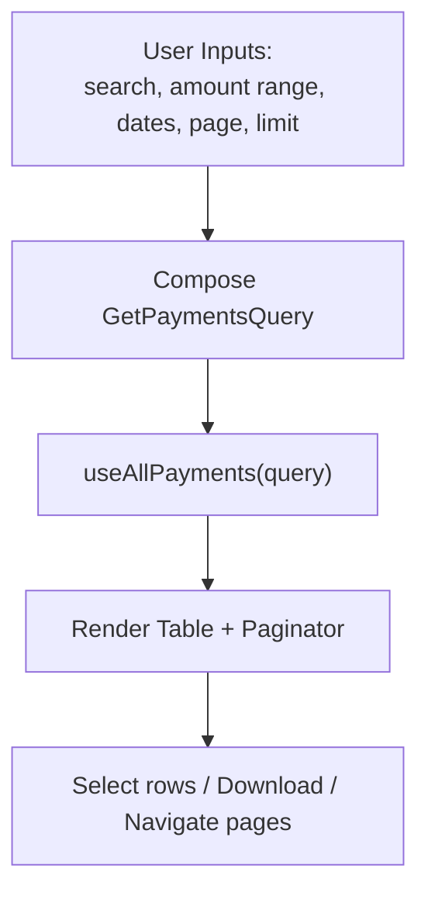
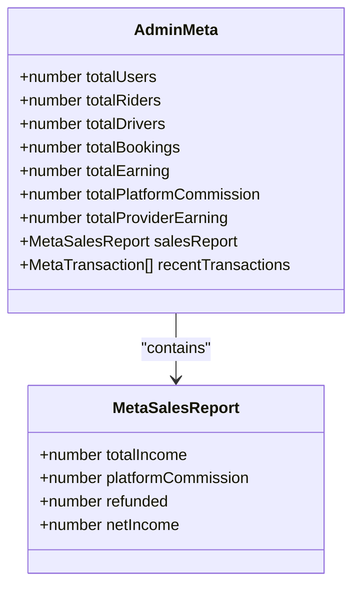
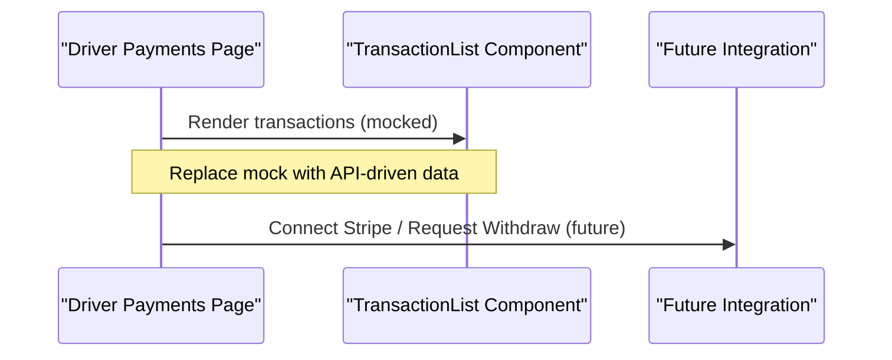
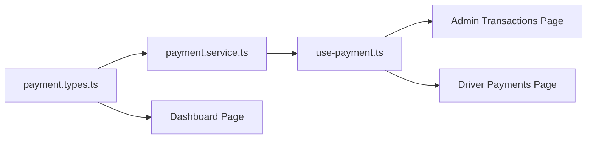

# Transaction Management & Refunds

<cite>
**Referenced Files in This Document**
- [payment.service.ts](file://src/services/payment.service.ts)
- [use-payment.ts](file://src/hooks/booking/use-payment.ts)
- [payment.types.ts](file://src/types/payment.types.ts)
- [transactions page (admin)](file://src/app/admin/(view)/transactions/page.tsx)
- [transactions-table component](file://src/app/admin/(view)/_components/transactions-table.tsx)
- [dashboard page (admin)](file://src/app/admin/(view)/dashboard/page.tsx)
- [driver payments page](file://src/app/driver/(view)/my-payments/page.tsx)
- [driver transaction list component](file://src/app/driver/(view)/my-payments/_components/transaction-list.tsx)
- [API integration guide](file://API-INTEGRATION.md)
</cite>

## Table of Contents
1. [Introduction](#introduction)
2. [Project Structure](#project-structure)
3. [Core Components](#core-components)
4. [Architecture Overview](#architecture-overview)
5. [Detailed Component Analysis](#detailed-component-analysis)
6. [Dependency Analysis](#dependency-analysis)
7. [Performance Considerations](#performance-considerations)
8. [Troubleshooting Guide](#troubleshooting-guide)
9. [Conclusion](#conclusion)
10. [Appendices](#appendices)

## Introduction
This document explains the transaction lifecycle management for payments, refunds, and reconciliation across user, driver, and admin roles. It covers:
- Payment initiation and confirmation flows
- Refund workflow from initiation to completion, including partial refunds and status management
- Transaction querying capabilities with filtering and pagination
- Reporting features for financial overview and reconciliation
- Examples of refund scenarios, dispute handling, and reconciliation processes

The implementation is a client-side integration that calls backend endpoints via typed services and React Query hooks.

## Project Structure
The payment and refund functionality spans three layers:
- Services: HTTP clients for payment/refund endpoints
- Hooks: React Query wrappers for data fetching and mutations
- UI: Admin and Driver pages for viewing transactions, initiating refunds, and reporting

**Diagram sources**
- [payment.service.ts:1-72](file://src/services/payment.service.ts#L1-L72)
- [use-payment.ts:1-122](file://src/hooks/booking/use-payment.ts#L1-L122)
- [transactions page (admin)](file://src/app/admin/(view)/transactions/page.tsx#L1-L500)
- [driver payments page](file://src/app/driver/(view)/my-payments/page.tsx#L1-L94)
- [dashboard page (admin)](file://src/app/admin/(view)/dashboard/page.tsx#L1-L227)

**Section sources**
- [payment.service.ts:1-72](file://src/services/payment.service.ts#L1-L72)
- [use-payment.ts:1-122](file://src/hooks/booking/use-payment.ts#L1-L122)
- [transactions page (admin):1-500](file://src/app/admin/(view)/transactions/page.tsx#L1-L500)
- [driver payments page:1-94](file://src/app/driver/(view)/my-payments/page.tsx#L1-L94)
- [dashboard page (admin):1-227](file://src/app/admin/(view)/dashboard/page.tsx#L1-L227)

## Core Components
- Payment types define statuses and payloads:
  - Payment statuses: pending, completed, refunded
  - Refund statuses: pending, underReview, confirmed, rejected
  - Card management types and payloads
- Services expose endpoints for checkout, confirm, query, refund, and refund status changes
- Hooks wrap services with React Query keys and invalidation logic
- Admin UI provides advanced filtering, pagination, and export actions
- Driver UI shows earnings and withdrawal options

Key responsibilities:
- Data access layer: service functions map to REST endpoints
- State synchronization: hooks manage cache keys and invalidate on mutations
- UI interactions: filters, sorting, selection, and actions like refunding or changing refund status

**Section sources**
- [payment.types.ts:1-95](file://src/types/payment.types.ts#L1-L95)
- [payment.service.ts:16-57](file://src/services/payment.service.ts#L16-L57)
- [use-payment.ts:15-86](file://src/hooks/booking/use-payment.ts#L15-L86)

## Architecture Overview
The architecture follows a clear separation:
- UI components call hooks
- Hooks call service functions
- Service functions perform HTTP requests using a shared fetch wrapper
- Backend endpoints handle business logic and persistence

**Diagram sources**
- [transactions page (admin):145-166](file://src/app/admin/(view)/transactions/page.tsx#L145-L166)
- [use-payment.ts:42-47](file://src/hooks/booking/use-payment.ts#L42-L47)
- [payment.service.ts:27-38](file://src/services/payment.service.ts#L27-L38)

## Detailed Component Analysis

### Payment Lifecycle: Checkout and Confirmation
- Initiation: Client calls checkout endpoint to obtain a client secret for payment provider
- Confirmation: Client confirms payment with intent ID and booking/user identifiers
- Result: Server returns a Payment object reflecting updated state

**Diagram sources**
- [use-payment.ts:23-33](file://src/hooks/booking/use-payment.ts#L23-L33)
- [payment.service.ts:17-21](file://src/services/payment.service.ts#L17-L21)

**Section sources**
- [use-payment.ts:23-33](file://src/hooks/booking/use-payment.ts#L23-L33)
- [payment.service.ts:17-21](file://src/services/payment.service.ts#L17-L21)

### Refund Workflow: Initiation to Completion
- Admin initiates a refund by calling refund endpoint with intent ID and amount (supports partial refunds)
- Refund record created with initial status; admin can update status through changeRefundStatus
- Status progression: pending → underReview → confirmed | rejected
- Audit trail: note field available on refund creation and status updates

**Diagram sources**
- [use-payment.ts:57-63](file://src/hooks/booking/use-payment.ts#L57-L63)
- [use-payment.ts:80-86](file://src/hooks/booking/use-payment.ts#L80-L86)
- [payment.service.ts:43-53](file://src/services/payment.service.ts#L43-L53)
- [payment.types.ts:41-62](file://src/types/payment.types.ts#L41-L62)

**Section sources**
- [use-payment.ts:57-63](file://src/hooks/booking/use-payment.ts#L57-L63)
- [use-payment.ts:80-86](file://src/hooks/booking/use-payment.ts#L80-L86)
- [payment.service.ts:43-53](file://src/services/payment.service.ts#L43-L53)
- [payment.types.ts:41-62](file://src/types/payment.types.ts#L41-L62)

### Transaction Querying and Filtering
Admin transactions page supports:
- Text search by searchTerm
- Amount range filter (minAmount, maxAmount)
- Date range filter (dateFrom, dateTo)
- Pagination (page, limit)

Query building and rendering:
- Filters are composed into GetPaymentsQuery
- useAllPayments hook fetches paginated results
- Table displays transaction details and status badges

**Diagram sources**
- [transactions page (admin):145-166](file://src/app/admin/(view)/transactions/page.tsx#L145-L166)
- [use-payment.ts:42-47](file://src/hooks/booking/use-payment.ts#L42-L47)
- [payment.service.ts:27-38](file://src/services/payment.service.ts#L27-L38)

**Section sources**
- [transactions page (admin):145-166](file://src/app/admin/(view)/transactions/page.tsx#L145-L166)
- [use-payment.ts:42-47](file://src/hooks/booking/use-payment.ts#L42-L47)
- [payment.service.ts:27-38](file://src/services/payment.service.ts#L27-L38)

### Reporting and Financial Reconciliation
Dashboard aggregates sales metrics:
- Total income, platform commission, refunded amounts, net income
- Percentages for breakdown visualization
- Recent transactions table for quick review

Reconciliation process:
- Compare totalIncome vs netIncome and refunded to validate ledger balance
- Use platformCommission and providerEarning fields to reconcile splits
- Export selected transactions for accounting

**Diagram sources**
- [admin.types.ts:13-30](file://src/types/admin.types.ts#L13-L30)
- [dashboard page (admin):62-111](file://src/app/admin/(view)/dashboard/page.tsx#L62-L111)

**Section sources**
- [admin.types.ts:13-30](file://src/types/admin.types.ts#L13-L30)
- [dashboard page (admin):62-111](file://src/app/admin/(view)/dashboard/page.tsx#L62-L111)

### Driver Payment History and Withdrawals
Driver payments page:
- Displays current balance placeholder
- Tabs for transaction history and withdraw requests
- Placeholder transaction list component awaiting API integration
- Action buttons to request withdrawals or connect Stripe account

**Diagram sources**
- [driver payments page:22-94](file://src/app/driver/(view)/my-payments/page.tsx#L22-L94)
- [driver transaction list component:24-57](file://src/app/driver/(view)/my-payments/_components/transaction-list.tsx#L24-L57)

**Section sources**
- [driver payments page:22-94](file://src/app/driver/(view)/my-payments/page.tsx#L22-L94)
- [driver transaction list component:24-57](file://src/app/driver/(view)/my-payments/_components/transaction-list.tsx#L24-L57)

## Dependency Analysis
- Services depend on shared fetch utilities and type definitions
- Hooks depend on services and React Query primitives
- UI depends on hooks and shadcn/ui components
- Admin dashboard depends on admin meta types and chart components

**Diagram sources**
- [payment.types.ts:1-95](file://src/types/payment.types.ts#L1-L95)
- [payment.service.ts:1-72](file://src/services/payment.service.ts#L1-L72)
- [use-payment.ts:1-122](file://src/hooks/booking/use-payment.ts#L1-L122)
- [transactions page (admin):1-500](file://src/app/admin/(view)/transactions/page.tsx#L1-L500)
- [driver payments page:1-94](file://src/app/driver/(view)/my-payments/page.tsx#L1-L94)
- [dashboard page (admin):1-227](file://src/app/admin/(view)/dashboard/page.tsx#L1-L227)

**Section sources**
- [payment.types.ts:1-95](file://src/types/payment.types.ts#L1-L95)
- [payment.service.ts:1-72](file://src/services/payment.service.ts#L1-L72)
- [use-payment.ts:1-122](file://src/hooks/booking/use-payment.ts#L1-L122)
- [transactions page (admin):1-500](file://src/app/admin/(view)/transactions/page.tsx#L1-L500)
- [driver payments page:1-94](file://src/app/driver/(view)/my-payments/page.tsx#L1-L94)
- [dashboard page (admin):1-227](file://src/app/admin/(view)/dashboard/page.tsx#L1-L227)

## Performance Considerations
- Use server-side pagination and filtering to reduce payload sizes
- Cache queries with stable keys; invalidate only affected caches after mutations
- Debounce search input to avoid excessive requests
- Avoid re-rendering large tables by virtualizing rows if needed
- Precompute derived values (e.g., totals) on the server when possible

[No sources needed since this section provides general guidance]

## Troubleshooting Guide
Common issues and resolutions:
- Empty results: Verify filters (searchTerm, amount range, date range) and pagination parameters
- Stale data: Ensure mutation success callbacks invalidate relevant query keys
- Partial refund errors: Validate amount does not exceed original payment amount
- Status transitions: Confirm allowed transitions (pending → underReview → confirmed/rejected)
- Audit notes: Always include note fields for traceability during status changes

Operational checks:
- Inspect network requests for correct query strings and payloads
- Validate response shapes against ApiResponse and PagedResponse types
- Confirm token cookie presence for authenticated endpoints

**Section sources**
- [use-payment.ts:57-86](file://src/hooks/booking/use-payment.ts#L57-L86)
- [payment.service.ts:27-53](file://src/services/payment.service.ts#L27-L53)
- [API integration guide:198-212](file://API-INTEGRATION.md#L198-L212)

## Conclusion
The transaction management system provides robust support for payments, refunds, and reconciliation:
- Clear separation between UI, hooks, and services
- Comprehensive filtering and pagination for transaction queries
- Structured refund workflow with status management and audit trails
- Reporting features enabling financial oversight and reconciliation

Adhering to these patterns ensures maintainability, scalability, and clarity across roles.

[No sources needed since this section summarizes without analyzing specific files]

## Appendices

### API Endpoints Reference
- Payment endpoints:
  - POST /payments/checkout
  - POST /payments/confirm-payment
  - GET /payments
  - GET /payments/:id
  - PATCH /payments/refound-payment
- Refund endpoints:
  - GET /refunds/my-refund
  - GET /refunds
  - GET /refunds/:id
  - PATCH /refunds/status/:id
  - DELETE /refunds/:id

**Section sources**
- [API integration guide:198-212](file://API-INTEGRATION.md#L198-L212)

### Example Scenarios

- Full refund scenario:
  - Admin selects a completed payment
  - Initiates refund with full amount
  - Updates status to underReview, then confirmed
  - Audit note recorded at each step

- Partial refund scenario:
  - Admin initiates refund with amount less than original payment
  - System creates a new refund record linked to the original payment
  - Status progresses similarly with notes documenting reason

- Dispute handling:
  - Mark refund as underReview while investigating
  - If disputed, set status to rejected with explanatory note
  - Log all actions for compliance and audit purposes

- Financial reconciliation:
  - Compare totalIncome, platformCommission, refunded, and netIncome
  - Cross-check providerEarning and platformCommission per transaction
  - Export filtered transactions for accounting verification

[No sources needed since this section provides conceptual examples]