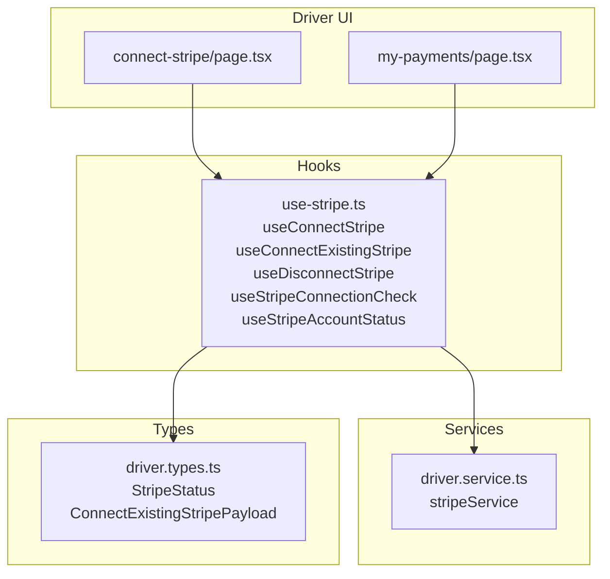
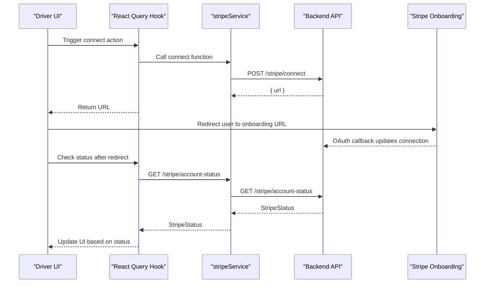
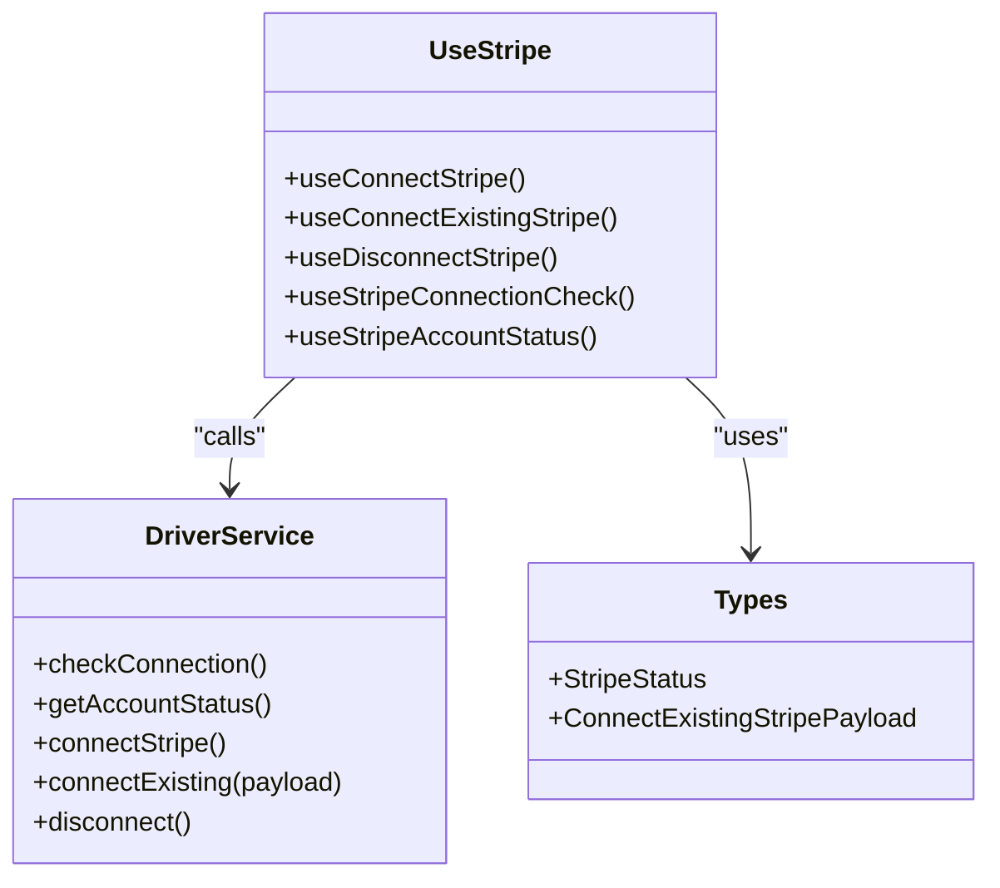

# Stripe Account Connection

<cite>
**Referenced Files in This Document**
- [use-stripe.ts](file://src/hooks/driver/use-stripe.ts)
- [driver.service.ts](file://src/services/driver.service.ts)
- [driver.types.ts](file://src/types/driver.types.ts)
- [connect-stripe/page.tsx](file://src/app/driver/(view)/my-payments/connect-stripe/page.tsx)
- [my-payments/page.tsx](file://src/app/driver/(view)/my-payments/page.tsx)
- [API-INTEGRATION.md](file://API-INTEGRATION.md)
</cite>

## Table of Contents
1. Introduction
2. Project Structure
3. Core Components
4. Architecture Overview
5. Detailed Component Analysis
6. Dependency Analysis
7. Performance Considerations
8. Troubleshooting Guide
9. Conclusion

## Introduction
This document explains the Stripe Connect account connection and onboarding flow for drivers, including:
- New account creation via Stripe OAuth
- Linking an existing Stripe account
- Checking connection and account status
- Disconnecting a connected account
- Implementing hooks useConnectStripe, useConnectExistingStripe, and useDisconnectStripe
- Handling error states and validation requirements
- Guidance for building custom onboarding forms and meeting Stripe compliance requirements

The implementation uses React Query for data fetching and mutations, with service functions calling backend endpoints that return Stripe URLs or statuses.

## Project Structure
Stripe-related code is organized into:
- Hooks for client-side state and API calls
- Service layer for HTTP requests
- Types for payloads and responses
- UI pages for driver onboarding and payment management

**Diagram sources**
- [connect-stripe/page.tsx](file://src/app/driver/(view)/my-payments/connect-stripe/page.tsx#L1-L72)
- [my-payments/page.tsx](file://src/app/driver/(view)/my-payments/page.tsx#L1-L94)
- [use-stripe.ts:1-48](file://src/hooks/driver/use-stripe.ts#L1-L48)
- [driver.service.ts:50-65](file://src/services/driver.service.ts#L50-L65)
- [driver.types.ts:65-74](file://src/types/driver.types.ts#L65-L74)

**Section sources**
- [use-stripe.ts:1-48](file://src/hooks/driver/use-stripe.ts#L1-L48)
- [driver.service.ts:50-65](file://src/services/driver.service.ts#L50-L65)
- [driver.types.ts:65-74](file://src/types/driver.types.ts#L65-L74)
- [connect-stripe/page.tsx](file://src/app/driver/(view)/my-payments/connect-stripe/page.tsx#L1-L72)
- [my-payments/page.tsx](file://src/app/driver/(view)/my-payments/page.tsx#L1-L94)
- [API-INTEGRATION.md:240-248](file://API-INTEGRATION.md#L240-L248)

## Core Components
- Hooks
  - useConnectStripe: Initiates new Stripe Connect onboarding by requesting a redirect URL from the backend.
  - useConnectExistingStripe: Links an existing Stripe account using the provided Stripe account ID.
  - useDisconnectStripe: Disconnects the current Stripe account.
  - useStripeConnectionCheck: Checks whether a Stripe account is connected.
  - useStripeAccountStatus: Retrieves detailed account status (charges/payouts enabled).
- Services
  - stripeService methods call backend endpoints:
    - POST /stripe/connect → returns a URL to redirect to Stripe’s onboarding
    - POST /stripe/connect-existing → links an existing account
    - DELETE /stripe/disconnect → disconnects the account
    - GET /stripe/check-connection → boolean connection check
    - GET /stripe/account-status → detailed status object
- Types
  - StripeStatus: connected, accountId, chargesEnabled, payoutsEnabled
  - ConnectExistingStripePayload: stripeAccountId

These components together implement the full driver onboarding lifecycle.

**Section sources**
- [use-stripe.ts:12-48](file://src/hooks/driver/use-stripe.ts#L12-L48)
- [driver.service.ts:50-65](file://src/services/driver.service.ts#L50-L65)
- [driver.types.ts:65-74](file://src/types/driver.types.ts#L65-L74)
- [API-INTEGRATION.md:240-248](file://API-INTEGRATION.md#L240-L248)

## Architecture Overview
The flow centers around React Query hooks calling service functions that hit backend endpoints. The backend responds with either a Stripe redirect URL (for new accounts) or a status object (for linking/disconnecting/status checks).

**Diagram sources**
- [use-stripe.ts:26-32](file://src/hooks/driver/use-stripe.ts#L26-L32)
- [driver.service.ts:57-58](file://src/services/driver.service.ts#L57-L58)
- [API-INTEGRATION.md:244-246](file://API-INTEGRATION.md#L244-L246)

## Detailed Component Analysis

### useConnectStripe (New Account Creation)
Purpose:
- Start new Stripe Connect onboarding by obtaining a redirect URL from the backend.
- After successful mutation, invalidate related queries to refresh connection status.

Implementation highlights:
- Uses useMutation to call stripeService.connectStripe().
- On success, invalidates all queries under the "stripe" key to reflect updated connection state.

Usage pattern:
- In UI, call the mutation and redirect the browser to the returned URL.
- After redirect completes, re-check account status to update UI.

Error handling:
- Use onError to show user-friendly messages if the backend fails to generate a redirect URL.

Validation:
- Ensure the user is authenticated before initiating the flow.
- Optionally guard against already-connected accounts by checking status first.

**Section sources**
- [use-stripe.ts:26-32](file://src/hooks/driver/use-stripe.ts#L26-L32)
- [driver.service.ts:57-58](file://src/services/driver.service.ts#L57-L58)
- [API-INTEGRATION.md:245-246](file://API-INTEGRATION.md#L245-L246)

### useConnectExistingStripe (Link Existing Account)
Purpose:
- Link an existing Stripe account by sending the Stripe account ID to the backend.
- On success, invalidate related queries to refresh connection state.

Implementation highlights:
- Uses useMutation with payload ConnectExistingStripePayload.
- Calls stripeService.connectExisting(payload).
- Invalidates "stripe" queries on success.

Usage pattern:
- Collect the Stripe account ID from the user.
- Validate format (e.g., starts with acct_).
- Submit via mutation; handle errors and success states.

Validation:
- Enforce non-empty input and basic format checks before submission.

**Section sources**
- [use-stripe.ts:34-40](file://src/hooks/driver/use-stripe.ts#L34-L40)
- [driver.service.ts:60-61](file://src/services/driver.service.ts#L60-L61)
- [driver.types.ts:72-74](file://src/types/driver.types.ts#L72-L74)

### useDisconnectStripe (Disconnect Account)
Purpose:
- Disconnect the currently linked Stripe account.
- Invalidate related queries to reflect the disconnected state.

Implementation highlights:
- Uses useMutation to call stripeService.disconnect().
- On success, invalidates "stripe" queries.

Usage pattern:
- Confirm with the user before disconnecting.
- After success, navigate away or refresh the dashboard.

**Section sources**
- [use-stripe.ts:42-48](file://src/hooks/driver/use-stripe.ts#L42-L48)
- [driver.service.ts:63-64](file://src/services/driver.service.ts#L63-L64)

### Status and Connection Checks
- useStripeConnectionCheck:
  - Queries /stripe/check-connection to determine if an account is connected.
- useStripeAccountStatus:
  - Queries /stripe/account-status to retrieve detailed status fields (connected, accountId, chargesEnabled, payoutsEnabled).

Usage pattern:
- Use these hooks to gate features like withdrawals until the account is fully set up.
- Display appropriate prompts when not connected or missing required capabilities.

**Section sources**
- [use-stripe.ts:12-24](file://src/hooks/driver/use-stripe.ts#L12-L24)
- [driver.service.ts:51-55](file://src/services/driver.service.ts#L51-L55)
- [driver.types.ts:65-70](file://src/types/driver.types.ts#L65-L70)
- [API-INTEGRATION.md:243-245](file://API-INTEGRATION.md#L243-L245)

### Driver Onboarding Page (connect-stripe)
The page provides two paths:
- New to Stripe: initiate new account creation flow
- Already have Stripe: enter existing Stripe account ID

Current state:
- UI is implemented but actions are placeholders awaiting integration with hooks and services.

Integration guidance:
- For new account creation:
  - Call useConnectStripe()
  - Redirect to the returned URL
  - After redirect, refresh status using useStripeAccountStatus()
- For existing account linking:
  - Validate the account ID input
  - Call useConnectExistingStripe({ stripeAccountId })
  - On success, refresh status and navigate to payments

**Section sources**
- [connect-stripe/page.tsx](file://src/app/driver/(view)/my-payments/connect-stripe/page.tsx#L14-L22)
- [connect-stripe/page.tsx](file://src/app/driver/(view)/my-payments/connect-stripe/page.tsx#L44-L60)

### Payments Dashboard Routing Logic
The payments dashboard conditionally routes users:
- If Stripe is connected, allow withdrawal requests
- Otherwise, prompt to connect Stripe

This logic should be replaced with actual status checks using the hooks described above.

**Section sources**
- [my-payments/page.tsx](file://src/app/driver/(view)/my-payments/page.tsx#L19-L21)
- [my-payments/page.tsx](file://src/app/driver/(view)/my-payments/page.tsx#L69-L87)

## Dependency Analysis

**Diagram sources**
- [use-stripe.ts:1-48](file://src/hooks/driver/use-stripe.ts#L1-L48)
- [driver.service.ts:50-65](file://src/services/driver.service.ts#L50-L65)
- [driver.types.ts:65-74](file://src/types/driver.types.ts#L65-L74)

**Section sources**
- [use-stripe.ts:1-48](file://src/hooks/driver/use-stripe.ts#L1-L48)
- [driver.service.ts:50-65](file://src/services/driver.service.ts#L50-L65)
- [driver.types.ts:65-74](file://src/types/driver.types.ts#L65-L74)

## Performance Considerations
- Query keys:
  - Centralized keys ("stripe", "status") and ("stripe", "connection") ensure consistent cache behavior.
- Cache invalidation:
  - Mutations invalidate all "stripe" queries on success, ensuring UI reflects latest state without manual refetches.
- Network efficiency:
  - Avoid redundant calls by leveraging React Query caching and only triggering refetches when necessary.

[No sources needed since this section provides general guidance]

## Troubleshooting Guide
Common issues and resolutions:
- Missing redirect URL:
  - Ensure the backend endpoint returns a valid URL for new account creation.
  - Handle errors in the mutation’s onError callback and display user-friendly messages.
- Incorrect existing account ID:
  - Validate input format (e.g., starts with "acct_").
  - Show inline validation errors before submitting.
- Stale UI after redirect:
  - Invalidate queries on success and optionally force a refetch of account status after redirect completes.
- Feature gating:
  - Use connection and status checks to disable actions like withdrawals until the account is properly connected and enabled.

**Section sources**
- [use-stripe.ts:26-48](file://src/hooks/driver/use-stripe.ts#L26-L48)
- [driver.service.ts:50-65](file://src/services/driver.service.ts#L50-L65)
- [driver.types.ts:65-74](file://src/types/driver.types.ts#L65-L74)

## Conclusion
The Stripe Connect integration is structured around clear separation of concerns:
- Hooks encapsulate React Query logic and mutation strategies
- Services centralize API calls
- Types define contracts for payloads and responses
- UI pages orchestrate flows and present actionable steps

By following the patterns outlined here—redirecting for new accounts, validating inputs for existing accounts, and consistently refreshing status—you can implement a robust driver onboarding experience aligned with Stripe’s requirements.