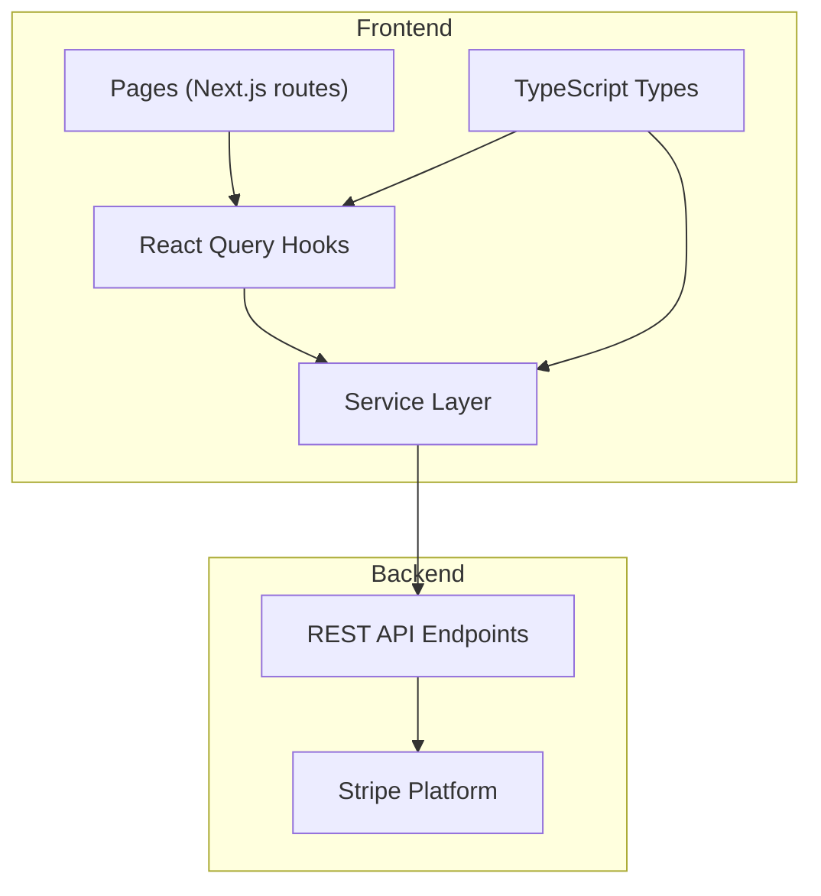
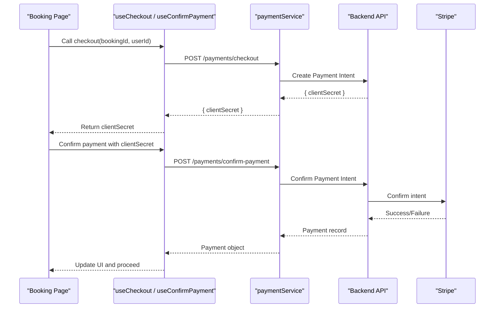
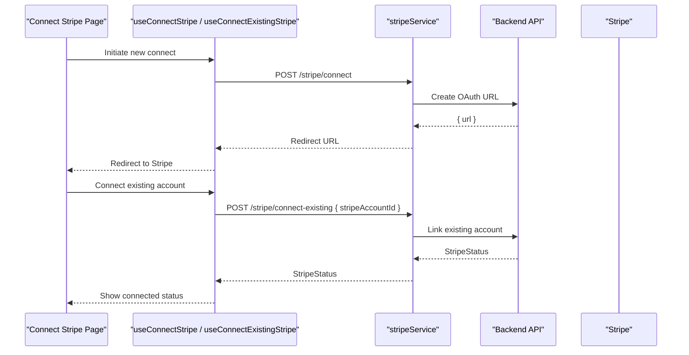
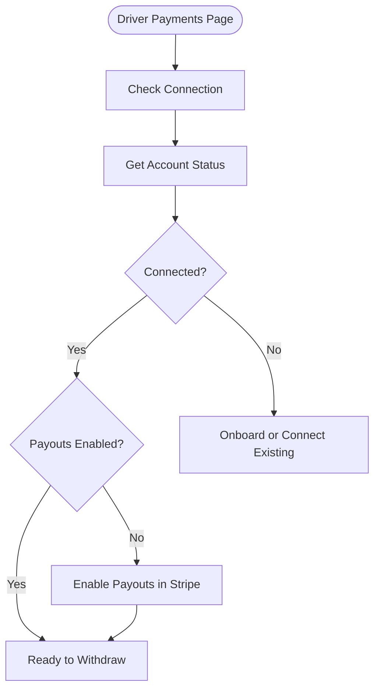
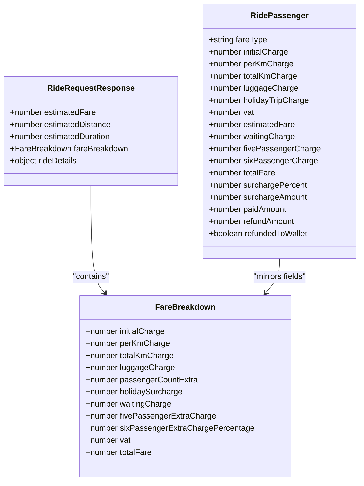
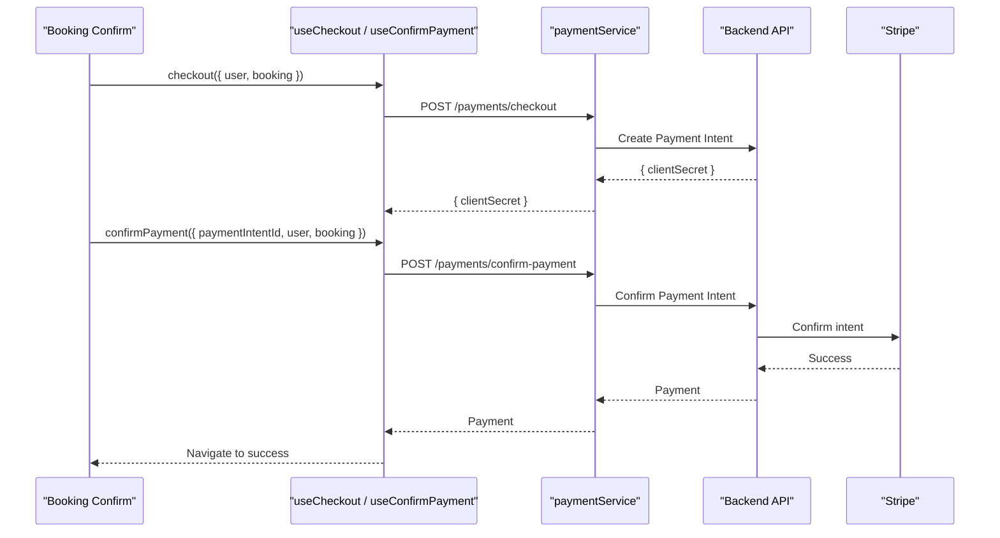
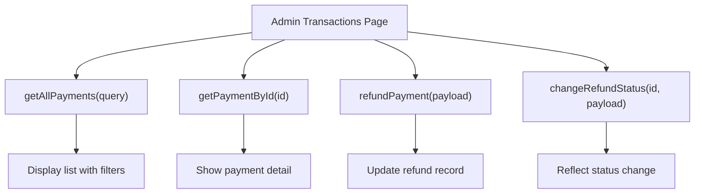
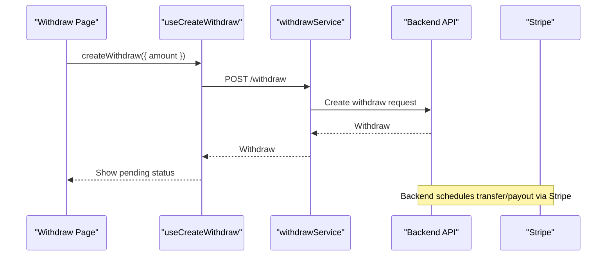
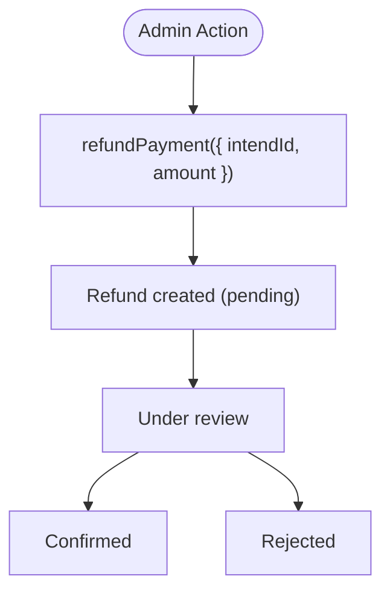
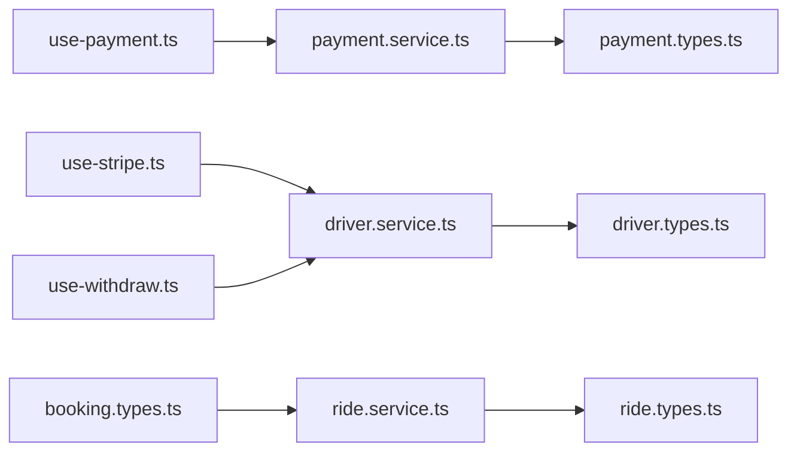

# Stripe Payment Processing

<cite>
**Referenced Files in This Document**
- [API-INTEGRATION.md](file://API-INTEGRATION.md)
- [payment.service.ts](file://src/services/payment.service.ts)
- [use-payment.ts](file://src/hooks/booking/use-payment.ts)
- [payment.types.ts](file://src/types/payment.types.ts)
- [driver.service.ts](file://src/services/driver.service.ts)
- [use-stripe.ts](file://src/hooks/driver/use-stripe.ts)
- [driver.types.ts](file://src/types/driver.types.ts)
- [connect-stripe/page.tsx](file://src/app/driver/(view)/my-payments/connect-stripe/page.tsx)
- [withdraw/page.tsx](file://src/app/driver/(view)/my-payments/withdraw/page.tsx)
- [use-withdraw.ts](file://src/hooks/driver/use-withdraw.ts)
- [ride.service.ts](file://src/services/ride.service.ts)
- [ride.types.ts](file://src/types/ride.types.ts)
- [booking.types.ts](file://src/types/booking.types.ts)
</cite>

## Table of Contents
1. Introduction
2. Project Structure
3. Core Components
4. Architecture Overview
5. Detailed Component Analysis
6. Dependency Analysis
7. Performance Considerations
8. Troubleshooting Guide
9. Conclusion
10. Appendices

## Introduction
This document explains the Stripe payment processing integration for the Split Ride application. It covers driver onboarding with Stripe Connect, account linking and payout setup, fare calculation inputs, payment collection flows, transaction management, withdrawal processing, webhook handling considerations, error handling strategies, PCI DSS compliance guidance, and examples for custom payment flows including refunds and chargebacks. The content is derived from the repository’s services, hooks, types, pages, and API integration guide.

## Project Structure
The frontend implements a layered architecture:
- Services encapsulate HTTP calls to backend endpoints.
- Hooks wrap services with React Query for caching and mutations.
- Pages implement UI flows that consume hooks.
- Types define request/response contracts.
- API-INTEGRATION.md catalogs endpoints and their status.

[No sources needed since this diagram shows conceptual workflow, not actual code structure]

**Section sources**
- [API-INTEGRATION.md:10-24](file://API-INTEGRATION.md#L10-L24)

## Core Components
- Payment service and hooks manage checkout, confirmation, refunds, and card management.
- Driver service and hooks manage Stripe Connect lifecycle and withdrawals.
- Types define payment, refund, withdraw, and Stripe connection states.
- Pages provide UI for connecting Stripe accounts and initiating withdrawals.

Key responsibilities:
- Checkout and confirm payments via backend endpoints.
- Manage saved cards and default selection.
- Admin operations for listing payments/refunds and changing statuses.
- Driver onboarding with Stripe Connect (new or existing).
- Withdrawal requests and admin processing.

**Section sources**
- [payment.service.ts:16-57](file://src/services/payment.service.ts#L16-L57)
- [use-payment.ts:23-86](file://src/hooks/booking/use-payment.ts#L23-L86)
- [payment.types.ts:1-94](file://src/types/payment.types.ts#L1-L94)
- [driver.service.ts:50-96](file://src/services/driver.service.ts#L50-L96)
- [use-stripe.ts:12-48](file://src/hooks/driver/use-stripe.ts#L12-L48)
- [driver.types.ts:65-117](file://src/types/driver.types.ts#L65-L117)

## Architecture Overview
The payment flow uses a two-step server-side creation and client-side confirmation pattern typical of Stripe Payment Intents:
- Client initiates checkout by calling the backend to create a Payment Intent and receive a client secret.
- Client confirms the payment using the client secret.
- Backend records the transaction and updates payment state.

**Diagram sources**
- [payment.service.ts:17-21](file://src/services/payment.service.ts#L17-L21)
- [use-payment.ts:23-33](file://src/hooks/booking/use-payment.ts#L23-L33)
- [API-INTEGRATION.md:200-211](file://API-INTEGRATION.md#L200-L211)

## Detailed Component Analysis

### Driver Onboarding with Stripe Connect
Driver onboarding supports two paths:
- New Stripe account: initiate platform redirect to Stripe onboarding.
- Existing Stripe account: connect an existing Stripe account ID.

The driver UI provides options for both flows, while the backend exposes endpoints to check connection, get account status, connect, connect existing, and disconnect.

**Diagram sources**
- [driver.service.ts:50-65](file://src/services/driver.service.ts#L50-L65)
- [use-stripe.ts:26-40](file://src/hooks/driver/use-stripe.ts#L26-L40)
- [connect-stripe/page.tsx:14-22](file://src/app/driver/(view)/my-payments/connect-stripe/page.tsx#L14-L22)
- [API-INTEGRATION.md:240-248](file://API-INTEGRATION.md#L240-L248)

**Section sources**
- [driver.service.ts:50-65](file://src/services/driver.service.ts#L50-L65)
- [use-stripe.ts:12-48](file://src/hooks/driver/use-stripe.ts#L12-L48)
- [driver.types.ts:65-74](file://src/types/driver.types.ts#L65-L74)
- [connect-stripe/page.tsx:11-22](file://src/app/driver/(view)/my-payments/connect-stripe/page.tsx#L11-L22)
- [API-INTEGRATION.md:240-248](file://API-INTEGRATION.md#L240-L248)

### Account Linking and Payout Setup
- Connection checks and account status are available via dedicated endpoints.
- Payout enablement is reflected in the StripeStatus response.

**Diagram sources**
- [driver.service.ts:51-55](file://src/services/driver.service.ts#L51-L55)
- [driver.types.ts:65-70](file://src/types/driver.types.ts#L65-L70)

**Section sources**
- [driver.service.ts:51-55](file://src/services/driver.service.ts#L51-L55)
- [driver.types.ts:65-70](file://src/types/driver.types.ts#L65-L70)

### Fare Calculation Inputs
Fare components are modeled in ride types and used across booking and passenger details. These fields inform backend calculations and final amounts charged.

**Diagram sources**
- [ride.types.ts:83-160](file://src/types/ride.types.ts#L83-L160)
- [booking.types.ts:106-149](file://src/types/booking.types.ts#L106-L149)

**Section sources**
- [ride.types.ts:83-160](file://src/types/ride.types.ts#L83-L160)
- [booking.types.ts:106-149](file://src/types/booking.types.ts#L106-L149)
- [ride.service.ts:33-114](file://src/services/ride.service.ts#L33-L114)

### Payment Collection Flow
The payment collection follows the standard checkout-confirm pattern:
- Checkout creates a Payment Intent and returns a client secret.
- Confirm payment finalizes the transaction and persists a Payment record.

**Diagram sources**
- [payment.service.ts:17-21](file://src/services/payment.service.ts#L17-L21)
- [use-payment.ts:23-33](file://src/hooks/booking/use-payment.ts#L23-L33)
- [API-INTEGRATION.md:200-211](file://API-INTEGRATION.md#L200-L211)

**Section sources**
- [payment.service.ts:17-21](file://src/services/payment.service.ts#L17-L21)
- [use-payment.ts:23-33](file://src/hooks/booking/use-payment.ts#L23-L33)
- [payment.types.ts:30-39](file://src/types/payment.types.ts#L30-L39)
- [API-INTEGRATION.md:200-211](file://API-INTEGRATION.md#L200-L211)

### Transaction Management
Admin capabilities include listing payments, retrieving details, and managing refunds. Refund statuses can be updated through dedicated endpoints.

**Diagram sources**
- [payment.service.ts:27-56](file://src/services/payment.service.ts#L27-L56)
- [use-payment.ts:42-86](file://src/hooks/booking/use-payment.ts#L42-L86)
- [API-INTEGRATION.md:205-211](file://API-INTEGRATION.md#L205-L211)

**Section sources**
- [payment.service.ts:27-56](file://src/services/payment.service.ts#L27-L56)
- [use-payment.ts:42-86](file://src/hooks/booking/use-payment.ts#L42-L86)
- [payment.types.ts:46-62](file://src/types/payment.types.ts#L46-L62)
- [API-INTEGRATION.md:205-211](file://API-INTEGRATION.md#L205-L211)

### Withdrawal Processing
Drivers can request withdrawals; admins can proceed or cancel them. The UI currently includes placeholders for amount and bank details, but the service layer expects only an amount in the create payload.

**Diagram sources**
- [driver.service.ts:67-74](file://src/services/driver.service.ts#L67-L74)
- [use-withdraw.ts:13-19](file://src/hooks/driver/use-withdraw.ts#L13-L19)
- [driver.types.ts:100-106](file://src/types/driver.types.ts#L100-L106)
- [API-INTEGRATION.md:252-262](file://API-INTEGRATION.md#L252-L262)

**Section sources**
- [driver.service.ts:67-74](file://src/services/driver.service.ts#L67-L74)
- [use-withdraw.ts:13-19](file://src/hooks/driver/use-withdraw.ts#L13-L19)
- [driver.types.ts:100-106](file://src/types/driver.types.ts#L100-L106)
- [withdraw/page.tsx:21-24](file://src/app/driver/(view)/my-payments/withdraw/page.tsx#L21-L24)
- [API-INTEGRATION.md:252-262](file://API-INTEGRATION.md#L252-L262)

### Webhook Handling for Payment Events
Webhooks are typically handled server-side to reconcile events such as payment_intent.succeeded, charge.refunded, and charge.dispute.created. While no frontend webhook handlers exist in this repository, the presence of payment intent IDs and refund/dispute-related types indicates backend reconciliation should update Payment and Refund records accordingly.

Recommendations:
- Verify signatures securely.
- Idempotently process events.
- Update local Payment/Refund statuses based on Stripe events.
- Emit internal notifications or trigger downstream actions (e.g., release funds, adjust balances).

[No sources needed since this section provides general guidance]

### Error Handling for Failed Transactions
Common failure scenarios and handling strategies:
- Payment intent creation fails: surface actionable errors and allow retry.
- Confirmation fails due to insufficient funds or card decline: prompt alternative payment method.
- Network errors: implement retries with exponential backoff for idempotent calls.
- Server errors: log and present user-friendly messages.

Implementation tips:
- Use React Query onError callbacks to handle failures consistently.
- Normalize error responses and map to user-facing messages.
- Maintain optimistic UI updates only after successful confirmation.

[No sources needed since this section provides general guidance]

### PCI DSS Compliance Requirements
To remain compliant:
- Never collect raw PAN or CVV in your app. Use Stripe Elements or Stripe.js to tokenize card data directly to Stripe.
- Store only non-sensitive references (e.g., paymentMethodId, last4) returned by Stripe.
- Ensure HTTPS everywhere and secure storage of tokens.
- Limit access to sensitive configuration (API keys) to server-side environment variables.
- Regularly audit dependencies and maintain least privilege.

[No sources needed since this section provides general guidance]

### Custom Payment Flows and Edge Cases

#### Refunds
- Admin-initiated partial/full refunds are supported via dedicated endpoints.
- Refund statuses can be changed to under review, confirmed, or rejected.

**Diagram sources**
- [payment.service.ts:43-56](file://src/services/payment.service.ts#L43-L56)
- [use-payment.ts:57-86](file://src/hooks/booking/use-payment.ts#L57-L86)
- [payment.types.ts:41-62](file://src/types/payment.types.ts#L41-L62)

**Section sources**
- [payment.service.ts:43-56](file://src/services/payment.service.ts#L43-L56)
- [use-payment.ts:57-86](file://src/hooks/booking/use-payment.ts#L57-L86)
- [payment.types.ts:41-62](file://src/types/payment.types.ts#L41-L62)

#### Chargebacks
- Monitor dispute events server-side and update related records.
- Provide admin tools to respond to disputes and attach notes.
- Reflect outcomes in UI and accounting systems.

[No sources needed since this section provides general guidance]

## Dependency Analysis
The following diagram maps key dependencies between services, hooks, and types involved in payments and Stripe Connect.

**Diagram sources**
- [payment.service.ts:1-14](file://src/services/payment.service.ts#L1-L14)
- [payment.types.ts:1-94](file://src/types/payment.types.ts#L1-L94)
- [use-payment.ts:1-21](file://src/hooks/booking/use-payment.ts#L1-L21)
- [driver.service.ts:1-16](file://src/services/driver.service.ts#L1-L16)
- [driver.types.ts:1-117](file://src/types/driver.types.ts#L1-L117)
- [use-stripe.ts:1-6](file://src/hooks/driver/use-stripe.ts#L1-L6)
- [use-withdraw.ts:1-5](file://src/hooks/driver/use-withdraw.ts#L1-L5)
- [ride.service.ts:1-11](file://src/services/ride.service.ts#L1-L11)
- [ride.types.ts:1-47](file://src/types/ride.types.ts#L1-L47)
- [booking.types.ts:1-20](file://src/types/booking.types.ts#L1-L20)

**Section sources**
- [payment.service.ts:1-14](file://src/services/payment.service.ts#L1-L14)
- [use-payment.ts:1-21](file://src/hooks/booking/use-payment.ts#L1-L21)
- [driver.service.ts:1-16](file://src/services/driver.service.ts#L1-L16)
- [use-stripe.ts:1-6](file://src/hooks/driver/use-stripe.ts#L1-L6)
- [use-withdraw.ts:1-5](file://src/hooks/driver/use-withdraw.ts#L1-L5)
- [ride.service.ts:1-11](file://src/services/ride.service.ts#L1-L11)
- [ride.types.ts:1-47](file://src/types/ride.types.ts#L1-L47)
- [booking.types.ts:1-20](file://src/types/booking.types.ts#L1-L20)

## Performance Considerations
- Prefer query caching and invalidation patterns already implemented in hooks to minimize redundant network calls.
- Debounce search/filter inputs when querying large datasets (e.g., admin transactions).
- Avoid unnecessary re-renders by memoizing expensive computations and splitting heavy components.
- Use pagination parameters provided by services to limit payload sizes.

[No sources needed since this section provides general guidance]

## Troubleshooting Guide
Common issues and resolutions:
- Missing token: ensure authentication cookie is set before calling services.
- Incorrect endpoint usage: verify against API-INTEGRATION.md mappings.
- Stripe Connect not linked: check connection and account status endpoints; ensure payouts enabled.
- Withdrawals failing: validate amount limits and driver payout settings; review admin status changes.

Operational pointers:
- Inspect hook loading/error states and React Query cache keys.
- Validate payloads against TypeScript interfaces to catch mismatches early.
- Log server-side webhook events and reconcile discrepancies with local records.

**Section sources**
- [API-INTEGRATION.md:299-307](file://API-INTEGRATION.md#L299-L307)
- [use-payment.ts:15-21](file://src/hooks/booking/use-payment.ts#L15-L21)
- [use-stripe.ts:7-10](file://src/hooks/driver/use-stripe.ts#L7-L10)

## Conclusion
The repository provides a solid foundation for Stripe-based payments with clear separation of concerns across services, hooks, and types. Driver onboarding via Stripe Connect, payment collection through checkout/confirm, transaction management, and withdrawal workflows are well-modeled. To complete production readiness, implement robust server-side webhook handling, comprehensive error handling, and strict PCI DSS practices. The diagrams and sections above serve as a practical guide for extending and maintaining the payment system.

[No sources needed since this section summarizes without analyzing specific files]

## Appendices

### API Endpoint Reference Summary
- Payments: checkout, confirm-payment, list, detail, refund, refund status.
- Cards: add, list, set default, remove.
- Stripe Connect: check-connection, account-status, connect, connect-existing, disconnect.
- Withdrawals: create, my-withdraws, list, detail, change status.

**Section sources**
- [API-INTEGRATION.md:198-262](file://API-INTEGRATION.md#L198-L262)