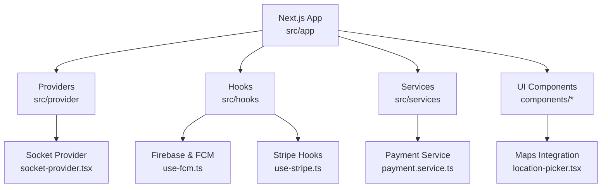
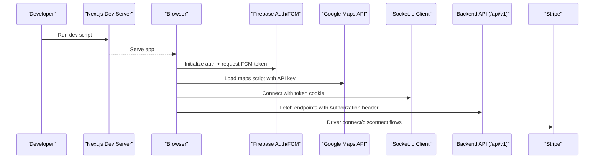
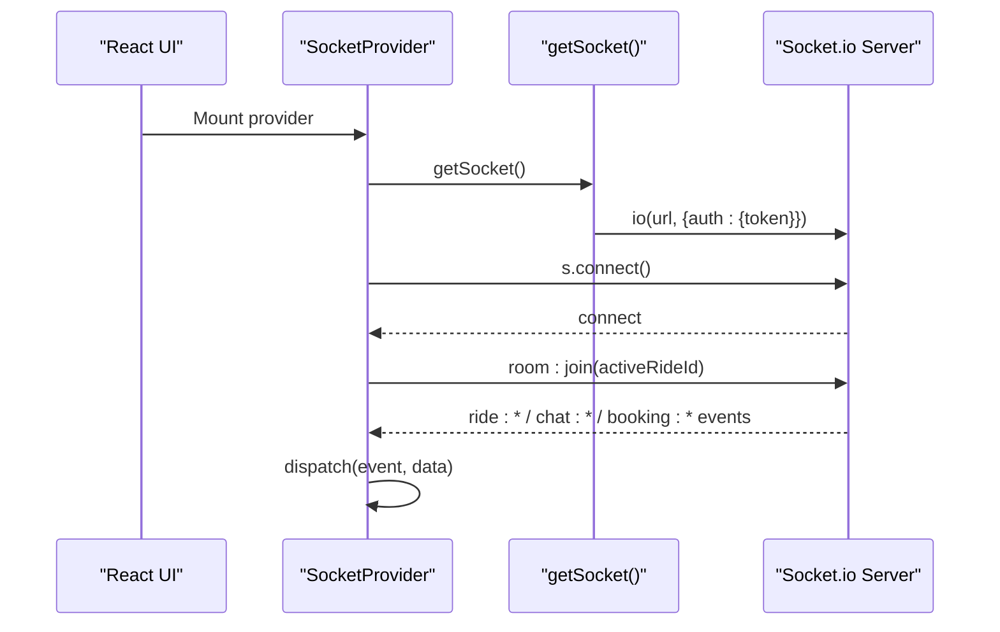
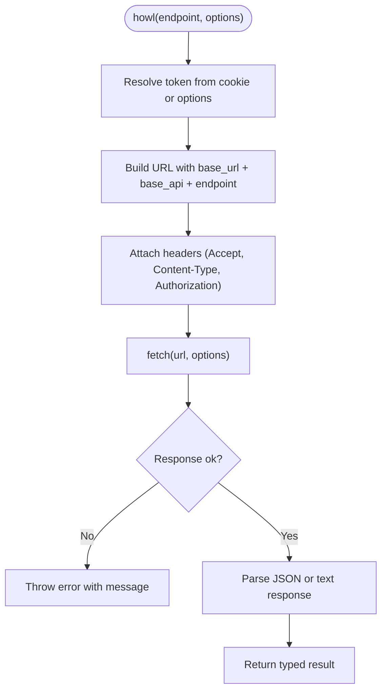
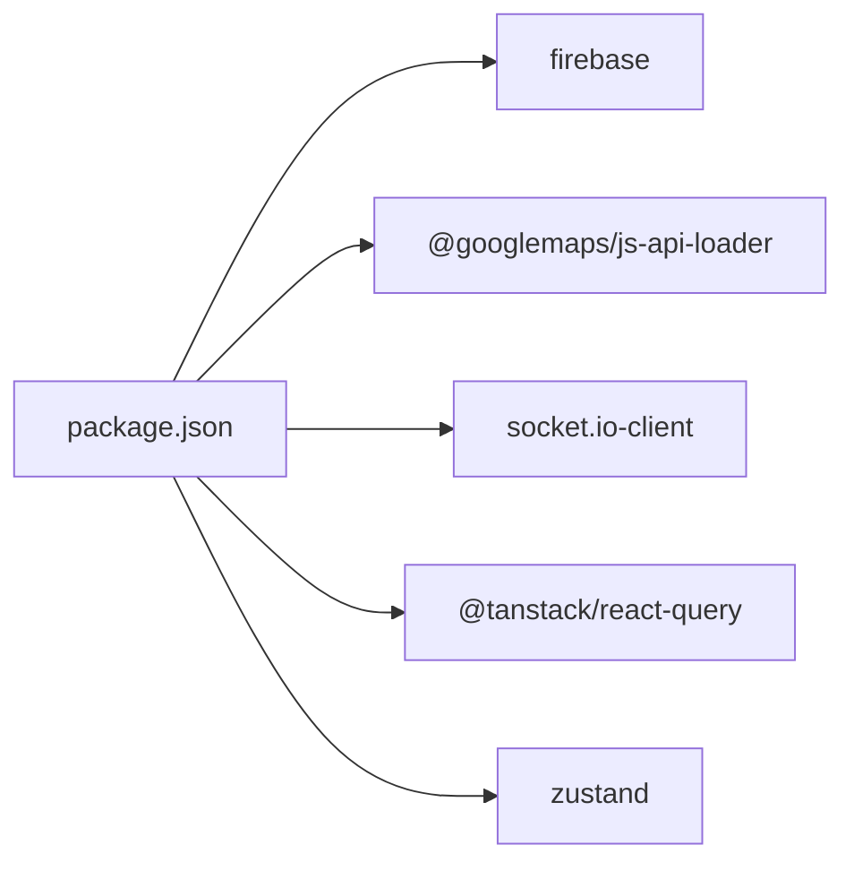

# Getting Started

<cite>
**Referenced Files in This Document**
- [README.md](file://README.md)
- [package.json](file://package.json)
- [next.config.ts](file://next.config.ts)
- [src/app/layout.tsx](file://src/app/layout.tsx)
- [src/lib/firebase.ts](file://src/lib/firebase.ts)
- [src/hooks/shared/use-fcm.ts](file://src/hooks/shared/use-fcm.ts)
- [src/components/core/location-picker.tsx](file://src/components/core/location-picker.tsx)
- [src/app/(view)/book/pin/page.tsx](file://src/app/(view)/book/pin/page.tsx)
- [src/app/(view)/book/select/page.tsx](file://src/app/(view)/book/select/page.tsx)
- [src/components/ui/address-autocomplete.tsx](file://src/components/ui/address-autocomplete.tsx)
- [src/lib/socket.ts](file://src/lib/socket.ts)
- [src/provider/socket-provider.tsx](file://src/provider/socket-provider.tsx)
- [src/lib/api.ts](file://src/lib/api.ts)
- [src/services/payment.service.ts](file://src/services/payment.service.ts)
- [src/hooks/driver/use-stripe.ts](file://src/hooks/driver/use-stripe.ts)
- [src/app/driver/(view)/my-payments/connect-stripe/page.tsx](file://src/app/driver/(view)/my-payments/connect-stripe/page.tsx)
</cite>

## Table of Contents
1. Introduction
2. Project Structure
3. Core Components
4. Architecture Overview
5. Detailed Component Analysis
6. Dependency Analysis
7. Performance Considerations
8. Troubleshooting Guide
9. Conclusion

## Introduction
Split Ride is a Next.js-based ride-sharing platform that connects passengers with drivers. It provides:
- Passenger and driver flows for booking, matching, live updates, and payments
- Real-time communication via Socket.io
- Authentication and push notifications via Firebase
- Maps and location services via Google Maps API
- Payments through Stripe (driver onboarding and payouts)

This guide helps you set up the project locally, configure required services, start the development server, and run your first actions.

## Project Structure
The application uses the Next.js App Router with client components, hooks, services, providers, and stores. Key areas relevant to setup include:
- Environment configuration for Firebase, Google Maps, Socket.io, and backend API
- Providers for global state and real-time connections
- Services and hooks for payments and Stripe integration

**Diagram sources**
- [src/app/layout.tsx:1-48](file://src/app/layout.tsx#L1-L48)
- [src/provider/socket-provider.tsx:1-122](file://src/provider/socket-provider.tsx#L1-L122)
- [src/hooks/shared/use-fcm.ts:1-19](file://src/hooks/shared/use-fcm.ts#L1-L19)
- [src/hooks/driver/use-stripe.ts:1-48](file://src/hooks/driver/use-stripe.ts#L1-L48)
- [src/services/payment.service.ts:1-38](file://src/services/payment.service.ts#L1-L38)
- [src/components/core/location-picker.tsx:78-129](file://src/components/core/location-picker.tsx#L78-L129)

**Section sources**
- [README.md:1-37](file://README.md#L1-L37)
- [package.json:1-68](file://package.json#L1-L68)
- [src/app/layout.tsx:1-48](file://src/app/layout.tsx#L1-L48)

## Core Components
- Firebase initialization and FCM token retrieval
- Google Maps dynamic loading and Places service
- Socket.io client connection and event routing
- Backend API client with authentication header handling
- Stripe payment flows and driver account connection UI

**Section sources**
- [src/lib/firebase.ts:1-46](file://src/lib/firebase.ts#L1-L46)
- [src/hooks/shared/use-fcm.ts:1-19](file://src/hooks/shared/use-fcm.ts#L1-L19)
- [src/components/core/location-picker.tsx:78-129](file://src/components/core/location-picker.tsx#L78-L129)
- [src/lib/socket.ts:1-50](file://src/lib/socket.ts#L1-L50)
- [src/provider/socket-provider.tsx:1-122](file://src/provider/socket-provider.tsx#L1-L122)
- [src/lib/api.ts:1-106](file://src/lib/api.ts#L1-L106)
- [src/services/payment.service.ts:1-38](file://src/services/payment.service.ts#L1-L38)
- [src/hooks/driver/use-stripe.ts:1-48](file://src/hooks/driver/use-stripe.ts#L1-L48)
- [src/app/driver/(view)/my-payments/connect-stripe/page.tsx](file://src/app/driver/(view)/my-payments/connect-stripe/page.tsx#L1-L72)

## Architecture Overview
High-level runtime flow for core integrations:

**Diagram sources**
- [src/lib/firebase.ts:1-46](file://src/lib/firebase.ts#L1-L46)
- [src/hooks/shared/use-fcm.ts:1-19](file://src/hooks/shared/use-fcm.ts#L1-L19)
- [src/components/core/location-picker.tsx:78-129](file://src/components/core/location-picker.tsx#L78-L129)
- [src/lib/socket.ts:1-50](file://src/lib/socket.ts#L1-L50)
- [src/lib/api.ts:1-106](file://src/lib/api.ts#L1-L106)
- [src/hooks/driver/use-stripe.ts:1-48](file://src/hooks/driver/use-stripe.ts#L1-L48)

## Detailed Component Analysis

### Environment Configuration
Set up environment variables for all third-party services. Create a .env file at the repository root with the following keys:

- Firebase
  - NEXT_PUBLIC_FIREBASE_API_KEY
  - NEXT_PUBLIC_FIREBASE_AUTH_DOMAIN
  - NEXT_PUBLIC_FIREBASE_PROJECT_ID
  - NEXT_PUBLIC_FIREBASE_STORAGE_BUCKET
  - NEXT_PUBLIC_FIREBASE_MESSAGING_SENDER_ID
  - NEXT_PUBLIC_FIREBASE_APP_ID
  - NEXT_PUBLIC_FIREBASE_MEASUREMENT_ID
  - NEXT_PUBLIC_FIREBASE_VAPID_KEY

- Google Maps
  - NEXT_PUBLIC_GOOGLE_MAPS_API_KEY

- Backend API and Socket.io
  - NEXT_PUBLIC_SERVER_URL
  - NEXT_PUBLIC_SOCKET_URL (optional; falls back to SERVER_URL)

Notes:
- The app reads these values from process.env.* and uses them to initialize Firebase, load Google Maps, and connect to the backend and Socket.io server.
- If NEXT_PUBLIC_SOCKET_URL is not provided, it falls back to NEXT_PUBLIC_SERVER_URL or localhost:3000.

**Section sources**
- [src/lib/firebase.ts:4-12](file://src/lib/firebase.ts#L4-L12)
- [src/lib/firebase.ts:38-41](file://src/lib/firebase.ts#L38-L41)
- [src/hooks/shared/use-fcm.ts:1-19](file://src/hooks/shared/use-fcm.ts#L1-L19)
- [src/components/core/location-picker.tsx:42-92](file://src/components/core/location-picker.tsx#L42-L92)
- [src/app/(view)/book/pin/page.tsx](file://src/app/(view)/book/pin/page.tsx#L1-L20)
- [src/app/(view)/book/select/page.tsx](file://src/app/(view)/book/select/page.tsx#L50-L60)
- [src/components/ui/address-autocomplete.tsx:130-150](file://src/components/ui/address-autocomplete.tsx#L130-L150)
- [src/lib/socket.ts:6-9](file://src/lib/socket.ts#L6-L9)
- [src/lib/api.ts:1-3](file://src/lib/api.ts#L1-L3)

### Installation Requirements
- Node.js (compatible with Next.js 16)
- A package manager: npm, yarn, pnpm, or bun

Install dependencies:
- npm install
- yarn install
- pnpm install
- bun install

Run the development server:
- npm run dev
- yarn dev
- pnpm dev
- bun dev

Open http://localhost:3000 in your browser.

**Section sources**
- [package.json:5-11](file://package.json#L5-L11)
- [README.md:5-17](file://README.md#L5-L17)

### Development Server Startup
After installing dependencies and configuring environment variables:
- Start the dev server using your preferred package manager command
- The app will auto-reload on changes
- Ensure NEXT_PUBLIC_SERVER_URL points to your running backend if different from localhost:3000

**Section sources**
- [README.md:5-17](file://README.md#L5-L17)
- [src/lib/api.ts:1-3](file://src/lib/api.ts#L1-L3)

### First-Time Contributor Guidance
- Use the provided linting and formatting scripts:
  - Lint: biome check
  - Format: biome format --write
- Follow the existing folder structure:
  - Features under src/app/(view), src/app/admin, src/app/driver
  - Shared logic in src/hooks, src/services, src/store, src/types
  - UI primitives in src/components/ui and shared components in src/components/core

**Section sources**
- [package.json:9-11](file://package.json#L9-L11)
- [src/app/layout.tsx:1-48](file://src/app/layout.tsx#L1-L48)

### Basic Usage Examples
- Book a ride: Navigate to the booking flow pages under src/app/(view)/book
- View past rides: Access my-rides routes under src/app/(view)/my-rides
- Driver dashboard: Visit src/app/driver/(view) for driver-specific features
- Admin panel: Visit src/app/admin for admin-only pages

These are implemented as Next.js App Router pages and can be navigated once the app is running.

[No sources needed since this section doesn't analyze specific files]

### Firebase Setup
- Initialize Firebase with your project credentials
- Enable Google and Apple OAuth providers
- Request notification permission and retrieve an FCM token

Steps:
- Add Firebase config keys to your .env
- The app initializes Firebase and exports auth instances and providers
- The FCM hook requests permission and fetches the token

**Section sources**
- [src/lib/firebase.ts:1-22](file://src/lib/firebase.ts#L1-L22)
- [src/hooks/shared/use-fcm.ts:1-19](file://src/hooks/shared/use-fcm.ts#L1-L19)

### Google Maps API Setup
- Provide a valid Google Maps API key
- The app dynamically loads the Maps JavaScript API and initializes Places
- Address autocomplete and map pickers use the same key

Steps:
- Set NEXT_PUBLIC_GOOGLE_MAPS_API_KEY
- The component injects the script and initializes the map and places service

**Section sources**
- [src/components/core/location-picker.tsx:78-129](file://src/components/core/location-picker.tsx#L78-L129)
- [src/app/(view)/book/pin/page.tsx](file://src/app/(view)/book/pin/page.tsx#L1-L20)
- [src/app/(view)/book/select/page.tsx](file://src/app/(view)/book/select/page.tsx#L50-L60)
- [src/components/ui/address-autocomplete.tsx:130-150](file://src/components/ui/address-autocomplete.tsx#L130-L150)

### Stripe Setup
- Driver onboarding UI exists for connecting new or existing Stripe accounts
- Payment service calls are defined for checkout and confirm-payment flows
- Hooks manage connection status and mutations

Steps:
- Implement backend endpoints referenced by the UI and hooks
- Configure Stripe secrets on the backend
- Use the provided hooks to trigger connect/disconnect flows

**Section sources**
- [src/app/driver/(view)/my-payments/connect-stripe/page.tsx](file://src/app/driver/(view)/my-payments/connect-stripe/page.tsx#L1-L72)
- [src/services/payment.service.ts:1-38](file://src/services/payment.service.ts#L1-L38)
- [src/hooks/driver/use-stripe.ts:1-48](file://src/hooks/driver/use-stripe.ts#L1-L48)

### Socket.io Setup
- The client connects to the configured socket URL and attaches a token from cookies
- A provider manages connection lifecycle and dispatches events to a store
- All expected events are registered centrally

Steps:
- Ensure NEXT_PUBLIC_SOCKET_URL or NEXT_PUBLIC_SERVER_URL points to your Socket.io server
- Confirm the server accepts the token from the cookie and emits documented events

**Diagram sources**
- [src/lib/socket.ts:1-50](file://src/lib/socket.ts#L1-L50)
- [src/provider/socket-provider.tsx:1-122](file://src/provider/socket-provider.tsx#L1-L122)

**Section sources**
- [src/lib/socket.ts:1-50](file://src/lib/socket.ts#L1-L50)
- [src/provider/socket-provider.tsx:1-122](file://src/provider/socket-provider.tsx#L1-L122)

### Backend API Client
- Base URL and API prefix are configurable via environment variables
- Requests include Authorization header when a token cookie is present
- Both JSON and FormData helpers are available

**Diagram sources**
- [src/lib/api.ts:1-73](file://src/lib/api.ts#L1-L73)

**Section sources**
- [src/lib/api.ts:1-106](file://src/lib/api.ts#L1-L106)

## Dependency Analysis
Key runtime dependencies used for setup and core features:
- Firebase SDK for auth and messaging
- Google Maps JS API loader for maps and places
- Socket.io client for real-time events
- React Query for data fetching and caching
- Zustand for lightweight stores

**Diagram sources**
- [package.json:12-47](file://package.json#L12-L47)

**Section sources**
- [package.json:12-47](file://package.json#L12-L47)

## Performance Considerations
- Lazy-load heavy libraries like Firebase messaging and Google Maps to reduce initial bundle size
- Reuse single Socket.io instance and avoid redundant reconnections
- Prefer React Query caching for API responses to minimize network overhead
- Keep remote image domains allowed in Next.js images config to prevent unnecessary failures

[No sources needed since this section provides general guidance]

## Troubleshooting Guide
Common issues and resolutions:

- Firebase not initializing or FCM token null
  - Verify all NEXT_PUBLIC_FIREBASE_* variables are set correctly
  - Ensure VAPID key is configured for web push
  - Check browser permissions for notifications

- Google Maps not loading or Places unavailable
  - Confirm NEXT_PUBLIC_GOOGLE_MAPS_API_KEY is correct and enabled for Maps JavaScript API and Places
  - Inspect console for script load errors

- Socket.io connection fails
  - Ensure NEXT_PUBLIC_SOCKET_URL or NEXT_PUBLIC_SERVER_URL points to a running server
  - Verify the server accepts the token from the cookie and CORS settings allow credentials

- API requests fail with 401/403
  - Confirm the backend sets the token cookie after login
  - Ensure NEXT_PUBLIC_SERVER_URL matches the backend address

- Stripe connect buttons do nothing
  - Implement backend endpoints referenced by the UI and hooks
  - Check network tab for missing API calls and verify Stripe configuration on the backend

Relevant configuration files:
- Firebase: [src/lib/firebase.ts:1-46](file://src/lib/firebase.ts#L1-L46)
- FCM hook: [src/hooks/shared/use-fcm.ts:1-19](file://src/hooks/shared/use-fcm.ts#L1-L19)
- Google Maps usage: [src/components/core/location-picker.tsx:78-129](file://src/components/core/location-picker.tsx#L78-L129)
- Socket client: [src/lib/socket.ts:1-50](file://src/lib/socket.ts#L1-L50)
- Socket provider: [src/provider/socket-provider.tsx:1-122](file://src/provider/socket-provider.tsx#L1-L122)
- API client: [src/lib/api.ts:1-106](file://src/lib/api.ts#L1-L106)
- Stripe UI: [src/app/driver/(view)/my-payments/connect-stripe/page.tsx](file://src/app/driver/(view)/my-payments/connect-stripe/page.tsx#L1-L72)
- Stripe hooks: [src/hooks/driver/use-stripe.ts:1-48](file://src/hooks/driver/use-stripe.ts#L1-L48)
- Payment service: [src/services/payment.service.ts:1-38](file://src/services/payment.service.ts#L1-L38)

**Section sources**
- [src/lib/firebase.ts:1-46](file://src/lib/firebase.ts#L1-L46)
- [src/hooks/shared/use-fcm.ts:1-19](file://src/hooks/shared/use-fcm.ts#L1-L19)
- [src/components/core/location-picker.tsx:78-129](file://src/components/core/location-picker.tsx#L78-L129)
- [src/lib/socket.ts:1-50](file://src/lib/socket.ts#L1-L50)
- [src/provider/socket-provider.tsx:1-122](file://src/provider/socket-provider.tsx#L1-L122)
- [src/lib/api.ts:1-106](file://src/lib/api.ts#L1-L106)
- [src/app/driver/(view)/my-payments/connect-stripe/page.tsx](file://src/app/driver/(view)/my-payments/connect-stripe/page.tsx#L1-L72)
- [src/hooks/driver/use-stripe.ts:1-48](file://src/hooks/driver/use-stripe.ts#L1-L48)
- [src/services/payment.service.ts:1-38](file://src/services/payment.service.ts#L1-L38)

## Conclusion
You now have the essentials to set up Split Ride locally, configure Firebase, Google Maps, Stripe, and Socket.io, and run the development server. Use the troubleshooting tips to resolve common issues and refer to the linked source files for implementation details. For contributions, follow the existing structure and scripts to keep code quality consistent.