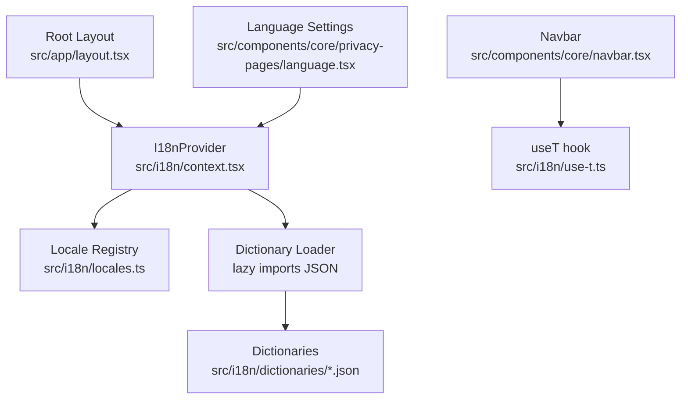
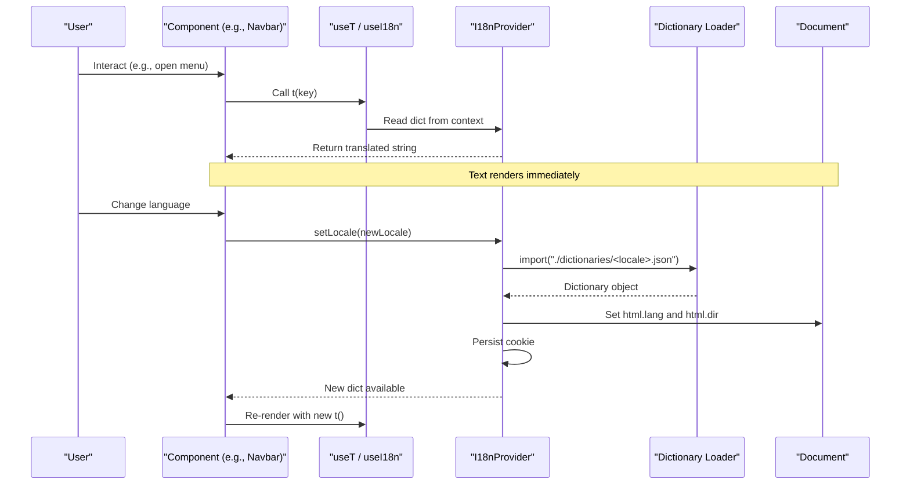
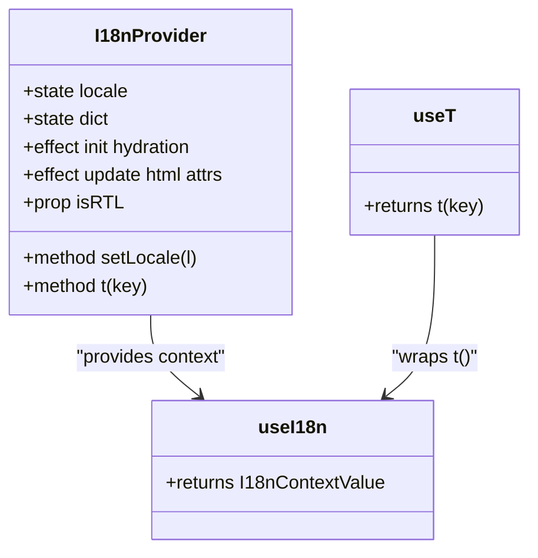
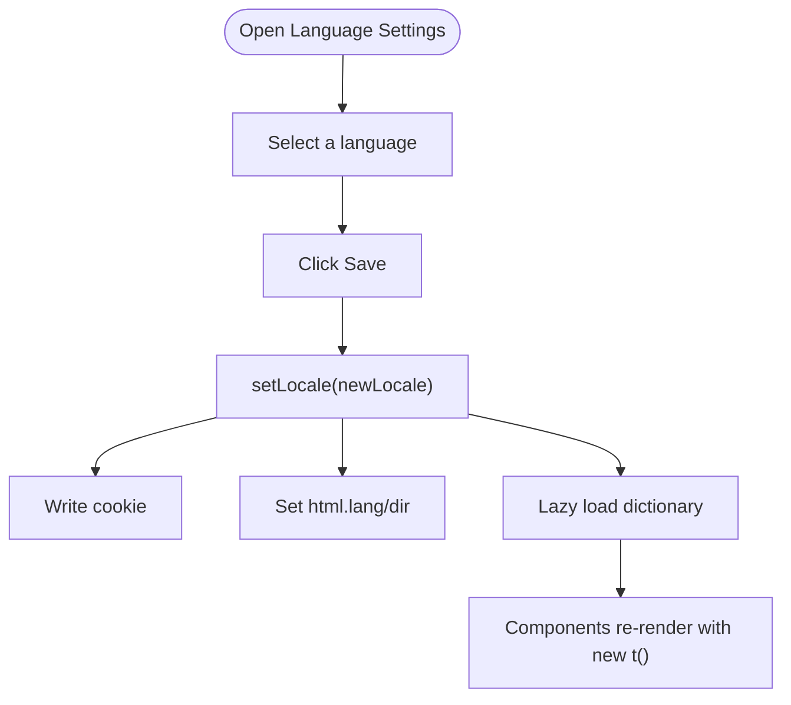
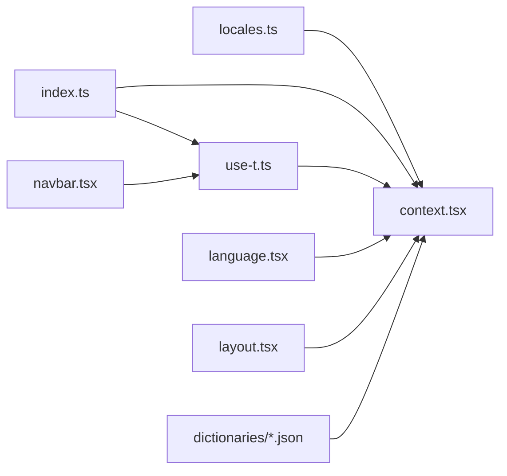

# Internationalization

<cite>
**Referenced Files in This Document**
- [index.ts](file://src/i18n/index.ts)
- [context.tsx](file://src/i18n/context.tsx)
- [use-t.ts](file://src/i18n/use-t.ts)
- [locales.ts](file://src/i18n/locales.ts)
- [en.json](file://src/i18n/dictionaries/en.json)
- [ar.json](file://src/i18n/dictionaries/ar.json)
- [ur.json](file://src/i18n/dictionaries/ur.json)
- [layout.tsx](file://src/app/layout.tsx)
- [navbar.tsx](file://src/components/core/navbar.tsx)
- [language.tsx](file://src/components/core/privacy-pages/language.tsx)
</cite>

## Table of Contents
1. [Introduction](#introduction)
2. [Project Structure](#project-structure)
3. [Core Components](#core-components)
4. [Architecture Overview](#architecture-overview)
5. [Detailed Component Analysis](#detailed-component-analysis)
6. [Dependency Analysis](#dependency-analysis)
7. [Performance Considerations](#performance-considerations)
8. [Troubleshooting Guide](#troubleshooting-guide)
9. [Conclusion](#conclusion)
10. [Appendices](#appendices)

## Introduction
This document explains the internationalization (i18n) system that supports 12 languages with right-to-left (RTL) layout for Arabic and Urdu. It covers translation context, dictionary structure, dynamic language switching, RTL implementation, and guidelines for adding new languages and testing. It also provides examples of how to implement i18n in new features and clarifies current capabilities and limitations around date/time formatting and number localization.

## Project Structure
The i18n system is implemented as a lightweight client-side provider with lazy-loaded JSON dictionaries:
- Provider and hooks live under src/i18n
- Dictionaries are stored per locale under src/i18n/dictionaries
- The root layout wraps the app with I18nProvider
- UI components consume translations via useT or useI18n

**Diagram sources**
- [layout.tsx:1-48](file://src/app/layout.tsx#L1-L48)
- [context.tsx:1-101](file://src/i18n/context.tsx#L1-L101)
- [locales.ts:1-34](file://src/i18n/locales.ts#L1-L34)
- [navbar.tsx:1-502](file://src/components/core/navbar.tsx#L1-L502)
- [language.tsx:1-98](file://src/components/core/privacy-pages/language.tsx#L1-L98)

**Section sources**
- [index.ts:1-5](file://src/i18n/index.ts#L1-L5)
- [context.tsx:1-101](file://src/i18n/context.tsx#L1-L101)
- [locales.ts:1-34](file://src/i18n/locales.ts#L1-L34)
- [layout.tsx:1-48](file://src/app/layout.tsx#L1-L48)

## Core Components
- I18nProvider: Initializes locale from cookie or browser detection, lazily loads the dictionary, persists selection via cookie, sets html lang and dir attributes, and exposes t, setLocale, locale, and isRTL.
- useI18n: Context consumer returning full i18n state and methods.
- useT: Convenience hook returning only the t function.
- locales: Central registry of supported locales, type definition, RTL list, and human-readable names.
- Dictionaries: Flat key-value JSON files per locale. Keys are dot-namespaced strings.

Key behaviors:
- Dynamic loading: Each locale’s dictionary is imported on demand.
- Persistence: Locale is saved to a cookie and restored on next load.
- Browser detection: Falls back to navigator.language if no cookie exists.
- RTL support: Sets document.documentElement.dir based on RTL_LOCALES.

**Section sources**
- [context.tsx:1-101](file://src/i18n/context.tsx#L1-L101)
- [use-t.ts:1-6](file://src/i18n/use-t.ts#L1-L6)
- [locales.ts:1-34](file://src/i18n/locales.ts#L1-L34)
- [en.json:1-533](file://src/i18n/dictionaries/en.json#L1-L533)
- [ar.json:1-577](file://src/i18n/dictionaries/ar.json#L1-L577)
- [ur.json:1-577](file://src/i18n/dictionaries/ur.json#L1-L577)

## Architecture Overview
The runtime flow for language switching and rendering localized content:

**Diagram sources**
- [context.tsx:42-101](file://src/i18n/context.tsx#L42-L101)
- [navbar.tsx:180-220](file://src/components/core/navbar.tsx#L180-L220)
- [language.tsx:1-98](file://src/components/core/privacy-pages/language.tsx#L1-L98)

## Detailed Component Analysis

### I18nProvider and Hooks
Responsibilities:
- Hydration-safe initialization using a ref guard
- Cookie-based persistence and browser fallback
- Lazy dictionary loading with English fallback
- Global HTML attribute updates for accessibility and layout direction
- Exposing t, setLocale, locale, and isRTL

Implementation highlights:
- Cookie read/write helpers ensure cross-session persistence
- detectBrowserLocale normalizes navigator.language to supported codes
- loadDictionary maps each Locale to a dynamic import; missing keys fall back to English
- Effect updates document.documentElement.lang and .dir whenever locale changes

**Diagram sources**
- [context.tsx:1-101](file://src/i18n/context.tsx#L1-L101)
- [use-t.ts:1-6](file://src/i18n/use-t.ts#L1-L6)

**Section sources**
- [context.tsx:1-101](file://src/i18n/context.tsx#L1-L101)
- [use-t.ts:1-6](file://src/i18n/use-t.ts#L1-L6)

### Locale Registry and Names
- LOCALES: Array of supported language codes
- Locale: Type derived from LOCALES
- RTL_LOCALES: List of locales requiring RTL layout
- LOCALE_NAMES: Human-readable labels used by the language selector

Usage example:
- Language settings component enumerates LOCALES and displays LOCALE_NAMES mapped through t for consistent labeling.

**Section sources**
- [locales.ts:1-34](file://src/i18n/locales.ts#L1-L34)
- [language.tsx:1-98](file://src/components/core/privacy-pages/language.tsx#L1-L98)

### Dictionary Structure
- Flat JSON objects keyed by dot-namespaced strings
- Example namespaces: common.*, nav.*, auth.*, profile.*, book.*, admin.*
- All 12 locales include these namespaces to ensure consistent coverage

Guidelines:
- Use descriptive, hierarchical keys
- Keep values short and translatable
- Avoid embedding variables directly; use placeholders where needed

**Section sources**
- [en.json:1-533](file://src/i18n/dictionaries/en.json#L1-L533)
- [ar.json:1-577](file://src/i18n/dictionaries/ar.json#L1-L577)
- [ur.json:1-577](file://src/i18n/dictionaries/ur.json#L1-L577)

### Dynamic Language Switching
- The Language settings page lets users pick a language and save it
- Saving triggers setLocale, which:
  - Persists the choice to a cookie
  - Updates html.lang and html.dir
  - Loads the corresponding dictionary
  - Causes all components using useT/useI18n to re-render with new text

**Diagram sources**
- [language.tsx:1-98](file://src/components/core/privacy-pages/language.tsx#L1-L98)
- [context.tsx:66-101](file://src/i18n/context.tsx#L66-L101)

**Section sources**
- [language.tsx:1-98](file://src/components/core/privacy-pages/language.tsx#L1-L98)
- [context.tsx:66-101](file://src/i18n/context.tsx#L66-L101)

### RTL Layout Implementation
- RTL_LOCALES includes Arabic and Urdu
- On locale change, document.documentElement.dir is set to rtl or ltr accordingly
- This automatically mirrors layouts that rely on logical CSS properties (start/end margins, flex directions)

Recommendations:
- Prefer logical properties (margin-inline-start, padding-inline-end)
- Ensure icons and images do not assume LTR-only orientation
- Test menus, drawers, and popovers in RTL

**Section sources**
- [locales.ts:18-18](file://src/i18n/locales.ts#L18-L18)
- [context.tsx:78-83](file://src/i18n/context.tsx#L78-L83)

### Date/Time Formatting and Number Localization
Current status:
- No dedicated date/time or number formatters are provided by the i18n module
- Some components may use simple formatting utilities or browser APIs

Guidance:
- For relative times, consider Intl.RelativeTimeFormat with the active locale
- For absolute dates/times, use Intl.DateTimeFormat with the active locale
- For numbers/currencies, use Intl.NumberFormat with currency and locale options
- Centralize these utilities in a small helper and pass the current locale from useI18n

[No sources needed since this section provides general guidance]

## Dependency Analysis
High-level dependencies between i18n modules and UI:

**Diagram sources**
- [index.ts:1-5](file://src/i18n/index.ts#L1-L5)
- [context.tsx:1-101](file://src/i18n/context.tsx#L1-L101)
- [use-t.ts:1-6](file://src/i18n/use-t.ts#L1-L6)
- [locales.ts:1-34](file://src/i18n/locales.ts#L1-L34)
- [navbar.tsx:1-502](file://src/components/core/navbar.tsx#L1-L502)
- [language.tsx:1-98](file://src/components/core/privacy-pages/language.tsx#L1-L98)
- [layout.tsx:1-48](file://src/app/layout.tsx#L1-L48)

**Section sources**
- [index.ts:1-5](file://src/i18n/index.ts#L1-L5)
- [context.tsx:1-101](file://src/i18n/context.tsx#L1-L101)
- [navbar.tsx:1-502](file://src/components/core/navbar.tsx#L1-L502)
- [language.tsx:1-98](file://src/components/core/privacy-pages/language.tsx#L1-L98)
- [layout.tsx:1-48](file://src/app/layout.tsx#L1-L48)

## Performance Considerations
- Lazy loading: Each dictionary is dynamically imported only when needed, reducing initial bundle size.
- Cookie persistence avoids repeated detection and ensures fast restore on reload.
- Single source of truth: One context value prevents redundant lookups.
- Recommendations:
  - Keep dictionaries lean; avoid large inline assets
  - Preload critical dictionaries if you anticipate immediate usage
  - Consider memoizing formatted outputs if frequently recomputed

[No sources needed since this section provides general guidance]

## Troubleshooting Guide
Common issues and resolutions:
- Missing translation key:
  - Symptom: Key string rendered verbatim
  - Cause: Key not present in the active dictionary
  - Fix: Add the key to all dictionaries or implement a fallback strategy
- Language not changing:
  - Check that setLocale is called and cookie is written
  - Verify html.dir and html.lang update after change
- RTL misalignment:
  - Confirm locale is in RTL_LOCALES
  - Review CSS for hard-coded left/right properties; prefer logical properties
- Initial render mismatch:
  - Ensure hydration guard prevents premature reads before cookie/browser detection

**Section sources**
- [context.tsx:24-83](file://src/i18n/context.tsx#L24-L83)
- [locales.ts:18-18](file://src/i18n/locales.ts#L18-L18)

## Conclusion
The i18n system provides a robust foundation for multi-language support with automatic RTL handling and persistent user preferences. It uses a simple, scalable dictionary model and minimal runtime overhead. To extend functionality, add new locales and dictionaries, integrate centralized formatters for dates and numbers, and validate RTL behavior across components.

[No sources needed since this section summarizes without analyzing specific files]

## Appendices

### Adding a New Language
Steps:
1. Add the code to LOCALES and LOCALE_NAMES in locales.ts
2. Create a new dictionary file in src/i18n/dictionaries/<code>.json with all required keys
3. Add the mapping in loadDictionary within context.tsx
4. Test language selection, persistence, and RTL if applicable

**Section sources**
- [locales.ts:1-34](file://src/i18n/locales.ts#L1-L34)
- [context.tsx:42-64](file://src/i18n/context.tsx#L42-L64)

### Managing Translations
Best practices:
- Use clear, hierarchical keys (e.g., feature.section.item)
- Keep values concise and free of embedded logic
- Maintain parity across all dictionaries to prevent fallbacks
- Use placeholders for dynamic content and format at render time

**Section sources**
- [en.json:1-533](file://src/i18n/dictionaries/en.json#L1-L533)
- [ar.json:1-577](file://src/i18n/dictionaries/ar.json#L1-L577)
- [ur.json:1-577](file://src/i18n/dictionaries/ur.json#L1-L577)

### Testing Internationalized Components
Checklist:
- Verify all visible strings resolve via t()
- Toggle language and confirm persistence via cookie
- Validate RTL layout for Arabic and Urdu
- Inspect html.lang and html.dir attributes
- Confirm no hardcoded strings remain outside dictionaries

**Section sources**
- [navbar.tsx:180-220](file://src/components/core/navbar.tsx#L180-L220)
- [language.tsx:1-98](file://src/components/core/privacy-pages/language.tsx#L1-L98)
- [context.tsx:78-83](file://src/i18n/context.tsx#L78-L83)

### Implementing i18n in New Features
Examples:
- Navigation labels:
  - Define keys like nav.bookRide and render with t(nav.bookRide)
- Form labels and placeholders:
  - Use keys such as auth.login.phoneLabel and auth.login.phonePlaceholder
- Error messages and notifications:
  - Centralize under profile.* or common.* namespaces
- Language settings:
  - Use useI18n().setLocale and LOCALE_NAMES for display

**Section sources**
- [navbar.tsx:54-121](file://src/components/core/navbar.tsx#L54-L121)
- [language.tsx:1-98](file://src/components/core/privacy-pages/language.tsx#L1-L98)
- [en.json:1-533](file://src/i18n/dictionaries/en.json#L1-L533)