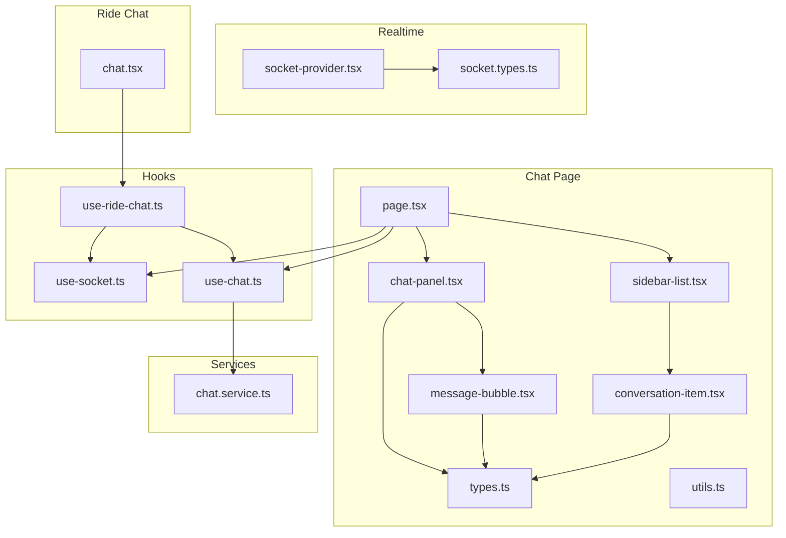
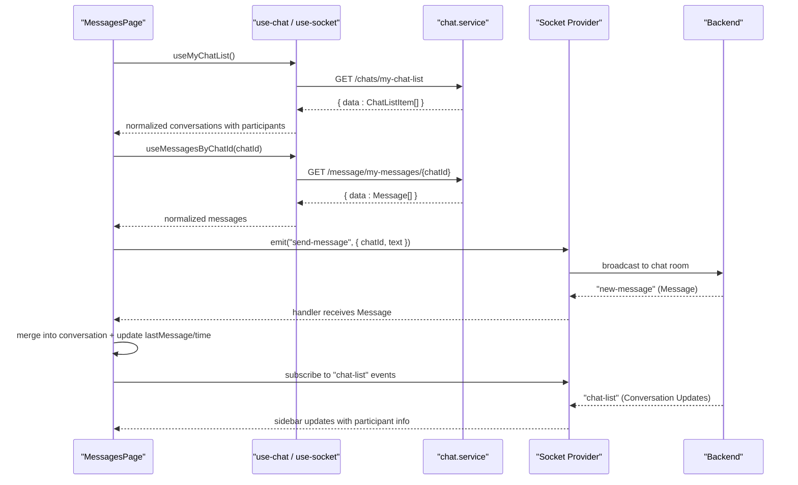
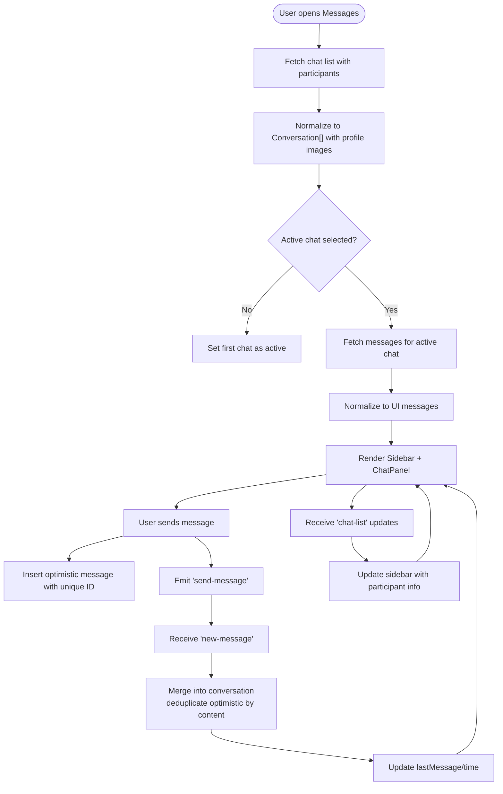
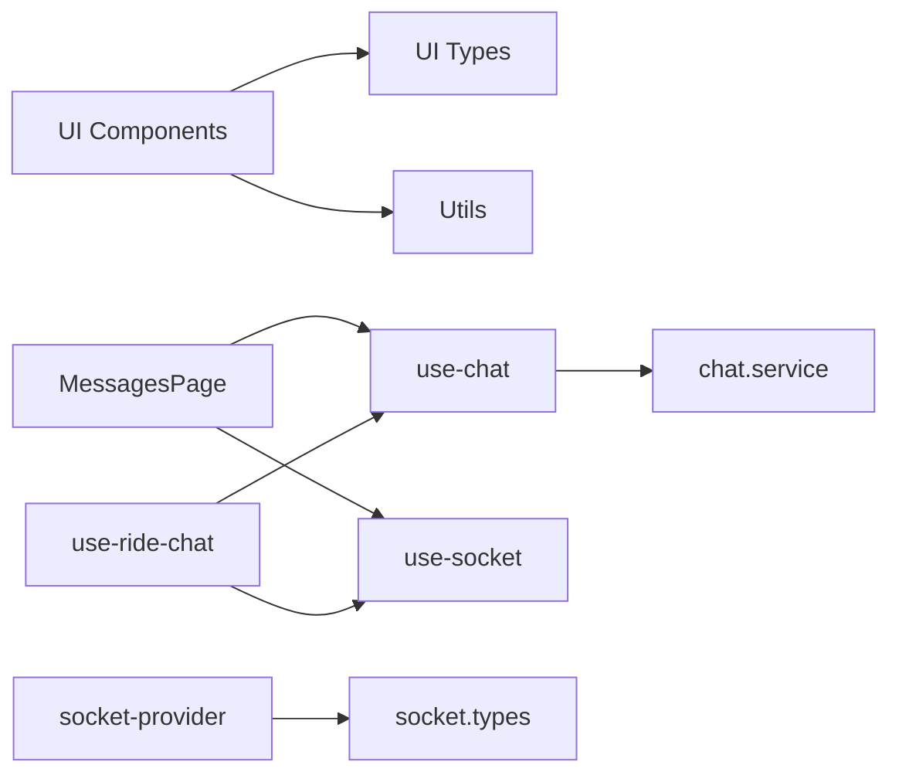

# Chat System

<cite>
**Referenced Files in This Document**
- [page.tsx](file://src/app/message/page.tsx)
- [chat-panel.tsx](file://src/app/message/_components/chat-panel.tsx)
- [conversation-item.tsx](file://src/app/message/_components/conversation-item.tsx)
- [message-bubble.tsx](file://src/app/message/_components/message-bubble.tsx)
- [sidebar-list.tsx](file://src/app/message/_components/sidebar-list.tsx)
- [types.ts](file://src/app/message/types.ts)
- [utils.ts](file://src/app/message/utils.ts)
- [use-chat.ts](file://src/hooks/shared/use-chat.ts)
- [chat.service.ts](file://src/services/chat.service.ts)
- [socket-provider.tsx](file://src/provider/socket-provider.tsx)
- [use-socket.ts](file://src/hooks/shared/use-socket.ts)
- [socket.types.ts](file://src/types/socket.types.ts)
- [chat.types.ts](file://src/types/chat.types.ts)
- [chat.tsx](file://src/app/(view)/my-rides/[id]/chat.tsx)
- [use-ride-chat.ts](file://src/hooks/shared/use-ride-chat.ts)
</cite>

## Update Summary
**Changes Made**
- Updated file paths from `src/app/(view)/message/` to `src/app/message/` throughout the documentation
- Updated socket event names from legacy `chat:message` to new `new-message` and `chat-list` events
- Enhanced real-time communication architecture with improved optimistic updates and deduplication logic
- Updated conversation management with sophisticated participant information through ChatParticipant and ChatBooking interfaces
- Improved mobile-responsive design implementation with conditional rendering based on screen size
- Enhanced socket integration with better event handling, state management, and error handling for booking-specific chats
- Expanded message types with read receipts support and edit history fields (isEdited)
- Added enhanced error handling and retry logic for booking-specific chats with lazy chat creation

## Table of Contents
1. Introduction
2. Project Structure
3. Core Components
4. Architecture Overview
5. Detailed Component Analysis
6. Dependency Analysis
7. Performance Considerations
8. Troubleshooting Guide
9. Conclusion

## Introduction
This document explains the real-time chat system implementation, covering message sending and receiving workflows, conversation management, and message persistence. It details the chat interface components (message bubble rendering and conversation list), the use-chat hook for data operations, the chat service layer for API integration, and real-time updates via WebSocket events using the new 'new-message' and 'chat-list' event patterns. It also includes guidance on implementing new features, handling message types, managing state, user presence indicators, message status tracking, and chat room management with enhanced mobile-responsive design and sophisticated participant information.

## Project Structure
The chat feature is implemented as a client-side Next.js application with:
- A main chat page at `src/app/message/` that manages conversations and messages with enhanced mobile-responsive design
- Reusable UI components for the sidebar, conversation list, and message bubbles
- React Query hooks for data fetching and mutations with improved error handling
- A service layer for REST API calls
- An enhanced Socket.IO-based provider and hooks for real-time communication with new event patterns (`new-message`, `chat-list`)
- Type definitions for chat entities and socket events including ChatParticipant and ChatBooking interfaces with profile images and online status
- A ride-specific chat component integrated into the ride detail view with lazy chat creation and improved message synchronization

**Diagram sources**
- [page.tsx:1-386](file://src/app/message/page.tsx#L1-L386)
- [sidebar-list.tsx:1-41](file://src/app/message/_components/sidebar-list.tsx#L1-L41)
- [chat-panel.tsx:1-184](file://src/app/message/_components/chat-panel.tsx#L1-L184)
- [conversation-item.tsx:1-64](file://src/app/message/_components/conversation-item.tsx#L1-L64)
- [message-bubble.tsx:1-56](file://src/app/message/_components/message-bubble.tsx#L1-L56)
- [types.ts:1-22](file://src/app/message/types.ts#L1-L22)
- [utils.ts:1-17](file://src/app/message/utils.ts#L1-L17)
- [use-chat.ts:1-95](file://src/hooks/shared/use-chat.ts#L1-L95)
- [chat.service.ts:1-51](file://src/services/chat.service.ts#L1-L51)
- [socket-provider.tsx:1-123](file://src/provider/socket-provider.tsx#L1-L123)
- [use-socket.ts:1-57](file://src/hooks/shared/use-socket.ts#L1-L57)
- [socket.types.ts:1-304](file://src/types/socket.types.ts#L1-304)
- [chat.tsx](file://src/app/(view)/my-rides/[id]/chat.tsx#L1-L143)
- [use-ride-chat.ts:1-116](file://src/hooks/shared/use-ride-chat.ts#L1-L116)

**Section sources**
- [page.tsx:1-386](file://src/app/message/page.tsx#L1-L386)
- [chat-panel.tsx:1-184](file://src/app/message/_components/chat-panel.tsx#L1-L184)
- [conversation-item.tsx:1-64](file://src/app/message/_components/conversation-item.tsx#L1-L64)
- [message-bubble.tsx:1-56](file://src/app/message/_components/message-bubble.tsx#L1-L56)
- [sidebar-list.tsx:1-41](file://src/app/message/_components/sidebar-list.tsx#L1-L41)
- [types.ts:1-22](file://src/app/message/types.ts#L1-L22)
- [utils.ts:1-17](file://src/app/message/utils.ts#L1-L17)
- [use-chat.ts:1-95](file://src/hooks/shared/use-chat.ts#L1-L95)
- [chat.service.ts:1-51](file://src/services/chat.service.ts#L1-L51)
- [socket-provider.tsx:1-123](file://src/provider/socket-provider.tsx#L1-L123)
- [use-socket.ts:1-57](file://src/hooks/shared/use-socket.ts#L1-L57)
- [socket.types.ts:1-304](file://src/types/socket.types.ts#L1-304)
- [chat.tsx](file://src/app/(view)/my-rides/[id]/chat.tsx#L1-L143)
- [use-ride-chat.ts:1-116](file://src/hooks/shared/use-ride-chat.ts#L1-L116)

## Core Components
- MessagesPage orchestrates conversation selection, message normalization, optimistic send, and real-time update handling with enhanced mobile-responsive design and sophisticated participant information.
- SidebarList renders the list of conversations with last message preview, unread counts, and online presence indicators.
- ConversationItem displays participant info, online presence indicator, time formatting, and unread badge with profile image support.
- ChatPanel shows the active conversation, message bubbles, quick suggestions, and input area with improved UX and avatar grouping logic.
- MessageBubble renders individual messages with avatar grouping logic and enhanced styling.
- use-chat provides React Query hooks for chat list, messages, creation, status updates, and seen marking with improved error handling.
- chat.service encapsulates REST endpoints for chats and messages with comprehensive CRUD operations.
- Enhanced Socket infrastructure (provider and hooks) manages connection lifecycle, event dispatching, and typed emit/on helpers with new 'new-message' and 'chat-list' events.
- Ride chat integrates a compact chat popover within the ride detail flow with lazy chat creation, improved message synchronization, and automatic read receipt handling.

**Section sources**
- [page.tsx:1-386](file://src/app/message/page.tsx#L1-L386)
- [sidebar-list.tsx:1-41](file://src/app/message/_components/sidebar-list.tsx#L1-L41)
- [conversation-item.tsx:1-64](file://src/app/message/_components/conversation-item.tsx#L1-L64)
- [chat-panel.tsx:1-184](file://src/app/message/_components/chat-panel.tsx#L1-L184)
- [message-bubble.tsx:1-56](file://src/app/message/_components/message-bubble.tsx#L1-L56)
- [use-chat.ts:1-95](file://src/hooks/shared/use-chat.ts#L1-L95)
- [chat.service.ts:1-51](file://src/services/chat.service.ts#L1-L51)
- [socket-provider.tsx:1-123](file://src/provider/socket-provider.tsx#L1-L123)
- [use-socket.ts:1-57](file://src/hooks/shared/use-socket.ts#L1-L57)
- [chat.tsx](file://src/app/(view)/my-rides/[id]/chat.tsx#L1-L143)
- [use-ride-chat.ts:1-116](file://src/hooks/shared/use-ride-chat.ts#L1-L116)

## Architecture Overview
The chat system combines REST APIs for persistence and WebSocket for real-time updates using the new 'new-message' and 'chat-list' event patterns. The page subscribes to server events and merges incoming messages into local state with enhanced optimistic updates and deduplication logic. The ride chat uses a dedicated hook to lazily create or fetch a chat per booking and syncs messages similarly with improved error handling and retry logic.

**Diagram sources**
- [page.tsx:1-386](file://src/app/message/page.tsx#L1-L386)
- [use-chat.ts:1-95](file://src/hooks/shared/use-chat.ts#L1-L95)
- [chat.service.ts:1-51](file://src/services/chat.service.ts#L1-L51)
- [socket-provider.tsx:1-123](file://src/provider/socket-provider.tsx#L1-L123)
- [use-socket.ts:1-57](file://src/hooks/shared/use-socket.ts#L1-L57)

## Detailed Component Analysis

### MessagesPage
Responsibilities:
- Fetches chat list and messages using React Query hooks with enhanced error handling.
- Normalizes API responses to UI models (messages and conversations) with sophisticated ChatParticipant support including profile images and online status.
- Manages active conversation selection and mobile navigation with responsive design.
- Implements optimistic message sending by inserting a temporary message before server echo with deduplication logic.
- Subscribes to "new-message" and "chat-list" events and merges them into the correct conversation, deduplicating optimistic entries.

Key behaviors:
- Mapping functions convert API messages and chats to UI types, handling flexible fields (e.g., lastMessage as string or object) and enhanced participant information.
- State updates preserve previous conversation data while refreshing last message and timestamps with optimized comparison logic.
- Incoming messages are appended only if not already present by id; optimistic duplicates are removed when server echoes with content-based matching.
- Enhanced mobile-responsive layout with conditional rendering based on screen size and back button navigation.

**Diagram sources**
- [page.tsx:1-386](file://src/app/message/page.tsx#L1-L386)

**Section sources**
- [page.tsx:1-386](file://src/app/message/page.tsx#L1-L386)

### Chat Panel and Message Bubble
Responsibilities:
- ChatPanel renders header with participant info, scrollable message list, quick suggestion buttons, and input area with enhanced UX.
- Groups consecutive messages from the same sender to show avatars only at group boundaries with improved avatar display logic.
- MessageBubble renders each message with alignment and styling based on sender identity and enhanced visual feedback.

Features:
- Auto-scroll to bottom on new messages with smooth scrolling behavior.
- Keyboard support (Enter to send) with proper focus management.
- Placeholder content and suggested prompts for empty states with internationalization support.
- Enhanced mobile-responsive design with back button navigation and adaptive layouts.

**Section sources**
- [chat-panel.tsx:1-184](file://src/app/message/_components/chat-panel.tsx#L1-L184)
- [message-bubble.tsx:1-56](file://src/app/message/_components/message-bubble.tsx#L1-L56)

### Conversation List and Presence
Responsibilities:
- SidebarList renders a scrollable list of conversations with optimized rendering performance.
- ConversationItem shows participant avatar/name, last message preview, relative timestamp, unread count, and online presence indicator with profile image support.

Presence:
- Online indicator is rendered when participant.isOnline is true with visual feedback.
- Profile images are displayed with fallback to initials when images are unavailable.

Time formatting:
- Uses a utility to format relative time strings with multiple granularity levels.

**Section sources**
- [sidebar-list.tsx:1-41](file://src/app/message/_components/sidebar-list.tsx#L1-L41)
- [conversation-item.tsx:1-64](file://src/app/message/_components/conversation-item.tsx#L1-L64)
- [utils.ts:1-17](file://src/app/message/utils.ts#L1-L17)

### Data Types
- UI types define Message and Conversation structures used by components with enhanced participant information.
- API types define Chat, Message, payloads, and statuses consumed by hooks and services with sophisticated participant and booking interfaces.
- Enhanced ChatParticipant and ChatBooking interfaces provide detailed participant information including profile images, online status, and booking context.

**Section sources**
- [types.ts:1-22](file://src/app/message/types.ts#L1-L22)
- [chat.types.ts:1-80](file://src/types/chat.types.ts#L1-80)

### use-chat Hook
Responsibilities:
- Provides query keys and hooks for:
  - Creating chats with improved error handling
  - Listing my chats with search functionality
  - Getting chat by booking id with retry logic
  - Updating chat status
  - Fetching messages by chat id
  - Updating messages with edit history support
  - Marking messages seen
  - Deleting conversations

Integration:
- Uses chat.service for HTTP calls with comprehensive error handling.
- Invalidates relevant queries on mutations to keep UI consistent with optimized cache management.

**Section sources**
- [use-chat.ts:1-95](file://src/hooks/shared/use-chat.ts#L1-L95)

### Chat Service Layer
Responsibilities:
- Encapsulates REST endpoints for chats and messages with comprehensive CRUD operations.
- Methods include creating chats, listing chats, fetching by id/booking, updating status, getting/updating/deleting messages, marking seen, and deleting conversations.

Endpoints:
- Chats: POST /chats, GET /chats/my-chat-list, GET /chats/{id}, PATCH /chats/{id}, DELETE /chats/{id}, GET /chats/booking/{bookingId}
- Messages: GET /message/my-messages/{chatId}, GET /messages/{id}, PATCH /messages/update/{id}, PATCH /messages/seen/{id}, DELETE /messages/{id}, DELETE /messages/chat/{chatId}

**Section sources**
- [chat.service.ts:1-51](file://src/services/chat.service.ts#L1-L51)

### Real-time Communication (WebSocket)
Responsibilities:
- socket-provider.tsx connects/disconnects, reattaches to rooms, and registers handlers for all known events including enhanced chat events with new event patterns.
- use-socket.ts exposes typed emit/on/off helpers and a convenience hook to subscribe to an event for the component lifetime.
- socket.types.ts defines typed client-to-server and server-to-client events, including new 'new-message' and 'chat-list' events instead of legacy 'chat:message'.

Events:
- Client emits: "send-message", "chat:seen"
- Server emits: "new-message", "chat-list", "chat:seen"

Room management:
- Provider joins ride rooms via "room:join" after connect, ensuring real-time updates for active rides with persistent room management.

**Updated** Enhanced with new event patterns ('new-message', 'chat-list'), improved type safety, and better error handling

**Section sources**
- [socket-provider.tsx:1-123](file://src/provider/socket-provider.tsx#L1-L123)
- [use-socket.ts:1-57](file://src/hooks/shared/use-socket.ts#L1-L57)
- [socket.types.ts:1-304](file://src/types/socket.types.ts#L1-304)

### Ride Chat Integration
Responsibilities:
- use-ride-chat lazily creates a 1:1 chat for a booking if missing, then fetches and syncs messages with improved error handling and retry logic.
- Subscribes to "new-message" and appends new messages to local state with deduplication.
- Marks unseen messages as seen automatically with read receipt support.
- chat.tsx renders a compact popover chat with send functionality and enhanced user experience.

Flow:
- If chat by booking id is missing or errored, it triggers creation with participants [myId, otherUserId] and handles errors gracefully.
- After creation, invalidates the booking query to refetch and populate chat id with optimistic updates.
- Merges messages from either the chat response or separate messages query with intelligent fallback logic.

**Updated** Enhanced with new 'new-message' event handling, improved message synchronization, lazy chat creation, and automatic read receipt processing

**Section sources**
- [use-ride-chat.ts:1-116](file://src/hooks/shared/use-ride-chat.ts#L1-L116)
- [chat.tsx](file://src/app/(view)/my-rides/[id]/chat.tsx#L1-L143)

## Dependency Analysis
High-level dependencies:
- UI components depend on UI types and utilities with enhanced participant information.
- MessagesPage depends on use-chat and use-socket with improved error handling.
- use-chat depends on chat.service with comprehensive API coverage.
- socket-provider depends on socket.types with new event patterns.
- use-ride-chat composes use-chat and use-socket with lazy initialization logic.

**Diagram sources**
- [page.tsx:1-386](file://src/app/message/page.tsx#L1-L386)
- [use-chat.ts:1-95](file://src/hooks/shared/use-chat.ts#L1-L95)
- [chat.service.ts:1-51](file://src/services/chat.service.ts#L1-L51)
- [socket-provider.tsx:1-123](file://src/provider/socket-provider.tsx#L1-L123)
- [use-socket.ts:1-57](file://src/hooks/shared/use-socket.ts#L1-L57)
- [socket.types.ts:1-304](file://src/types/socket.types.ts#L1-304)
- [use-ride-chat.ts:1-116](file://src/hooks/shared/use-ride-chat.ts#L1-L116)

**Section sources**
- [page.tsx:1-386](file://src/app/message/page.tsx#L1-L386)
- [use-chat.ts:1-95](file://src/hooks/shared/use-chat.ts#L1-L95)
- [chat.service.ts:1-51](file://src/services/chat.service.ts#L1-L51)
- [socket-provider.tsx:1-123](file://src/provider/socket-provider.tsx#L1-L123)
- [use-socket.ts:1-57](file://src/hooks/shared/use-socket.ts#L1-L57)
- [socket.types.ts:1-304](file://src/types/socket.types.ts#L1-304)
- [use-ride-chat.ts:1-116](file://src/hooks/shared/use-ride-chat.ts#L1-L116)

## Performance Considerations
- Prefer optimistic updates for immediate UI feedback; rely on server echo to replace placeholders and avoid duplicate renders with content-based deduplication.
- Normalize data efficiently using memoization to prevent unnecessary re-renders with optimized comparison logic.
- Deduplicate incoming messages by id and content to prevent redundant appends and improve performance.
- Keep socket event handlers lightweight; offload heavy processing outside the handler with efficient state updates.
- Use pagination or virtualization for large message lists if needed with lazy loading strategies.
- Avoid frequent query invalidations; batch updates where possible with optimized cache management.
- Enhanced mobile-responsive design reduces unnecessary re-renders on different screen sizes with conditional rendering.
- Implement profile image caching and fallback strategies for better user experience.

## Troubleshooting Guide
Common issues and resolutions:
- No messages appear after sending:
  - Ensure "send-message" is emitted and "new-message" is subscribed with proper event handling.
  - Verify server echoes messages with matching chat id and unique ids with enhanced validation.
- Duplicate messages:
  - Confirm deduplication logic checks existing ids and removes optimistic duplicates with content-based matching.
- Unread counts not updating:
  - Check that "chat:seen" events are handled and UI reflects read state with proper state synchronization.
- Connection problems:
  - Validate socket URL configuration and cookie-based token availability with enhanced error logging.
  - Inspect provider logs for connect/disconnect events with improved error reporting.
- Mobile responsiveness issues:
  - Check conditional rendering logic for mobile vs desktop views with proper breakpoint handling.
  - Verify CSS classes for responsive breakpoints with modern CSS frameworks.
- Participant information not displaying:
  - Ensure ChatParticipant interfaces are properly mapped with profile images and online status.
  - Check that chat-list events include complete participant information.

**Updated** Added troubleshooting for new event patterns ('new-message', 'chat-list'), mobile responsiveness, and participant information display

**Section sources**
- [page.tsx:1-386](file://src/app/message/page.tsx#L1-L386)
- [socket-provider.tsx:1-123](file://src/provider/socket-provider.tsx#L1-L123)
- [use-socket.ts:1-57](file://src/hooks/shared/use-socket.ts#L1-L57)
- [socket.types.ts:1-304](file://src/types/socket.types.ts#L1-304)

## Conclusion
The chat system integrates REST APIs for persistence and WebSocket for real-time messaging using the enhanced 'new-message' and 'chat-list' event patterns. The architecture separates concerns across UI components, hooks, services, and socket infrastructure, enabling scalable features like optimistic sends, presence indicators, and ride-specific chat flows with improved mobile-responsive design and sophisticated participant information. Following the patterns documented here will simplify adding new message types, enhancing state management, and extending real-time capabilities with the updated event system and enhanced ChatParticipant and ChatBooking interfaces for rich user profiles and booking context.