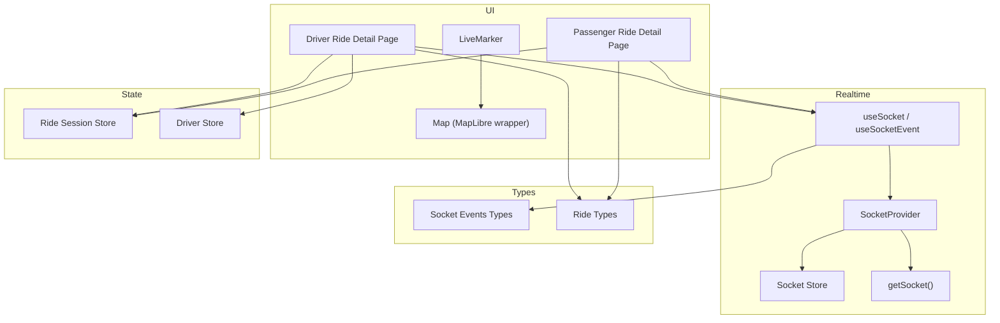
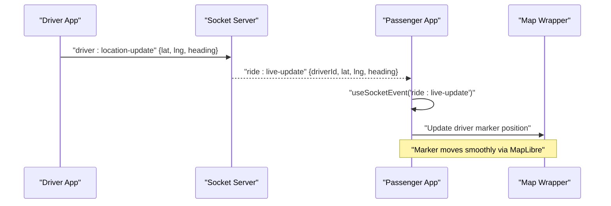
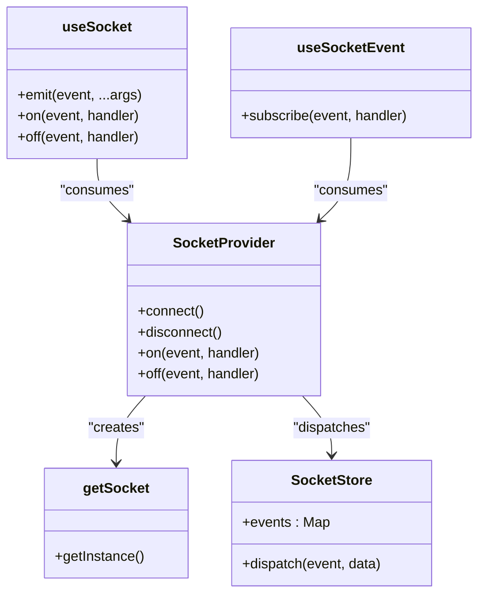
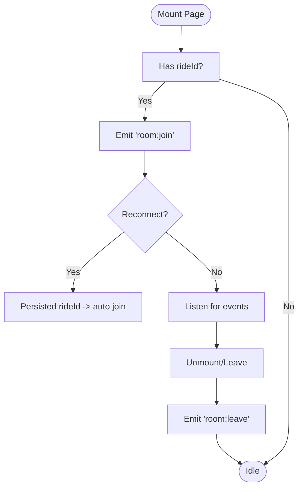
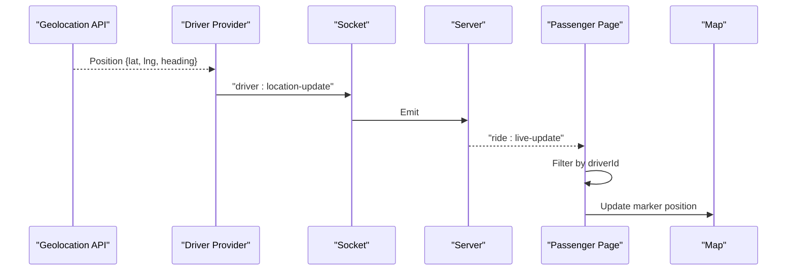
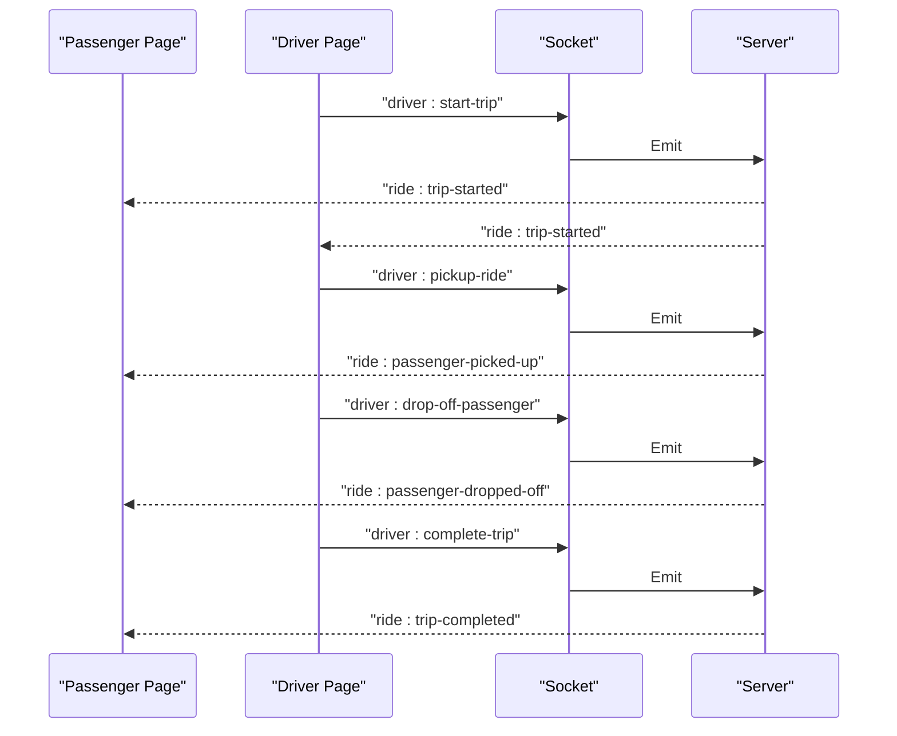
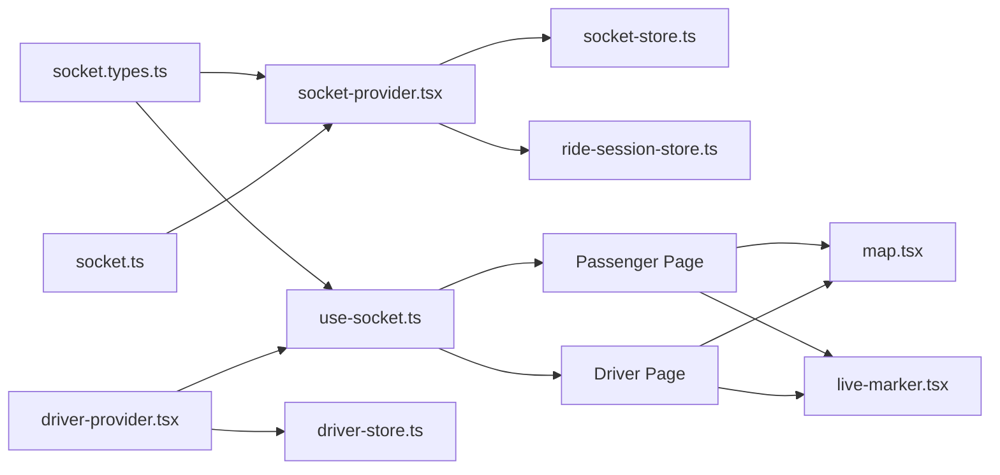

# Live Features

<cite>
**Referenced Files in This Document**
- [live-marker.tsx](file://src/components/core/live-marker.tsx)
- [ride-session-store.ts](file://src/store/ride-session-store.ts)
- [use-socket.ts](file://src/hooks/shared/use-socket.ts)
- [socket.ts](file://src/lib/socket.ts)
- [socket.types.ts](file://src/types/socket.types.ts)
- [socket-provider.tsx](file://src/provider/socket-provider.tsx)
- [socket-store.ts](file://src/store/socket-store.ts)
- [map.tsx](file://src/components/ui/map.tsx)
- [page.tsx (passenger ride detail)](file://src/app/(view)/my-rides/[id]/page.tsx)
- [page.tsx (driver ride detail)](file://src/app/driver/(view)/my-rides/[id]/page.tsx)
- [driver-provider.tsx](file://src/app/driver/driver-provider.tsx)
- [driver-store.ts](file://src/store/driver-store.ts)
- [use-ride.ts](file://src/hooks/booking/use-ride.ts)
- [use-driver-ride.ts](file://src/hooks/driver/use-driver-ride.ts)
- [ride.types.ts](file://src/types/ride.types.ts)
</cite>

## Table of Contents
1. [Introduction](#introduction)
2. [Project Structure](#project-structure)
3. [Core Components](#core-components)
4. [Architecture Overview](#architecture-overview)
5. [Detailed Component Analysis](#detailed-component-analysis)
6. [Dependency Analysis](#dependency-analysis)
7. [Performance Considerations](#performance-considerations)
8. [Troubleshooting Guide](#troubleshooting-guide)
9. [Conclusion](#conclusion)
10. [Appendices](#appendices)

## Introduction
This document explains the live real-time features for location tracking, ride status updates, and driver-passenger synchronization. It covers:
- The live marker component used to visualize moving vehicles and users on the map
- Ride session management across pages and reconnects
- Event-driven architecture for ride lifecycle events and passenger-driver communication
- Real-time map updates using a MapLibre-based map wrapper
- Driver availability tracking and ride progress monitoring
- Practical examples for adding new live features, handling location streams, and optimizing performance

## Project Structure
The live features span UI components, hooks, providers, stores, types, and page-level logic:
- UI layer: LiveMarker and Map components render real-time positions
- Communication layer: Socket provider, hook, and typed event contracts
- State layer: Ride session store and driver store manage active rides and driver state
- Pages: Passenger and driver ride detail pages orchestrate room joins, GPS watching, and UI updates

**Diagram sources**
- [live-marker.tsx](file://src/components/core/live-marker.tsx)
- [map.tsx](file://src/components/ui/map.tsx)
- [socket-provider.tsx](file://src/provider/socket-provider.tsx)
- [use-socket.ts](file://src/hooks/shared/use-socket.ts)
- [socket-store.ts](file://src/store/socket-store.ts)
- [socket.ts](file://src/lib/socket.ts)
- [ride-session-store.ts](file://src/store/ride-session-store.ts)
- [driver-store.ts](file://src/store/driver-store.ts)
- [socket.types.ts](file://src/types/socket.types.ts)
- [ride.types.ts](file://src/types/ride.types.ts)
- [page.tsx (passenger ride detail)](file://src/app/(view)/my-rides/[id]/page.tsx)
- [page.tsx (driver ride detail)](file://src/app/driver/(view)/my-rides/[id]/page.tsx)

**Section sources**
- [live-marker.tsx](file://src/components/core/live-marker.tsx)
- [map.tsx](file://src/components/ui/map.tsx)
- [socket-provider.tsx](file://src/provider/socket-provider.tsx)
- [use-socket.ts](file://src/hooks/shared/use-socket.ts)
- [socket-store.ts](file://src/store/socket-store.ts)
- [socket.ts](file://src/lib/socket.ts)
- [ride-session-store.ts](file://src/store/ride-session-store.ts)
- [driver-store.ts](file://src/store/driver-store.ts)
- [socket.types.ts](file://src/types/socket.types.ts)
- [ride.types.ts](file://src/types/ride.types.ts)
- [page.tsx (passenger ride detail)](file://src/app/(view)/my-rides/[id]/page.tsx)
- [page.tsx (driver ride detail)](file://src/app/driver/(view)/my-rides/[id]/page.tsx)

## Core Components
- LiveMarker: A small avatar-like marker with an animated ping ring, used to represent drivers or passengers on the map.
- Map wrapper: A MapLibre-based React component that manages map instance, markers, routes, and viewport control.
- Socket infrastructure: Provider initializes and centralizes socket connection; hook provides emit/on/off utilities; typed events ensure type safety.
- Stores: Ride session store persists the active ride ID across reloads; driver store tracks driver location and incoming requests.

Key responsibilities:
- LiveMarker renders a consistent visual for moving entities.
- Map wrapper handles rendering routes and markers efficiently.
- Socket provider ensures reconnection and automatic room rejoin based on persisted ride session.
- Hooks abstract socket usage and provide typed subscriptions.
- Stores keep minimal runtime state needed for live features.

**Section sources**
- [live-marker.tsx](file://src/components/core/live-marker.tsx)
- [map.tsx](file://src/components/ui/map.tsx)
- [socket-provider.tsx](file://src/provider/socket-provider.tsx)
- [use-socket.ts](file://src/hooks/shared/use-socket.ts)
- [socket-store.ts](file://src/store/socket-store.ts)
- [ride-session-store.ts](file://src/store/ride-session-store.ts)
- [driver-store.ts](file://src/store/driver-store.ts)

## Architecture Overview
The system uses an event-driven architecture over WebSockets:
- Clients join a ride-specific room to receive live updates.
- Drivers broadcast their position; server relays it as a ride-scoped event to passengers.
- Ride lifecycle events (accepted, started, completed, etc.) are broadcast to relevant participants.
- The UI subscribes to these events and updates markers and states accordingly.

**Diagram sources**
- [socket.types.ts](file://src/types/socket.types.ts)
- [driver-provider.tsx](file://src/app/driver/driver-provider.tsx)
- [page.tsx (passenger ride detail)](file://src/app/(view)/my-rides/[id]/page.tsx)
- [map.tsx](file://src/components/ui/map.tsx)

## Detailed Component Analysis

### Live Marker Component
Purpose:
- Renders a compact, animated marker suitable for real-time vehicle/user indicators.
- Accepts optional image source and styling props for customization.

Behavior:
- Displays a pulsing ring animation around the avatar to emphasize movement.
- Falls back to a default car icon when no image is provided.

Usage:
- Rendered inside a Map marker content for both driver and passenger views.

**Section sources**
- [live-marker.tsx](file://src/components/core/live-marker.tsx)
- [page.tsx (passenger ride detail)](file://src/app/(view)/my-rides/[id]/page.tsx)
- [page.tsx (driver ride detail)](file://src/app/driver/(view)/my-rides/[id]/page.tsx)

### Map Wrapper (MapLibre)
Purpose:
- Encapsulates MapLibre initialization, theme switching, and viewport control.
- Provides composable primitives: MapMarker, MarkerContent, MarkerLabel, MapRoute.

Key behaviors:
- Creates and manages a single MapLibre instance per component tree.
- Syncs controlled/uncontrolled viewport changes.
- Efficiently updates marker positions and labels without full re-renders.

Integration:
- Used by both passenger and driver ride detail pages to show routes, pickup/destination, and live markers.

**Section sources**
- [map.tsx](file://src/components/ui/map.tsx)
- [page.tsx (passenger ride detail)](file://src/app/(view)/my-rides/[id]/page.tsx)
- [page.tsx (driver ride detail)](file://src/app/driver/(view)/my-rides/[id]/page.tsx)

### Socket Infrastructure
Components:
- getSocket(): Creates a singleton socket instance with auth token from cookies and transports fallback.
- SocketProvider: Connects/disconnects, registers global handlers, dispatches events into a store, and re-joins the last active ride room after reconnect.
- useSocket(): Hook to emit and subscribe to events with strong typing.
- useSocketEvent(): Hook to subscribe to a specific event for the lifetime of a component.
- Socket Store: Holds the latest event payload and timestamp for each event type.

Flow:
- On connect, if there is a persisted active ride ID, automatically join its room.
- All incoming events are dispatched into the store for consumption by components.

**Diagram sources**
- [socket-provider.tsx](file://src/provider/socket-provider.tsx)
- [use-socket.ts](file://src/hooks/shared/use-socket.ts)
- [socket-store.ts](file://src/store/socket-store.ts)
- [socket.ts](file://src/lib/socket.ts)

**Section sources**
- [socket.ts](file://src/lib/socket.ts)
- [socket-provider.tsx](file://src/provider/socket-provider.tsx)
- [use-socket.ts](file://src/hooks/shared/use-socket.ts)
- [socket-store.ts](file://src/store/socket-store.ts)

### Ride Session Management
- Active ride persistence: The ride session store keeps the current ride ID in localStorage so that after reloads or network drops, the app can rejoin the correct room.
- Room lifecycle:
  - Passenger page joins the ride room when the ride ID is available and leaves on unmount.
  - Driver page joins the room while the trip is ongoing and leaves when not.

**Diagram sources**
- [ride-session-store.ts](file://src/store/ride-session-store.ts)
- [socket-provider.tsx](file://src/provider/socket-provider.tsx)
- [page.tsx (passenger ride detail)](file://src/app/(view)/my-rides/[id]/page.tsx)
- [page.tsx (driver ride detail)](file://src/app/driver/(view)/my-rides/[id]/page.tsx)

**Section sources**
- [ride-session-store.ts](file://src/store/ride-session-store.ts)
- [socket-provider.tsx](file://src/provider/socket-provider.tsx)
- [page.tsx (passenger ride detail)](file://src/app/(view)/my-rides/[id]/page.tsx)
- [page.tsx (driver ride detail)](file://src/app/driver/(view)/my-rides/[id]/page.tsx)

### Location Tracking and Sharing Protocols
Driver side:
- Uses geolocation API to track position and heading.
- Emits "driver:location-update" at a fixed interval during testing; production should gate by distance change.
- Maintains local driver location in driver store for UI display.

Passenger side:
- Subscribes to "ride:live-update" and filters by driverId to update the driver marker.
- Optionally watches own GPS to show passenger position on the map.

Events:
- Client emits: "driver:location-update", "location:update"
- Server broadcasts: "ride:live-update"

**Diagram sources**
- [driver-provider.tsx](file://src/app/driver/driver-provider.tsx)
- [driver-store.ts](file://src/store/driver-store.ts)
- [socket.types.ts](file://src/types/socket.types.ts)
- [page.tsx (passenger ride detail)](file://src/app/(view)/my-rides/[id]/page.tsx)
- [map.tsx](file://src/components/ui/map.tsx)

**Section sources**
- [driver-provider.tsx](file://src/app/driver/driver-provider.tsx)
- [driver-store.ts](file://src/store/driver-store.ts)
- [socket.types.ts](file://src/types/socket.types.ts)
- [page.tsx (passenger ride detail)](file://src/app/(view)/my-rides/[id]/page.tsx)

### Ride Lifecycle Events and Status Updates
Key events:
- Rider: "ride:driver-accepted", "ride:trip-started", "ride:driver-arrived", "ride:trip-completed", "ride:cancelled", "ride:no-driver-found", "ride:waiting-charge", "ride:passenger-picked-up", "ride:passenger-dropped-off", "ride:request-rating", "ride:co-passenger-cancelled", "ride:co-passenger-picked", "ride:all-passengers-picked".
- Driver: "ride:new-request", "ride:cancelled-by-rider", "ride:passenger-no-show", "ride:rating-received", "ride:passenger-picked", "ride:all-passengers-dropped".
- Generic: "ride:status", "driver:status-changed", chat and booking events.

Passenger flow example:
- Listens for "ride:live-update" to move driver marker.
- On "ride:trip-completed", prompts rating dialog and clears active ride session.

Driver flow example:
- Joins room while trip is ongoing.
- Emits "driver:start-trip", "driver:pickup-ride", "driver:drop-off-passenger", "driver:complete-trip" with callbacks.

**Diagram sources**
- [socket.types.ts](file://src/types/socket.types.ts)
- [page.tsx (driver ride detail)](file://src/app/driver/(view)/my-rides/[id]/page.tsx)
- [page.tsx (passenger ride detail)](file://src/app/(view)/my-rides/[id]/page.tsx)

**Section sources**
- [socket.types.ts](file://src/types/socket.types.ts)
- [page.tsx (driver ride detail)](file://src/app/driver/(view)/my-rides/[id]/page.tsx)
- [page.tsx (passenger ride detail)](file://src/app/(view)/my-rides/[id]/page.tsx)

### Driver Availability Tracking
- Driver provider maintains driver location and online status.
- Incoming ride requests are added to the driver store for UI presentation.
- Production-ready comments indicate how to switch from time-based to distance-gated location updates.

**Section sources**
- [driver-provider.tsx](file://src/app/driver/driver-provider.tsx)
- [driver-store.ts](file://src/store/driver-store.ts)

### Real-Time Map Updates
- Routes are fetched from a routing service and rendered as multiple alternatives.
- Markers for pickup, destination, driver, and passenger are placed using MapMarker and MarkerContent.
- Driver/passenger positions update reactively via state changes driven by socket events.

**Section sources**
- [map.tsx](file://src/components/ui/map.tsx)
- [page.tsx (passenger ride detail)](file://src/app/(view)/my-rides/[id]/page.tsx)
- [page.tsx (driver ride detail)](file://src/app/driver/(view)/my-rides/[id]/page.tsx)

## Dependency Analysis
High-level dependencies among live feature modules:

**Diagram sources**
- [socket.types.ts](file://src/types/socket.types.ts)
- [socket-provider.tsx](file://src/provider/socket-provider.tsx)
- [use-socket.ts](file://src/hooks/shared/use-socket.ts)
- [socket.ts](file://src/lib/socket.ts)
- [socket-store.ts](file://src/store/socket-store.ts)
- [ride-session-store.ts](file://src/store/ride-session-store.ts)
- [driver-provider.tsx](file://src/app/driver/driver-provider.tsx)
- [driver-store.ts](file://src/store/driver-store.ts)
- [map.tsx](file://src/components/ui/map.tsx)
- [live-marker.tsx](file://src/components/core/live-marker.tsx)
- [page.tsx (passenger ride detail)](file://src/app/(view)/my-rides/[id]/page.tsx)
- [page.tsx (driver ride detail)](file://src/app/driver/(view)/my-rides/[id]/page.tsx)

**Section sources**
- [socket.types.ts](file://src/types/socket.types.ts)
- [socket-provider.tsx](file://src/provider/socket-provider.tsx)
- [use-socket.ts](file://src/hooks/shared/use-socket.ts)
- [socket.ts](file://src/lib/socket.ts)
- [socket-store.ts](file://src/store/socket-store.ts)
- [ride-session-store.ts](file://src/store/ride-session-store.ts)
- [driver-provider.tsx](file://src/app/driver/driver-provider.tsx)
- [driver-store.ts](file://src/store/driver-store.ts)
- [map.tsx](file://src/components/ui/map.tsx)
- [live-marker.tsx](file://src/components/core/live-marker.tsx)
- [page.tsx (passenger ride detail)](file://src/app/(view)/my-rides/[id]/page.tsx)
- [page.tsx (driver ride detail)](file://src/app/driver/(view)/my-rides/[id]/page.tsx)

## Performance Considerations
- Location update throttling:
  - Use distance gating (e.g., haversine threshold) instead of fixed intervals to reduce bandwidth and CPU usage.
  - Debounce or coalesce rapid updates before emitting to the server.
- Map rendering:
  - Prefer updating existing markers rather than recreating them.
  - Avoid heavy computations in render paths; compute route selections off the main thread if necessary.
- Geolocation:
  - Tune enableHighAccuracy and maximumAge based on device capabilities and battery constraints.
  - Apply minimum delta thresholds to ignore tiny jitter movements.
- Room management:
  - Ensure rooms are joined only when needed and left promptly to avoid unnecessary server load.
- Data fetching:
  - Cache route results where appropriate and avoid redundant fetches on every mount.

[No sources needed since this section provides general guidance]

## Troubleshooting Guide
Common issues and resolutions:
- No live updates received:
  - Verify room join/leave behavior and that the active ride ID is persisted correctly.
  - Confirm that the driver is emitting location updates and that the server is broadcasting "ride:live-update".
- Driver marker not moving:
  - Ensure the passenger page filters "ride:live-update" by the correct driverId.
  - Check that the map marker coordinates are updated when state changes.
- Reconnect does not resume updates:
  - Confirm that SocketProvider re-joins the last active ride room after connect.
  - Validate that the ride session store contains the expected rideId after reload.
- Excessive battery/network usage:
  - Switch from time-based to distance-gated location emission on the driver side.
  - Reduce geolocation accuracy or increase maximumAge on devices with limited resources.

**Section sources**
- [socket-provider.tsx](file://src/provider/socket-provider.tsx)
- [ride-session-store.ts](file://src/store/ride-session-store.ts)
- [driver-provider.tsx](file://src/app/driver/driver-provider.tsx)
- [page.tsx (passenger ride detail)](file://src/app/(view)/my-rides/[id]/page.tsx)

## Conclusion
The live features rely on a robust event-driven architecture built on WebSockets, with clear separation between UI, communication, and state layers. The live marker and map wrapper provide smooth real-time visualization, while ride session management ensures continuity across reconnects. By adopting distance-gated location updates and careful room management, the system remains efficient and responsive.

[No sources needed since this section summarizes without analyzing specific files]

## Appendices

### Adding a New Live Feature
Steps:
- Define client/server event types in the socket types file.
- Subscribe to the event in the relevant page using the typed hook.
- Update local state and trigger map/UI updates.
- If needed, persist any required context in the ride session or driver store.

Examples:
- To add a new notification event, define it in the event types, then listen in the component and show a toast or banner.
- To add a new live metric (e.g., ETA), extend the live update payload and update the UI accordingly.

**Section sources**
- [socket.types.ts](file://src/types/socket.types.ts)
- [use-socket.ts](file://src/hooks/shared/use-socket.ts)
- [ride-session-store.ts](file://src/store/ride-session-store.ts)
- [driver-store.ts](file://src/store/driver-store.ts)

### Handling Location Data Streams
Best practices:
- Use geolocation watchPosition for continuous updates.
- Throttle emissions based on distance change.
- Maintain a local reference of the last position to compare deltas.
- Provide fallbacks for missing permissions or unavailable APIs.

**Section sources**
- [driver-provider.tsx](file://src/app/driver/driver-provider.tsx)
- [page.tsx (passenger ride detail)](file://src/app/(view)/my-rides/[id]/page.tsx)

### Optimizing Real-Time Performance
Recommendations:
- Distance-gated location updates on the driver side.
- Debounce UI updates and batch state changes.
- Minimize re-renders by updating marker positions directly when possible.
- Use lightweight payloads for frequent events.

[No sources needed since this section provides general guidance]