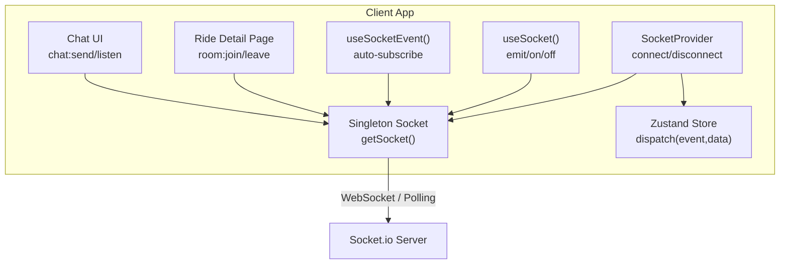
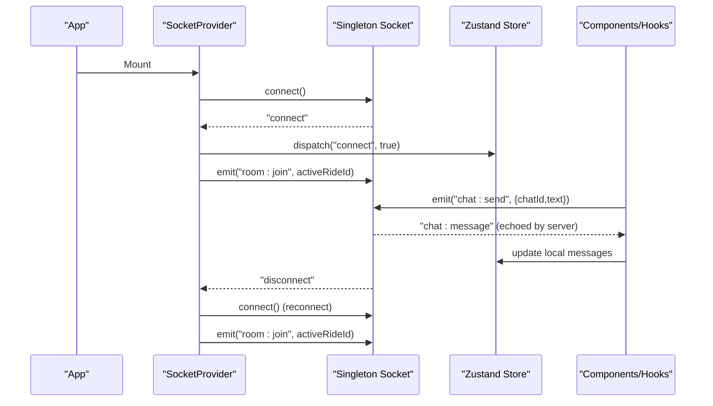
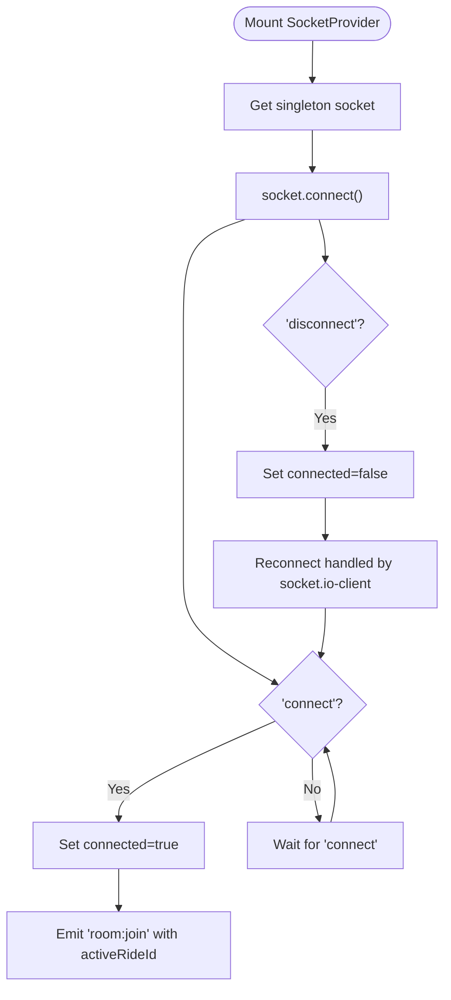
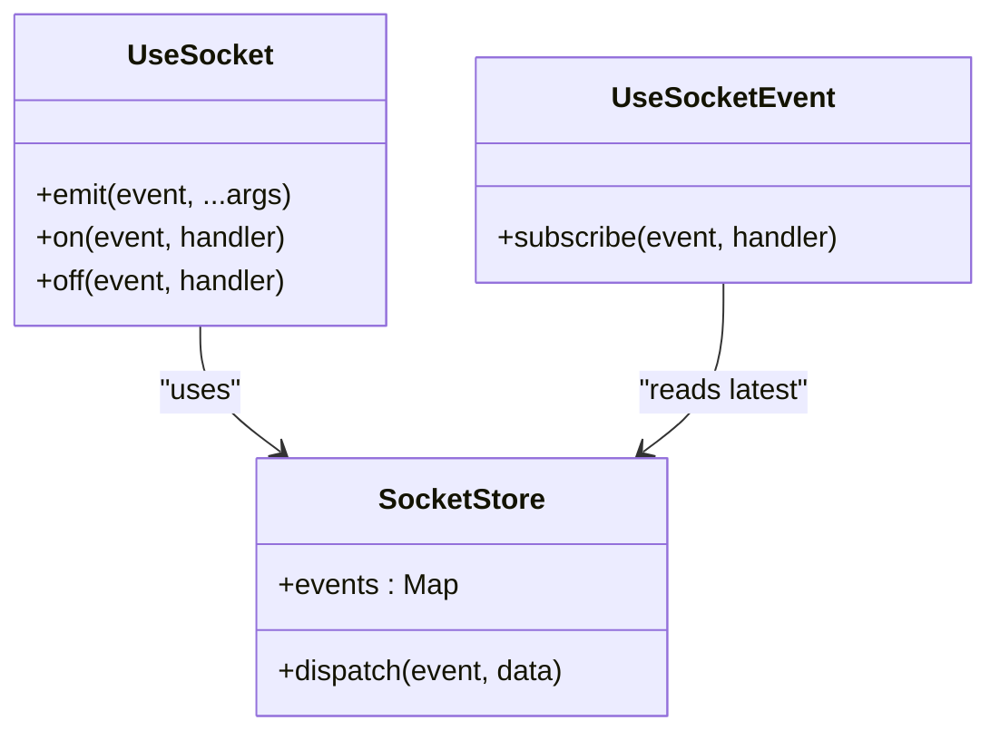
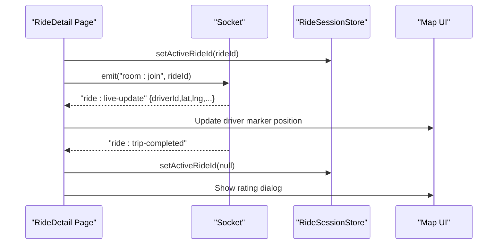
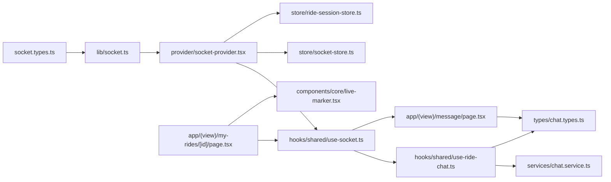

# Real-time Communication

<cite>
**Referenced Files in This Document**
- [socket.ts](file://src/lib/socket.ts)
- [socket-provider.tsx](file://src/provider/socket-provider.tsx)
- [use-socket.ts](file://src/hooks/shared/use-socket.ts)
- [socket-store.ts](file://src/store/socket-store.ts)
- [socket.types.ts](file://src/types/socket.types.ts)
- [ride-session-store.ts](file://src/store/ride-session-store.ts)
- [page.tsx (my-rides/[id])](file://src/app/(view)/my-rides/[id]/page.tsx)
- [live-marker.tsx](file://src/components/core/live-marker.tsx)
- [use-chat.ts](file://src/hooks/shared/use-chat.ts)
- [use-ride-chat.ts](file://src/hooks/shared/use-ride-chat.ts)
- [chat.types.ts](file://src/types/chat.types.ts)
- [chat.service.ts](file://src/services/chat.service.ts)
- [page.tsx (message)](file://src/app/(view)/message/page.tsx)
</cite>

## Table of Contents
1. Introduction
2. Project Structure
3. Core Components
4. Architecture Overview
5. Detailed Component Analysis
6. Dependency Analysis
7. Performance Considerations
8. Troubleshooting Guide
9. Conclusion
10. Appendices

## Introduction
This document explains the real-time communication system built with Socket.io on the client side. It covers WebSocket connection management, event-driven architecture, message protocols, chat functionality, live location tracking, and status updates. It also documents connection lifecycle management, error handling, reconnection strategies, event types, message formats, security considerations, and how to implement new real-time features.

## Project Structure
The real-time layer is implemented as a thin client-side wrapper around socket.io-client:
- A singleton socket instance is created and configured once per app lifetime.
- A React provider manages connection lifecycle and centralizes event dispatching into a Zustand store.
- Typed hooks provide safe emit/on/off APIs for components.
- Feature-specific hooks integrate sockets with REST-backed data (e.g., chat).
- Ride detail pages join rooms and consume live events for driver position and trip state.



**Diagram sources**
- [socket-provider.tsx:66-115](file://src/provider/socket-provider.tsx#L66-L115)
- [socket.ts:23-42](file://src/lib/socket.ts#L23-L42)
- [use-socket.ts:12-39](file://src/hooks/shared/use-socket.ts#L12-L39)
- [socket-store.ts:19-25](file://src/store/socket-store.ts#L19-L25)
- [page.tsx (my-rides/[id]):76-83](file://src/app/(view)/my-rides/[id]/page.tsx#L76-L83)
- [page.tsx (message):250-278](file://src/app/(view)/message/page.tsx#L250-L278)

**Section sources**
- [socket.ts:1-50](file://src/lib/socket.ts#L1-L50)
- [socket-provider.tsx:1-122](file://src/provider/socket-provider.tsx#L1-L122)
- [use-socket.ts:1-57](file://src/hooks/shared/use-socket.ts#L1-L57)
- [socket-store.ts:1-34](file://src/store/socket-store.ts#L1-L34)
- [socket.types.ts:1-278](file://src/types/socket.types.ts#L1-L278)

## Core Components
- Singleton socket factory: Creates a single socket instance with credentials and transport fallbacks.
- Socket provider: Connects on mount, tracks connected state, joins active ride room after reconnect, and dispatches all known server events into a global store.
- Typed hooks: Provide type-safe emit/on/off helpers and an auto-cleanup subscription hook.
- Event store: Centralized, typed storage of the latest server event payload for each event type.
- Ride session persistence: Persists the active ride ID so that reconnections can automatically rejoin the correct room.

Key responsibilities:
- Connection lifecycle: connect/disconnect, rejoin room on reconnect.
- Event routing: map incoming events to a typed store entry.
- Type safety: enforce event names and payloads via TypeScript interfaces.

**Section sources**
- [socket.ts:23-42](file://src/lib/socket.ts#L23-L42)
- [socket-provider.tsx:66-115](file://src/provider/socket-provider.tsx#L66-L115)
- [use-socket.ts:12-39](file://src/hooks/shared/use-socket.ts#L12-L39)
- [socket-store.ts:19-25](file://src/store/socket-store.ts#L19-L25)
- [ride-session-store.ts:9-20](file://src/store/ride-session-store.ts#L9-L20)

## Architecture Overview
The client subscribes to a curated set of server-to-client events and exposes typed methods to emit client-to-server events. The provider ensures a single socket instance, handles connection state, and persists the active ride room across reloads.



**Diagram sources**
- [socket-provider.tsx:71-108](file://src/provider/socket-provider.tsx#L71-L108)
- [socket.ts:23-42](file://src/lib/socket.ts#L23-L42)
- [socket-store.ts:19-25](file://src/store/socket-store.ts#L19-L25)
- [page.tsx (message):250-278](file://src/app/(view)/message/page.tsx#L250-L278)

## Detailed Component Analysis

### Socket Factory and Provider
- Singleton creation with environment-based URL, credentials enabled, and transport fallbacks.
- Authentication token read from cookies and attached during handshake.
- Global debug logging for incoming/outgoing events.
- Provider connects on mount, sets connected state, and reattaches to the last active ride room using persisted ride session.
- All known server events are registered once and dispatched into the Zustand store.



**Diagram sources**
- [socket-provider.tsx:71-108](file://src/provider/socket-provider.tsx#L71-L108)
- [socket.ts:23-42](file://src/lib/socket.ts#L23-L42)
- [ride-session-store.ts:9-20](file://src/store/ride-session-store.ts#L9-L20)

**Section sources**
- [socket.ts:6-42](file://src/lib/socket.ts#L6-L42)
- [socket-provider.tsx:23-115](file://src/provider/socket-provider.tsx#L23-L115)
- [ride-session-store.ts:9-20](file://src/store/ride-session-store.ts#L9-L20)

### Typed Hooks and Event Store
- useSocket(): Provides type-safe emit/on/off wrappers over the singleton socket.
- useSocketEvent(event, handler): Subscribes to a specific event for the component’s lifetime and cleans up on unmount.
- useSocketStore.dispatch(event, data): Stores the latest payload for each event type with a timestamp.
- useSocketEvent<E>(event): Selector hook to read the latest stored event entry.



**Diagram sources**
- [use-socket.ts:12-57](file://src/hooks/shared/use-socket.ts#L12-L57)
- [socket-store.ts:14-31](file://src/store/socket-store.ts#L14-L31)

**Section sources**
- [use-socket.ts:12-57](file://src/hooks/shared/use-socket.ts#L12-L57)
- [socket-store.ts:14-31](file://src/store/socket-store.ts#L14-L31)

### Chat Functionality
- REST-backed chat service provides CRUD operations for chats and messages.
- useRideChat orchestrates lazy chat creation per booking, fetches history, and merges live messages from the socket.
- Messages page integrates chat list and conversation view, applying optimistic updates and deduplication when echoing server messages.

```mermaid
sequenceDiagram
participant UI as "MessagesPage"
participant RC as "useRideChat"
participant Sock as "Socket"
participant API as "Chat Service"
UI->>API : GET /chats/my-chat-list
UI->>API : GET /messages/my-messages/{chatId}
UI->>Sock : emit("chat : send", {chatId,text})
Sock-->>UI : "chat : message" (server echo)
Note over UI : Optimistic message added; replaced/deduplicated on echo
RC->>API : GET /chats/booking/{bookingId}
RC->>API : POST /chats (if missing)
RC->>Sock : listen "chat : message"
```

**Diagram sources**
- [page.tsx (message):69-278](file://src/app/(view)/message/page.tsx#L69-L278)
- [use-ride-chat.ts:17-101](file://src/hooks/shared/use-ride-chat.ts#L17-L101)
- [chat.service.ts:11-49](file://src/services/chat.service.ts#L11-L49)

**Section sources**
- [use-chat.ts:18-92](file://src/hooks/shared/use-chat.ts#L18-L92)
- [use-ride-chat.ts:17-101](file://src/hooks/shared/use-ride-chat.ts#L17-L101)
- [chat.types.ts:28-66](file://src/types/chat.types.ts#L28-L66)
- [chat.service.ts:11-49](file://src/services/chat.service.ts#L11-L49)
- [page.tsx (message):69-278](file://src/app/(view)/message/page.tsx#L69-L278)

### Live Location Tracking and Status Updates
- Ride detail page joins the ride room and listens for driver live updates.
- Driver position is rendered on the map using a custom marker component.
- Trip completion triggers a rating dialog and clears the active ride session.



**Diagram sources**
- [page.tsx (my-rides/[id]):76-97](file://src/app/(view)/my-rides/[id]/page.tsx#L76-L97)
- [ride-session-store.ts:9-20](file://src/store/ride-session-store.ts#L9-L20)
- [live-marker.tsx:6-29](file://src/components/core/live-marker.tsx#L6-L29)

**Section sources**
- [page.tsx (my-rides/[id]):76-97](file://src/app/(view)/my-rides/[id]/page.tsx#L76-L97)
- [live-marker.tsx:6-29](file://src/components/core/live-marker.tsx#L6-L29)

## Dependency Analysis
The following diagram shows key runtime dependencies among client modules involved in real-time communication.



**Diagram sources**
- [socket.types.ts:1-278](file://src/types/socket.types.ts#L1-L278)
- [socket.ts:1-50](file://src/lib/socket.ts#L1-L50)
- [socket-provider.tsx:1-122](file://src/provider/socket-provider.tsx#L1-L122)
- [use-socket.ts:1-57](file://src/hooks/shared/use-socket.ts#L1-L57)
- [socket-store.ts:1-34](file://src/store/socket-store.ts#L1-L34)
- [ride-session-store.ts:1-21](file://src/store/ride-session-store.ts#L1-L21)
- [use-ride-chat.ts:1-102](file://src/hooks/shared/use-ride-chat.ts#L1-L102)
- [chat.service.ts:1-50](file://src/services/chat.service.ts#L1-L50)
- [chat.types.ts:1-66](file://src/types/chat.types.ts#L1-L66)
- [page.tsx (message):1-310](file://src/app/(view)/message/page.tsx#L1-L310)
- [page.tsx (my-rides/[id]):1-342](file://src/app/(view)/my-rides/[id]/page.tsx#L1-L342)
- [live-marker.tsx:1-30](file://src/components/core/live-marker.tsx#L1-L30)

**Section sources**
- [socket.types.ts:1-278](file://src/types/socket.types.ts#L1-L278)
- [socket.ts:1-50](file://src/lib/socket.ts#L1-L50)
- [socket-provider.tsx:1-122](file://src/provider/socket-provider.tsx#L1-L122)
- [use-socket.ts:1-57](file://src/hooks/shared/use-socket.ts#L1-L57)
- [socket-store.ts:1-34](file://src/store/socket-store.ts#L1-L34)
- [ride-session-store.ts:1-21](file://src/store/ride-session-store.ts#L1-L21)
- [use-ride-chat.ts:1-102](file://src/hooks/shared/use-ride-chat.ts#L1-L102)
- [chat.service.ts:1-50](file://src/services/chat.service.ts#L1-L50)
- [chat.types.ts:1-66](file://src/types/chat.types.ts#L1-L66)
- [page.tsx (message):1-310](file://src/app/(view)/message/page.tsx#L1-L310)
- [page.tsx (my-rides/[id]):1-342](file://src/app/(view)/my-rides/[id]/page.tsx#L1-L342)
- [live-marker.tsx:1-30](file://src/components/core/live-marker.tsx#L1-L30)

## Performance Considerations
- Transport fallback: The socket is configured to prefer WebSocket and fall back to polling if needed, improving reliability under restrictive networks.
- Room scoping: Joining only the relevant ride room reduces broadcast noise and memory usage.
- Event batching: The provider registers handlers once and dispatches to a single store, minimizing per-component listener overhead.
- Geolocation throttling: The ride detail page filters out tiny GPS jitter before updating UI state.
- Optimistic messaging: Chat UI adds messages immediately and reconciles with server echoes to avoid perceived latency.

[No sources needed since this section provides general guidance]

## Troubleshooting Guide
Common issues and checks:
- Not receiving events: Ensure the component is mounted inside SocketProvider and uses the typed hooks to subscribe. Verify the event name matches the server contract.
- Missing room context: Confirm the active ride ID is set and that "room:join" is emitted; after reconnect, the provider will rejoin automatically based on persisted ride session.
- Duplicate messages: If you see duplicates, ensure your UI deduplicates by message id or content and removes optimistic placeholders upon server echo.
- Auth failures: Check that the cookie containing the token is present and readable; the socket attaches it during handshake.
- Error events: Listen for the generic "error" event to surface server-side errors to users.

**Section sources**
- [socket-provider.tsx:23-64](file://src/provider/socket-provider.tsx#L23-L64)
- [socket.ts:11-32](file://src/lib/socket.ts#L11-L32)
- [page.tsx (message):177-232](file://src/app/(view)/message/page.tsx#L177-L232)

## Conclusion
The client-side real-time layer is minimal, type-safe, and composable. It centralizes connection management, routes events into a typed store, and offers ergonomic hooks for emitting and subscribing. Features like chat and live location tracking build cleanly on top of this foundation by combining REST-backed persistence with real-time updates.

[No sources needed since this section summarizes without analyzing specific files]

## Appendices

### Event Catalog and Message Formats
- Client-to-server events include room management, chat send/seen, driver controls, availability, ride requests, fare breakdown, cancellations, and ratings.
- Server-to-client events cover ride lifecycle, live updates, chat messages/seen, booking notifications, driver status changes, and generic notifications.
- Payload shapes are defined in the shared types file and referenced by hooks and UI components.

For exact field names and structures, refer to the centralized type definitions.

**Section sources**
- [socket.types.ts:136-270](file://src/types/socket.types.ts#L136-L270)
- [socket.types.ts:30-134](file://src/types/socket.types.ts#L30-L134)
- [chat.types.ts:28-66](file://src/types/chat.types.ts#L28-L66)

### Security Considerations
- Authentication: The socket attaches a token read from cookies during handshake. Ensure secure cookie settings and HTTPS in production.
- Authorization: Rooms should be validated server-side to prevent cross-user access.
- Input validation: Validate all incoming payloads server-side; clients should not trust server responses blindly.
- Rate limiting: Apply rate limits on high-frequency events such as location updates and chat sends.

**Section sources**
- [socket.ts:11-32](file://src/lib/socket.ts#L11-L32)

### Implementing New Real-time Features
Steps to add a new feature:
1. Define event signatures in the shared types file (both directions).
2. Add the event to the provider’s known events list if it is a server-to-client event.
3. Emit the event using the typed emit helper from useSocket().
4. Subscribe using useSocketEvent() in the relevant component or hook.
5. Persist any necessary context (e.g., room membership) in stores if required.
6. Test both optimistic UI behavior and server echo reconciliation.

Example references:
- Adding a new server event: extend the server-to-client interface and register it in the provider’s event list.
- Emitting a new action: call emit with the new event name and payload from a component or hook.
- Listening for a new event: use useSocketEvent in the component that needs to react.

**Section sources**
- [socket.types.ts:136-270](file://src/types/socket.types.ts#L136-L270)
- [socket-provider.tsx:23-64](file://src/provider/socket-provider.tsx#L23-L64)
- [use-socket.ts:12-39](file://src/hooks/shared/use-socket.ts#L12-L39)
- [use-socket.ts:42-57](file://src/hooks/shared/use-socket.ts#L42-L57)