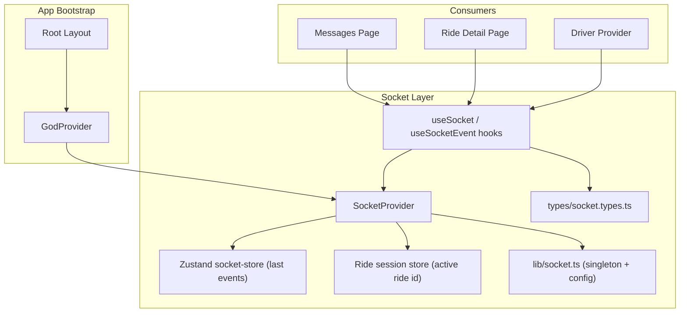
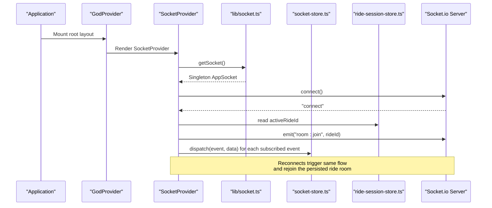
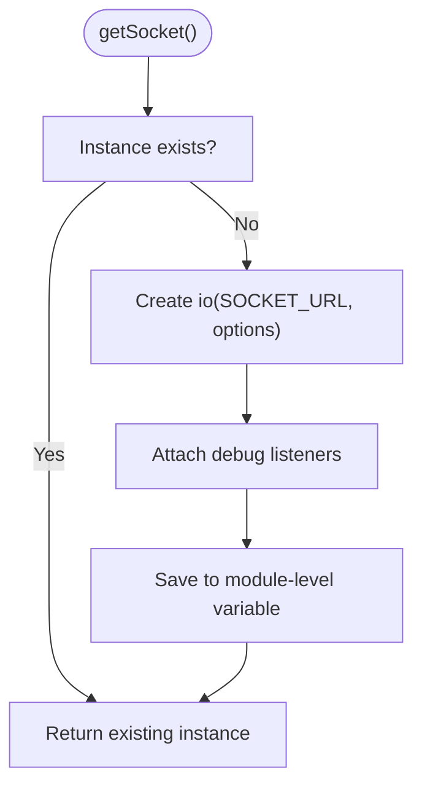
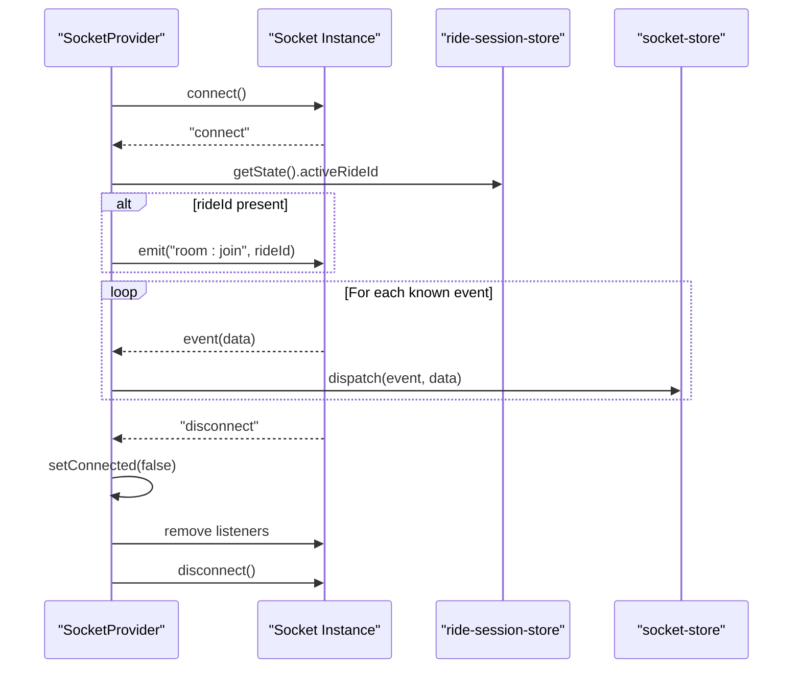
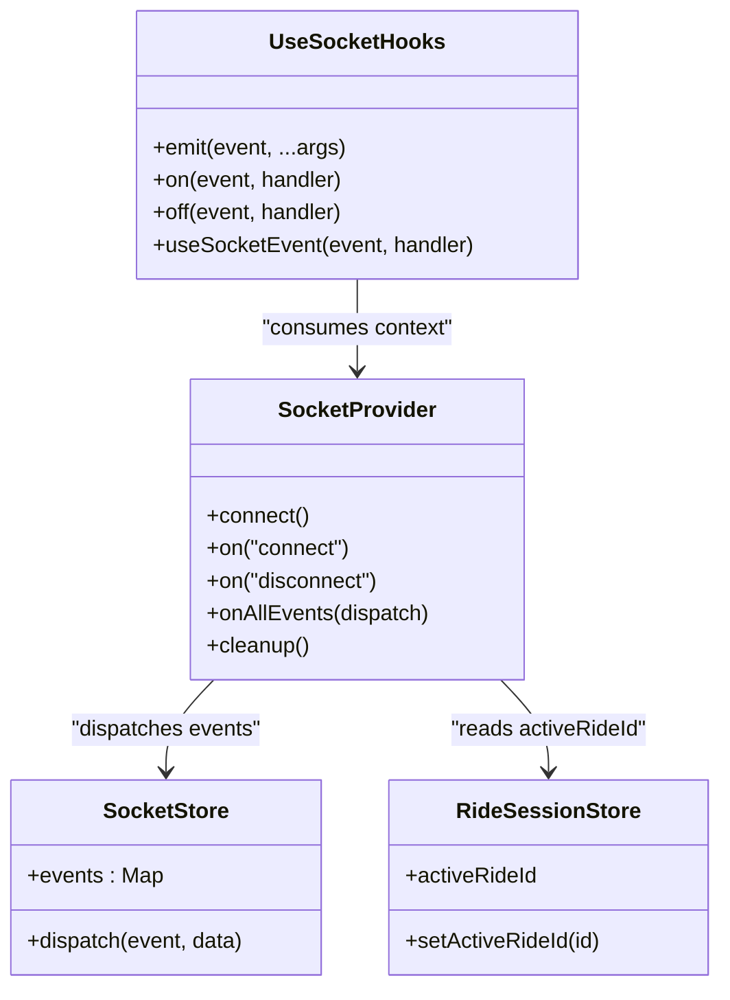
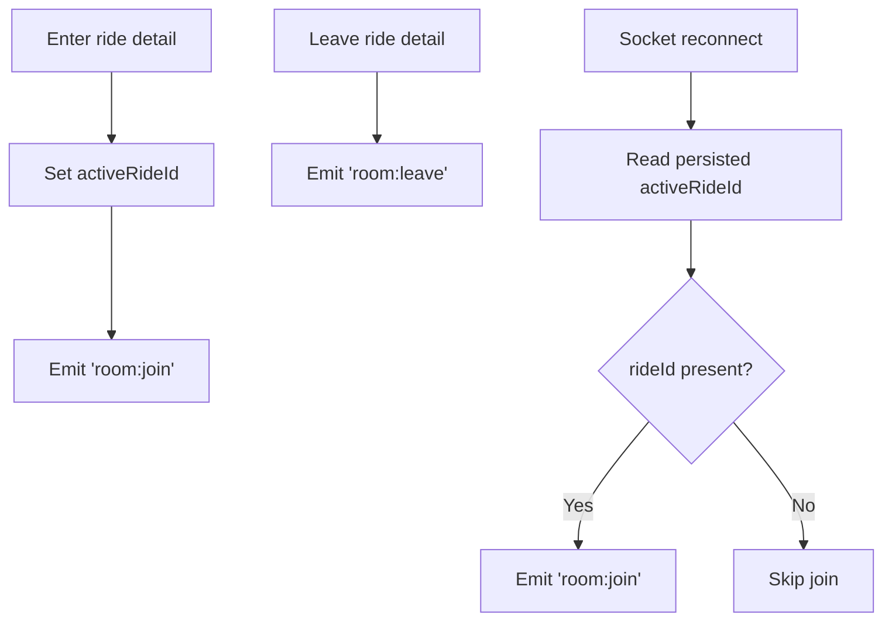
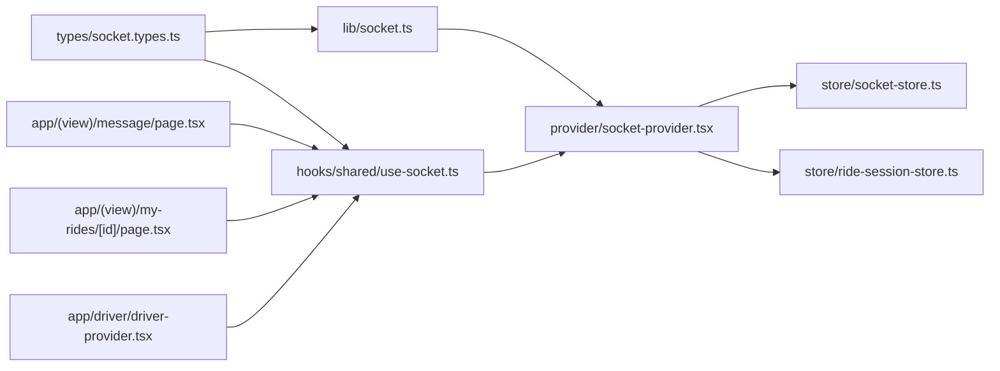

# WebSocket Infrastructure

<cite>
**Referenced Files in This Document**
- [socket.ts](file://src/lib/socket.ts)
- [socket-provider.tsx](file://src/provider/socket-provider.tsx)
- [use-socket.ts](file://src/hooks/shared/use-socket.ts)
- [socket-store.ts](file://src/store/socket-store.ts)
- [ride-session-store.ts](file://src/store/ride-session-store.ts)
- [god-provider.tsx](file://src/provider/god-provider.tsx)
- [socket.types.ts](file://src/types/socket.types.ts)
- [message/page.tsx](file://src/app/(view)/message/page.tsx)
- [my-rides/[id]/page.tsx](file://src/app/(view)/my-rides/[id]/page.tsx)
- [driver-provider.tsx](file://src/app/driver/driver-provider.tsx)
</cite>

## Table of Contents
1. [Introduction](#introduction)
2. [Project Structure](#project-structure)
3. [Core Components](#core-components)
4. [Architecture Overview](#architecture-overview)
5. [Detailed Component Analysis](#detailed-component-analysis)
6. [Dependency Analysis](#dependency-analysis)
7. [Performance Considerations](#performance-considerations)
8. [Troubleshooting Guide](#troubleshooting-guide)
9. [Conclusion](#conclusion)
10. [Appendices](#appendices)

## Introduction
This document explains the WebSocket infrastructure layer built on Socket.io for real-time features such as ride updates, chat, and notifications. It covers the client implementation, connection lifecycle management, event handling architecture, centralized configuration, reconnection behavior, error handling, context provider pattern, global state integration, cleanup procedures, usage examples, security considerations, authentication integration, and performance optimization techniques.

## Project Structure
The WebSocket layer is organized into focused modules:
- Client initialization and singleton socket instance
- React Context provider for global access and lifecycle
- Hooks for emitting events and subscribing to events
- Centralized store for last-seen events
- Type definitions for all server-to-client and client-to-server events
- Usage across pages and providers for riders and drivers

**Diagram sources**
- [god-provider.tsx:34-41](file://src/provider/god-provider.tsx#L34-L41)
- [socket-provider.tsx:66-115](file://src/provider/socket-provider.tsx#L66-L115)
- [socket.ts:23-42](file://src/lib/socket.ts#L23-L42)
- [use-socket.ts:12-39](file://src/hooks/shared/use-socket.ts#L12-L39)
- [socket-store.ts:19-25](file://src/store/socket-store.ts#L19-L25)
- [ride-session-store.ts:9-20](file://src/store/ride-session-store.ts#L9-L20)
- [socket.types.ts:30-134](file://src/types/socket.types.ts#L30-L134)

**Section sources**
- [god-provider.tsx:34-41](file://src/provider/god-provider.tsx#L34-L41)
- [socket-provider.tsx:66-115](file://src/provider/socket-provider.tsx#L66-L115)
- [socket.ts:23-42](file://src/lib/socket.ts#L23-L42)
- [use-socket.ts:12-39](file://src/hooks/shared/use-socket.ts#L12-L39)
- [socket-store.ts:19-25](file://src/store/socket-store.ts#L19-L25)
- [ride-session-store.ts:9-20](file://src/store/ride-session-store.ts#L9-L20)
- [socket.types.ts:30-134](file://src/types/socket.types.ts#L30-L134)

## Core Components
- lib/socket.ts: Creates a single Socket.io client with centralized configuration, transports, credentials, and auth token injection from cookies. Provides getSocket() and destroySocket().
- provider/socket-provider.tsx: React Context provider that connects/disconnects the socket, tracks connected state, joins the active ride room after connect, dispatches incoming events to a central store, and cleans up listeners and the socket instance on unmount.
- hooks/shared/use-socket.ts: Typed hooks to emit events and subscribe/unsubscribe to specific events safely within components. Also includes a convenience hook to auto-subscribe for component lifetime.
- store/socket-store.ts: Zustand store holding the latest event per type with timestamp; exposes a selector hook to read the last event entry.
- store/ride-session-store.ts: Persisted store keeping the active ride ID so that reconnects can rejoin the correct room automatically.
- types/socket.types.ts: Strongly typed event contracts for both directions (server-to-client and client-to-server), plus internal helper types for event names and payloads.

Key responsibilities:
- Centralized configuration and singleton socket instance
- Global connection state via Context
- Automatic room rejoin on reconnect using persisted ride session
- Event dispatching to a global store for UI consumption
- Safe typed emission and subscription APIs

**Section sources**
- [socket.ts:6-42](file://src/lib/socket.ts#L6-L42)
- [socket-provider.tsx:66-115](file://src/provider/socket-provider.tsx#L66-L115)
- [use-socket.ts:12-39](file://src/hooks/shared/use-socket.ts#L12-L39)
- [socket-store.ts:19-25](file://src/store/socket-store.ts#L19-L25)
- [ride-session-store.ts:9-20](file://src/store/ride-session-store.ts#L9-L20)
- [socket.types.ts:30-134](file://src/types/socket.types.ts#L30-L134)

## Architecture Overview
The application bootstraps a global SocketProvider which initializes the Socket.io client once and manages its lifecycle. The provider subscribes to a known set of events and forwards them to a centralized store. Consumers use typed hooks to emit events or subscribe to specific events. Room membership is managed by joining/leaving rooms based on the active ride stored in a persistent store.

**Diagram sources**
- [god-provider.tsx:34-41](file://src/provider/god-provider.tsx#L34-L41)
- [socket-provider.tsx:66-115](file://src/provider/socket-provider.tsx#L66-L115)
- [socket.ts:23-42](file://src/lib/socket.ts#L23-L42)
- [socket-store.ts:19-25](file://src/store/socket-store.ts#L19-L25)
- [ride-session-store.ts:9-20](file://src/store/ride-session-store.ts#L9-L20)

## Detailed Component Analysis

### Socket Client Initialization and Configuration
- Singletons: A module-level variable holds the only socket instance. getSocket() lazily creates it with:
  - autoConnect disabled to allow explicit control
  - withCredentials enabled for cookie-based auth
  - transports fallback to ["websocket", "polling"]
  - auth callback injecting a token read from cookies
- Debug logging: onAny and onAnyOutgoing log received and emitted events.
- Cleanup: destroySocket() disconnects and nulls the instance.

**Diagram sources**
- [socket.ts:23-42](file://src/lib/socket.ts#L23-L42)

**Section sources**
- [socket.ts:6-42](file://src/lib/socket.ts#L6-L42)

### Connection Lifecycle Management
- Provider mounts at app root under GodProvider.
- On mount:
  - Connects the socket
  - Sets connected state to true on "connect"
  - Reads persisted activeRideId and emits "room:join" if present
  - Registers handlers for all known events and dispatches them to the store
  - Tracks "disconnect" to set connected false
- On unmount:
  - Removes all event listeners
  - Calls destroySocket() to disconnect and clear the singleton

**Diagram sources**
- [socket-provider.tsx:66-115](file://src/provider/socket-provider.tsx#L66-L115)
- [ride-session-store.ts:9-20](file://src/store/ride-session-store.ts#L9-L20)
- [socket-store.ts:19-25](file://src/store/socket-store.ts#L19-L25)

**Section sources**
- [socket-provider.tsx:66-115](file://src/provider/socket-provider.tsx#L66-L115)

### Event Handling Architecture
- Centralized registration: The provider loops through ALL_EVENTS and attaches a handler that dispatches to the store.
- Store model: Each event maps to an entry containing payload and timestamp.
- Selector hook: useSocketEvent(event) returns the latest entry for a given event.
- Component subscriptions: useSocketEvent hook from use-socket.ts provides automatic subscription/unsubscription tied to component lifecycle.

**Diagram sources**
- [socket-provider.tsx:66-115](file://src/provider/socket-provider.tsx#L66-L115)
- [socket-store.ts:19-25](file://src/store/socket-store.ts#L19-L25)
- [use-socket.ts:12-39](file://src/hooks/shared/use-socket.ts#L12-L39)
- [ride-session-store.ts:9-20](file://src/store/ride-session-store.ts#L9-L20)

**Section sources**
- [socket-provider.tsx:23-64](file://src/provider/socket-provider.tsx#L23-L64)
- [socket-store.ts:19-31](file://src/store/socket-store.ts#L19-L31)
- [use-socket.ts:12-56](file://src/hooks/shared/use-socket.ts#L12-L56)

### Room Management and Persistence
- Active ride persistence: ride-session-store persists activeRideId to localStorage.
- Join/leave semantics:
  - Ride detail page sets activeRideId and emits "room:join" when mounted; emits "room:leave" on unmount.
  - SocketProvider re-joins the persisted rideId on every "connect".

**Diagram sources**
- [my-rides/[id]/page.tsx:75-85](file://src/app/(view)/my-rides/[id]/page.tsx#L75-L85)
- [socket-provider.tsx:76-83](file://src/provider/socket-provider.tsx#L76-L83)
- [ride-session-store.ts:9-20](file://src/store/ride-session-store.ts#L9-L20)

**Section sources**
- [my-rides/[id]/page.tsx:75-85](file://src/app/(view)/my-rides/[id]/page.tsx#L75-L85)
- [socket-provider.tsx:76-83](file://src/provider/socket-provider.tsx#L76-L83)
- [ride-session-store.ts:9-20](file://src/store/ride-session-store.ts#L9-L20)

### Usage Examples

#### Establishing connections and sending events
- Riders and drivers obtain the socket via useSocket() and call emit(...) with typed events.
- Example references:
  - Emitting room join/leave in ride detail page
  - Emitting driver location updates in driver provider

**Section sources**
- [my-rides/[id]/page.tsx:75-85](file://src/app/(view)/my-rides/[id]/page.tsx#L75-L85)
- [driver-provider.tsx:109-118](file://src/app/driver/driver-provider.tsx#L109-L118)

#### Managing events in components
- Subscribe to live updates and completion events in ride detail page.
- Subscribe to chat messages in message page.

**Section sources**
- [my-rides/[id]/page.tsx:87-103](file://src/app/(view)/my-rides/[id]/page.tsx#L87-L103)
- [message/page.tsx:231](file://src/app/(view)/message/page.tsx#L231)

#### Implementing custom socket hooks
- Use the provided useSocketEvent hook to auto-subscribe/unsubscribe within a component’s lifecycle.
- Alternatively, use the base useSocket() to manually manage on/off.

**Section sources**
- [use-socket.ts:42-56](file://src/hooks/shared/use-socket.ts#L42-L56)

### Security Considerations and Authentication Integration
- Cookie-based authentication:
  - The client reads a token from cookies and sends it via the auth handshake callback.
  - withCredentials is enabled to allow cookies to be sent with requests.
- Recommendations:
  - Ensure the token cookie is HttpOnly and SameSite configured appropriately for cross-origin setups.
  - Validate tokens server-side and bind sessions to secure transport (HTTPS).
  - Avoid storing sensitive tokens in localStorage; prefer httpOnly cookies.
  - Restrict allowed origins and implement rate limiting on the server.

**Section sources**
- [socket.ts:11-32](file://src/lib/socket.ts#L11-L32)

### Error Handling Mechanisms
- Connection errors:
  - The server may emit a generic "error" event with a message.
  - The provider does not attach a dedicated handler for "error"; consumers can listen directly if needed.
- Disconnections:
  - The provider toggles connected state on "disconnect".
  - Socket.io handles reconnection internally; the provider re-joins the active room upon reconnect.
- Best practices:
  - Surface user-friendly messages for transient failures.
  - Debounce or throttle high-frequency events like location updates.
  - Log errors consistently and consider reporting to monitoring services.

**Section sources**
- [socket-provider.tsx:84-87](file://src/provider/socket-provider.tsx#L84-L87)
- [socket.types.ts:133](file://src/types/socket.types.ts#L133)

## Dependency Analysis
The following diagram shows how components depend on the socket layer and stores.

**Diagram sources**
- [socket.types.ts:30-134](file://src/types/socket.types.ts#L30-L134)
- [socket.ts:23-42](file://src/lib/socket.ts#L23-L42)
- [socket-provider.tsx:66-115](file://src/provider/socket-provider.tsx#L66-L115)
- [use-socket.ts:12-39](file://src/hooks/shared/use-socket.ts#L12-L39)
- [socket-store.ts:19-25](file://src/store/socket-store.ts#L19-L25)
- [ride-session-store.ts:9-20](file://src/store/ride-session-store.ts#L9-L20)
- [message/page.tsx:77-78](file://src/app/(view)/message/page.tsx#L77-L78)
- [my-rides/[id]/page.tsx:57-85](file://src/app/(view)/my-rides/[id]/page.tsx#L57-L85)
- [driver-provider.tsx:29-36](file://src/app/driver/driver-provider.tsx#L29-L36)

**Section sources**
- [socket.types.ts:30-134](file://src/types/socket.types.ts#L30-L134)
- [socket.ts:23-42](file://src/lib/socket.ts#L23-L42)
- [socket-provider.tsx:66-115](file://src/provider/socket-provider.tsx#L66-L115)
- [use-socket.ts:12-39](file://src/hooks/shared/use-socket.ts#L12-L39)
- [socket-store.ts:19-25](file://src/store/socket-store.ts#L19-L25)
- [ride-session-store.ts:9-20](file://src/store/ride-session-store.ts#L9-L20)
- [message/page.tsx:77-78](file://src/app/(view)/message/page.tsx#L77-L78)
- [my-rides/[id]/page.tsx:57-85](file://src/app/(view)/my-rides/[id]/page.tsx#L57-L85)
- [driver-provider.tsx:29-36](file://src/app/driver/driver-provider.tsx#L29-L36)

## Performance Considerations
- Transport selection: Uses ["websocket", "polling"] to optimize latency and reliability.
- Throttling location updates:
  - Rider side uses geolocation watch with minimum delta filtering to avoid jitter.
  - Driver side has commented production-ready distance-gated logic; currently uses a fixed interval for testing.
- Room scoping: Joining specific ride rooms reduces broadcast overhead.
- Centralized event dispatch: Keeps UI logic simple but consider debouncing heavy reducers if needed.
- Avoid unnecessary re-renders: Prefer selectors and memoization where appropriate.

[No sources needed since this section provides general guidance]

## Troubleshooting Guide
Common issues and remedies:
- No events received:
  - Verify the socket is connected (useSocketContext.connected).
  - Confirm the active ride room was joined; check persisted activeRideId and "room:join" emissions.
- Token not sent:
  - Ensure the token cookie exists and is accessible to the client.
  - Confirm withCredentials is enabled and CORS allows cookies.
- Excessive network traffic:
  - Review location update intervals and apply distance gating.
  - Ensure components unsubscribe from events on unmount.
- Reconnect not rejoining room:
  - Confirm activeRideId is persisted and read during "connect".
  - Check that the provider’s cleanup removes listeners before destroying the socket.

**Section sources**
- [socket-provider.tsx:76-83](file://src/provider/socket-provider.tsx#L76-L83)
- [socket.ts:25-32](file://src/lib/socket.ts#L25-L32)
- [ride-session-store.ts:9-20](file://src/store/ride-session-store.ts#L9-L20)

## Conclusion
The WebSocket infrastructure provides a robust, type-safe foundation for real-time features. It centralizes configuration, manages connection lifecycle, ensures room persistence across reconnects, and offers ergonomic hooks for event emission and subscription. With proper authentication via cookies and careful attention to performance tuning, the system scales well for rider-driver interactions, chat, and notifications.

[No sources needed since this section summarizes without analyzing specific files]

## Appendices

### API Definitions (Selected Events)
- Server-to-client events include ride lifecycle, live updates, chat, booking, and notification events.
- Client-to-server events include room management, chat messaging, driver controls, availability, and ride requests.

For full event signatures and payloads, refer to the type definitions.

**Section sources**
- [socket.types.ts:30-270](file://src/types/socket.types.ts#L30-L270)