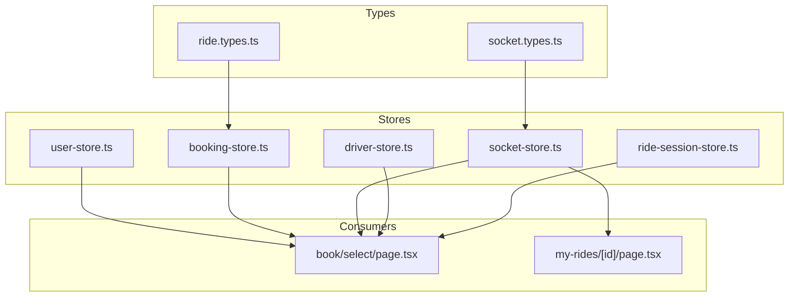
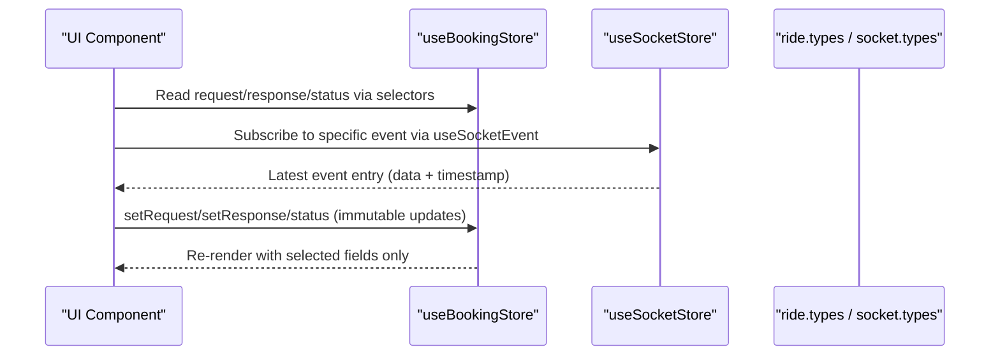
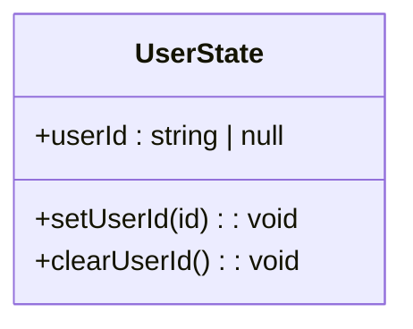
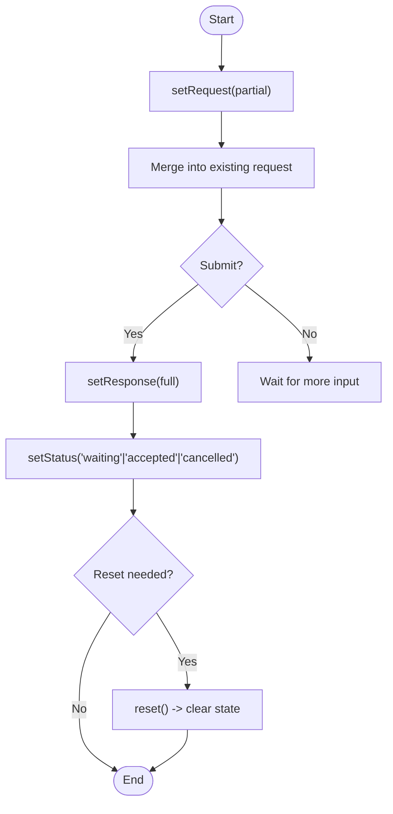
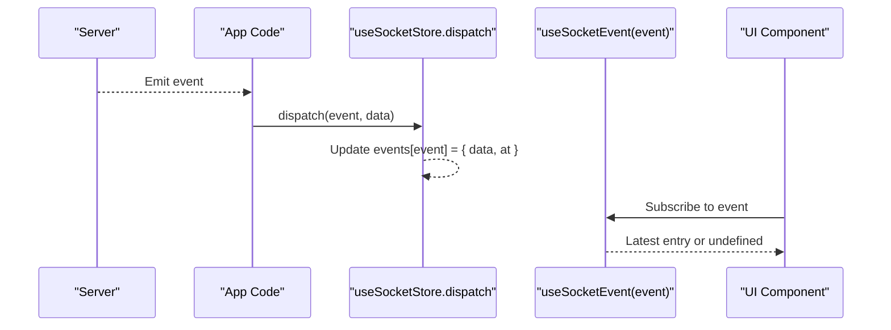
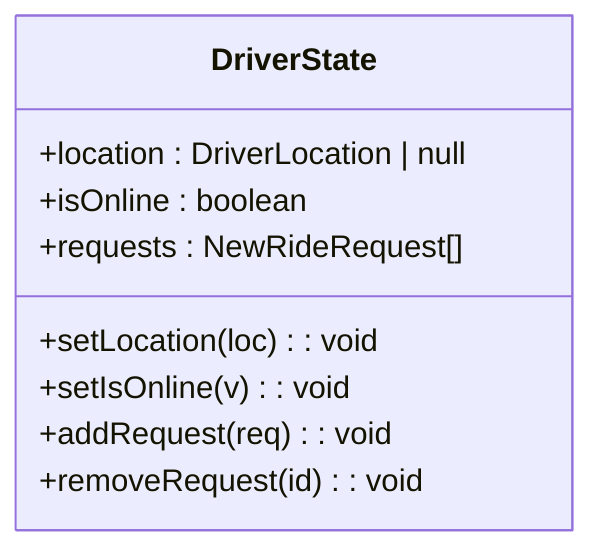
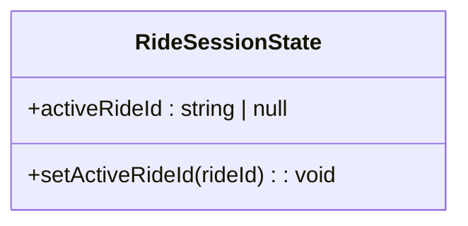
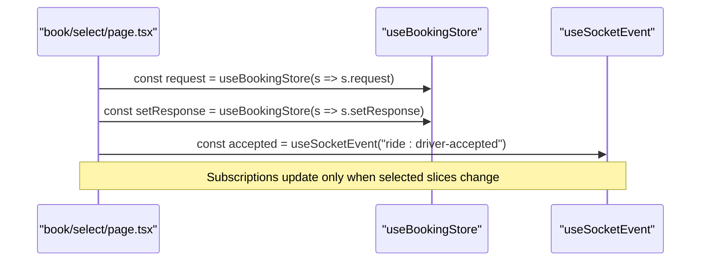
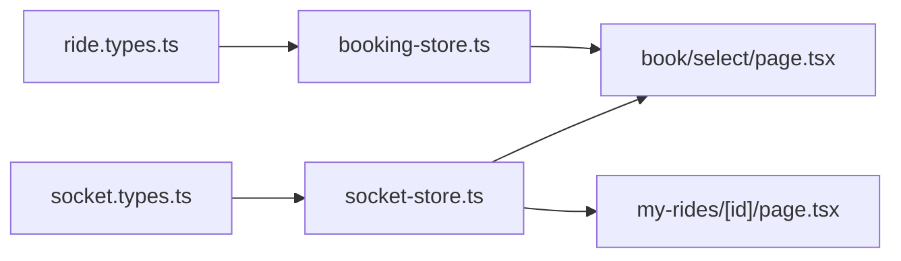

# Client State with Zustand

<cite>
**Referenced Files in This Document**
- [user-store.ts](file://src/store/user-store.ts)
- [booking-store.ts](file://src/store/booking-store.ts)
- [socket-store.ts](file://src/store/socket-store.ts)
- [driver-store.ts](file://src/store/driver-store.ts)
- [ride-session-store.ts](file://src/store/ride-session-store.ts)
- [ride.types.ts](file://src/types/ride.types.ts)
- [socket.types.ts](file://src/types/socket.types.ts)
- [page.tsx (book/select)](file://src/app/(view)/book/select/page.tsx)
- [page.tsx (my-rides/[id])](file://src/app/(view)/my-rides/[id]/page.tsx)
</cite>

## Table of Contents
1. Introduction
2. Project Structure
3. Core Components
4. Architecture Overview
5. Detailed Component Analysis
6. Dependency Analysis
7. Performance Considerations
8. Troubleshooting Guide
9. Conclusion

## Introduction
This document explains the client-side state management approach using Zustand across the application. It covers store creation patterns, state structure design, action implementations, and best practices for organization, performance, and debugging. Examples are drawn from existing stores such as user-store, booking-store, and socket-store to demonstrate common patterns like typed state, immutable updates, persistence, and derived selectors.

## Project Structure
The state layer is organized by feature/domain into small, focused stores under src/store. Each store:
- Defines a TypeScript interface describing its state and actions
- Creates a Zustand store via create
- Exposes typed hooks for reading and updating state
- Optionally uses middleware like persist for storage-backed state

**Diagram sources**
- [user-store.ts](file://src/store/user-store.ts)
- [booking-store.ts](file://src/store/booking-store.ts)
- [socket-store.ts](file://src/store/socket-store.ts)
- [driver-store.ts](file://src/store/driver-store.ts)
- [ride-session-store.ts](file://src/store/ride-session-store.ts)
- [ride.types.ts](file://src/types/ride.types.ts)
- [socket.types.ts](file://src/types/socket.types.ts)
- [page.tsx (book/select)](file://src/app/(view)/book/select/page.tsx)
- [page.tsx (my-rides/[id])](file://src/app/(view)/my-rides/[id]/page.tsx)

**Section sources**
- [user-store.ts](file://src/store/user-store.ts)
- [booking-store.ts](file://src/store/booking-store.ts)
- [socket-store.ts](file://src/store/socket-store.ts)
- [driver-store.ts](file://src/store/driver-store.ts)
- [ride-session-store.ts](file://src/store/ride-session-store.ts)
- [ride.types.ts](file://src/types/ride.types.ts)
- [socket.types.ts](file://src/types/socket.types.ts)
- [page.tsx (book/select)](file://src/app/(view)/book/select/page.tsx)
- [page.tsx (my-rides/[id])](file://src/app/(view)/my-rides/[id]/page.tsx)

## Core Components
This section summarizes each store’s purpose, shape, and key actions.

- User Store
  - Purpose: Holds minimal authentication-related identifiers.
  - State: userId
  - Actions: setUserId, clearUserId
  - Pattern: Simple primitive state with direct setters.

- Booking Store
  - Purpose: Manages ride request/response lifecycle and status during booking flows.
  - State: request (partial payload), response (full response), status (idle/waiting/accepted/cancelled)
  - Actions: setRequest (merge), setResponse, setStatus, reset
  - Pattern: Partial merge updates for incremental form-like data; full object replacement for responses; explicit reset for flow completion.

- Socket Store
  - Purpose: Centralized event bus for server-to-client events.
  - State: events map keyed by event name, each entry includes data and timestamp
  - Actions: dispatch(event, data)
  - Derived Selector: useSocketEvent(event) returns latest entry or undefined
  - Pattern: Typed event map using union types; selector-based subscription per event.

- Driver Store
  - Purpose: Driver-specific runtime state including location, online status, and incoming requests.
  - State: location, isOnline, requests
  - Actions: setLocation, setIsOnline, addRequest, removeRequest
  - Persistence: Persisted via zustand/middleware persist to sessionStorage; partialize ensures only requests are persisted.
  - Pattern: Immutable array updates; selective persistence.

- Ride Session Store
  - Purpose: Tracks active ride identifier across navigation.
  - State: activeRideId
  - Actions: setActiveRideId
  - Persistence: Persisted to localStorage.

Best practices demonstrated:
- Strong typing with interfaces and utility types
- Immutable updates via functional set(state => ...)
- Selectors for fine-grained subscriptions
- Middleware for persistence where appropriate
- Clear separation between transient and persistent state

**Section sources**
- [user-store.ts](file://src/store/user-store.ts)
- [booking-store.ts](file://src/store/booking-store.ts)
- [socket-store.ts](file://src/store/socket-store.ts)
- [driver-store.ts](file://src/store/driver-store.ts)
- [ride-session-store.ts](file://src/store/ride-session-store.ts)

## Architecture Overview
The stores act as single sources of truth for their domains. Consumers subscribe via selectors to avoid unnecessary re-renders. Some stores integrate with external systems (e.g., socket events) and expose typed helpers for consumers.

**Diagram sources**
- [booking-store.ts](file://src/store/booking-store.ts)
- [socket-store.ts](file://src/store/socket-store.ts)
- [ride.types.ts](file://src/types/ride.types.ts)
- [socket.types.ts](file://src/types/socket.types.ts)

## Detailed Component Analysis

### User Store
- State shape: A simple string identifier or null.
- Actions: Direct setters that replace the value.
- Typical usage: Clearing identity on logout or switching users.

**Diagram sources**
- [user-store.ts](file://src/store/user-store.ts)

**Section sources**
- [user-store.ts](file://src/store/user-store.ts)

### Booking Store
- State shape:
  - request: Partial ride request payload used to accumulate form inputs
  - response: Full ride request response after submission
  - status: Lifecycle state machine for the booking flow
- Actions:
  - setRequest merges new fields into the existing request
  - setResponse replaces the entire response
  - setStatus transitions the flow
  - reset clears all fields back to initial values

**Diagram sources**
- [booking-store.ts](file://src/store/booking-store.ts)
- [ride.types.ts](file://src/types/ride.types.ts)

**Section sources**
- [booking-store.ts](file://src/store/booking-store.ts)
- [ride.types.ts](file://src/types/ride.types.ts)

### Socket Store
- State shape:
  - events: Map from event names to entries containing data and timestamp
- Actions:
  - dispatch(event, data) appends an entry with current time
- Derived selector:
  - useSocketEvent(event) subscribes to a single event and returns the latest entry or undefined

**Diagram sources**
- [socket-store.ts](file://src/store/socket-store.ts)
- [socket.types.ts](file://src/types/socket.types.ts)

**Section sources**
- [socket-store.ts](file://src/store/socket-store.ts)
- [socket.types.ts](file://src/types/socket.types.ts)

### Driver Store
- State shape:
  - location: Driver position and heading
  - isOnline: Availability flag
  - requests: Incoming ride requests list
- Actions:
  - setLocation, setIsOnline, addRequest, removeRequest
- Persistence:
  - Uses persist middleware with sessionStorage
  - partialize persists only requests to avoid stale location data

**Diagram sources**
- [driver-store.ts](file://src/store/driver-store.ts)
- [ride.types.ts](file://src/types/ride.types.ts)

**Section sources**
- [driver-store.ts](file://src/store/driver-store.ts)
- [ride.types.ts](file://src/types/ride.types.ts)

### Ride Session Store
- State shape:
  - activeRideId: Current ride identifier
- Actions:
  - setActiveRideId
- Persistence:
  - Uses persist middleware with localStorage

**Diagram sources**
- [ride-session-store.ts](file://src/store/ride-session-store.ts)

**Section sources**
- [ride-session-store.ts](file://src/store/ride-session-store.ts)

### Consumer Patterns and Derived State
- Reading state via selectors:
  - Components subscribe to specific fields to minimize re-renders.
  - Example: book/select page reads request, response, and sets response via selectors.
- Listening to socket events:
  - my-rides/[id] page subscribes to live updates and trip completion events through useSocketEvent.

**Diagram sources**
- [page.tsx (book/select)](file://src/app/(view)/book/select/page.tsx)
- [booking-store.ts](file://src/store/booking-store.ts)
- [socket-store.ts](file://src/store/socket-store.ts)

**Section sources**
- [page.tsx (book/select)](file://src/app/(view)/book/select/page.tsx)
- [page.tsx (my-rides/[id])](file://src/app/(view)/my-rides/[id]/page.tsx)

## Dependency Analysis
- Type dependencies:
  - booking-store depends on ride.types for request/response shapes.
  - socket-store depends on socket.types for event definitions and data payloads.
- Runtime dependencies:
  - Stores depend on Zustand core and optional middleware (persist).
  - Consumers depend on stores and type definitions.

**Diagram sources**
- [ride.types.ts](file://src/types/ride.types.ts)
- [socket.types.ts](file://src/types/socket.types.ts)
- [booking-store.ts](file://src/store/booking-store.ts)
- [socket-store.ts](file://src/store/socket-store.ts)
- [page.tsx (book/select)](file://src/app/(view)/book/select/page.tsx)
- [page.tsx (my-rides/[id])](file://src/app/(view)/my-rides/[id]/page.tsx)

**Section sources**
- [ride.types.ts](file://src/types/ride.types.ts)
- [socket.types.ts](file://src/types/socket.types.ts)
- [booking-store.ts](file://src/store/booking-store.ts)
- [socket-store.ts](file://src/store/socket-store.ts)
- [page.tsx (book/select)](file://src/app/(view)/book/select/page.tsx)
- [page.tsx (my-rides/[id])](file://src/app/(view)/my-rides/[id]/page.tsx)

## Performance Considerations
- Prefer selectors:
  - Subscribe to the smallest necessary slice of state to avoid unnecessary re-renders.
  - Example patterns: read request/response separately, subscribe to a single socket event.
- Immutable updates:
  - Use functional set(state => ...) to compute next state safely and efficiently.
  - For partial objects, spread existing state before merging new fields.
- Avoid heavy computations in render:
  - If you need derived values, compute them inside the component or memoize outside if reused.
- Persistence wisely:
  - Persist only what is necessary (e.g., driver requests) to reduce I/O overhead.
  - Separate transient runtime state (e.g., driver location) from persistent state.

[No sources needed since this section provides general guidance]

## Troubleshooting Guide
- Unexpected re-renders:
  - Check if components subscribe to too much state; narrow selectors to exact fields.
- Stale data after reload:
  - Verify persist configuration and partialize settings; ensure transient fields are not persisted unintentionally.
- Socket events not appearing:
  - Confirm the correct event name is used with useSocketEvent and that dispatch is called with matching event keys.
- Type mismatches:
  - Ensure state and actions align with defined interfaces; keep types in sync with API contracts.

**Section sources**
- [driver-store.ts](file://src/store/driver-store.ts)
- [socket-store.ts](file://src/store/socket-store.ts)
- [booking-store.ts](file://src/store/booking-store.ts)

## Conclusion
The Zustand-based state architecture emphasizes strong typing, immutable updates, and fine-grained subscriptions. Stores are small and cohesive, with persistence applied selectively. Consumers leverage selectors and derived helpers to stay performant and maintainable. Following these patterns will help you create new stores consistently and optimize rendering behavior across the application.

[No sources needed since this section summarizes without analyzing specific files]