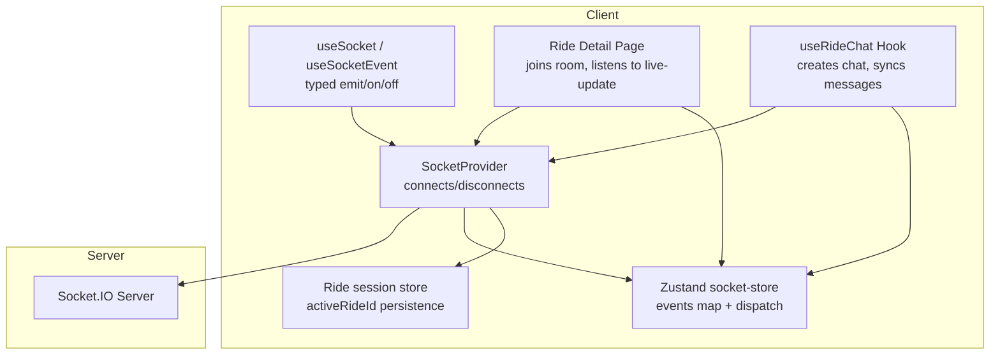
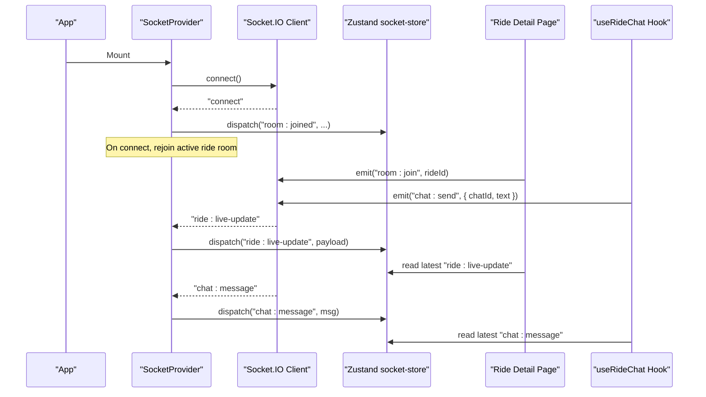
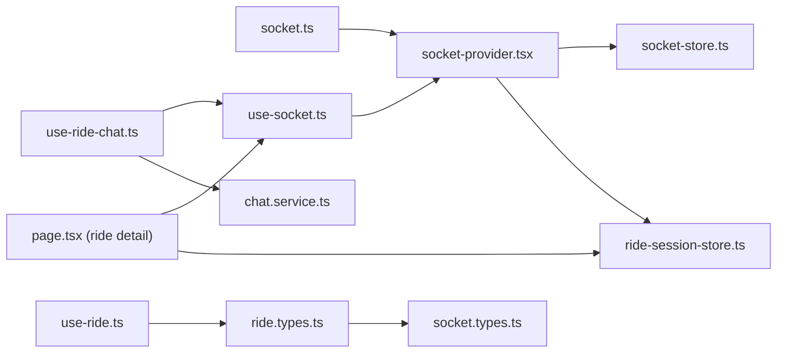

# Real-time State Synchronization

<cite>
**Referenced Files in This Document**
- [socket.ts](file://src/lib/socket.ts)
- [socket-provider.tsx](file://src/provider/socket-provider.tsx)
- [use-socket.ts](file://src/hooks/shared/use-socket.ts)
- [socket-store.ts](file://src/store/socket-store.ts)
- [ride-session-store.ts](file://src/store/ride-session-store.ts)
- [socket.types.ts](file://src/types/socket.types.ts)
- [use-ride-chat.ts](file://src/hooks/shared/use-ride-chat.ts)
- [chat.service.ts](file://src/services/chat.service.ts)
- [page.tsx](file://src/app/(view)/my-rides/[id]/page.tsx)
- [use-ride.ts](file://src/hooks/booking/use-ride.ts)
- [ride.types.ts](file://src/types/ride.types.ts)
</cite>

## Table of Contents
1. [Introduction](#introduction)
2. [Project Structure](#project-structure)
3. [Core Components](#core-components)
4. [Architecture Overview](#architecture-overview)
5. [Detailed Component Analysis](#detailed-component-analysis)
6. [Dependency Analysis](#dependency-analysis)
7. [Performance Considerations](#performance-considerations)
8. [Troubleshooting Guide](#troubleshooting-guide)
9. [Conclusion](#conclusion)

## Introduction
This document explains how the application implements real-time state synchronization using WebSocket connections. It covers the socket connection lifecycle, event handling patterns, and strategies for synchronizing real-time updates with local state. You will learn how to manage connection state, handle reconnection logic, and integrate live data with both Zustand stores and TanStack Query. The guide also includes practical patterns for presence indicators, live chat messages, and ride status updates.

## Project Structure
The real-time layer is composed of:
- A singleton Socket.IO client factory that creates and configures the underlying connection.
- A React provider that manages connection lifecycle, room membership, and centralizes event dispatching into a Zustand store.
- Typed hooks for emitting events and subscribing to server events.
- A typed event contract defining all server-to-client and client-to-server payloads.
- Feature-specific integrations (ride detail page and ride chat hook) that combine WebSocket events with UI state and TanStack Query.

**Diagram sources**
- [socket-provider.tsx:66-115](file://src/provider/socket-provider.tsx#L66-L115)
- [use-socket.ts:12-39](file://src/hooks/shared/use-socket.ts#L12-L39)
- [socket-store.ts:19-25](file://src/store/socket-store.ts#L19-L25)
- [ride-session-store.ts:9-20](file://src/store/ride-session-store.ts#L9-L20)
- [page.tsx:78-85](file://src/app/(view)/my-rides/[id]/page.tsx#L78-L85)
- [use-ride-chat.ts:17-55](file://src/hooks/shared/use-ride-chat.ts#L17-L55)

**Section sources**
- [socket.ts:1-50](file://src/lib/socket.ts#L1-L50)
- [socket-provider.tsx:1-122](file://src/provider/socket-provider.tsx#L1-L122)
- [use-socket.ts:1-57](file://src/hooks/shared/use-socket.ts#L1-L57)
- [socket-store.ts:1-34](file://src/store/socket-store.ts#L1-L34)
- [ride-session-store.ts:1-21](file://src/store/ride-session-store.ts#L1-L21)
- [socket.types.ts:1-278](file://src/types/socket.types.ts#L1-L278)

## Core Components
- Socket client factory: Creates a single Socket.IO instance with credentials and transport fallbacks. Provides connect/disconnect utilities.
- Socket provider: Initializes the connection, tracks connected state, joins rooms on connect, and routes all known events into a centralized Zustand store.
- Typed hooks: Expose safe emit/on/off methods and a convenience hook to subscribe to an event for the lifetime of a component.
- Event types: Strongly typed definitions for all server-to-client and client-to-server events and payloads.
- Ride session store: Persists the active ride ID across reloads so the provider can rejoin the correct room after reconnect.
- Feature integrations:
  - Ride detail page: Joins the ride room, listens to driver location broadcasts, and reacts to trip completion.
  - Ride chat hook: Lazily creates a chat if missing, fetches history via TanStack Query, and merges live messages from WebSocket.

**Section sources**
- [socket.ts:23-42](file://src/lib/socket.ts#L23-L42)
- [socket-provider.tsx:66-115](file://src/provider/socket-provider.tsx#L66-L115)
- [use-socket.ts:12-39](file://src/hooks/shared/use-socket.ts#L12-L39)
- [socket.types.ts:30-134](file://src/types/socket.types.ts#L30-L134)
- [ride-session-store.ts:9-20](file://src/store/ride-session-store.ts#L9-L20)
- [page.tsx:78-103](file://src/app/(view)/my-rides/[id]/page.tsx#L78-L103)
- [use-ride-chat.ts:17-108](file://src/hooks/shared/use-ride-chat.ts#L17-L108)

## Architecture Overview
The system uses a unidirectional flow:
- Provider connects to the server and subscribes to a fixed set of events.
- Incoming events are dispatched into a global Zustand store keyed by event name.
- Components subscribe to specific events or read the latest entry from the store.
- Room membership is managed per feature (e.g., ride detail page joins a ride room).
- Reconnection is handled automatically by the provider; it re-joins the last active ride room based on persisted session state.

**Diagram sources**
- [socket-provider.tsx:71-108](file://src/provider/socket-provider.tsx#L71-L108)
- [socket-store.ts:19-25](file://src/store/socket-store.ts#L19-L25)
- [page.tsx:78-96](file://src/app/(view)/my-rides/[id]/page.tsx#L78-L96)
- [use-ride-chat.ts:71-76](file://src/hooks/shared/use-ride-chat.ts#L71-L76)

## Detailed Component Analysis

### Socket Client Factory
Responsibilities:
- Build a single Socket.IO instance with credentials and transport options.
- Provide getSocket and destroySocket helpers.
- Log incoming/outgoing events for debugging.

Key behaviors:
- Uses environment variables for the server URL.
- Reads authentication token from cookies before connecting.
- Disables auto-connect to allow controlled initialization.

**Section sources**
- [socket.ts:6-42](file://src/lib/socket.ts#L6-L42)

### Socket Provider
Responsibilities:
- Initialize and own the socket instance.
- Track connected state.
- Join the active ride room on connect using persisted ride session.
- Dynamically bind handlers for all known events and dispatch them into the Zustand store.
- Clean up listeners and disconnect on unmount.

Reconnection strategy:
- Relies on Socket.IO’s built-in reconnection.
- On each "connect" event, re-joins the last active ride room by reading the persisted activeRideId.

Room management:
- Features explicitly join/leave rooms (e.g., ride detail page emits "room:join"/"room:leave").

**Section sources**
- [socket-provider.tsx:66-115](file://src/provider/socket-provider.tsx#L66-L115)
- [ride-session-store.ts:9-20](file://src/store/ride-session-store.ts#L9-L20)

### Typed Hooks: useSocket and useSocketEvent
- useSocket: Returns the raw socket instance, connected flag, and typed emit/on/off helpers.
- useSocketEvent: Subscribes to a specific event for the lifetime of the component and cleans up on unmount.

Typing:
- Leverages the shared event type definitions to ensure compile-time safety for emitted and received payloads.

**Section sources**
- [use-socket.ts:12-56](file://src/hooks/shared/use-socket.ts#L12-L56)
- [socket.types.ts:274-278](file://src/types/socket.types.ts#L274-L278)

### Centralized Event Store (Zustand)
Design:
- Maintains a map of the latest event entries, each including the payload and timestamp.
- Provides a dispatch function used by the provider to update the store atomically.
- Offers a selector hook to read the latest entry for a given event.

Usage patterns:
- Components can either subscribe via useSocketEvent or read the latest entry from the store when they need to react to any change.

**Section sources**
- [socket-store.ts:14-31](file://src/store/socket-store.ts#L14-L31)

### Ride Session Persistence
Purpose:
- Persist the currently active ride ID across reloads.
- Enables automatic rejoining of the correct room after network recovery or page refresh.

Integration:
- Ride detail page sets the active ride ID when mounted.
- Socket provider reads this value on connect to rejoin the room.

**Section sources**
- [ride-session-store.ts:9-20](file://src/store/ride-session-store.ts#L9-L20)
- [page.tsx:78-85](file://src/app/(view)/my-rides/[id]/page.tsx#L78-L85)
- [socket-provider.tsx:76-83](file://src/provider/socket-provider.tsx#L76-L83)

### Live Chat Integration (TanStack Query + WebSocket)
Flow:
- Fetch or lazily create a 1:1 chat for a booking using TanStack Query.
- Load message history via queries.
- Subscribe to "chat:message" events and append new messages to local state.
- Mark messages as seen by calling the API mutation when they become visible.

Optimizations:
- Avoid duplicate inserts by checking existing message IDs.
- Invalidate relevant query keys after mutations to keep server state consistent.

**Section sources**
- [use-ride-chat.ts:17-108](file://src/hooks/shared/use-ride-chat.ts#L17-L108)
- [chat.service.ts:11-49](file://src/services/chat.service.ts#L11-L49)

### Ride Status and Live Location Updates
Flow:
- Ride detail page joins the ride room and listens for "ride:live-update".
- Updates local driver position state for rendering on the map.
- Reacts to "ride:trip-completed" to prompt rating and clear the active ride session.

Data sources:
- Driver location broadcasted via "ride:live-update" contains coordinates and optional heading.
- Ride metadata fetched via TanStack Query hooks.

**Section sources**
- [page.tsx:78-103](file://src/app/(view)/my-rides/[id]/page.tsx#L78-L103)
- [use-ride.ts:38-44](file://src/hooks/booking/use-ride.ts#L38-L44)
- [ride.types.ts:14-33](file://src/types/ride.types.ts#L14-L33)

### Presence Indicators Pattern
Conceptual approach:
- Maintain a small presence store keyed by user IDs.
- Update presence on "driver:status-changed" or similar events.
- Render online/offline badges in UI components.

[No sources needed since this section provides conceptual guidance]

## Dependency Analysis
The following diagram shows key dependencies between modules involved in real-time synchronization.

**Diagram sources**
- [socket.ts:1-50](file://src/lib/socket.ts#L1-L50)
- [socket-provider.tsx:1-122](file://src/provider/socket-provider.tsx#L1-L122)
- [socket-store.ts:1-34](file://src/store/socket-store.ts#L1-L34)
- [ride-session-store.ts:1-21](file://src/store/ride-session-store.ts#L1-L21)
- [use-socket.ts:1-57](file://src/hooks/shared/use-socket.ts#L1-L57)
- [use-ride-chat.ts:1-108](file://src/hooks/shared/use-ride-chat.ts#L1-L108)
- [chat.service.ts:1-50](file://src/services/chat.service.ts#L1-L50)
- [page.tsx:1-371](file://src/app/(view)/my-rides/[id]/page.tsx#L1-L371)
- [ride.types.ts:1-161](file://src/types/ride.types.ts#L1-L161)
- [socket.types.ts:1-278](file://src/types/socket.types.ts#L1-L278)
- [use-ride.ts:1-60](file://src/hooks/booking/use-ride.ts#L1-L60)

**Section sources**
- [socket.ts:1-50](file://src/lib/socket.ts#L1-L50)
- [socket-provider.tsx:1-122](file://src/provider/socket-provider.tsx#L1-L122)
- [socket-store.ts:1-34](file://src/store/socket-store.ts#L1-L34)
- [ride-session-store.ts:1-21](file://src/store/ride-session-store.ts#L1-L21)
- [use-socket.ts:1-57](file://src/hooks/shared/use-socket.ts#L1-L57)
- [use-ride-chat.ts:1-108](file://src/hooks/shared/use-ride-chat.ts#L1-L108)
- [chat.service.ts:1-50](file://src/services/chat.service.ts#L1-L50)
- [page.tsx:1-371](file://src/app/(view)/my-rides/[id]/page.tsx#L1-L371)
- [ride.types.ts:1-161](file://src/types/ride.types.ts#L1-L161)
- [socket.types.ts:1-278](file://src/types/socket.types.ts#L1-L278)
- [use-ride.ts:1-60](file://src/hooks/booking/use-ride.ts#L1-L60)

## Performance Considerations
- Prefer event subscriptions (useSocketEvent) for high-frequency updates like "ride:live-update" to avoid unnecessary store reads.
- Use the centralized store only when you need to observe the latest event globally or when multiple consumers must react to the same event.
- Debounce or throttle frequent location updates at the source (driver side) and consider filtering tiny movements on the client to reduce render churn.
- Keep room membership minimal: join only when necessary and leave on unmount to reduce server load.
- For chat, prefer appending new messages locally and invalidating only the affected query keys to minimize refetch overhead.

[No sources needed since this section provides general guidance]

## Troubleshooting Guide
Common issues and remedies:
- No events received after reconnect: Ensure the provider re-joins the active room on "connect" and that the active ride ID is persisted correctly.
- Duplicate messages in chat: Verify deduplication logic by message ID before appending.
- Stale UI state: After mutations (e.g., marking messages seen), invalidate corresponding query keys to refresh server-backed data.
- Authentication failures: Confirm that the token is available in cookies before connecting and that the server accepts it.

**Section sources**
- [socket-provider.tsx:76-83](file://src/provider/socket-provider.tsx#L76-L83)
- [ride-session-store.ts:9-20](file://src/store/ride-session-store.ts#L9-L20)
- [use-ride-chat.ts:71-88](file://src/hooks/shared/use-ride-chat.ts#L71-L88)
- [chat.service.ts:38-45](file://src/services/chat.service.ts#L38-L45)
- [socket.ts:23-42](file://src/lib/socket.ts#L23-L42)

## Conclusion
The application implements a robust real-time layer by combining a typed Socket.IO client, a provider-managed connection lifecycle, and a centralized Zustand event store. Features such as live chat and ride tracking integrate seamlessly by subscribing to specific events and merging them with TanStack Query-backed server state. The design supports reliable reconnection through room rejoining and offers clear extension points for additional real-time features like presence indicators.