# Server State with TanStack Query

<cite>
**Referenced Files in This Document**
- [god-provider.tsx](file://src/provider/god-provider.tsx)
- [api.ts](file://src/lib/api.ts)
- [use-user.ts](file://src/hooks/shared/use-user.ts)
- [auth.service.ts](file://src/services/auth.service.ts)
- [use-auth.ts](file://src/hooks/auth/use-auth.ts)
- [use-booking.ts](file://src/hooks/booking/use-booking.ts)
- [booking.service.ts](file://src/services/booking.service.ts)
- [use-driver-ride.ts](file://src/hooks/driver/use-driver-ride.ts)
- [use-chat.ts](file://src/hooks/shared/use-chat.ts)
- [chat.service.ts](file://src/services/chat.service.ts)
- [use-ride-chat.ts](file://src/hooks/shared/use-ride-chat.ts)
- [use-notification.ts](file://src/hooks/shared/use-notification.ts)
- [use-settings.ts](file://src/hooks/shared/use-settings.ts)
</cite>

## Table of Contents
1. Introduction
2. Project Structure
3. Core Components
4. Architecture Overview
5. Detailed Component Analysis
6. Dependency Analysis
7. Performance Considerations
8. Troubleshooting Guide
9. Conclusion

## Introduction
This document explains how server state is managed using TanStack Query across the application. It covers query configuration, caching strategies, data synchronization patterns, mutation workflows, invalidation strategies, and performance optimizations. It also provides guidance for implementing optimistic updates and robust error handling, along with examples of custom hooks that wrap API calls and manage loading states, errors, and data transformations.

## Project Structure
The project organizes server state around a clear separation:
- Providers configure TanStack Query globally.
- Services encapsulate HTTP requests via a shared fetch wrapper.
- Hooks implement queries and mutations, exposing stable keys and invalidation logic.
- Feature-specific hooks coordinate multiple queries/mutations and integrate with real-time channels when needed.

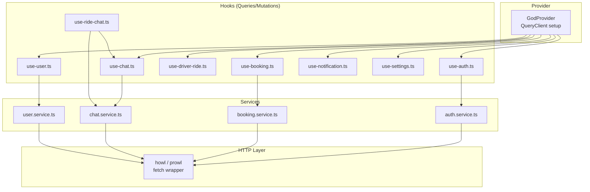

**Diagram sources**
- [god-provider.tsx:1-48](file://src/provider/god-provider.tsx#L1-L48)
- [api.ts:1-106](file://src/lib/api.ts#L1-L106)
- [use-user.ts:1-117](file://src/hooks/shared/use-user.ts#L1-L117)
- [auth.service.ts:1-43](file://src/services/auth.service.ts#L1-L43)
- [use-auth.ts:1-68](file://src/hooks/auth/use-auth.ts#L1-L68)
- [use-booking.ts:1-60](file://src/hooks/booking/use-booking.ts#L1-L60)
- [booking.service.ts:1-45](file://src/services/booking.service.ts#L1-L45)
- [use-driver-ride.ts:1-35](file://src/hooks/driver/use-driver-ride.ts#L1-L35)
- [use-chat.ts:1-95](file://src/hooks/shared/use-chat.ts#L1-L95)
- [chat.service.ts:1-50](file://src/services/chat.service.ts#L1-L50)
- [use-ride-chat.ts:1-108](file://src/hooks/shared/use-ride-chat.ts#L1-L108)
- [use-notification.ts:1-40](file://src/hooks/shared/use-notification.ts#L1-L40)
- [use-settings.ts:1-40](file://src/hooks/shared/use-settings.ts#L1-L40)

**Section sources**
- [god-provider.tsx:1-48](file://src/provider/god-provider.tsx#L1-L48)
- [api.ts:1-106](file://src/lib/api.ts#L1-L106)

## Core Components
- Global QueryClient configuration:
  - Default staleTime and retry are set at the provider level to balance freshness and network usage.
- HTTP layer:
  - A centralized JSON and FormData fetch wrapper handles base URLs, headers, token injection from cookies, and consistent error throwing.
- Services:
  - Thin modules that call the HTTP wrapper with typed endpoints and payloads.
- Hooks:
  - Encapsulate useQuery and useMutation, define query keys, and perform targeted invalidations after mutations.

Key responsibilities:
- Queries: read-only data access with automatic background refetching based on staleness.
- Mutations: write operations with success handlers that invalidate relevant queries.
- Keys: stable key factories ensure precise cache targeting.

**Section sources**
- [god-provider.tsx:22-32](file://src/provider/god-provider.tsx#L22-L32)
- [api.ts:23-73](file://src/lib/api.ts#L23-L73)
- [api.ts:83-105](file://src/lib/api.ts#L83-L105)
- [use-user.ts:17-28](file://src/hooks/shared/use-user.ts#L17-L28)
- [use-user.ts:30-37](file://src/hooks/shared/use-user.ts#L30-L37)
- [use-booking.ts:14-18](file://src/hooks/booking/use-booking.ts#L14-L18)
- [use-booking.ts:35-44](file://src/hooks/booking/use-booking.ts#L35-L44)
- [use-chat.ts:11-16](file://src/hooks/shared/use-chat.ts#L11-L16)
- [use-chat.ts:18-24](file://src/hooks/shared/use-chat.ts#L18-L24)

## Architecture Overview
The system follows a layered approach:
- Provider initializes QueryClient and wraps the app.
- Hooks subscribe to the cache via useQuery/useMutation.
- Services call the HTTP wrapper to reach the backend.
- Mutations trigger targeted invalidations to keep UI in sync.

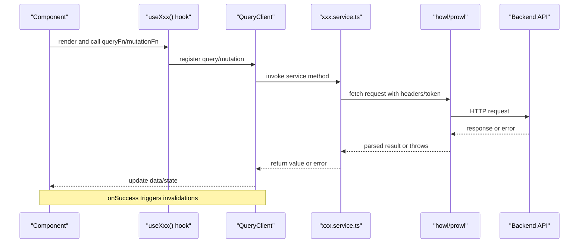

**Diagram sources**
- [god-provider.tsx:22-32](file://src/provider/god-provider.tsx#L22-L32)
- [api.ts:23-73](file://src/lib/api.ts#L23-L73)
- [use-user.ts:30-37](file://src/hooks/shared/use-user.ts#L30-L37)
- [use-booking.ts:35-44](file://src/hooks/booking/use-booking.ts#L35-L44)
- [use-chat.ts:18-24](file://src/hooks/shared/use-chat.ts#L18-L24)

## Detailed Component Analysis

### Global Query Client Configuration
- Stale time and retry defaults are defined once at the provider level.
- Devtools are enabled in development for debugging.

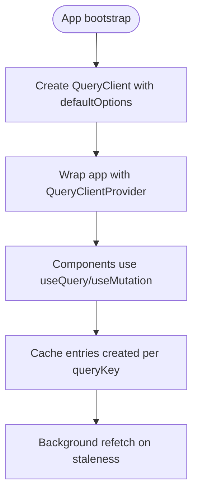

**Diagram sources**
- [god-provider.tsx:22-32](file://src/provider/god-provider.tsx#L22-L32)

**Section sources**
- [god-provider.tsx:22-32](file://src/provider/god-provider.tsx#L22-L32)

### HTTP Layer and Error Handling
- The JSON wrapper builds requests with base URL, content type, credentials, and optional Authorization header derived from cookies.
- Non-ok responses throw an Error with a message extracted from the response body or status text.
- The FormData wrapper similarly sets headers and throws on non-ok responses.

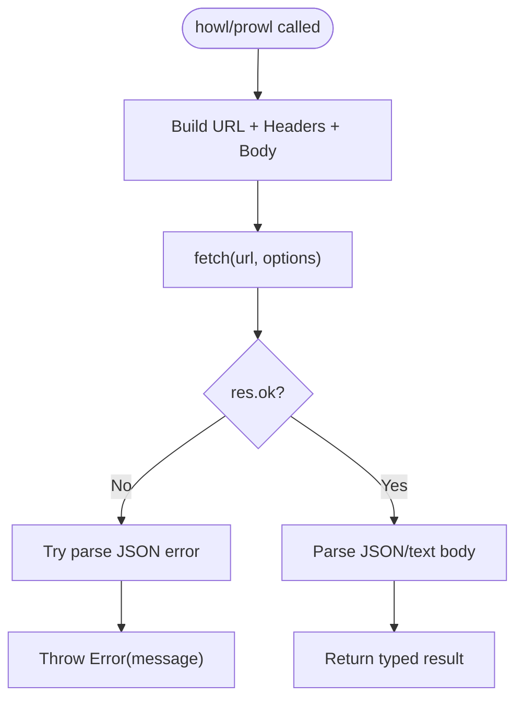

**Diagram sources**
- [api.ts:23-73](file://src/lib/api.ts#L23-L73)
- [api.ts:83-105](file://src/lib/api.ts#L83-L105)

**Section sources**
- [api.ts:23-73](file://src/lib/api.ts#L23-L73)
- [api.ts:83-105](file://src/lib/api.ts#L83-L105)

### User Module: Profile and Admin Lists
- Query keys centralize cache addressing for profile, list, and detail views.
- Mutations invalidate specific keys to refresh affected lists/details.
- A dedicated hook synchronizes user ID between the cache and a lightweight store, and re-fetches when a token exists but no user ID is present.

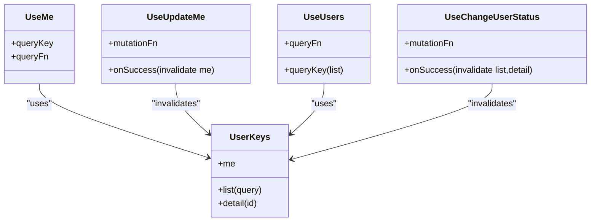

**Diagram sources**
- [use-user.ts:17-28](file://src/hooks/shared/use-user.ts#L17-L28)
- [use-user.ts:30-37](file://src/hooks/shared/use-user.ts#L30-L37)
- [use-user.ts:67-72](file://src/hooks/shared/use-user.ts#L67-L72)
- [use-user.ts:82-92](file://src/hooks/shared/use-user.ts#L82-L92)

**Section sources**
- [use-user.ts:17-28](file://src/hooks/shared/use-user.ts#L17-L28)
- [use-user.ts:30-37](file://src/hooks/shared/use-user.ts#L30-L37)
- [use-user.ts:67-72](file://src/hooks/shared/use-user.ts#L67-L72)
- [use-user.ts:82-92](file://src/hooks/shared/use-user.ts#L82-L92)
- [use-user.ts:94-116](file://src/hooks/shared/use-user.ts#L94-L116)

### Authentication Module: Mutations Only
- Auth flows are implemented as mutations without cached reads.
- Each mutation delegates to the auth service which uses the HTTP wrapper.

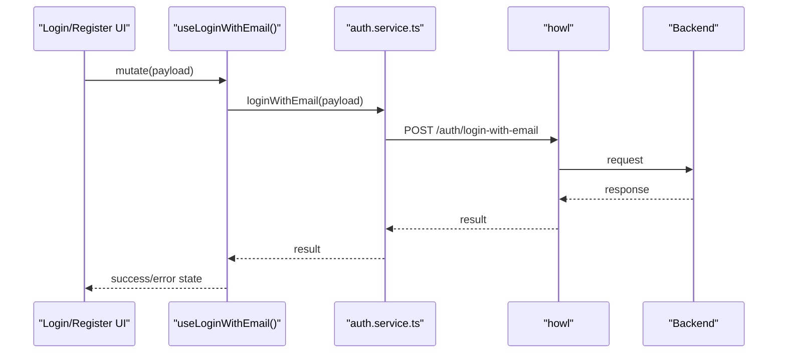

**Diagram sources**
- [use-auth.ts:27-31](file://src/hooks/auth/use-auth.ts#L27-L31)
- [auth.service.ts:22-23](file://src/services/auth.service.ts#L22-L23)
- [api.ts:23-73](file://src/lib/api.ts#L23-L73)

**Section sources**
- [use-auth.ts:15-68](file://src/hooks/auth/use-auth.ts#L15-L68)
- [auth.service.ts:15-43](file://src/services/auth.service.ts#L15-L43)

### Booking Module: Queries, Mutations, and Invalidation
- Centralized key factories for my bookings, details, and admin lists.
- Status change mutation invalidates both the list and the specific booking detail.

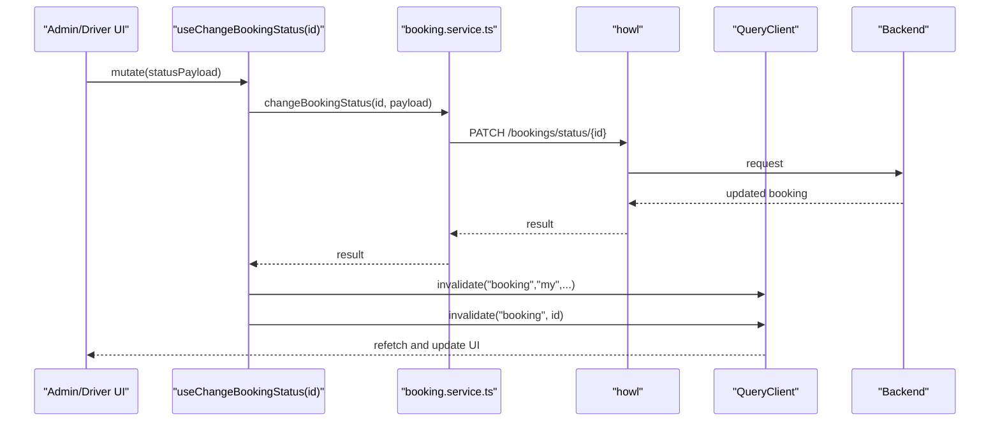

**Diagram sources**
- [use-booking.ts:35-44](file://src/hooks/booking/use-booking.ts#L35-L44)
- [booking.service.ts:27-28](file://src/services/booking.service.ts#L27-L28)
- [api.ts:23-73](file://src/lib/api.ts#L23-L73)

**Section sources**
- [use-booking.ts:14-18](file://src/hooks/booking/use-booking.ts#L14-L18)
- [use-booking.ts:20-33](file://src/hooks/booking/use-booking.ts#L20-L33)
- [use-booking.ts:35-44](file://src/hooks/booking/use-booking.ts#L35-L44)
- [use-booking.ts:46-51](file://src/hooks/booking/use-booking.ts#L46-L51)
- [booking.service.ts:13-44](file://src/services/booking.service.ts#L13-L44)

### Driver Rides Module: Keyed Queries
- Stable key factories for driver rides list, detail, and passengers by ride.
- Queries are conditionally enabled when identifiers are available.

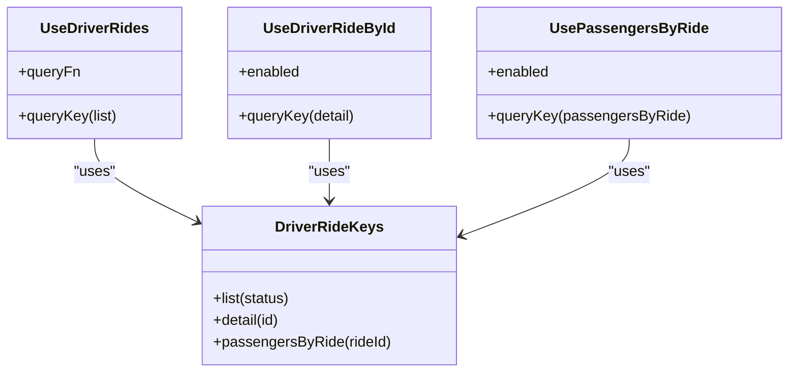

**Diagram sources**
- [use-driver-ride.ts:7-11](file://src/hooks/driver/use-driver-ride.ts#L7-L11)
- [use-driver-ride.ts:13-18](file://src/hooks/driver/use-driver-ride.ts#L13-L18)
- [use-driver-ride.ts:20-26](file://src/hooks/driver/use-driver-ride.ts#L20-L26)
- [use-driver-ride.ts:28-34](file://src/hooks/driver/use-driver-ride.ts#L28-L34)

**Section sources**
- [use-driver-ride.ts:1-35](file://src/hooks/driver/use-driver-ride.ts#L1-L35)

### Chat Module: Queries, Mutations, and Real-Time Sync
- Key factories organize chat lists, messages, and individual items.
- Mutations invalidate related lists/messages.
- A specialized hook orchestrates lazy chat creation, message fetching, and live updates via socket events.

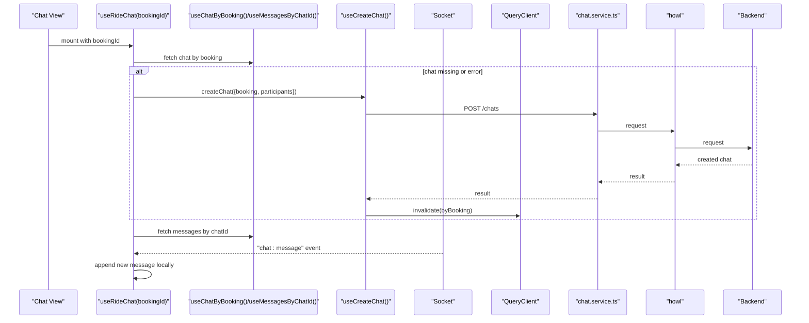

**Diagram sources**
- [use-ride-chat.ts:17-55](file://src/hooks/shared/use-ride-chat.ts#L17-L55)
- [use-chat.ts:18-24](file://src/hooks/shared/use-chat.ts#L18-L24)
- [use-chat.ts:33-40](file://src/hooks/shared/use-chat.ts#L33-L40)
- [use-chat.ts:51-60](file://src/hooks/shared/use-chat.ts#L51-L60)
- [use-chat.ts:71-77](file://src/hooks/shared/use-chat.ts#L71-L77)
- [chat.service.ts:11-24](file://src/services/chat.service.ts#L11-L24)
- [api.ts:23-73](file://src/lib/api.ts#L23-L73)

**Section sources**
- [use-chat.ts:11-16](file://src/hooks/shared/use-chat.ts#L11-L16)
- [use-chat.ts:18-24](file://src/hooks/shared/use-chat.ts#L18-L24)
- [use-chat.ts:33-40](file://src/hooks/shared/use-chat.ts#L33-L40)
- [use-chat.ts:51-60](file://src/hooks/shared/use-chat.ts#L51-L60)
- [use-chat.ts:71-77](file://src/hooks/shared/use-chat.ts#L71-L77)
- [use-ride-chat.ts:17-108](file://src/hooks/shared/use-ride-chat.ts#L17-L108)
- [chat.service.ts:11-50](file://src/services/chat.service.ts#L11-L50)

### Notifications and Settings Modules
- Notifications:
  - List query and mutations mark all done or delete notifications, invalidating the list.
- Settings:
  - General settings and per-key settings are queried and updated with targeted invalidations.

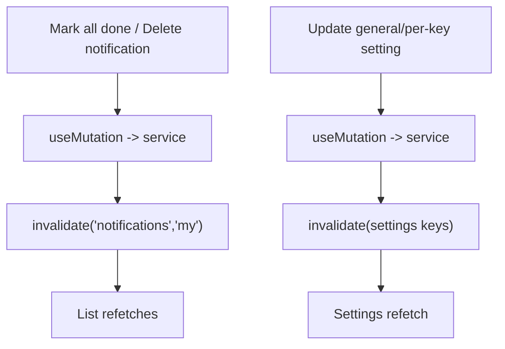

**Diagram sources**
- [use-notification.ts:17-31](file://src/hooks/shared/use-notification.ts#L17-L31)
- [use-settings.ts:19-25](file://src/hooks/shared/use-settings.ts#L19-L25)
- [use-settings.ts:34-40](file://src/hooks/shared/use-settings.ts#L34-L40)

**Section sources**
- [use-notification.ts:6-15](file://src/hooks/shared/use-notification.ts#L6-L15)
- [use-notification.ts:17-31](file://src/hooks/shared/use-notification.ts#L17-L31)
- [use-settings.ts:7-17](file://src/hooks/shared/use-settings.ts#L7-L17)
- [use-settings.ts:19-25](file://src/hooks/shared/use-settings.ts#L19-L25)
- [use-settings.ts:27-40](file://src/hooks/shared/use-settings.ts#L27-L40)

## Dependency Analysis
- Provider depends on React Query primitives and devtools.
- Hooks depend on services and QueryClient for invalidations.
- Services depend on the HTTP wrapper.
- No circular dependencies observed among these layers.

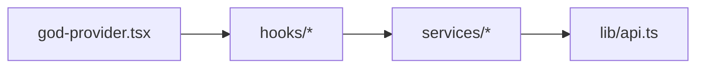

**Diagram sources**
- [god-provider.tsx:1-48](file://src/provider/god-provider.tsx#L1-L48)
- [api.ts:1-106](file://src/lib/api.ts#L1-L106)

**Section sources**
- [god-provider.tsx:1-48](file://src/provider/god-provider.tsx#L1-L48)
- [api.ts:1-106](file://src/lib/api.ts#L1-L106)

## Performance Considerations
- Caching strategy:
  - Default staleTime ensures queries remain fresh without excessive refetches.
  - Retry is limited to reduce noise on transient failures.
- Background refetching:
  - Enabled automatically when queries become stale; consider tuning staleTime per feature if needed.
- Selective invalidation:
  - Mutations invalidate only affected keys to minimize refetch scope.
- Conditional queries:
  - Use enabled flags to avoid unnecessary requests when identifiers are missing.
- Data transformation:
  - Transform data inside queryFn where appropriate to keep components simple.
- Real-time integration:
  - For live features like chat, combine local state for immediate UX with cache invalidation for consistency.

[No sources needed since this section provides general guidance]

## Troubleshooting Guide
- Network errors:
  - The HTTP wrapper throws Errors with messages from the server or fallbacks. Handle them in component UI or mutation callbacks.
- Token issues:
  - Authorization is injected from cookies; ensure cookies are present and accessible.
- Missing data:
  - Some queries are disabled until IDs exist; verify enabled conditions and navigation flow.
- Stale data:
  - If UI does not reflect changes, confirm that mutations invalidate the correct query keys.
- Debugging:
  - Use React Query Devtools in development to inspect cache, refetch behavior, and invalidations.

**Section sources**
- [api.ts:45-72](file://src/lib/api.ts#L45-L72)
- [api.ts:99-102](file://src/lib/api.ts#L99-L102)
- [use-user.ts:94-116](file://src/hooks/shared/use-user.ts#L94-L116)
- [use-booking.ts:27-33](file://src/hooks/booking/use-booking.ts#L27-L33)
- [god-provider.tsx:22-32](file://src/provider/god-provider.tsx#L22-L32)

## Conclusion
The codebase demonstrates a clean, scalable pattern for server state management with TanStack Query:
- Centralized QueryClient configuration.
- Consistent HTTP wrapper with robust error handling.
- Well-scoped query keys and targeted invalidations.
- Optional real-time enhancements integrated alongside cache-driven updates.
Following these patterns ensures predictable caching, efficient refetching, and maintainable data flows across the application.

[No sources needed since this section summarizes without analyzing specific files]