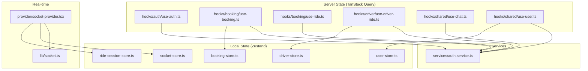
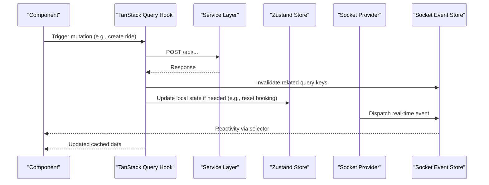
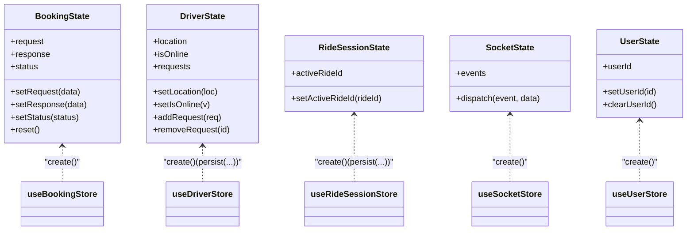
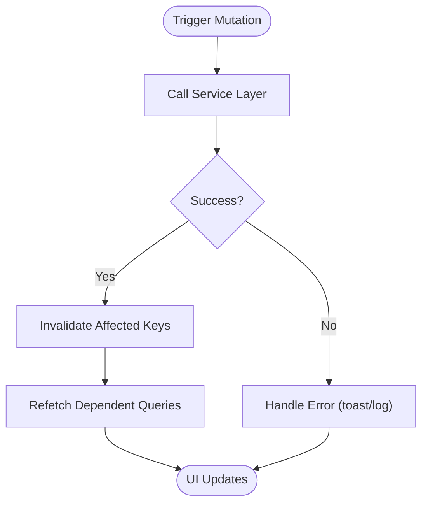
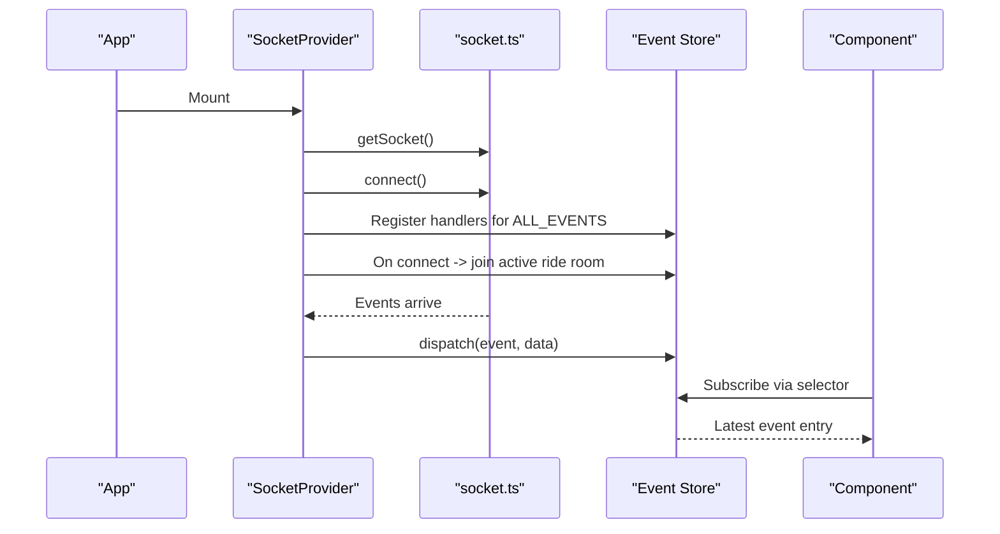
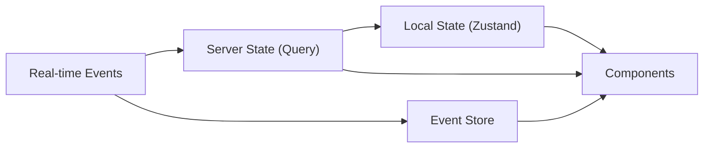
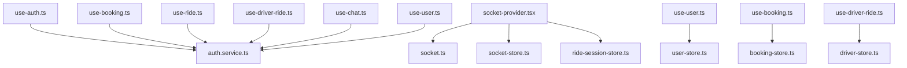

# State Management

<cite>
**Referenced Files in This Document**
- [booking-store.ts](file://src/store/booking-store.ts)
- [driver-store.ts](file://src/store/driver-store.ts)
- [ride-session-store.ts](file://src/store/ride-session-store.ts)
- [socket-store.ts](file://src/store/socket-store.ts)
- [user-store.ts](file://src/store/user-store.ts)
- [use-auth.ts](file://src/hooks/auth/use-auth.ts)
- [use-booking.ts](file://src/hooks/booking/use-booking.ts)
- [use-driver-ride.ts](file://src/hooks/driver/use-driver-ride.ts)
- [use-chat.ts](file://src/hooks/shared/use-chat.ts)
- [use-user.ts](file://src/hooks/shared/use-user.ts)
- [use-ride.ts](file://src/hooks/booking/use-ride.ts)
- [use-socket.ts](file://src/hooks/shared/use-socket.ts)
- [socket-provider.tsx](file://src/provider/socket-provider.tsx)
- [socket.ts](file://src/lib/socket.ts)
- [auth.service.ts](file://src/services/auth.service.ts)
</cite>

## Table of Contents
1. [Introduction](#introduction)
2. [Project Structure](#project-structure)
3. [Core Components](#core-components)
4. [Architecture Overview](#architecture-overview)
5. [Detailed Component Analysis](#detailed-component-analysis)
6. [Dependency Analysis](#dependency-analysis)
7. [Performance Considerations](#performance-considerations)
8. [Troubleshooting Guide](#troubleshooting-guide)
9. [Conclusion](#conclusion)
10. [Appendices](#appendices)

## Introduction
This document explains the client-side state management architecture built with Zustand for local UI and session state, TanStack Query for server-state caching and mutations, and Socket.IO for real-time synchronization. It clarifies how local state, server state, and real-time updates interact, and provides patterns for persistence, optimistic updates, and error handling. It also includes conventions for creating new stores and hooks.

## Project Structure
The state layer is organized into:
- Local state stores (Zustand): small, focused slices of UI/session state
- Server state hooks (TanStack Query): typed query/mutation hooks that call services
- Real-time bridge (Socket.IO + provider): connects socket events to a lightweight event store
- Services: HTTP clients encapsulating API calls

**Diagram sources**
- [socket-provider.tsx:1-122](file://src/provider/socket-provider.tsx#L1-L122)
- [socket.ts:1-50](file://src/lib/socket.ts#L1-L50)
- [use-auth.ts:1-68](file://src/hooks/auth/use-auth.ts#L1-L68)
- [use-booking.ts:1-60](file://src/hooks/booking/use-booking.ts#L1-L60)
- [use-ride.ts:1-60](file://src/hooks/booking/use-ride.ts#L1-L60)
- [use-driver-ride.ts:1-35](file://src/hooks/driver/use-driver-ride.ts#L1-L35)
- [use-chat.ts:1-92](file://src/hooks/shared/use-chat.ts#L1-L92)
- [use-user.ts:1-117](file://src/hooks/shared/use-user.ts#L1-L117)
- [auth.service.ts:1-43](file://src/services/auth.service.ts#L1-L43)
- [booking-store.ts:1-28](file://src/store/booking-store.ts#L1-L28)
- [driver-store.ts:1-37](file://src/store/driver-store.ts#L1-L37)
- [ride-session-store.ts:1-21](file://src/store/ride-session-store.ts#L1-L21)
- [socket-store.ts:1-34](file://src/store/socket-store.ts#L1-L34)
- [user-store.ts:1-14](file://src/store/user-store.ts#L1-L14)

**Section sources**
- [socket-provider.tsx:1-122](file://src/provider/socket-provider.tsx#L1-L122)
- [socket.ts:1-50](file://src/lib/socket.ts#L1-L50)
- [use-auth.ts:1-68](file://src/hooks/auth/use-auth.ts#L1-L68)
- [use-booking.ts:1-60](file://src/hooks/booking/use-booking.ts#L1-L60)
- [use-ride.ts:1-60](file://src/hooks/booking/use-ride.ts#L1-L60)
- [use-driver-ride.ts:1-35](file://src/hooks/driver/use-driver-ride.ts#L1-L35)
- [use-chat.ts:1-92](file://src/hooks/shared/use-chat.ts#L1-L92)
- [use-user.ts:1-117](file://src/hooks/shared/use-user.ts#L1-L117)
- [auth.service.ts:1-43](file://src/services/auth.service.ts#L1-L43)
- [booking-store.ts:1-28](file://src/store/booking-store.ts#L1-L28)
- [driver-store.ts:1-37](file://src/store/driver-store.ts#L1-L37)
- [ride-session-store.ts:1-21](file://src/store/ride-session-store.ts#L1-L21)
- [socket-store.ts:1-34](file://src/store/socket-store.ts#L1-L34)
- [user-store.ts:1-14](file://src/store/user-store.ts#L1-L14)

## Core Components
- Local state stores (Zustand)
  - Booking flow state: request/response/status for the current booking wizard
  - Driver context: location, online status, incoming requests; persisted partially
  - Ride session: active ride ID persisted across reloads
  - Socket events: last known event per type with timestamp
  - User identity: minimal userId slice synced from server state
- Server state (TanStack Query)
  - Auth, bookings, rides, chat, users: typed queries and mutations with normalized keys
  - Invalidation strategies after mutations to keep UI consistent
- Real-time bridge
  - Socket provider manages connection lifecycle and dispatches events into the event store
  - Hooks to emit and subscribe to events with proper cleanup

Key responsibilities:
- Keep UI-only or ephemeral state in Zustand stores
- Cache and mutate server data via TanStack Query hooks
- Use Socket.IO to push real-time updates into the event store and invalidate relevant queries

**Section sources**
- [booking-store.ts:1-28](file://src/store/booking-store.ts#L1-L28)
- [driver-store.ts:1-37](file://src/store/driver-store.ts#L1-L37)
- [ride-session-store.ts:1-21](file://src/store/ride-session-store.ts#L1-L21)
- [socket-store.ts:1-34](file://src/store/socket-store.ts#L1-L34)
- [user-store.ts:1-14](file://src/store/user-store.ts#L1-L14)
- [use-auth.ts:1-68](file://src/hooks/auth/use-auth.ts#L1-L68)
- [use-booking.ts:1-60](file://src/hooks/booking/use-booking.ts#L1-L60)
- [use-ride.ts:1-60](file://src/hooks/booking/use-ride.ts#L1-L60)
- [use-driver-ride.ts:1-35](file://src/hooks/driver/use-driver-ride.ts#L1-L35)
- [use-chat.ts:1-92](file://src/hooks/shared/use-chat.ts#L1-L92)
- [use-user.ts:1-117](file://src/hooks/shared/use-user.ts#L1-L117)
- [socket-provider.tsx:1-122](file://src/provider/socket-provider.tsx#L1-L122)
- [socket.ts:1-50](file://src/lib/socket.ts#L1-L50)

## Architecture Overview
The system separates concerns clearly:
- Local state: fast UI transitions, form drafts, session flags
- Server state: cache, background refetch, retries, invalidation
- Real-time: low-latency updates bridged into both the event store and server state caches

**Diagram sources**
- [use-ride.ts:1-60](file://src/hooks/booking/use-ride.ts#L1-L60)
- [use-booking.ts:1-60](file://src/hooks/booking/use-booking.ts#L1-L60)
- [socket-provider.tsx:1-122](file://src/provider/socket-provider.tsx#L1-L122)
- [socket-store.ts:1-34](file://src/store/socket-store.ts#L1-L34)
- [auth.service.ts:1-43](file://src/services/auth.service.ts#L1-L43)

## Detailed Component Analysis

### Local State Stores (Zustand)
- Pattern
  - Small, single-purpose stores
  - Actions are thin setters that merge or replace state
  - Persistence via middleware where appropriate
- Stores
  - Booking store: orchestrates the rider’s booking wizard state
  - Driver store: tracks driver location, online flag, and incoming requests; persists only requests
  - Ride session store: persists active ride ID across reloads
  - Socket event store: holds the latest event entry per event type
  - User store: minimal userId slice synced from server state

**Diagram sources**
- [booking-store.ts:1-28](file://src/store/booking-store.ts#L1-L28)
- [driver-store.ts:1-37](file://src/store/driver-store.ts#L1-L37)
- [ride-session-store.ts:1-21](file://src/store/ride-session-store.ts#L1-L21)
- [socket-store.ts:1-34](file://src/store/socket-store.ts#L1-L34)
- [user-store.ts:1-14](file://src/store/user-store.ts#L1-L14)

**Section sources**
- [booking-store.ts:1-28](file://src/store/booking-store.ts#L1-L28)
- [driver-store.ts:1-37](file://src/store/driver-store.ts#L1-L37)
- [ride-session-store.ts:1-21](file://src/store/ride-session-store.ts#L1-L21)
- [socket-store.ts:1-34](file://src/store/socket-store.ts#L1-L34)
- [user-store.ts:1-14](file://src/store/user-store.ts#L1-L14)

### Server State Caching (TanStack Query)
- Patterns
  - Centralized key factories for consistent query keys
  - Queries for read paths, mutations for write paths
  - Invalidation on success to keep caches fresh
- Examples by domain
  - Auth: register/login/logout/forgot/reset/change password
  - Bookings: list/detail/change status
  - Rides: my/all/detail/requests/passengers
  - Chat: list/messages/update/mark seen/delete
  - Users: me/list/detail/update/change status

**Diagram sources**
- [use-booking.ts:1-60](file://src/hooks/booking/use-booking.ts#L1-L60)
- [use-ride.ts:1-60](file://src/hooks/booking/use-ride.ts#L1-L60)
- [use-chat.ts:1-92](file://src/hooks/shared/use-chat.ts#L1-L92)
- [use-user.ts:1-117](file://src/hooks/shared/use-user.ts#L1-L117)
- [use-auth.ts:1-68](file://src/hooks/auth/use-auth.ts#L1-L68)

**Section sources**
- [use-auth.ts:1-68](file://src/hooks/auth/use-auth.ts#L1-L68)
- [use-booking.ts:1-60](file://src/hooks/booking/use-booking.ts#L1-L60)
- [use-ride.ts:1-60](file://src/hooks/booking/use-ride.ts#L1-L60)
- [use-driver-ride.ts:1-35](file://src/hooks/driver/use-driver-ride.ts#L1-L35)
- [use-chat.ts:1-92](file://src/hooks/shared/use-chat.ts#L1-L92)
- [use-user.ts:1-117](file://src/hooks/shared/use-user.ts#L1-L117)

### Real-time State Synchronization
- Connection lifecycle managed by the socket provider
- All expected events are registered once and dispatched into the event store
- Active ride room rejoin on connect using persisted ride session
- Hooks to emit and subscribe with automatic cleanup

**Diagram sources**
- [socket-provider.tsx:1-122](file://src/provider/socket-provider.tsx#L1-L122)
- [socket.ts:1-50](file://src/lib/socket.ts#L1-L50)
- [socket-store.ts:1-34](file://src/store/socket-store.ts#L1-L34)
- [ride-session-store.ts:1-21](file://src/store/ride-session-store.ts#L1-L21)

**Section sources**
- [socket-provider.tsx:1-122](file://src/provider/socket-provider.tsx#L1-L122)
- [socket.ts:1-50](file://src/lib/socket.ts#L1-L50)
- [socket-store.ts:1-34](file://src/store/socket-store.ts#L1-L34)
- [use-socket.ts:1-57](file://src/hooks/shared/use-socket.ts#L1-L57)

### Relationship Between Local, Server, and Real-time State
- Local state drives immediate UI feedback (e.g., booking wizard steps)
- Server state ensures consistency with the backend and enables sharing across components
- Real-time events can:
  - Update the event store for reactive UI
  - Invalidate or update server state caches
  - Adjust local state when necessary (e.g., clear booking flow)

[No sources needed since this diagram shows conceptual workflow, not actual code structure]

### State Persistence Patterns
- Partial persistence: persist only stable subsets (e.g., driver requests) while transient fields (e.g., location) are recomputed
- Session persistence: persist identifiers like active ride ID to restore rooms after reloads
- Storage selection: choose sessionStorage vs localStorage based on scope and privacy

**Section sources**
- [driver-store.ts:1-37](file://src/store/driver-store.ts#L1-L37)
- [ride-session-store.ts:1-21](file://src/store/ride-session-store.ts#L1-L21)

### Optimistic Updates
- Typical pattern
  - Update local state immediately for instant feedback
  - Execute mutation in background
  - On success: reconcile with server state and clear temporary flags
  - On failure: rollback local changes and surface errors
- Where to apply
  - Chat message send
  - Driver accept/reject actions
  - Status toggles

[No sources needed since this section provides general guidance]

### Error Handling Strategies
- Mutations: handle network/server errors at hook level; show user-friendly messages
- Queries: leverage retry options and stale-while-revalidate behavior
- Real-time: log unexpected events and degrade gracefully when missing handlers

**Section sources**
- [use-auth.ts:1-68](file://src/hooks/auth/use-auth.ts#L1-L68)
- [use-chat.ts:1-92](file://src/hooks/shared/use-chat.ts#L1-L92)
- [socket-provider.tsx:1-122](file://src/provider/socket-provider.tsx#L1-L122)

### Creating New Stores and Hooks (Conventions)
- New Zustand store
  - Define a minimal interface describing state and actions
  - Export a create-based hook; add persist middleware only when needed
  - Prefer partial merges for incremental updates
- New TanStack Query hook
  - Centralize keys in a keys object
  - Use useQuery for reads and useMutation for writes
  - Invalidate affected keys in onSuccess to keep caches coherent
- Real-time integration
  - Add new events to the provider’s event list
  - Provide a subscription hook with cleanup
  - Optionally dispatch to the event store and/or invalidate queries

**Section sources**
- [use-booking.ts:1-60](file://src/hooks/booking/use-booking.ts#L1-L60)
- [use-ride.ts:1-60](file://src/hooks/booking/use-ride.ts#L1-L60)
- [use-chat.ts:1-92](file://src/hooks/shared/use-chat.ts#L1-L92)
- [use-user.ts:1-117](file://src/hooks/shared/use-user.ts#L1-L117)
- [socket-provider.tsx:1-122](file://src/provider/socket-provider.tsx#L1-L122)
- [use-socket.ts:1-57](file://src/hooks/shared/use-socket.ts#L1-L57)

## Dependency Analysis
- Low coupling between domains via explicit keys and small stores
- Clear separation: services do I/O, hooks orchestrate caching, stores hold UI/session state
- Real-time dependency chain: provider depends on socket lib, dispatches to event store, and optionally interacts with session store

**Diagram sources**
- [use-auth.ts:1-68](file://src/hooks/auth/use-auth.ts#L1-L68)
- [use-booking.ts:1-60](file://src/hooks/booking/use-booking.ts#L1-L60)
- [use-ride.ts:1-60](file://src/hooks/booking/use-ride.ts#L1-L60)
- [use-driver-ride.ts:1-35](file://src/hooks/driver/use-driver-ride.ts#L1-L35)
- [use-chat.ts:1-92](file://src/hooks/shared/use-chat.ts#L1-L92)
- [use-user.ts:1-117](file://src/hooks/shared/use-user.ts#L1-L117)
- [auth.service.ts:1-43](file://src/services/auth.service.ts#L1-L43)
- [socket-provider.tsx:1-122](file://src/provider/socket-provider.tsx#L1-L122)
- [socket.ts:1-50](file://src/lib/socket.ts#L1-L50)
- [socket-store.ts:1-34](file://src/store/socket-store.ts#L1-L34)
- [ride-session-store.ts:1-21](file://src/store/ride-session-store.ts#L1-L21)
- [user-store.ts:1-14](file://src/store/user-store.ts#L1-L14)
- [booking-store.ts:1-28](file://src/store/booking-store.ts#L1-L28)
- [driver-store.ts:1-37](file://src/store/driver-store.ts#L1-L37)

**Section sources**
- [use-auth.ts:1-68](file://src/hooks/auth/use-auth.ts#L1-L68)
- [use-booking.ts:1-60](file://src/hooks/booking/use-booking.ts#L1-L60)
- [use-ride.ts:1-60](file://src/hooks/booking/use-ride.ts#L1-L60)
- [use-driver-ride.ts:1-35](file://src/hooks/driver/use-driver-ride.ts#L1-L35)
- [use-chat.ts:1-92](file://src/hooks/shared/use-chat.ts#L1-L92)
- [use-user.ts:1-117](file://src/hooks/shared/use-user.ts#L1-L117)
- [auth.service.ts:1-43](file://src/services/auth.service.ts#L1-L43)
- [socket-provider.tsx:1-122](file://src/provider/socket-provider.tsx#L1-L122)
- [socket.ts:1-50](file://src/lib/socket.ts#L1-L50)
- [socket-store.ts:1-34](file://src/store/socket-store.ts#L1-L34)
- [ride-session-store.ts:1-21](file://src/store/ride-session-store.ts#L1-L21)
- [user-store.ts:1-14](file://src/store/user-store.ts#L1-L14)
- [booking-store.ts:1-28](file://src/store/booking-store.ts#L1-L28)
- [driver-store.ts:1-37](file://src/store/driver-store.ts#L1-L37)

## Performance Considerations
- Prefer selectors to minimize re-renders when reading from stores
- Normalize query keys to avoid duplicate fetches
- Debounce frequent updates (e.g., live location) before writing to stores
- Use partial persistence wisely to reduce storage overhead
- Avoid unnecessary invalidations; target specific keys

[No sources needed since this section provides general guidance]

## Troubleshooting Guide
- Real-time issues
  - Verify connection state and ensure reconnect logic re-joins the correct room
  - Confirm all expected events are registered in the provider
- Stale data
  - Ensure mutations invalidate dependent keys
  - Check enabled flags on detail queries
- Identity sync
  - Validate that user id is updated after successful login and cleared on logout

**Section sources**
- [socket-provider.tsx:1-122](file://src/provider/socket-provider.tsx#L1-L122)
- [use-user.ts:1-117](file://src/hooks/shared/use-user.ts#L1-L117)
- [use-booking.ts:1-60](file://src/hooks/booking/use-booking.ts#L1-L60)
- [use-chat.ts:1-92](file://src/hooks/shared/use-chat.ts#L1-L92)

## Conclusion
This architecture cleanly separates local UI state, server state, and real-time updates. Zustand handles fast, scoped state; TanStack Query centralizes caching and mutations; Socket.IO bridges real-time signals into the UI. Following the established patterns for stores, hooks, keys, and invalidation yields predictable, maintainable state flows.

## Appendices
- Conventions checklist
  - One store per feature slice
  - Centralized key factories
  - Invalidation on success
  - Minimal persistence with partialization
  - Explicit event registration and cleanup

[No sources needed since this section summarizes without analyzing specific files]