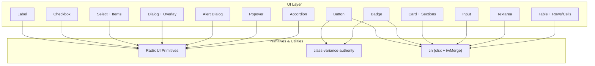
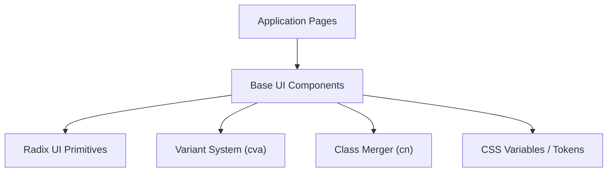
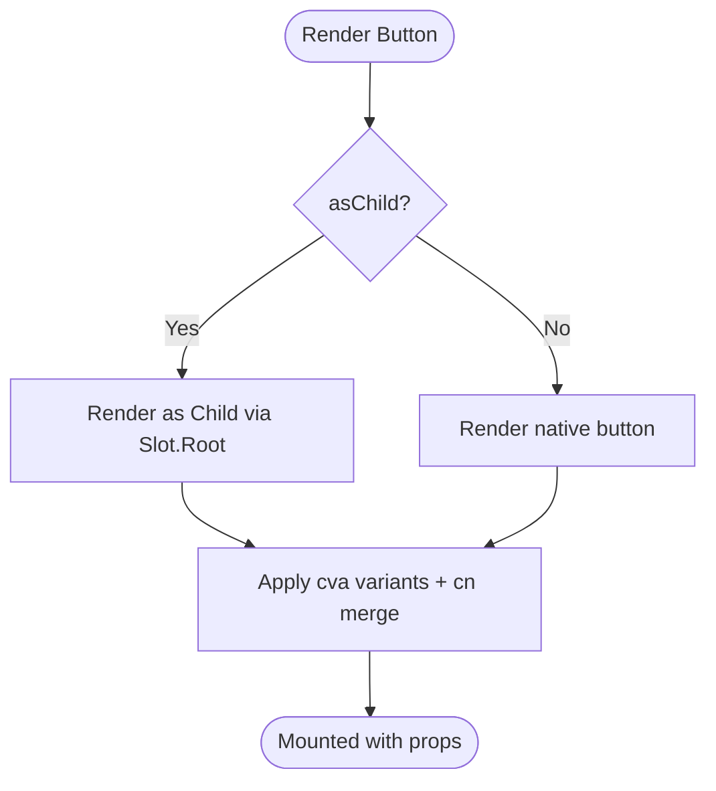
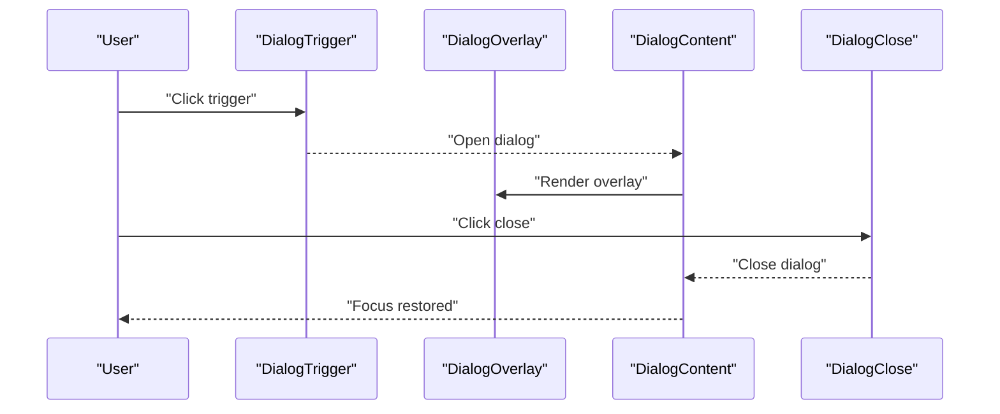
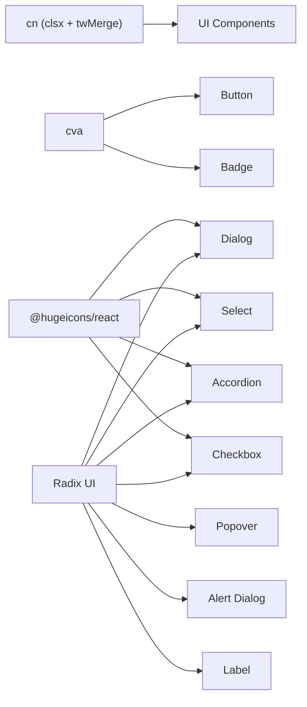

# Base Components

<cite>
**Referenced Files in This Document**
- [button.tsx](file://src/components/ui/button.tsx)
- [card.tsx](file://src/components/ui/card.tsx)
- [input.tsx](file://src/components/ui/input.tsx)
- [dialog.tsx](file://src/components/ui/dialog.tsx)
- [table.tsx](file://src/components/ui/table.tsx)
- [select.tsx](file://src/components/ui/select.tsx)
- [accordion.tsx](file://src/components/ui/accordion.tsx)
- [badge.tsx](file://src/components/ui/badge.tsx)
- [label.tsx](file://src/components/ui/label.tsx)
- [textarea.tsx](file://src/components/ui/textarea.tsx)
- [checkbox.tsx](file://src/components/ui/checkbox.tsx)
- [alert-dialog.tsx](file://src/components/ui/alert-dialog.tsx)
- [popover.tsx](file://src/components/ui/popover.tsx)
- [utils.ts](file://src/lib/utils.ts)
- [components.json](file://components.json)
</cite>

## Table of Contents
1. [Introduction](#introduction)
2. [Project Structure](#project-structure)
3. [Core Components](#core-components)
4. [Architecture Overview](#architecture-overview)
5. [Detailed Component Analysis](#detailed-component-analysis)
6. [Dependency Analysis](#dependency-analysis)
7. [Performance Considerations](#performance-considerations)
8. [Troubleshooting Guide](#troubleshooting-guide)
9. [Conclusion](#conclusion)
10. [Appendices](#appendices)

## Introduction
This document describes the base UI components built on shadcn/ui and Radix UI primitives within this project. It covers each component’s props, variants, composition patterns, accessibility features, responsive behavior, and guidelines for extending components consistently across the application. The goal is to provide a practical reference for building accessible, themeable, and maintainable interfaces using the shared component library.

## Project Structure
The base UI components live under src/components/ui and are configured via shadcn/ui (components.json). They rely on:
- Radix UI primitives for composable, accessible behaviors
- Tailwind CSS with CSS variables for theming
- class-variance-authority (cva) for variant management
- A shared cn utility for merging classes deterministically

**Diagram sources**
- [components.json:1-30](file://components.json#L1-L30)
- [utils.ts:1-7](file://src/lib/utils.ts#L1-L7)
- [button.tsx:1-69](file://src/components/ui/button.tsx#L1-L69)
- [badge.tsx:1-50](file://src/components/ui/badge.tsx#L1-L50)
- [card.tsx:1-101](file://src/components/ui/card.tsx#L1-L101)
- [input.tsx:1-20](file://src/components/ui/input.tsx#L1-L20)
- [textarea.tsx:1-19](file://src/components/ui/textarea.tsx#L1-L19)
- [label.tsx:1-25](file://src/components/ui/label.tsx#L1-L25)
- [checkbox.tsx:1-34](file://src/components/ui/checkbox.tsx#L1-L34)
- [select.tsx:1-213](file://src/components/ui/select.tsx#L1-L213)
- [dialog.tsx:1-171](file://src/components/ui/dialog.tsx#L1-L171)
- [alert-dialog.tsx:1-200](file://src/components/ui/alert-dialog.tsx#L1-L200)
- [popover.tsx:1-90](file://src/components/ui/popover.tsx#L1-L90)
- [accordion.tsx:1-96](file://src/components/ui/accordion.tsx#L1-L96)
- [table.tsx:1-117](file://src/components/ui/table.tsx#L1-L117)

**Section sources**
- [components.json:1-30](file://components.json#L1-L30)
- [utils.ts:1-7](file://src/lib/utils.ts#L1-L7)

## Core Components
Below is a concise overview of each base component, including key props, variants, and usage patterns.

- Button
  - Props: className, variant, size, asChild, plus standard button attributes
  - Variants: default, accent, outline, secondary, ghost, destructive, link; sizes include default, xs, sm, lg, icon, icon-xs, icon-sm, icon-lg
  - Behavior: supports asChild to render as any element via Radix Slot; uses cva for styling; includes focus-visible and aria-invalid states
  - Usage pattern: pair with icons via data-icon slots; use asChild to integrate with Link or other interactive elements

- Badge
  - Props: className, variant, asChild, plus span attributes
  - Variants: default, secondary, destructive, outline, ghost, link
  - Behavior: small inline label with optional icon spacing; supports asChild

- Card
  - Props: size ("default" | "sm")
  - Composition: CardHeader, CardTitle, CardDescription, CardAction, CardContent, CardFooter
  - Behavior: responsive padding and grid layout for header actions; image-first child auto-rounded corners

- Input
  - Props: type, className, plus native input attributes
  - Behavior: consistent height, placeholder styling, focus ring, disabled state, aria-invalid support

- Textarea
  - Props: className, plus native textarea attributes
  - Behavior: resizable control disabled by default, focus ring, invalid state styling

- Label
  - Props: className, plus Radix Label Root attributes
  - Behavior: peer-disabled integration for form fields

- Checkbox
  - Props: className, plus Radix Checkbox Root attributes
  - Behavior: custom indicator with icon; peer-disabled and aria-invalid states

- Select
  - Props: Trigger supports size ("sm" | "default"); Content supports position and align
  - Composition: SelectGroup, SelectValue, SelectTrigger, SelectContent, SelectLabel, SelectItem, SelectSeparator, Scroll buttons
  - Behavior: portalized content, animated open/close, item-aligned positioning option, keyboard navigation

- Dialog
  - Props: showCloseButton, overlayClassName on Content; Header/Footer support showCloseButton
  - Composition: Dialog, DialogTrigger, DialogPortal, DialogOverlay, DialogContent, DialogHeader, DialogFooter, DialogTitle, DialogDescription, DialogClose
  - Behavior: centered modal with animations, close button integrated via Button

- Alert Dialog
  - Props: size ("default" | "sm") on Content
  - Composition: AlertDialog, Trigger, Portal, Overlay, Content, Header, Footer, Media, Title, Description, Action, Cancel
  - Behavior: pre-styled action/cancel buttons via Button; media slot for icons/images

- Popover
  - Props: align, sideOffset on Content
  - Composition: Popover, Trigger, Anchor, Content, Header, Title, Description
  - Behavior: floating panel with slide-in animations

- Accordion
  - Props: none beyond Radix Root
  - Composition: Accordion, Item, Trigger, Content
  - Behavior: expand/collapse with animated content and chevron indicators

- Table
  - Props: className on Table
  - Composition: TableHeader, TableBody, TableFooter, TableRow, TableHead, TableCell, TableCaption
  - Behavior: horizontal scroll container, hover and selected row styles

**Section sources**
- [button.tsx:1-69](file://src/components/ui/button.tsx#L1-L69)
- [badge.tsx:1-50](file://src/components/ui/badge.tsx#L1-L50)
- [card.tsx:1-101](file://src/components/ui/card.tsx#L1-L101)
- [input.tsx:1-20](file://src/components/ui/input.tsx#L1-L20)
- [textarea.tsx:1-19](file://src/components/ui/textarea.tsx#L1-L19)
- [label.tsx:1-25](file://src/components/ui/label.tsx#L1-L25)
- [checkbox.tsx:1-34](file://src/components/ui/checkbox.tsx#L1-L34)
- [select.tsx:1-213](file://src/components/ui/select.tsx#L1-L213)
- [dialog.tsx:1-171](file://src/components/ui/dialog.tsx#L1-L171)
- [alert-dialog.tsx:1-200](file://src/components/ui/alert-dialog.tsx#L1-L200)
- [popover.tsx:1-90](file://src/components/ui/popover.tsx#L1-L90)
- [accordion.tsx:1-96](file://src/components/ui/accordion.tsx#L1-L96)
- [table.tsx:1-117](file://src/components/ui/table.tsx#L1-L117)

## Architecture Overview
The UI layer composes Radix primitives with Tailwind CSS and shadcn conventions. Styling is centralized through cva-based variants and the cn utility. Theming relies on CSS variables defined at the app level.

[No sources needed since this diagram shows conceptual workflow, not actual code structure]

## Detailed Component Analysis

### Button
- Purpose: Primary interactive element with multiple visual variants and sizes.
- Key props:
  - variant: default, accent, outline, secondary, ghost, destructive, link
  - size: default, xs, sm, lg, icon, icon-xs, icon-sm, icon-lg
  - asChild: boolean to render as another element
- Accessibility:
  - Focus-visible ring and outline handling
  - aria-invalid styling when paired with validation
- Responsive:
  - Icon sizes adapt based on presence of icon data attributes
- Composition:
  - Use asChild to integrate with routing/link components
- Example usage patterns:
  - Default primary action
  - Destructive action for delete flows
  - Ghost or outline for secondary actions
  - Icon-only buttons using icon sizes

**Diagram sources**
- [button.tsx:45-66](file://src/components/ui/button.tsx#L45-L66)

**Section sources**
- [button.tsx:1-69](file://src/components/ui/button.tsx#L1-L69)

### Badge
- Purpose: Small status or categorization labels.
- Key props:
  - variant: default, secondary, destructive, outline, ghost, link
  - asChild: boolean
- Accessibility:
  - Focus-visible ring and aria-invalid styling
- Composition:
  - Wrap text or icons; can be rendered as an anchor via asChild

**Section sources**
- [badge.tsx:1-50](file://src/components/ui/badge.tsx#L1-L50)

### Card
- Purpose: Container for grouped content with header, description, action, content, and footer sections.
- Key props:
  - size: default, sm
- Composition:
  - CardHeader, CardTitle, CardDescription, CardAction, CardContent, CardFooter
- Responsive:
  - Grid layout for header with action placement; reduced padding in sm size
- Example usage patterns:
  - Profile card with avatar image first child
  - Settings summary with title, description, and action

**Section sources**
- [card.tsx:1-101](file://src/components/ui/card.tsx#L1-L101)

### Form Inputs (Input, Textarea, Label, Checkbox)
- Input
  - Props: type, className, plus native input attributes
  - States: focus-visible ring, disabled, aria-invalid
- Textarea
  - Props: className, plus native textarea attributes
  - States: focus-visible ring, disabled, aria-invalid
- Label
  - Props: className, plus Radix Label Root attributes
  - Integration: peer-disabled for associated controls
- Checkbox
  - Props: className, plus Radix Checkbox Root attributes
  - States: checked, disabled, aria-invalid

Example usage patterns:
- Single-line text input with label
- Multi-line notes with textarea
- Consent checkbox with label

**Section sources**
- [input.tsx:1-20](file://src/components/ui/input.tsx#L1-L20)
- [textarea.tsx:1-19](file://src/components/ui/textarea.tsx#L1-L19)
- [label.tsx:1-25](file://src/components/ui/label.tsx#L1-L25)
- [checkbox.tsx:1-34](file://src/components/ui/checkbox.tsx#L1-L34)

### Dialog Interactions
- Purpose: Modal overlays for confirmations, forms, or rich content.
- Composition:
  - Dialog, DialogTrigger, DialogPortal, DialogOverlay, DialogContent, DialogHeader, DialogFooter, DialogTitle, DialogDescription, DialogClose
- Key props:
  - Content.showCloseButton: boolean to toggle close button
  - Content.overlayClassName: customize backdrop appearance
- Accessibility:
  - Focus trap and escape-to-close handled by Radix
- Example usage patterns:
  - Confirmation dialog with header/footer actions
  - Inline form inside dialog content

**Diagram sources**
- [dialog.tsx:11-88](file://src/components/ui/dialog.tsx#L11-L88)

**Section sources**
- [dialog.tsx:1-171](file://src/components/ui/dialog.tsx#L1-171)

### Table Configurations
- Purpose: Data display with headers, rows, cells, and captions.
- Composition:
  - Table, TableHeader, TableBody, TableFooter, TableRow, TableHead, TableCell, TableCaption
- Features:
  - Horizontal scrolling container
  - Hover and selected row highlighting
  - Consistent alignment and spacing

Example usage patterns:
- Paginated list with caption
- Selection-enabled rows with checkboxes

**Section sources**
- [table.tsx:1-117](file://src/components/ui/table.tsx#L1-L117)

### Select Dropdowns
- Purpose: Accessible dropdown selection with grouping and separators.
- Composition:
  - Select, SelectGroup, SelectValue, SelectTrigger, SelectContent, SelectLabel, SelectItem, SelectSeparator, Scroll buttons
- Key props:
  - Trigger.size: sm | default
  - Content.position: item-aligned | popper
  - Content.align: center | start | end
- Features:
  - Animated open/close transitions
  - Keyboard navigation and filtering via Radix
  - Optional scroll buttons for long lists

Example usage patterns:
- Country/state selector
- Filter menu with grouped options

**Section sources**
- [select.tsx:1-213](file://src/components/ui/select.tsx#L1-L213)

### Accordion Panels
- Purpose: Expandable sections for FAQs or settings.
- Composition:
  - Accordion, AccordionItem, AccordionTrigger, AccordionContent
- Features:
  - Animated content expansion/collapse
  - Chevron indicators toggled by expanded state

Example usage patterns:
- FAQ page
- Collapsible settings panel

**Section sources**
- [accordion.tsx:1-96](file://src/components/ui/accordion.tsx#L1-L96)

### Alert Dialog
- Purpose: Critical confirmation dialogs with media and actions.
- Composition:
  - AlertDialog, Trigger, Portal, Overlay, Content, Header, Footer, Media, Title, Description, Action, Cancel
- Key props:
  - Content.size: default | sm
- Features:
  - Pre-styled Action/Cancel buttons via Button
  - Optional media area for icons/images

Example usage patterns:
- Delete account confirmation
- Warning before irreversible action

**Section sources**
- [alert-dialog.tsx:1-200](file://src/components/ui/alert-dialog.tsx#L1-L200)

### Popover
- Purpose: Lightweight floating panels for contextual info or quick actions.
- Composition:
  - Popover, Trigger, Anchor, Content, Header, Title, Description
- Key props:
  - Content.align, Content.sideOffset
- Features:
  - Slide-in animations and portal rendering

Example usage patterns:
- Tooltip-like richer content
- Quick filters or actions near a control

**Section sources**
- [popover.tsx:1-90](file://src/components/ui/popover.tsx#L1-L90)

## Dependency Analysis
- External dependencies:
  - Radix UI primitives for robust, accessible behaviors
  - class-variance-authority for variant-driven styling
  - Hugeicons for consistent iconography
- Internal utilities:
  - cn merges class names deterministically using clsx and tailwind-merge
- Configuration:
  - components.json defines style, aliases, and registry sources

**Diagram sources**
- [utils.ts:1-7](file://src/lib/utils.ts#L1-L7)
- [button.tsx:1-69](file://src/components/ui/button.tsx#L1-L69)
- [badge.tsx:1-50](file://src/components/ui/badge.tsx#L1-L50)
- [dialog.tsx:1-171](file://src/components/ui/dialog.tsx#L1-L171)
- [select.tsx:1-213](file://src/components/ui/select.tsx#L1-L213)
- [accordion.tsx:1-96](file://src/components/ui/accordion.tsx#L1-L96)
- [popover.tsx:1-90](file://src/components/ui/popover.tsx#L1-L90)
- [alert-dialog.tsx:1-200](file://src/components/ui/alert-dialog.tsx#L1-L200)
- [label.tsx:1-25](file://src/components/ui/label.tsx#L1-L25)
- [checkbox.tsx:1-34](file://src/components/ui/checkbox.tsx#L1-L34)

**Section sources**
- [components.json:1-30](file://components.json#L1-L30)
- [utils.ts:1-7](file://src/lib/utils.ts#L1-L7)

## Performance Considerations
- Prefer asChild for lightweight wrappers to avoid extra DOM nodes when integrating with links or third-party components.
- Use cva variants instead of conditional classNames to keep bundle size predictable and reduce runtime branching.
- Keep Dialog/Popover content minimal; lazy-load heavy content when possible.
- Avoid excessive nested portals; prefer single-level overlays where feasible.
- Leverage table virtualization libraries for large datasets rather than rendering all rows at once.

[No sources needed since this section provides general guidance]

## Troubleshooting Guide
Common issues and resolutions:
- Focus not trapped in Dialog/Popover
  - Ensure you are using the provided Radix-based components and not overriding their root elements.
- Invalid state not visible
  - Add aria-invalid to inputs and ensure your validation logic sets it appropriately; components apply destructive styling when aria-invalid is present.
- Select content clipped
  - Adjust Content.position to "popper" and verify available viewport space; consider reducing sideOffset or align.
- Button not clickable when wrapped
  - Use asChild to forward events to the underlying element (e.g., Link).
- Inconsistent sizing
  - Verify size prop values match supported variants; avoid mixing unsupported sizes.

**Section sources**
- [dialog.tsx:1-171](file://src/components/ui/dialog.tsx#L1-L171)
- [popover.tsx:1-90](file://src/components/ui/popover.tsx#L1-L90)
- [select.tsx:1-213](file://src/components/ui/select.tsx#L1-L213)
- [button.tsx:1-69](file://src/components/ui/button.tsx#L1-L69)
- [input.tsx:1-20](file://src/components/ui/input.tsx#L1-L20)

## Conclusion
These base components provide a cohesive, accessible foundation for building user interfaces. By composing Radix primitives with consistent styling and clear APIs, teams can maintain design consistency, improve accessibility, and scale efficiently. Follow the extension guidelines below to evolve the component set while preserving reliability and predictability.

[No sources needed since this section summarizes without analyzing specific files]

## Appendices

### Accessibility Guidelines
- Always associate labels with inputs using Radix Label or htmlFor equivalents.
- Provide descriptive titles and descriptions for dialogs and popovers.
- Respect focus management; do not remove focus traps from overlays.
- Use aria-invalid for validation feedback; leverage built-in destructive styles.

**Section sources**
- [label.tsx:1-25](file://src/components/ui/label.tsx#L1-L25)
- [dialog.tsx:1-171](file://src/components/ui/dialog.tsx#L1-L171)
- [popover.tsx:1-90](file://src/components/ui/popover.tsx#L1-L90)
- [input.tsx:1-20](file://src/components/ui/input.tsx#L1-L20)

### Responsive Behavior Notes
- Cards adjust padding and grid layout for smaller screens and sm size.
- Tables wrap horizontally; consider responsive column visibility strategies.
- Dialogs and popovers animate entrance/exit and adapt to viewport constraints.

**Section sources**
- [card.tsx:1-101](file://src/components/ui/card.tsx#L1-L101)
- [table.tsx:1-117](file://src/components/ui/table.tsx#L1-L117)
- [dialog.tsx:1-171](file://src/components/ui/dialog.tsx#L1-L171)
- [popover.tsx:1-90](file://src/components/ui/popover.tsx#L1-L90)

### Extending Base Components
- Adding new variants:
  - Extend cva variant maps in Button/Badge and document defaults.
- Creating themed tokens:
  - Update CSS variables used by components (colors, rings, borders).
- Composing higher-order components:
  - Build feature-rich wrappers around base components (e.g., FormField combining Label, Input, and error messages).
- Maintaining consistency:
  - Reuse data-slot attributes and data-* modifiers for testing and styling hooks.
  - Keep prop surfaces minimal and aligned with Radix primitives.

**Section sources**
- [button.tsx:1-69](file://src/components/ui/button.tsx#L1-L69)
- [badge.tsx:1-50](file://src/components/ui/badge.tsx#L1-L50)
- [utils.ts:1-7](file://src/lib/utils.ts#L1-L7)
- [components.json:1-30](file://components.json#L1-L30)