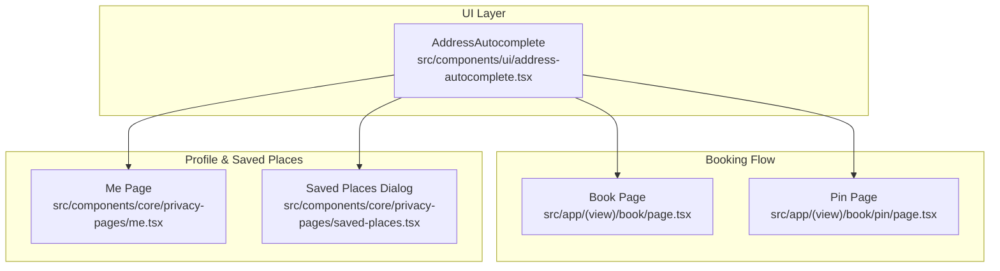
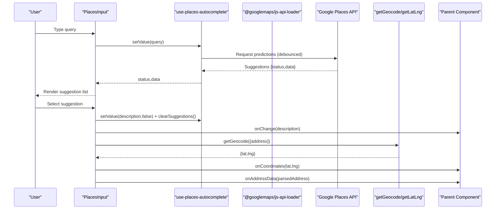
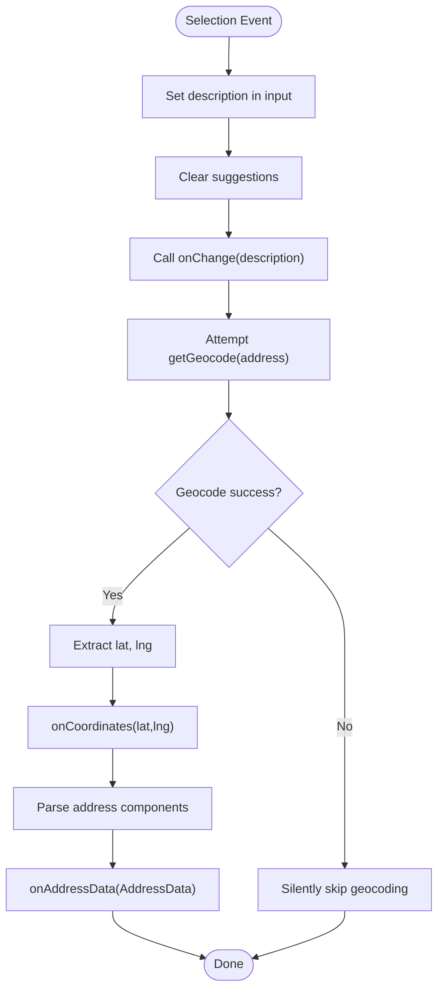
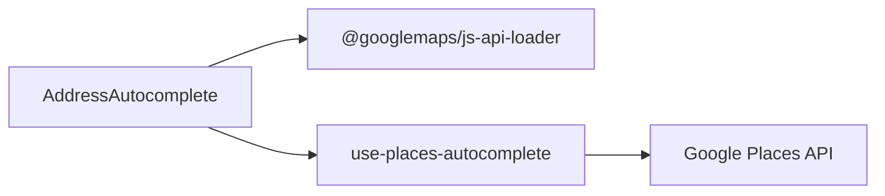

# Address Autocomplete Component

<cite>
**Referenced Files in This Document**
- [address-autocomplete.tsx](file://src/components/ui/address-autocomplete.tsx)
- [book page.tsx](file://src/app/(view)/book/page.tsx)
- [pin page.tsx](file://src/app/(view)/book/pin/page.tsx)
- [me.tsx](file://src/components/core/privacy-pages/me.tsx)
- [saved-places.tsx](file://src/components/core/privacy-pages/saved-places.tsx)
- [package.json](file://package.json)
</cite>

## Table of Contents
1. [Introduction](#introduction)
2. [Project Structure](#project-structure)
3. [Core Components](#core-components)
4. [Architecture Overview](#architecture-overview)
5. [Detailed Component Analysis](#detailed-component-analysis)
6. [Dependency Analysis](#dependency-analysis)
7. [Performance Considerations](#performance-considerations)
8. [Troubleshooting Guide](#troubleshooting-guide)
9. [Conclusion](#conclusion)
10. [Appendices](#appendices)

## Introduction
The AddressAutocomplete component provides intelligent address suggestions and validation by integrating with the Google Maps Places API. It offers:
- Debounced search to reduce network calls
- Result filtering via Google’s autocomplete service
- Optional geocoding to extract coordinates and structured address data
- A controlled input pattern for seamless integration into forms
- Graceful fallback when the Maps library is not yet loaded

This documentation explains how the component works, its props, state management, error handling, accessibility considerations, and usage examples across the application.

## Project Structure
The component lives under the shared UI layer and is consumed by multiple pages and dialogs:
- Component implementation: src/components/ui/address-autocomplete.tsx
- Usage in booking form: src/app/(view)/book/page.tsx
- Usage in pin selection flow: src/app/(view)/book/pin/page.tsx
- Usage in profile and saved places flows: src/components/core/privacy-pages/me.tsx and saved-places.tsx

**Diagram sources**
- [address-autocomplete.tsx:1-170](file://src/components/ui/address-autocomplete.tsx#L1-L170)
- [book page.tsx](file://src/app/(view)/book/page.tsx#L180-L220)
- [pin page.tsx](file://src/app/(view)/book/pin/page.tsx#L105-L125)
- [me.tsx:240-250](file://src/components/core/privacy-pages/me.tsx#L240-L250)
- [saved-places.tsx:155-170](file://src/components/core/privacy-pages/saved-places.tsx#L155-L170)

**Section sources**
- [address-autocomplete.tsx:1-170](file://src/components/ui/address-autocomplete.tsx#L1-L170)
- [book page.tsx](file://src/app/(view)/book/page.tsx#L180-L220)
- [pin page.tsx](file://src/app/(view)/book/pin/page.tsx#L105-L125)
- [me.tsx:240-250](file://src/components/core/privacy-pages/me.tsx#L240-L250)
- [saved-places.tsx:155-170](file://src/components/core/privacy-pages/saved-places.tsx#L155-L170)

## Core Components
- AddressAutocomplete (public): The main React component that loads the Google Maps Places library and renders either a basic input or the full autocomplete experience once ready.
- PlacesInput (internal): Implements the debounced search, suggestion list rendering, selection handling, and optional geocoding to coordinates and structured address fields.
- AddressData (type): Structured address shape including lat/lng and parsed components such as street name, number, district, municipality, and zip.

Key responsibilities:
- Dynamic loading of the Places library
- Controlled input synchronization
- Debounced queries to Google Places
- Selection handling and optional geocoding
- Rendering a dropdown of suggestions

**Section sources**
- [address-autocomplete.tsx:10-18](file://src/components/ui/address-autocomplete.tsx#L10-L18)
- [address-autocomplete.tsx:57-121](file://src/components/ui/address-autocomplete.tsx#L57-L121)
- [address-autocomplete.tsx:131-169](file://src/components/ui/address-autocomplete.tsx#L131-L169)

## Architecture Overview
The component follows a layered approach:
- Presentation layer: Renders an input and a floating suggestion list.
- Integration layer: Uses @googlemaps/js-api-loader to load the Places library and use-places-autocomplete for debounced queries and suggestions.
- Data enrichment layer: On selection, uses getGeocode/getLatLng to resolve coordinates and parse address components.

**Diagram sources**
- [address-autocomplete.tsx:57-121](file://src/components/ui/address-autocomplete.tsx#L57-L121)
- [address-autocomplete.tsx:131-169](file://src/components/ui/address-autocomplete.tsx#L131-L169)

## Detailed Component Analysis

### Props Interface
- value: string — Controlled input value
- onChange: (v: string) => void — Emitted on every change and on selection
- onCoordinates?: (lat: number, lng: number) => void — Optional callback invoked after successful geocoding
- onAddressData?: (data: AddressData) => void — Optional callback with parsed address fields
- disabled?: boolean — Disables the input

Notes:
- All callbacks are optional except onChange.
- When onCoordinates/onAddressData are provided, they are called only if geocoding succeeds; failures are silently ignored.

**Section sources**
- [address-autocomplete.tsx:123-129](file://src/components/ui/address-autocomplete.tsx#L123-L129)

### State Management
- mapsReady: Controls whether the Places-enabled input is rendered or a fallback plain input is shown while the library loads.
- Internal hook state (from use-places-autocomplete):
  - ready: Indicates when the underlying Places library is ready
  - value/inputVal: Synchronizes controlled value with internal state
  - suggestions.status/data: Drives the suggestion list visibility and content
  - clearSuggestions(): Clears the dropdown after selection

Synchronization:
- If the parent updates value externally, the component syncs it into the internal input state without triggering additional suggestions.

**Section sources**
- [address-autocomplete.tsx:138-145](file://src/components/ui/address-autocomplete.tsx#L138-L145)
- [address-autocomplete.tsx:64-74](file://src/components/ui/address-autocomplete.tsx#L64-L74)

### Debounced Search and Filtering
- Debounce: 300ms delay before issuing a request to reduce API calls during typing.
- Filtering: Performed server-side by Google Places; client displays results when status is OK and data length > 0.

**Section sources**
- [address-autocomplete.tsx:64-70](file://src/components/ui/address-autocomplete.tsx#L64-L70)
- [address-autocomplete.tsx:103-118](file://src/components/ui/address-autocomplete.tsx#L103-L118)

### Result Selection and Geocoding
On selecting a suggestion:
- The input value is set to the selected description
- Suggestions are cleared
- onChange is called with the selected text
- Geocoding is attempted to obtain lat/lng and structured address fields
- onCoordinates and onAddressData are invoked if available and successful
- Errors from geocoding are caught and ignored (non-fatal)

**Diagram sources**
- [address-autocomplete.tsx:76-88](file://src/components/ui/address-autocomplete.tsx#L76-L88)

**Section sources**
- [address-autocomplete.tsx:76-88](file://src/components/ui/address-autocomplete.tsx#L76-L88)

### Accessibility Considerations
Current implementation:
- Uses a native <input> element with placeholder text
- Renders a floating <ul>/<li> list for suggestions
- No explicit ARIA roles or attributes for combobox behavior are present

Recommendations for improved accessibility:
- Add role="combobox" to the input and aria-expanded based on suggestion visibility
- Associate the list with the input using aria-controls and id references
- Provide aria-activedescendant pointing to the currently focused suggestion
- Ensure keyboard navigation (arrow keys, Enter, Escape) is implemented
- Announce suggestion count and selection changes to screen readers

[No sources needed since this section provides general guidance]

### Error Handling
- Library loading: The Places library import logs errors to console but does not block rendering; a fallback input is shown until ready.
- Geocoding errors: Caught and ignored so the user can still proceed with just the selected text.

Operational implications:
- If the API key is missing or invalid, suggestions may not appear; the input remains usable.
- Consumers should handle cases where onCoordinates/onAddressData are not invoked.

**Section sources**
- [address-autocomplete.tsx:140-145](file://src/components/ui/address-autocomplete.tsx#L140-L145)
- [address-autocomplete.tsx:80-87](file://src/components/ui/address-autocomplete.tsx#L80-L87)

### Usage Examples

- Basic usage with coordinates callback:
  - See usage in the booking form for pickup and drop-off inputs.
  - Reference: [book page.tsx](file://src/app/(view)/book/page.tsx#L186-L191), [book page.tsx](file://src/app/(view)/book/page.tsx#L215-L219)

- Using coordinates to pan a map:
  - In the pin selection page, onCoordinates is used to center and fly to the selected location.
  - Reference: [pin page.tsx](file://src/app/(view)/book/pin/page.tsx#L112-L124)

- Using structured address data:
  - In the saved places dialog, onAddressData populates fields like streetName, streetNumber, district, municipality, and zip.
  - Reference: [saved-places.tsx:161-165](file://src/components/core/privacy-pages/saved-places.tsx#L161-L165)

- Disabled state:
  - The me profile page disables the input while saving.
  - Reference: [me.tsx:243-248](file://src/components/core/privacy-pages/me.tsx#L243-L248)

**Section sources**
- [book page.tsx](file://src/app/(view)/book/page.tsx#L186-L191)
- [book page.tsx](file://src/app/(view)/book/page.tsx#L215-L219)
- [pin page.tsx](file://src/app/(view)/book/pin/page.tsx#L112-L124)
- [saved-places.tsx:161-165](file://src/components/core/privacy-pages/saved-places.tsx#L161-L165)
- [me.tsx:243-248](file://src/components/core/privacy-pages/me.tsx#L243-L248)

## Dependency Analysis
External dependencies relevant to the component:
- @googlemaps/js-api-loader: Dynamically loads the Google Maps JavaScript API and sets the API key
- use-places-autocomplete: Provides hooks for debounced autocomplete and geocoding utilities

**Diagram sources**
- [address-autocomplete.tsx:3-8](file://src/components/ui/address-autocomplete.tsx#L3-L8)
- [package.json:15-44](file://package.json#L15-L44)

**Section sources**
- [address-autocomplete.tsx:3-8](file://src/components/ui/address-autocomplete.tsx#L3-L8)
- [package.json:15-44](file://package.json#L15-L44)

## Performance Considerations
- Debounce interval: 300ms balances responsiveness and API cost. Adjust if necessary for specific UX needs.
- Conditional rendering: A lightweight input is shown until the Places library is ready, avoiding unnecessary work.
- Geocoding on selection: Only performed when a suggestion is chosen, minimizing extra requests.

[No sources needed since this section provides general guidance]

## Troubleshooting Guide
Common issues and resolutions:
- No suggestions appear:
  - Verify NEXT_PUBLIC_GOOGLE_MAPS_API_KEY is set and valid.
  - Check browser console for library loading errors.
  - Confirm the Places library is enabled in your Google Cloud project.
- Coordinates not updated:
  - Ensure onCoordinates is provided.
  - Inspect geocoding errors; they are intentionally silent.
- Dropdown not visible:
  - Ensure CSS stacking context allows the absolute-positioned list to render above other elements.
- Keyboard navigation:
  - Currently not implemented; add combobox behaviors for better usability.

**Section sources**
- [address-autocomplete.tsx:140-145](file://src/components/ui/address-autocomplete.tsx#L140-L145)
- [address-autocomplete.tsx:80-87](file://src/components/ui/address-autocomplete.tsx#L80-L87)

## Conclusion
AddressAutocomplete delivers a robust, reusable address input with debounced suggestions, optional geocoding, and flexible callbacks. Its design keeps the parent components simple while encapsulating Google Maps integration details. For production readiness, consider enhancing accessibility and surfacing geocoding errors to users.

[No sources needed since this section summarizes without analyzing specific files]

## Appendices

### Prop Reference Summary
- value: string
- onChange: (v: string) => void
- onCoordinates?: (lat: number, lng: number) => void
- onAddressData?: (data: AddressData) => void
- disabled?: boolean

**Section sources**
- [address-autocomplete.tsx:123-129](file://src/components/ui/address-autocomplete.tsx#L123-L129)