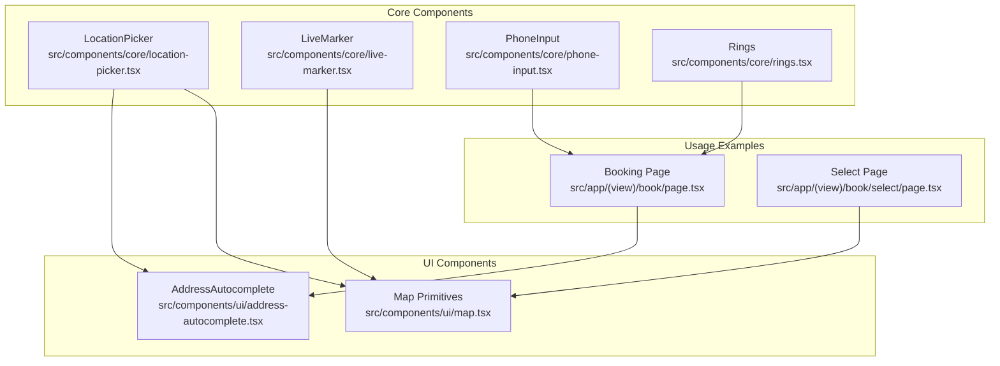
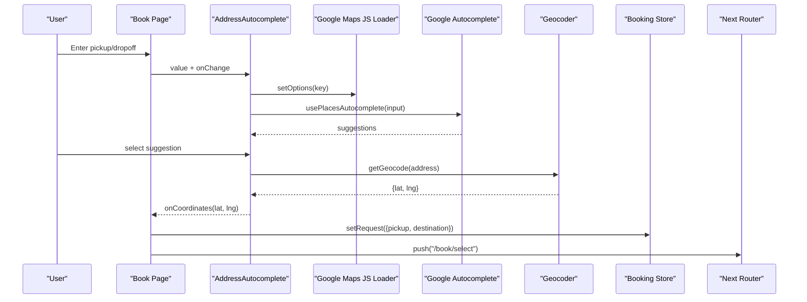
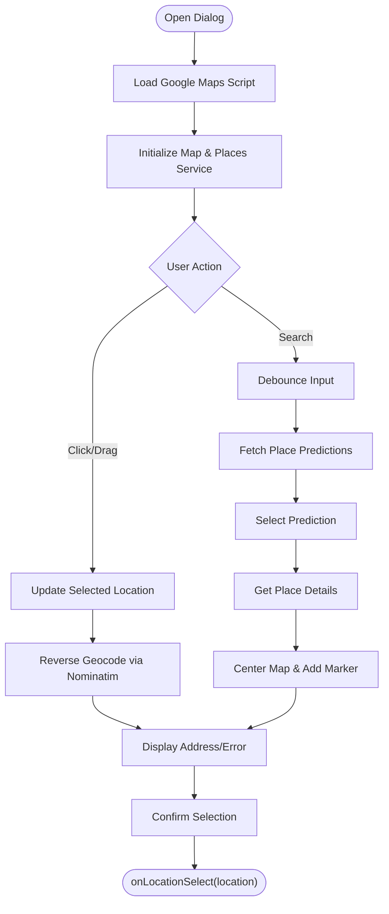
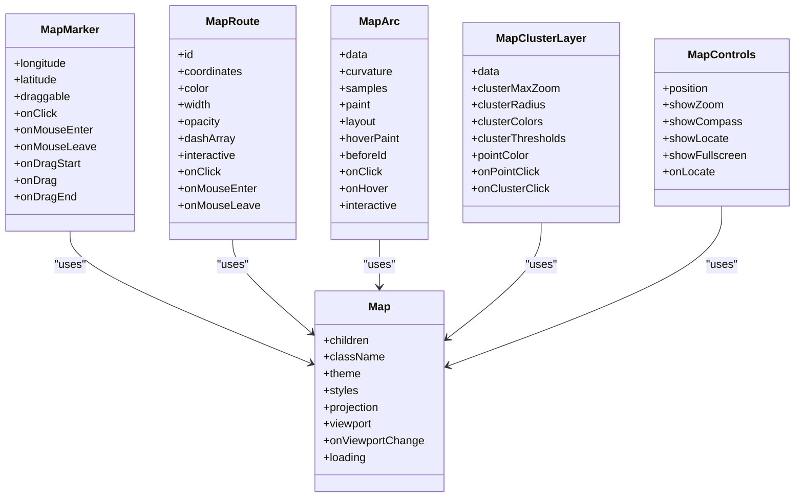
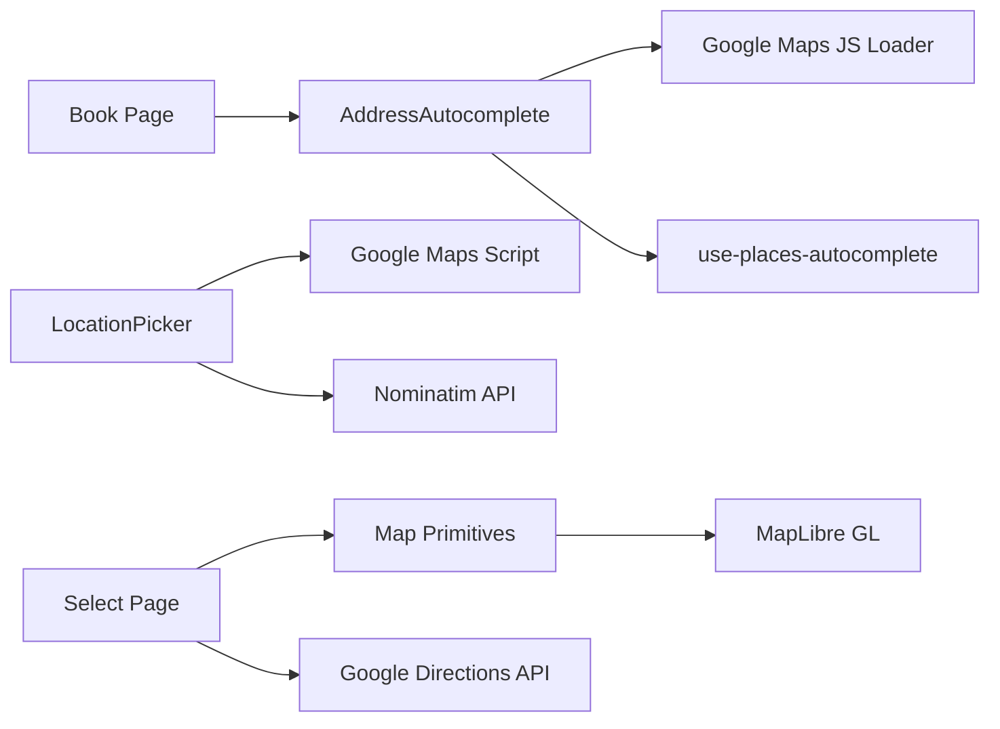

# Custom Business Components

<cite>
**Referenced Files in This Document**
- [location-picker.tsx](file://src/components/core/location-picker.tsx)
- [live-marker.tsx](file://src/components/core/live-marker.tsx)
- [address-autocomplete.tsx](file://src/components/ui/address-autocomplete.tsx)
- [phone-input.tsx](file://src/components/core/phone-input.tsx)
- [rings.tsx](file://src/components/core/rings.tsx)
- [map.tsx](file://src/components/ui/map.tsx)
- [book/page.tsx](file://src/app/(view)/book/page.tsx)
- [book/select/page.tsx](file://src/app/(view)/book/select/page.tsx)
</cite>

## Table of Contents
1. Introduction
2. Project Structure
3. Core Components
4. Architecture Overview
5. Detailed Component Analysis
6. Dependency Analysis
7. Performance Considerations
8. Troubleshooting Guide
9. Conclusion

## Introduction
This document provides comprehensive documentation for custom business components that extend beyond basic UI elements. It focuses on:
- Location picker with map integration and address autocomplete
- Live marker component for real-time visualization
- Navigation components for route drawing and map controls
- Phone input with international formatting and country selection
- Animated rings for visual effects
- Address autocomplete integrated with Google Maps

The goal is to explain complex props interfaces, state management patterns, external service integrations (Google Maps), usage examples, configuration options, and customization guidelines tailored for business-specific requirements.

## Project Structure
The relevant components are organized under src/components/core and src/components/ui, with usage examples in the booking flow pages. The key files include:
- Location picker and live marker in core
- Address autocomplete in ui
- Map primitives and navigation helpers in ui
- Usage examples in app/(view)/book pages

**Diagram sources**
- [location-picker.tsx:1-501](file://src/components/core/location-picker.tsx#L1-L501)
- [live-marker.tsx:1-30](file://src/components/core/live-marker.tsx#L1-L30)
- [address-autocomplete.tsx:1-170](file://src/components/ui/address-autocomplete.tsx#L1-L170)
- [phone-input.tsx:1-234](file://src/components/core/phone-input.tsx#L1-L234)
- [rings.tsx:1-15](file://src/components/core/rings.tsx#L1-L15)
- [map.tsx:1-1845](file://src/components/ui/map.tsx#L1-L1845)
- [book/page.tsx:1-200](file://src/app/(view)/book/page.tsx#L1-L200)
- [book/select/page.tsx:1-200](file://src/app/(view)/book/select/page.tsx#L1-L200)

**Section sources**
- [location-picker.tsx:1-501](file://src/components/core/location-picker.tsx#L1-L501)
- [address-autocomplete.tsx:1-170](file://src/components/ui/address-autocomplete.tsx#L1-L170)
- [map.tsx:1-1845](file://src/components/ui/map.tsx#L1-L1845)
- [book/page.tsx:1-200](file://src/app/(view)/book/page.tsx#L1-L200)
- [book/select/page.tsx:1-200](file://src/app/(view)/book/select/page.tsx#L1-L200)

## Core Components
- LocationPicker: A dialog-based location selector integrating Google Maps, search, reverse geocoding via Nominatim, and draggable markers.
- LiveMarker: A small animated avatar marker with a ping effect for live updates.
- AddressAutocomplete: A controlled input using Google Places Autocomplete with optional coordinate and structured address data callbacks.
- PhoneInput: International phone number input with flag icons, country search, and size variants.
- Rings: Decorative background element using gradient circles.
- Map Primitives: A full-featured MapLibre wrapper providing Map, Marker, Route, Arc, Cluster layers, and Controls.

Key responsibilities:
- External service integration (Google Maps, Nominatim)
- Controlled/uncontrolled state patterns
- Event-driven interactions (click, drag, hover)
- Styling and theming hooks (theme-aware map styles)

**Section sources**
- [location-picker.tsx:1-501](file://src/components/core/location-picker.tsx#L1-L501)
- [live-marker.tsx:1-30](file://src/components/core/live-marker.tsx#L1-L30)
- [address-autocomplete.tsx:1-170](file://src/components/ui/address-autocomplete.tsx#L1-L170)
- [phone-input.tsx:1-234](file://src/components/core/phone-input.tsx#L1-L234)
- [rings.tsx:1-15](file://src/components/core/rings.tsx#L1-L15)
- [map.tsx:1-1845](file://src/components/ui/map.tsx#L1-L1845)

## Architecture Overview
The system composes reusable UI primitives with business logic:
- Booking page uses AddressAutocomplete to capture pickup/dropoff addresses and coordinates.
- Select page integrates Map primitives to draw routes fetched from Google Directions API.
- LocationPicker offers an alternative map-based selection with reverse geocoding.
- LiveMarker can be used as a marker content inside MapMarker for driver or vehicle indicators.
- PhoneInput supports user registration and contact fields.
- Rings adds decorative visuals to layouts.

**Diagram sources**
- [book/page.tsx:1-200](file://src/app/(view)/book/page.tsx#L1-L200)
- [address-autocomplete.tsx:1-170](file://src/components/ui/address-autocomplete.tsx#L1-L170)
- [book/select/page.tsx:1-200](file://src/app/(view)/book/select/page.tsx#L1-L200)

## Detailed Component Analysis

### LocationPicker
Purpose:
- Provide a modal interface to pick a location by searching or clicking/dragging on a Google Map.
- Reverse geocode selected coordinates to display a human-readable address.

Props:
- onLocationSelect(locationData): callback invoked when user confirms selection.
- defaultLocation: fallback center if no initial selection.
- initialLocation: preselected location object.

State Management:
- Dialog open/close state.
- Selected location (coordinates + optional address).
- Search query, results, loading states.
- References for map instance, marker, and debounce timer.

External Integrations:
- Dynamically loads Google Maps script with places library.
- Uses PlacesService for autocomplete predictions and details.
- Calls Nominatim reverse geocoding endpoint for address resolution.

Interaction Flow:
- Open dialog -> load maps -> initialize map and services.
- Click/drag marker -> update selected location -> fetch address.
- Type search -> debounce -> show predictions -> select -> fetch details -> update map and address.

Error Handling:
- Network errors for Nominatim and Places API.
- Graceful fallbacks when address not found.

Customization:
- Adjust map style array to hide POI labels or customize features.
- Modify zoom level and control visibility.
- Replace Nominatim with another reverse geocoder if needed.

**Diagram sources**
- [location-picker.tsx:1-501](file://src/components/core/location-picker.tsx#L1-L501)

**Section sources**
- [location-picker.tsx:1-501](file://src/components/core/location-picker.tsx#L1-L501)

### LiveMarker
Purpose:
- Render a compact animated marker with a pulsing ring, suitable for live positions.

Props:
- src?: image URL for avatar; falls back to a car icon.
- pingColor?: CSS class for the ping animation color.
- ringClassName?: CSS class for the gradient ring around the avatar.

Behavior:
- Uses Tailwind classes for animations and gradients.
- No external dependencies beyond UI primitives.

Customization:
- Change ping color and ring gradient via props.
- Swap avatar image source per context (driver, vehicle).

**Section sources**
- [live-marker.tsx:1-30](file://src/components/core/live-marker.tsx#L1-L30)

### AddressAutocomplete
Purpose:
- Provide a controlled input with Google Places Autocomplete, returning coordinates and structured address data.

Props:
- value: string (controlled input value).
- onChange(v: string): update input text.
- onCoordinates?(lat: number, lng: number): emit selected coordinates.
- onAddressData?(data: AddressData): emit parsed address components.
- disabled?: boolean.

Data Model:
- AddressData includes lat, lng, streetName, streetNumber, district, municipality, zip.

Integration:
- Uses @googlemaps/js-api-loader to configure API key and import "places".
- use-places-autocomplete hook manages suggestions and debounced queries.
- getGeocode/getLatLng utilities convert selected description into coordinates.

Usage Example:
- In booking form, bind value/onChange and handle onCoordinates to store lat/lng.

**Section sources**
- [address-autocomplete.tsx:1-170](file://src/components/ui/address-autocomplete.tsx#L1-L170)
- [book/page.tsx:1-200](file://src/app/(view)/book/page.tsx#L1-L200)

### PhoneInput
Purpose:
- International phone number input with country flags, calling codes, and search.

Props:
- Inherits standard input props plus BasePhoneInput props.
- variant?: "sm" | "default" | "lg" for sizing.
- popupClassName?, scrollAreaClassName? for styling dropdown.
- onChange(value): emits normalized phone value.

Features:
- FlagComponent renders country flags.
- CountrySelect supports filtering countries by name.
- Integrates with Combobox UI primitives for accessibility and UX.

Customization:
- Override sizes via variant.
- Customize popup and scroll area classes.
- Integrate with form validation libraries.

**Section sources**
- [phone-input.tsx:1-234](file://src/components/core/phone-input.tsx#L1-L234)

### Rings
Purpose:
- Decorative background element composed of two large gradient circles with responsive sizing.

Usage:
- Typically placed in layout or page backgrounds for visual flair.

Customization:
- Adjust gradient colors and sizes via Tailwind classes.
- Toggle visibility based on breakpoints.

**Section sources**
- [rings.tsx:1-15](file://src/components/core/rings.tsx#L1-L15)

### Map Primitives and Navigation
Purpose:
- Provide a robust MapLibre wrapper with theme support, viewport control, markers, popups, tooltips, routes, arcs, clustering, and controls.

Key Exports:
- Map: container with theme detection, controlled viewport, and lifecycle events.
- useMap(): access map instance and loaded state.
- MapMarker, MarkerContent, MarkerPopup, MarkerTooltip, MarkerLabel: marker composition.
- MapControls: zoom, compass, locate, fullscreen buttons.
- MapRoute: draw line strings with interactive events.
- MapArc: draw curved arcs with hover/click handling.
- MapClusterLayer: cluster points with customizable thresholds and click behavior.

Props Highlights:
- Map: theme, styles, projection, viewport, onViewportChange, loading.
- MapMarker: longitude, latitude, draggable, drag callbacks, mouse events.
- MapRoute: coordinates, color, width, opacity, dashArray, interactive handlers.
- MapArc: data array with id/from/to, curvature, samples, paint/hoverPaint, beforeId.
- MapClusterLayer: data (GeoJSON or URL), clusterMaxZoom, clusterRadius, thresholds, colors, pointColor, click callbacks.

Navigation Integration:
- In select page, fetch directions from Google Directions API and render path via MapRoute.
- Fit bounds to route coordinates after loading.

**Diagram sources**
- [map.tsx:1-1845](file://src/components/ui/map.tsx#L1-L1845)

**Section sources**
- [map.tsx:1-1845](file://src/components/ui/map.tsx#L1-L1845)
- [book/select/page.tsx:1-200](file://src/app/(view)/book/select/page.tsx#L1-L200)

## Dependency Analysis
- AddressAutocomplete depends on Google Maps JS loader and use-places-autocomplete.
- LocationPicker dynamically injects Google Maps script and uses PlacesService and Nominatim.
- Map primitives depend on MapLibre GL and DOM APIs.
- Booking page orchestrates AddressAutocomplete and routing to select page.
- Select page uses Map primitives and Google Directions API to compute routes.

**Diagram sources**
- [address-autocomplete.tsx:1-170](file://src/components/ui/address-autocomplete.tsx#L1-L170)
- [location-picker.tsx:1-501](file://src/components/core/location-picker.tsx#L1-L501)
- [map.tsx:1-1845](file://src/components/ui/map.tsx#L1-L1845)
- [book/page.tsx:1-200](file://src/app/(view)/book/page.tsx#L1-L200)
- [book/select/page.tsx:1-200](file://src/app/(view)/book/select/page.tsx#L1-L200)

**Section sources**
- [address-autocomplete.tsx:1-170](file://src/components/ui/address-autocomplete.tsx#L1-L170)
- [location-picker.tsx:1-501](file://src/components/core/location-picker.tsx#L1-L501)
- [map.tsx:1-1845](file://src/components/ui/map.tsx#L1-L1845)
- [book/page.tsx:1-200](file://src/app/(view)/book/page.tsx#L1-L200)
- [book/select/page.tsx:1-200](file://src/app/(view)/book/select/page.tsx#L1-L200)

## Performance Considerations
- Debounce search inputs to reduce API calls (implemented in AddressAutocomplete and LocationPicker).
- Use controlled viewport sparingly; avoid frequent updates to prevent re-renders.
- Prefer MapRoute for simple lines; use MapArc for curved paths only when necessary due to higher computation cost.
- Limit cluster radius and thresholds to balance interactivity and rendering performance.
- Avoid heavy operations in event handlers; offload to refs or memoized values where possible.

[No sources needed since this section provides general guidance]

## Troubleshooting Guide
Common issues and resolutions:
- Google Maps not loading:
  - Ensure NEXT_PUBLIC_GOOGLE_MAPS_API_KEY is set.
  - Verify script injection and error handling in LocationPicker and AddressAutocomplete.
- Reverse geocoding fails:
  - Check Nominatim response status and network connectivity.
  - Display user-friendly error messages and allow manual pinning.
- Directions API returns empty route:
  - Validate origin/destination coordinates and travel mode.
  - Handle async cancellation to prevent stale updates.
- Map controls unresponsive:
  - Confirm map instance availability and isLoaded state.
  - Ensure proper cleanup of event listeners on unmount.

**Section sources**
- [location-picker.tsx:1-501](file://src/components/core/location-picker.tsx#L1-L501)
- [address-autocomplete.tsx:1-170](file://src/components/ui/address-autocomplete.tsx#L1-L170)
- [book/select/page.tsx:1-200](file://src/app/(view)/book/select/page.tsx#L1-L200)

## Conclusion
These custom business components provide a cohesive toolkit for location-centric features:
- Robust map integration with flexible primitives
- Seamless address autocomplete and reverse geocoding
- Real-time marker visualization
- International phone input
- Decorative visual enhancements

By leveraging controlled state patterns, external service integrations, and modular composition, teams can adapt these components to diverse business needs while maintaining performance and usability.