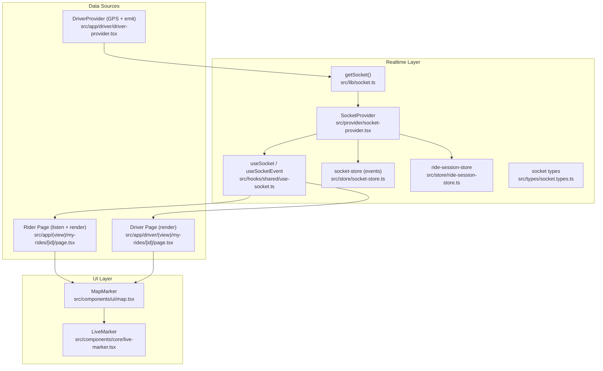
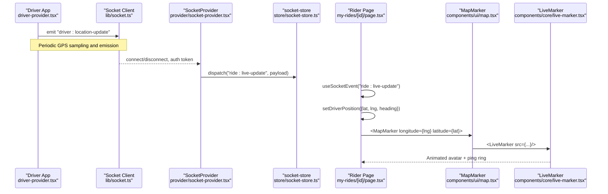
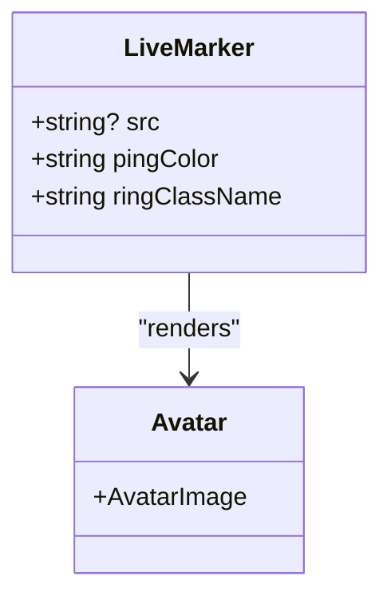
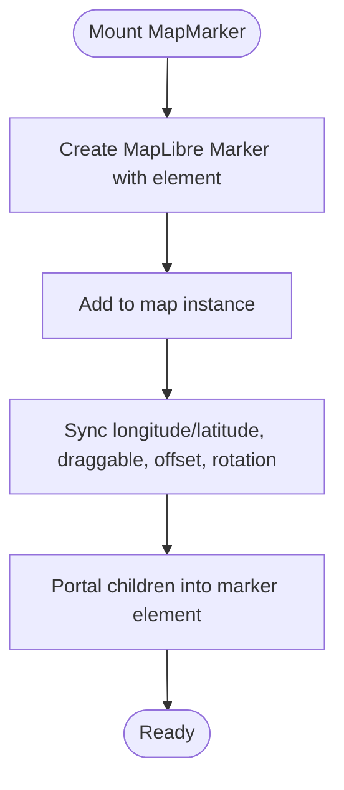
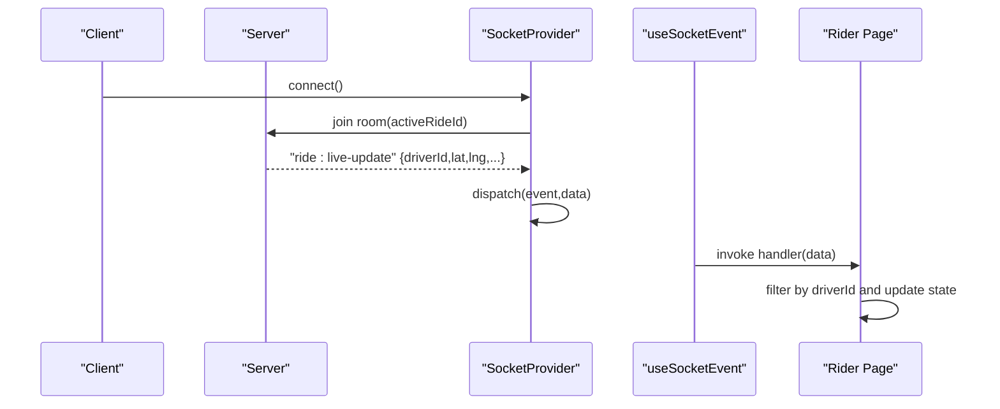
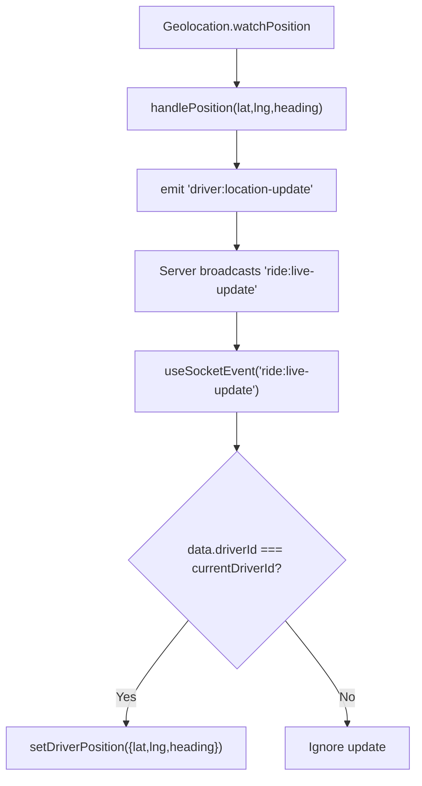
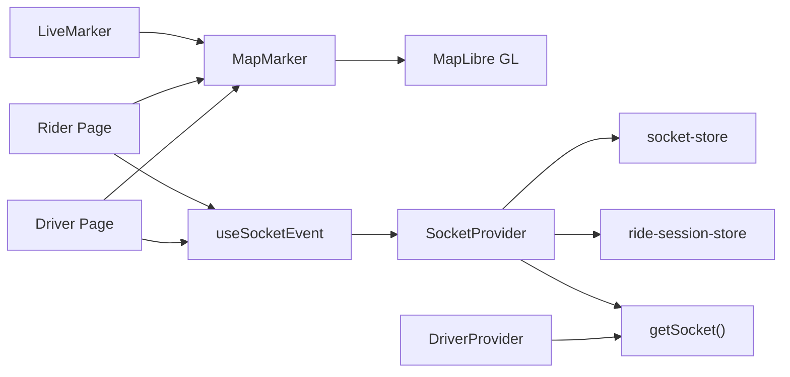

# Live Marker Component

<cite>
**Referenced Files in This Document**
- [live-marker.tsx](file://src/components/core/live-marker.tsx)
- [map.tsx](file://src/components/ui/map.tsx)
- [socket.ts](file://src/lib/socket.ts)
- [use-socket.ts](file://src/hooks/shared/use-socket.ts)
- [socket-provider.tsx](file://src/provider/socket-provider.tsx)
- [socket.types.ts](file://src/types/socket.types.ts)
- [socket-store.ts](file://src/store/socket-store.ts)
- [ride-session-store.ts](file://src/store/ride-session-store.ts)
- [driver-provider.tsx](file://src/app/driver/driver-provider.tsx)
- [my-rides page (rider)](file://src/app/(view)/my-rides/[id]/page.tsx)
- [my-rides page (driver)](file://src/app/driver/(view)/my-rides/[id]/page.tsx)
</cite>

## Table of Contents
1. [Introduction](#introduction)
2. [Project Structure](#project-structure)
3. [Core Components](#core-components)
4. [Architecture Overview](#architecture-overview)
5. [Detailed Component Analysis](#detailed-component-analysis)
6. [Dependency Analysis](#dependency-analysis)
7. [Performance Considerations](#performance-considerations)
8. [Troubleshooting Guide](#troubleshooting-guide)
9. [Conclusion](#conclusion)
10. [Appendices](#appendices)

## Introduction
This document explains the LiveMarker component and its integration with real-time position updates and marker animations on maps. It covers:
- Real-time data binding from WebSocket events to map markers
- Animation transitions for live indicators
- Performance optimizations for frequent position updates
- Integration with Socket.IO for live tracking
- Marker positioning algorithms and visual feedback mechanisms
- Configuration options for animation speed, update frequency, and styling
- Examples of connecting to real-time streams and handling edge cases such as network interruptions and rapid position changes

## Project Structure
The LiveMarker is a small UI component that renders an animated avatar/ping indicator. It is used inside MapLibre-based markers provided by the shared map wrapper. The real-time pipeline connects driver GPS updates to passengers via Socket.IO rooms and events.

**Diagram sources**
- [live-marker.tsx:1-30](file://src/components/core/live-marker.tsx#L1-L30)
- [map.tsx:374-495](file://src/components/ui/map.tsx#L374-L495)
- [socket-provider.tsx:67-116](file://src/provider/socket-provider.tsx#L67-L116)
- [use-socket.ts:12-56](file://src/hooks/shared/use-socket.ts#L12-L56)
- [socket-store.ts:1-34](file://src/store/socket-store.ts#L1-L34)
- [ride-session-store.ts:1-21](file://src/store/ride-session-store.ts#L1-L21)
- [socket.ts:1-50](file://src/lib/socket.ts#L1-L50)
- [socket.types.ts:30-160](file://src/types/socket.types.ts#L30-L160)
- [driver-provider.tsx:66-125](file://src/app/driver/driver-provider.tsx#L66-L125)
- [my-rides page (rider)](file://src/app/(view)/my-rides/[id]/page.tsx#L75-L96)
- [my-rides page (driver)](file://src/app/driver/(view)/my-rides/[id]/page.tsx#L238-L245)

**Section sources**
- [live-marker.tsx:1-30](file://src/components/core/live-marker.tsx#L1-L30)
- [map.tsx:374-495](file://src/components/ui/map.tsx#L374-L495)
- [socket-provider.tsx:67-116](file://src/provider/socket-provider.tsx#L67-L116)
- [use-socket.ts:12-56](file://src/hooks/shared/use-socket.ts#L12-L56)
- [socket-store.ts:1-34](file://src/store/socket-store.ts#L1-L34)
- [ride-session-store.ts:1-21](file://src/store/ride-session-store.ts#L1-L21)
- [socket.ts:1-50](file://src/lib/socket.ts#L1-L50)
- [socket.types.ts:30-160](file://src/types/socket.types.ts#L30-L160)
- [driver-provider.tsx:66-125](file://src/app/driver/driver-provider.tsx#L66-L125)
- [my-rides page (rider)](file://src/app/(view)/my-rides/[id]/page.tsx#L75-L96)
- [my-rides page (driver)](file://src/app/driver/(view)/my-rides/[id]/page.tsx#L238-L245)

## Core Components
- LiveMarker: A presentational component that renders an avatar with a pulsing ping ring. It accepts props for image source and Tailwind classes to customize colors and gradients.
- MapMarker: A MapLibre wrapper that manages a DOM element-backed marker, handles drag interactions, and applies rotation/offsets.
- Socket Provider and Hooks: Centralize connection lifecycle, event dispatch to stores, and typed helpers to subscribe/unsubscribe to events.
- Driver Provider: Captures GPS coordinates and emits location updates over Socket.IO; includes production-ready distance-gated emission logic (commented).
- Rider Page: Joins ride room, listens for live-update events, filters by driverId, and updates the driver marker position.

Key responsibilities:
- LiveMarker: Visual feedback only; no state or side effects.
- MapMarker: Low-level marker control and DOM portalization into MapLibre.
- Socket layer: Connection, authentication, room management, and event routing.
- Data flow: Driver GPS → Socket.IO → Server broadcast → Passenger listener → React state → MapMarker → LiveMarker.

**Section sources**
- [live-marker.tsx:1-30](file://src/components/core/live-marker.tsx#L1-L30)
- [map.tsx:374-495](file://src/components/ui/map.tsx#L374-L495)
- [socket-provider.tsx:67-116](file://src/provider/socket-provider.tsx#L67-L116)
- [use-socket.ts:12-56](file://src/hooks/shared/use-socket.ts#L12-L56)
- [driver-provider.tsx:66-125](file://src/app/driver/driver-provider.tsx#L66-L125)
- [my-rides page (rider)](file://src/app/(view)/my-rides/[id]/page.tsx#L75-L96)

## Architecture Overview
The system uses a client-server architecture with Socket.IO for real-time communication. The driver’s device sends periodic location updates; the server relays them to all clients in the same ride room. The passenger’s page subscribes to these updates and animates the driver marker accordingly.

**Diagram sources**
- [driver-provider.tsx:106-125](file://src/app/driver/driver-provider.tsx#L106-L125)
- [socket.ts:23-42](file://src/lib/socket.ts#L23-L42)
- [socket-provider.tsx:72-109](file://src/provider/socket-provider.tsx#L72-L109)
- [socket-store.ts:19-25](file://src/store/socket-store.ts#L19-L25)
- [my-rides page (rider)](file://src/app/(view)/my-rides/[id]/page.tsx#L87-L96)
- [map.tsx:374-495](file://src/components/ui/map.tsx#L374-L495)
- [live-marker.tsx:6-29](file://src/components/core/live-marker.tsx#L6-L29)

## Detailed Component Analysis

### LiveMarker Component
LiveMarker is a pure presentational component. It composes:
- A pulsing ping overlay using CSS animation
- A gradient ring around the avatar
- An AvatarImage with fallback

Configuration options:
- src: Optional profile image URL; falls back to a default car icon when null
- pingColor: Tailwind background color class for the ping ring
- ringClassName: Tailwind gradient classes for the outer ring

Animation behavior:
- Ping ring uses a built-in pulse animation to indicate activity
- Gradient ring provides visual emphasis without heavy JS animation

Integration points:
- Rendered inside MapMarker’s content portal
- No direct dependency on sockets or map instance

**Diagram sources**
- [live-marker.tsx:6-29](file://src/components/core/live-marker.tsx#L6-L29)

**Section sources**
- [live-marker.tsx:1-30](file://src/components/core/live-marker.tsx#L1-L30)

### MapMarker Wrapper
MapMarker encapsulates a MapLibre Marker with:
- Element-backed DOM node for custom content
- Drag support and callbacks
- Rotation and offset synchronization
- Portalized rendering of children into the marker’s DOM container

Performance considerations:
- Uses refs to avoid stale closures for event handlers
- Minimizes re-renders by comparing current vs new values before applying changes

**Diagram sources**
- [map.tsx:374-495](file://src/components/ui/map.tsx#L374-L495)

**Section sources**
- [map.tsx:374-495](file://src/components/ui/map.tsx#L374-L495)

### Socket Integration and Event Flow
The socket layer provides:
- Singleton socket instance with auth token from cookies
- Automatic reconnection and room rejoin based on persisted active ride ID
- Centralized event dispatch to a store for global access
- Typed hooks to subscribe/unsubscribe safely

Key events:
- ride:live-update: Contains driverId, lat, lng, heading, and optional metadata
- room:join/leave: Used to scope messages to a specific ride

**Diagram sources**
- [socket-provider.tsx:72-109](file://src/provider/socket-provider.tsx#L72-L109)
- [use-socket.ts:42-56](file://src/hooks/shared/use-socket.ts#L42-L56)
- [socket.types.ts:52-62](file://src/types/socket.types.ts#L52-L62)
- [my-rides page (rider)](file://src/app/(view)/my-rides/[id]/page.tsx#L75-L96)

**Section sources**
- [socket.ts:1-50](file://src/lib/socket.ts#L1-L50)
- [socket-provider.tsx:67-116](file://src/provider/socket-provider.tsx#L67-L116)
- [use-socket.ts:12-56](file://src/hooks/shared/use-socket.ts#L12-L56)
- [socket.types.ts:30-160](file://src/types/socket.types.ts#L30-L160)
- [socket-store.ts:1-34](file://src/store/socket-store.ts#L1-L34)
- [ride-session-store.ts:1-21](file://src/store/ride-session-store.ts#L1-L21)
- [my-rides page (rider)](file://src/app/(view)/my-rides/[id]/page.tsx#L75-L96)

### Driver Location Emission and Filtering
The driver provider:
- Acquires initial position and watches for updates
- Emits location updates at a fixed interval during testing; production code includes a distance-gated emitter (commented)
- Persists online status and vehicle association

The rider page:
- Filters incoming updates by matching driverId
- Updates local state which drives MapMarker position

**Diagram sources**
- [driver-provider.tsx:66-125](file://src/app/driver/driver-provider.tsx#L66-L125)
- [socket.types.ts:52-62](file://src/types/socket.types.ts#L52-L62)
- [my-rides page (rider)](file://src/app/(view)/my-rides/[id]/page.tsx#L87-L96)

**Section sources**
- [driver-provider.tsx:66-125](file://src/app/driver/driver-provider.tsx#L66-L125)
- [my-rides page (rider)](file://src/app/(view)/my-rides/[id]/page.tsx#L87-L96)

## Dependency Analysis
- LiveMarker depends on Avatar components and Tailwind utilities; it has no runtime dependencies beyond React.
- MapMarker depends on MapLibre GL and React DOM portals.
- Socket integration depends on:
  - getSocket() for singleton connection and auth
  - SocketProvider for lifecycle and event dispatch
  - socket-store for last-event caching
  - ride-session-store for room persistence across reloads
- Rider and driver pages depend on both the map wrapper and socket hooks.

**Diagram sources**
- [live-marker.tsx:1-30](file://src/components/core/live-marker.tsx#L1-L30)
- [map.tsx:374-495](file://src/components/ui/map.tsx#L374-L495)
- [use-socket.ts:12-56](file://src/hooks/shared/use-socket.ts#L12-L56)
- [socket-provider.tsx:67-116](file://src/provider/socket-provider.tsx#L67-L116)
- [socket-store.ts:1-34](file://src/store/socket-store.ts#L1-L34)
- [ride-session-store.ts:1-21](file://src/store/ride-session-store.ts#L1-L21)
- [socket.ts:1-50](file://src/lib/socket.ts#L1-L50)
- [driver-provider.tsx:66-125](file://src/app/driver/driver-provider.tsx#L66-L125)
- [my-rides page (rider)](file://src/app/(view)/my-rides/[id]/page.tsx#L75-L96)
- [my-rides page (driver)](file://src/app/driver/(view)/my-rides/[id]/page.tsx#L238-L245)

**Section sources**
- [live-marker.tsx:1-30](file://src/components/core/live-marker.tsx#L1-L30)
- [map.tsx:374-495](file://src/components/ui/map.tsx#L374-L495)
- [use-socket.ts:12-56](file://src/hooks/shared/use-socket.ts#L12-L56)
- [socket-provider.tsx:67-116](file://src/provider/socket-provider.tsx#L67-L116)
- [socket-store.ts:1-34](file://src/store/socket-store.ts#L1-L34)
- [ride-session-store.ts:1-21](file://src/store/ride-session-store.ts#L1-L21)
- [socket.ts:1-50](file://src/lib/socket.ts#L1-L50)
- [driver-provider.tsx:66-125](file://src/app/driver/driver-provider.tsx#L66-L125)
- [my-rides page (rider)](file://src/app/(view)/my-rides/[id]/page.tsx#L75-L96)
- [my-rides page (driver)](file://src/app/driver/(view)/my-rides/[id]/page.tsx#L238-L245)

## Performance Considerations
- Position update throttling:
  - Driver side: Production-ready haversine-based distance gating is included as comments; enable to reduce emissions when movement is minimal.
  - Rider side: Local GPS watcher uses a minimum delta threshold to avoid jitter-driven re-renders.
- Rendering efficiency:
  - MapMarker compares current vs new properties before updating to prevent unnecessary operations.
  - LiveMarker avoids JavaScript animations; relies on CSS transforms/animations for smoothness.
- Network resilience:
  - SocketProvider persists active ride ID and rejoins automatically after reconnects.
  - Auth token is read from cookies; ensure cookie availability for successful connections.

[No sources needed since this section provides general guidance]

## Troubleshooting Guide
Common issues and resolutions:
- No live updates on rider page:
  - Verify room join/leave calls are executed with the correct rideId.
  - Ensure the driver emits location updates and the server broadcasts ride:live-update.
  - Confirm the rider filters by driverId correctly.
- Reconnects not restoring room membership:
  - Check that activeRideId is persisted and SocketProvider re-emits room:join on connect.
- Excessive CPU usage or battery drain:
  - Enable distance-gated emission on the driver side.
  - Reduce update frequency if necessary.
- Marker not moving:
  - Confirm MapMarker receives updated longitude/latitude props.
  - Ensure the map instance is loaded before adding markers.

**Section sources**
- [socket-provider.tsx:72-109](file://src/provider/socket-provider.tsx#L72-L109)
- [my-rides page (rider)](file://src/app/(view)/my-rides/[id]/page.tsx#L75-L96)
- [driver-provider.tsx:66-125](file://src/app/driver/driver-provider.tsx#L66-L125)
- [map.tsx:374-495](file://src/components/ui/map.tsx#L374-L495)

## Conclusion
LiveMarker provides a lightweight, customizable visual indicator for live positions. Combined with the MapMarker wrapper and Socket.IO integration, it enables smooth real-time tracking experiences. By enabling distance-gated emissions and leveraging CSS animations, the system balances responsiveness and performance. Robust room rejoining and event filtering ensure reliability under network fluctuations.

[No sources needed since this section summarizes without analyzing specific files]

## Appendices

### Configuration Options
- LiveMarker props:
  - src: string | null — Image URL for the marker avatar; defaults to a car icon when null
  - pingColor: string — Tailwind bg-* class for the ping ring
  - ringClassName: string — Tailwind gradient classes for the outer ring
- MapMarker options:
  - longitude, latitude: number — Marker position
  - draggable: boolean — Enable dragging
  - offset: [number, number] — Pixel offset from coordinate
  - rotation: number — Degrees rotation
  - rotationAlignment, pitchAlignment: string — Alignment modes
- Socket configuration:
  - SOCKET_URL: Environment variable for server endpoint
  - Auth: Token read from cookies
  - Transports: ["websocket", "polling"]
- Update frequency:
  - Driver side: Interval-based emission in development; switch to distance-gated emission in production
  - Rider side: Minimum delta threshold for local GPS updates

**Section sources**
- [live-marker.tsx:6-29](file://src/components/core/live-marker.tsx#L6-L29)
- [map.tsx:374-495](file://src/components/ui/map.tsx#L374-L495)
- [socket.ts:6-32](file://src/lib/socket.ts#L6-L32)
- [driver-provider.tsx:77-118](file://src/app/driver/driver-provider.tsx#L77-L118)
- [my-rides page (rider)](file://src/app/(view)/my-rides/[id]/page.tsx#L106-L129)

### Example: Connecting to Real-Time Streams
- Join ride room:
  - On mount, persist activeRideId and emit room:join
- Listen for live updates:
  - Subscribe to ride:live-update
  - Filter by driverId
  - Update driverPosition state
- Render marker:
  - Pass driverPosition.lng and .lat to MapMarker
  - Use LiveMarker as content

**Section sources**
- [my-rides page (rider)](file://src/app/(view)/my-rides/[id]/page.tsx#L75-L96)
- [my-rides page (rider)](file://src/app/(view)/my-rides/[id]/page.tsx#L221-L231)

### Edge Cases Handling
- Network interruption:
  - SocketProvider auto-rejoins room on connect using persisted activeRideId
- Rapid position changes:
  - Distance-gated emission on driver side reduces noise
  - Minimum delta threshold on rider side prevents jitter
- Missing images:
  - LiveMarker falls back to a default car icon when src is null

**Section sources**
- [socket-provider.tsx:72-109](file://src/provider/socket-provider.tsx#L72-L109)
- [driver-provider.tsx:77-118](file://src/app/driver/driver-provider.tsx#L77-L118)
- [my-rides page (rider)](file://src/app/(view)/my-rides/[id]/page.tsx#L106-L129)
- [live-marker.tsx:6-29](file://src/components/core/live-marker.tsx#L6-L29)