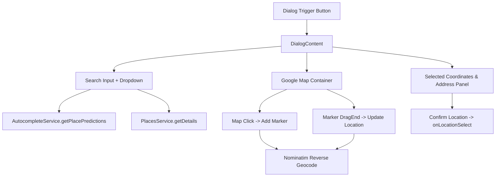
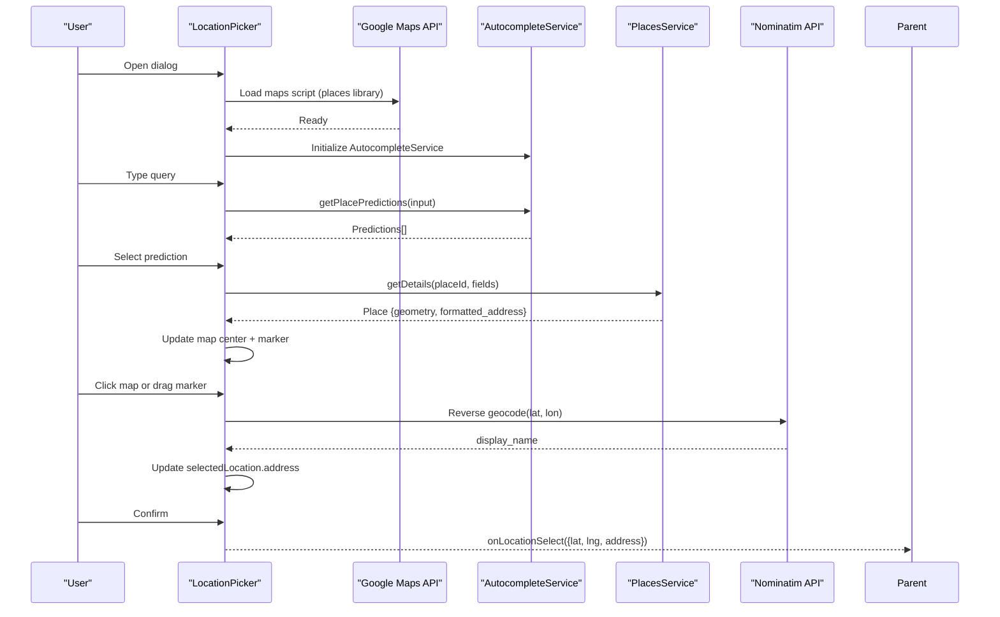
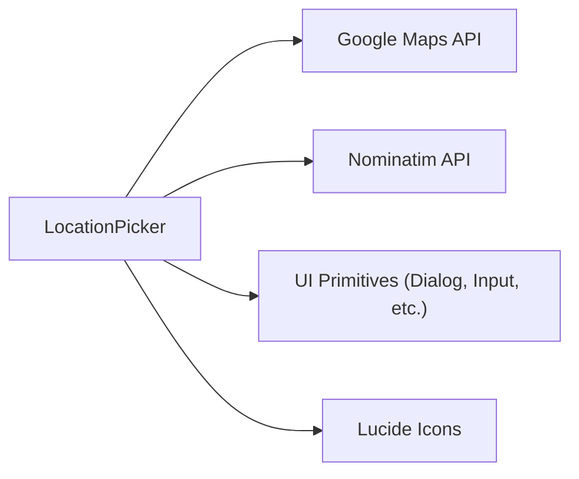
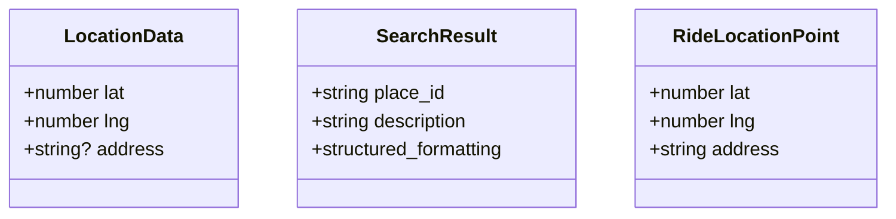

# Location Picker Component

<cite>
**Referenced Files in This Document**
- [location-picker.tsx](file://src/components/core/location-picker.tsx)
- [address-autocomplete.tsx](file://src/components/ui/address-autocomplete.tsx)
- [map.tsx](file://src/components/ui/map.tsx)
- [pin/page.tsx](file://src/app/(view)/book/pin/page.tsx)
- [ride.types.ts](file://src/types/ride.types.ts)
</cite>

## Table of Contents
1. [Introduction](#introduction)
2. [Project Structure](#project-structure)
3. [Core Components](#core-components)
4. [Architecture Overview](#architecture-overview)
5. [Detailed Component Analysis](#detailed-component-analysis)
6. [Dependency Analysis](#dependency-analysis)
7. [Performance Considerations](#performance-considerations)
8. [Troubleshooting Guide](#troubleshooting-guide)
9. [Conclusion](#conclusion)
10. [Appendices](#appendices)

## Introduction
This document provides comprehensive documentation for the LocationPicker component, a sophisticated location selection interface with Google Maps integration. It explains map initialization, marker management, address autocomplete via Google Places API, and reverse geocoding using Nominatim. It also covers complex state management for search queries, results handling, coordinate tracking, prop interfaces (LocationData, SearchResult), event handlers, configuration options, usage patterns, error handling strategies, and performance optimization techniques.

## Project Structure
The LocationPicker is implemented as a client-side React component that:
- Dynamically loads the Google Maps JavaScript API with the Places library
- Initializes a Google Map instance inside a dialog
- Manages a draggable marker to capture user-selected coordinates
- Provides an address autocomplete input powered by Google Places AutocompleteService and PlacesService
- Performs reverse geocoding via Nominatim to resolve addresses from coordinates
- Exposes a callback to return selected location data to parent components

**Diagram sources**
- [location-picker.tsx:105-143](file://src/components/core/location-picker.tsx#L105-L143)
- [location-picker.tsx:145-150](file://src/components/core/location-picker.tsx#L145-L150)
- [location-picker.tsx:152-176](file://src/components/core/location-picker.tsx#L152-L176)
- [location-picker.tsx:178-213](file://src/components/core/location-picker.tsx#L178-L213)
- [location-picker.tsx:215-265](file://src/components/core/location-picker.tsx#L215-L265)
- [location-picker.tsx:267-320](file://src/components/core/location-picker.tsx#L267-L320)
- [location-picker.tsx:328-333](file://src/components/core/location-picker.tsx#L328-L333)

**Section sources**
- [location-picker.tsx:1-501](file://src/components/core/location-picker.tsx#L1-L501)

## Core Components
- LocationPicker: Main component providing the interactive map and search UI.
- AddressAutocomplete: Reusable address input with Google Places integration used elsewhere in the app.
- Map (MapLibre): Alternative open-source map component used in other booking flows; not directly used by LocationPicker but relevant for context.

Key responsibilities:
- Dynamic loading of Google Maps JS API
- Map instantiation and configuration
- Marker creation and drag handling
- Search input debouncing and result rendering
- Reverse geocoding via Nominatim
- State synchronization between map interactions and selected location

**Section sources**
- [location-picker.tsx:1-501](file://src/components/core/location-picker.tsx#L1-L501)
- [address-autocomplete.tsx:1-170](file://src/components/ui/address-autocomplete.tsx#L1-L170)
- [map.tsx:1-800](file://src/components/ui/map.tsx#L1-L800)

## Architecture Overview
The component orchestrates several asynchronous operations and external APIs:
- Google Maps JS API loaded dynamically when the dialog opens
- AutocompleteService provides place predictions based on typed query
- PlacesService resolves geometry and formatted address for a selected prediction
- Nominatim reverse geocoding fetches human-readable address for current coordinates
- UI states reflect loading, errors, and results

**Diagram sources**
- [location-picker.tsx:71-93](file://src/components/core/location-picker.tsx#L71-L93)
- [location-picker.tsx:145-150](file://src/components/core/location-picker.tsx#L145-L150)
- [location-picker.tsx:215-265](file://src/components/core/location-picker.tsx#L215-L265)
- [location-picker.tsx:267-320](file://src/components/core/location-picker.tsx#L267-L320)
- [location-picker.tsx:178-213](file://src/components/core/location-picker.tsx#L178-L213)
- [location-picker.tsx:328-333](file://src/components/core/location-picker.tsx#L328-L333)

## Detailed Component Analysis

### Props and Interfaces
- LocationData: Represents a selected location with latitude, longitude, and optional address string.
- SearchResult: Internal type for autocomplete predictions returned by Google Places.
- LocationPickerProps:
  - onLocationSelect?: Callback invoked with LocationData upon confirmation.
  - defaultLocation?: Initial map center if no initialLocation provided.
  - initialLocation?: Preselected location to initialize state.

Usage examples:
- Provide onLocationSelect to receive selected coordinates and address.
- Use defaultLocation to set a sensible fallback center.
- Use initialLocation to prefill the picker with an existing value.

**Section sources**
- [location-picker.tsx:16-41](file://src/components/core/location-picker.tsx#L16-L41)

### Map Initialization and Lifecycle
- The component lazily loads the Google Maps JS API with the places library only when the dialog opens.
- On load, it initializes the map with a default zoom and minimal controls, then creates a PlacesService instance.
- If an initialLocation exists, a marker is placed immediately.

Lifecycle highlights:
- Dialog open triggers API load and initialization.
- Map click adds a new marker and updates selected location.
- Marker dragend updates selected location and clears active search.

**Section sources**
- [location-picker.tsx:95-143](file://src/components/core/location-picker.tsx#L95-L143)

### Marker Management
- A single draggable marker represents the selected location.
- When the marker is dragged, its new position is captured and used to update selectedLocation and trigger reverse geocoding.
- Previous markers are removed before adding a new one to avoid duplicates.

**Section sources**
- [location-picker.tsx:152-176](file://src/components/core/location-picker.tsx#L152-L176)

### Address Autocomplete with Google Places
- Debounced input handler prevents excessive calls while typing.
- AutocompleteService.getPlacePredictions returns structured suggestions.
- Upon selection, PlacesService.getDetails retrieves geometry and formatted address.
- The map is re-centered and a marker is added at the chosen location.

Error handling:
- Non-OK status clears results and hides dropdown.
- Exceptions during search reset UI state and show no results.

**Section sources**
- [location-picker.tsx:215-265](file://src/components/core/location-picker.tsx#L215-L265)
- [location-picker.tsx:267-320](file://src/components/core/location-picker.tsx#L267-L320)

### Reverse Geocoding with Nominatim
- After any change to coordinates (click or drag), the component requests a human-readable address from Nominatim.
- Loading state shows a spinner; errors display a user-friendly alert.
- Successful responses update the selectedLocation.address field.

**Section sources**
- [location-picker.tsx:178-213](file://src/components/core/location-picker.tsx#L178-L213)

### State Management
Internal state includes:
- open: Controls dialog visibility.
- selectedLocation: Current lat/lng and resolved address.
- isLoadingAddress / addressError: Reverse geocoding status and messages.
- searchQuery, searchResults, isSearching, showSearchResults: Autocomplete flow.
- autocompleteService, placesService: Cached services for API calls.
- mapRef, searchInputRef, searchTimeoutRef: DOM and timer references.

State transitions:
- Typing -> debounce -> performSearch -> update searchResults.
- Select prediction -> getDetails -> update selectedLocation and map.
- Map click/drag -> handleLocationChange -> reverse geocode -> update address.
- Confirm -> invoke onLocationSelect and close dialog.

**Section sources**
- [location-picker.tsx:50-69](file://src/components/core/location-picker.tsx#L50-L69)
- [location-picker.tsx:335-354](file://src/components/core/location-picker.tsx#L335-L354)

### Event Handlers
- handleSearchInputChange: Debounces input and triggers search.
- performSearch: Calls AutocompleteService and manages UI states.
- handleSearchResultSelect: Resolves details and updates map and selected location.
- clearSearch: Resets search-related states.
- handleSelectLocation: Emits selectedLocation via onLocationSelect and closes dialog.

**Section sources**
- [location-picker.tsx:215-265](file://src/components/core/location-picker.tsx#L215-L265)
- [location-picker.tsx:267-320](file://src/components/core/location-picker.tsx#L267-L320)
- [location-picker.tsx:322-333](file://src/components/core/location-picker.tsx#L322-L333)

### Configuration Options
- GOOGLE_MAPS_API_KEY: Environment variable used to load Google Maps. Ensure NEXT_PUBLIC_GOOGLE_MAPS_API_KEY is configured.
- Map styling: Minimal controls and POI label hiding are applied for a cleaner UX.

**Section sources**
- [location-picker.tsx:43-43](file://src/components/core/location-picker.tsx#L43-L43)
- [location-picker.tsx:109-123](file://src/components/core/location-picker.tsx#L109-L123)

### Usage Patterns
- Basic usage: Render LocationPicker and provide onLocationSelect to capture the final selection.
- Prefill: Pass initialLocation to start with a known address and coordinates.
- Default center: Provide defaultLocation to set a reasonable fallback map center.

Related flows in the app:
- Pin page uses a different map implementation (MapLibre) with AddressAutocomplete and Google Geocoding API for reverse geocoding. This demonstrates alternative patterns for address selection and map interaction.

**Section sources**
- [location-picker.tsx:45-49](file://src/components/core/location-picker.tsx#L45-L49)
- [pin/page.tsx:1-188](file://src/app/(view)/book/pin/page.tsx#L1-L188)
- [address-autocomplete.tsx:1-170](file://src/components/ui/address-autocomplete.tsx#L1-L170)

### Error Handling Strategies
- Google Maps load failure: Promise rejects; ensure environment key is valid.
- Autocomplete failures: Status check resets results and hides dropdown.
- Nominatim errors: Display user-facing alert and continue allowing selection without address.

Best practices:
- Always validate API keys and network connectivity.
- Provide fallbacks when address resolution fails.
- Debounce inputs to reduce API calls.

**Section sources**
- [location-picker.tsx:71-93](file://src/components/core/location-picker.tsx#L71-L93)
- [location-picker.tsx:233-265](file://src/components/core/location-picker.tsx#L233-L265)
- [location-picker.tsx:186-213](file://src/components/core/location-picker.tsx#L186-L213)

### Performance Optimization Techniques
- Debounced search input reduces unnecessary API calls.
- Lazy loading of Google Maps script avoids blocking initial render.
- Single marker lifecycle management prevents memory leaks and duplicate overlays.
- Clearing search state on map interactions keeps UI consistent.

[No sources needed since this section provides general guidance]

## Dependency Analysis
External dependencies and integrations:
- Google Maps JavaScript API (maps + places libraries)
- Nominatim OpenStreetMap reverse geocoding service
- UI primitives (Button, Dialog, Input, Alert, Skeleton) and icons (lucide-react)

Relationships:
- LocationPicker depends on Google Maps services for autocomplete and details.
- Reverse geocoding relies on Nominatim for address resolution.
- UI components provide layout and interactivity.

**Diagram sources**
- [location-picker.tsx:1-501](file://src/components/core/location-picker.tsx#L1-L501)

**Section sources**
- [location-picker.tsx:1-501](file://src/components/core/location-picker.tsx#L1-L501)

## Performance Considerations
- Debounce search input to minimize API calls.
- Avoid recreating map instances unnecessarily; reuse existing map reference where possible.
- Use efficient state updates to prevent excessive re-renders.
- Consider caching recent reverse geocoding results locally to reduce network overhead.
- Monitor Google Maps quota and implement backoff strategies for failed requests.

[No sources needed since this section provides general guidance]

## Troubleshooting Guide
Common issues and resolutions:
- Google Maps not loading: Verify NEXT_PUBLIC_GOOGLE_MAPS_API_KEY is set and has Places enabled.
- Autocomplete not returning results: Check PlacesServiceStatus and ensure correct types are requested.
- Reverse geocoding errors: Nominatim may rate-limit or fail; show user-friendly alerts and allow proceeding without address.
- Marker not updating: Ensure dragend listener is attached and positions are read correctly.

Operational checks:
- Inspect console logs for API errors.
- Validate network requests to Nominatim and Google endpoints.
- Confirm dialog open/close lifecycle resets internal state properly.

**Section sources**
- [location-picker.tsx:71-93](file://src/components/core/location-picker.tsx#L71-L93)
- [location-picker.tsx:233-265](file://src/components/core/location-picker.tsx#L233-L265)
- [location-picker.tsx:186-213](file://src/components/core/location-picker.tsx#L186-L213)
- [location-picker.tsx:351-354](file://src/components/core/location-picker.tsx#L351-L354)

## Conclusion
The LocationPicker component offers a robust, user-friendly interface for selecting locations with integrated Google Maps features and Nominatim reverse geocoding. Its architecture balances dynamic resource loading, responsive state management, and clear error handling. By following the documented usage patterns and optimization strategies, developers can integrate reliable location selection into their applications effectively.

[No sources needed since this section summarizes without analyzing specific files]

## Appendices

### Data Models and Types
- LocationData: Selected location payload with coordinates and optional address.
- SearchResult: Autocomplete prediction structure used internally.
- RideLocationPoint: Related type used across the application for ride request payloads.

**Diagram sources**
- [location-picker.tsx:16-29](file://src/components/core/location-picker.tsx#L16-L29)
- [ride.types.ts:64-68](file://src/types/ride.types.ts#L64-L68)

**Section sources**
- [location-picker.tsx:16-29](file://src/components/core/location-picker.tsx#L16-L29)
- [ride.types.ts:64-68](file://src/types/ride.types.ts#L64-L68)