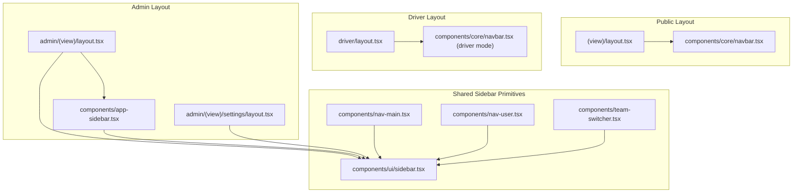
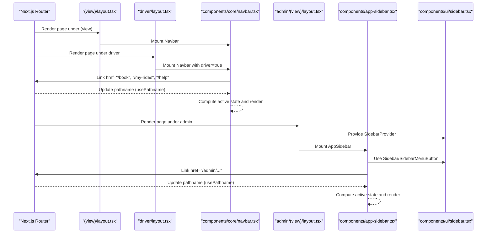
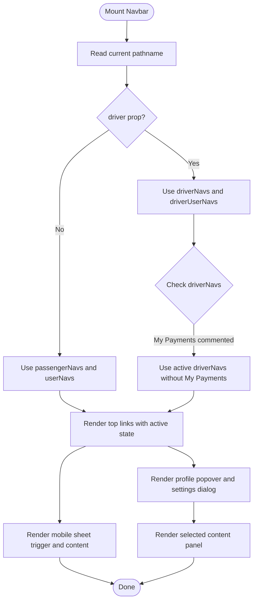
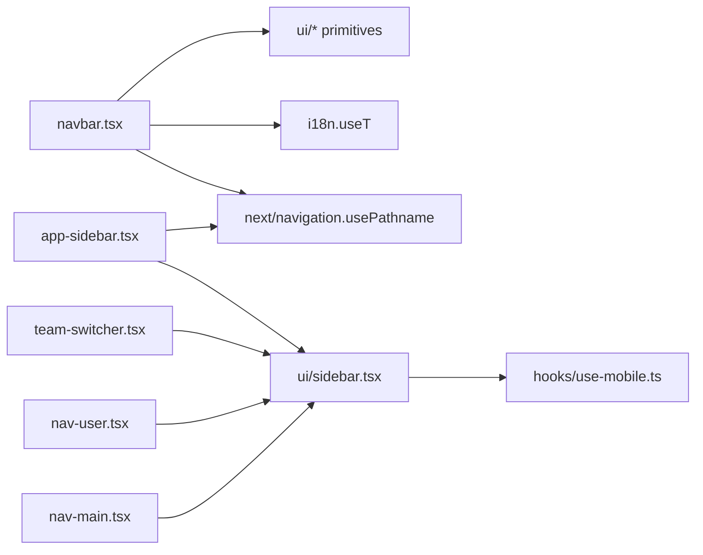

# Navigation Components

<cite>
**Referenced Files in This Document**
- [navbar.tsx](file://src/components/core/navbar.tsx)
- [app-sidebar.tsx](file://src/components/app-sidebar.tsx)
- [nav-main.tsx](file://src/components/nav-main.tsx)
- [nav-user.tsx](file://src/components/nav-user.tsx)
- [team-switcher.tsx](file://src/components/team-switcher.tsx)
- [sidebar.tsx](file://src/components/ui/sidebar.tsx)
- [layout.tsx](file://src/app/(view)/layout.tsx)
- [admin-layout.tsx](file://src/app/admin/(view)/layout.tsx)
- [settings-layout.tsx](file://src/app/admin/(view)/settings/layout.tsx)
- [use-mobile.ts](file://src/hooks/use-mobile.ts)
- [driver-layout.tsx](file://src/app/driver/layout.tsx)
</cite>

## Update Summary
**Changes Made**
- Updated driver navigation structure documentation to reflect removal of 'My Payments' from top-level navigation
- Added clarification about alternative access via user profile dropdown menu
- Updated component analysis sections to document the current navigation state

## Table of Contents
1. [Introduction](#introduction)
2. [Project Structure](#project-structure)
3. [Core Components](#core-components)
4. [Architecture Overview](#architecture-overview)
5. [Detailed Component Analysis](#detailed-component-analysis)
6. [Dependency Analysis](#dependency-analysis)
7. [Performance Considerations](#performance-considerations)
8. [Troubleshooting Guide](#troubleshooting-guide)
9. [Conclusion](#conclusion)
10. [Appendices](#appendices)

## Introduction
This document explains the navigation system across the application, focusing on:
- Main navbar for passenger and driver experiences
- Sidebar navigation for admin and app-wide contexts
- User-specific navigation elements (profile menu, settings dialog)
- Responsive design patterns, route-based active states, and role-aware rendering
- Component hierarchy, prop interfaces for menu configuration, and integration with Next.js routing
- Accessibility considerations, keyboard navigation, and performance optimization strategies for large navigation trees

## Project Structure
Navigation is implemented using a combination of:
- A top-level Navbar component used by the public-facing layout
- An AppSidebar and related sidebar components used within the admin area
- Reusable UI primitives from a shared sidebar component library



**Diagram sources**
- [layout.tsx](file://src/app/(view)/layout.tsx#L1-L14)
- [driver-layout.tsx:1-15](file://src/app/driver/layout.tsx#L1-L15)
- [navbar.tsx:181-214](file://src/components/core/navbar.tsx#L181-L214)
- [admin-layout.tsx](file://src/app/admin/(view)/layout.tsx#L20-L57)
- [app-sidebar.tsx:61-116](file://src/components/app-sidebar.tsx#L61-L116)
- [sidebar.tsx:62-157](file://src/components/ui/sidebar.tsx#L62-L157)
- [nav-main.tsx:21-77](file://src/components/nav-main.tsx#L21-L77)
- [nav-user.tsx:29-114](file://src/components/nav-user.tsx#L29-L114)
- [team-switcher.tsx:23-100](file://src/components/team-switcher.tsx#L23-L100)
- [settings-layout.tsx](file://src/app/admin/(view)/settings/layout.tsx#L66-L140)

**Section sources**
- [layout.tsx](file://src/app/(view)/layout.tsx#L1-L14)
- [driver-layout.tsx:1-15](file://src/app/driver/layout.tsx#L1-L15)
- [admin-layout.tsx](file://src/app/admin/(view)/layout.tsx#L20-L57)
- [app-sidebar.tsx:61-116](file://src/components/app-sidebar.tsx#L61-L116)
- [sidebar.tsx:62-157](file://src/components/ui/sidebar.tsx#L62-L157)

## Core Components
- Navbar: Top navigation bar for passengers and drivers, including mobile sheet menu and user profile popover with settings dialog.
- AppSidebar: Admin sidebar with collapsible icon mode and route-based active highlighting.
- NavMain: Collapsible group menu for nested items.
- NavUser: User dropdown inside the sidebar with account actions.
- TeamSwitcher: Team context switcher in the sidebar.
- Sidebar primitives: Shared building blocks for state, responsiveness, tooltips, and accessibility.

Key responsibilities:
- Role-aware rendering (passenger vs driver)
- Route-based active states via Next.js usePathname
- Responsive behavior (desktop sidebar vs mobile offcanvas/sheet)
- Keyboard shortcuts and accessible triggers

**Updated** Driver navigation structure modified - 'My Payments' removed from top-level navigation but remains accessible via user profile dropdown menu.

**Section sources**
- [navbar.tsx:54-193](file://src/components/core/navbar.tsx#L54-L193)
- [app-sidebar.tsx:31-116](file://src/components/app-sidebar.tsx#L31-L116)
- [nav-main.tsx:21-77](file://src/components/nav-main.tsx#L21-L77)
- [nav-user.tsx:29-114](file://src/components/nav-user.tsx#L29-L114)
- [team-switcher.tsx:23-100](file://src/components/team-switcher.tsx#L23-L100)
- [sidebar.tsx:62-157](file://src/components/ui/sidebar.tsx#L62-L157)

## Architecture Overview
The navigation architecture separates concerns between:
- Public-facing top nav (Navbar)
- Admin workspace nav (AppSidebar + Sidebar primitives)
- Shared UI primitives (SidebarProvider, SidebarMenuButton, etc.)



**Diagram sources**
- [layout.tsx](file://src/app/(view)/layout.tsx#L1-L14)
- [driver-layout.tsx:1-15](file://src/app/driver/layout.tsx#L1-L15)
- [navbar.tsx:181-214](file://src/components/core/navbar.tsx#L181-L214)
- [admin-layout.tsx](file://src/app/admin/(view)/layout.tsx#L20-L57)
- [app-sidebar.tsx:61-116](file://src/components/app-sidebar.tsx#L61-L116)
- [sidebar.tsx:62-157](file://src/components/ui/sidebar.tsx#L62-L157)

## Detailed Component Analysis

### Navbar (Public Top Navigation)
Responsibilities:
- Renders top links for passengers and drivers based on a boolean flag
- Provides a mobile sheet menu
- Displays user avatar, notifications, messages, and a profile popover
- Opens a settings dialog that renders content panels per item

Responsive behavior:
- Desktop: horizontal tabs with active underline
- Mobile: Sheet menu with same items
- Profile popover adapts to screen size; settings dialog uses a two-pane layout on desktop and a picker on mobile

Role-aware rendering:
- passengerNavs vs driverNavs arrays control top links
- userNavs vs driverUserNavs control profile settings sections

Route-based active states:
- Uses Next.js usePathname to compare current path with each link's href

Accessibility:
- Uses semantic Link components and buttons with aria-label where appropriate
- Dialog and Popover provide focus management through their primitives

Integration with Next.js routing:
- Links use href attributes to navigate client-side

**Updated** Driver navigation structure modified - 'My Payments' link temporarily disabled from top-level navigation as part of UI/UX improvements.



**Diagram sources**
- [navbar.tsx:54-193](file://src/components/core/navbar.tsx#L54-L193)
- [navbar.tsx:181-214](file://src/components/core/navbar.tsx#L181-L214)
- [navbar.tsx:254-337](file://src/components/core/navbar.tsx#L254-L337)
- [navbar.tsx:389-497](file://src/components/core/navbar.tsx#L389-L497)

**Section sources**
- [navbar.tsx:54-193](file://src/components/core/navbar.tsx#L54-L193)
- [navbar.tsx:181-214](file://src/components/core/navbar.tsx#L181-L214)
- [navbar.tsx:254-337](file://src/components/core/navbar.tsx#L254-L337)
- [navbar.tsx:389-497](file://src/components/core/navbar.tsx#L389-L497)

### Driver Navigation Structure
**Updated** The driver navigation has been restructured as part of UI/UX improvements:

Top-level navigation items (driverNavs):
- Home (`/driver`)
- My Rides (`/driver/my-rides`)
- Help & Support (`/help`)
- ~~My Payments~~ (temporarily removed from top-level)

Alternative access via user profile dropdown (driverUserNavs):
- Personal Info
- Refund Amount
- **My payments** (accessible here)
- My vehicles
- Login & Security
- Privacy
- Help & Support
- Language

The payments functionality remains fully operational at `/driver/my-payments`, only the direct navigation link was temporarily disabled.

**Section sources**
- [navbar.tsx:59-64](file://src/components/core/navbar.tsx#L59-L64)
- [navbar.tsx:123-149](file://src/components/core/navbar.tsx#L123-L149)

### AppSidebar (Admin Workspace)
Responsibilities:
- Provides a collapsible sidebar with header logo and menu items
- Highlights active routes based on exact match
- Integrates with SidebarProvider for responsive behavior

Prop interface for menu configuration:
- Items are defined locally as an array of objects with label, href, and icon fields

Route-based active states:
- Compares current pathname with each item's href

Collapsible modes:
- Supports icon-only mode on desktop and offcanvas on mobile

```mermaid
classDiagram
class AppSidebar {
+render()
-navItems : Array<{label, href, icon}>
}
class SidebarProvider {
+state : "expanded" | "collapsed"
+open : boolean
+isMobile : boolean
+toggleSidebar()
}
class SidebarMenuButton {
+isActive : boolean
+tooltip : string
}
AppSidebar --> SidebarProvider : "consumes context"
AppSidebar --> SidebarMenuButton : "renders items"
```

**Diagram sources**
- [app-sidebar.tsx:31-116](file://src/components/app-sidebar.tsx#L31-L116)
- [sidebar.tsx:62-157](file://src/components/ui/sidebar.tsx#L62-L157)
- [sidebar.tsx:510-558](file://src/components/ui/sidebar.tsx#L510-L558)

**Section sources**
- [app-sidebar.tsx:31-116](file://src/components/app-sidebar.tsx#L31-L116)
- [sidebar.tsx:62-157](file://src/components/ui/sidebar.tsx#L62-L157)

### NavMain (Collapsible Group Menu)
Responsibilities:
- Renders a group of collapsible menu items with optional sub-items
- Accepts a typed items prop for titles, URLs, icons, and nested items

Prop interface:
- items: array of objects with title, url, optional icon, optional isActive, and optional items[]

Keyboard and accessibility:
- Uses Collapsible primitives for expand/collapse semantics

```mermaid
classDiagram
class NavMain {
+items : Array<{title, url, icon?, isActive?, items?}>
+render()
}
class Collapsible {
+defaultOpen : boolean
}
class SidebarMenuSub {
+render()
}
NavMain --> Collapsible : "wraps each item"
NavMain --> SidebarMenuSub : "renders nested items"
```

**Diagram sources**
- [nav-main.tsx:21-77](file://src/components/nav-main.tsx#L21-L77)

**Section sources**
- [nav-main.tsx:21-77](file://src/components/nav-main.tsx#L21-L77)

### NavUser (User Dropdown in Sidebar)
Responsibilities:
- Displays user avatar and name/email
- Provides a dropdown with account-related actions
- Adapts side and alignment based on mobile state

Integration:
- Uses useSidebar to detect mobile context for positioning

**Section sources**
- [nav-user.tsx:29-114](file://src/components/nav-user.tsx#L29-L114)
- [sidebar.tsx:53-60](file://src/components/ui/sidebar.tsx#L53-L60)

### TeamSwitcher (Team Context Switcher)
Responsibilities:
- Shows current team with a dropdown list
- Allows switching teams and adding new ones
- Positions dropdown based on mobile state

**Section sources**
- [team-switcher.tsx:23-100](file://src/components/team-switcher.tsx#L23-L100)
- [sidebar.tsx:53-60](file://src/components/ui/sidebar.tsx#L53-L60)

### Sidebar Primitives (Shared Building Blocks)
Responsibilities:
- Provide context for open/collapsed state, mobile detection, and toggle behavior
- Implement keyboard shortcut (Ctrl/Cmd+B) to toggle sidebar
- Offer accessible triggers and tooltips when collapsed
- Support multiple variants and sizes for menu buttons

Key features:
- Cookie persistence for sidebar open state
- Mobile offcanvas via Sheet
- Tooltip auto-hide when expanded or on mobile

**Section sources**
- [sidebar.tsx:62-157](file://src/components/ui/sidebar.tsx#L62-L157)
- [sidebar.tsx:103-116](file://src/components/ui/sidebar.tsx#L103-L116)
- [sidebar.tsx:189-213](file://src/components/ui/sidebar.tsx#L189-L213)
- [sidebar.tsx:510-558](file://src/components/ui/sidebar.tsx#L510-L558)

### Settings Sub-navigation (Admin Settings)
Responsibilities:
- Horizontal scrollable strip on mobile
- Vertical sidebar on desktop
- Active state computed via exact or prefix matching

Active state logic:
- If item.exact is true, compares full pathname
- Otherwise, checks if pathname starts with item.href

**Section sources**
- [settings-layout.tsx](file://src/app/admin/(view)/settings/layout.tsx#L66-L140)

## Dependency Analysis
High-level dependencies:
- Navbar depends on Next.js router (usePathname), i18n hook, and UI primitives (Avatar, Button, Dialog, Popover, Sheet)
- AppSidebar depends on Sidebar primitives and Next.js router
- NavMain, NavUser, TeamSwitcher depend on Sidebar primitives and Hugeicons
- Sidebar primitives depend on mobile detection hook and Radix primitives



**Diagram sources**
- [navbar.tsx:181-214](file://src/components/core/navbar.tsx#L181-L214)
- [app-sidebar.tsx:61-116](file://src/components/app-sidebar.tsx#L61-L116)
- [nav-main.tsx:21-77](file://src/components/nav-main.tsx#L21-L77)
- [nav-user.tsx:29-114](file://src/components/nav-user.tsx#L29-L114)
- [team-switcher.tsx:23-100](file://src/components/team-switcher.tsx#L23-L100)
- [sidebar.tsx:62-157](file://src/components/ui/sidebar.tsx#L62-L157)
- [use-mobile.ts](file://src/hooks/use-mobile.ts)

**Section sources**
- [navbar.tsx:181-214](file://src/components/core/navbar.tsx#L181-L214)
- [app-sidebar.tsx:61-116](file://src/components/app-sidebar.tsx#L61-L116)
- [sidebar.tsx:62-157](file://src/components/ui/sidebar.tsx#L62-L157)

## Performance Considerations
- Avoid re-rendering large menus by memoizing computed lists and using stable keys
- Prefer static configuration arrays for navigation items to minimize runtime computation
- Use Next.js Link for client-side navigation to avoid full-page reloads
- For very large navigation trees:
  - Virtualize long lists if needed
  - Defer heavy content until opened (e.g., lazy-load settings panels)
  - Keep icons lightweight and reuse shared icon components
- Leverage collapsible groups to reduce initial DOM size
- Use CSS containment and will-change sparingly for smooth transitions

[No sources needed since this section provides general guidance]

## Troubleshooting Guide
Common issues and resolutions:
- Active state not updating:
  - Ensure you are comparing the correct pathname segments and handling prefixes for nested routes
  - Verify that Link components are used instead of anchor tags for client-side navigation
- Sidebar not toggling on mobile:
  - Confirm SidebarProvider wraps the sidebar and content
  - Check that the trigger button calls toggleSidebar
- Keyboard shortcut not working:
  - Ensure keydown listener is attached and meta/ctrl key is pressed together with the shortcut key
- Tooltip not visible when collapsed:
  - Tooltips are hidden when expanded or on mobile; verify state and device width
- Driver payments not appearing in top navigation:
  - This is intentional - payments are now accessible via user profile dropdown menu under 'My payments' option
  - Direct navigation link was temporarily disabled as part of UI/UX improvements

**Section sources**
- [sidebar.tsx:103-116](file://src/components/ui/sidebar.tsx#L103-L116)
- [sidebar.tsx:510-558](file://src/components/ui/sidebar.tsx#L510-L558)
- [settings-layout.tsx](file://src/app/admin/(view)/settings/layout.tsx#L66-L140)
- [navbar.tsx:59-64](file://src/components/core/navbar.tsx#L59-L64)

## Conclusion
The navigation system combines a role-aware top navbar and a robust admin sidebar built on shared primitives. It leverages Next.js routing for active states, supports responsive layouts, and integrates accessibility features through well-structured primitives. The recent UI/UX improvements have streamlined the driver navigation by removing the direct 'My Payments' link from the top-level navigation while maintaining full access through the user profile dropdown menu. By following the prop interfaces and patterns outlined here, you can customize navigation items, implement role-based visibility, and maintain performant, accessible navigation across devices.

[No sources needed since this section summarizes without analyzing specific files]

## Appendices

### Prop Interfaces Summary
- NavMain items:
  - title: string
  - url: string
  - icon?: React.ReactNode
  - isActive?: boolean
  - items?: Array<{ title: string; url: string }>
- AppSidebar items:
  - label: string
  - href: string
  - icon: React.ComponentType
- NavUser input:
  - user: { name: string; email: string; avatar: string }
- TeamSwitcher input:
  - teams: Array<{ name: string; logo: React.ReactNode; plan: string }>

**Section sources**
- [nav-main.tsx:21-34](file://src/components/nav-main.tsx#L21-L34)
- [app-sidebar.tsx:31-59](file://src/components/app-sidebar.tsx#L31-L59)
- [nav-user.tsx:29-37](file://src/components/nav-user.tsx#L29-L37)
- [team-switcher.tsx:23-31](file://src/components/team-switcher.tsx#L23-L31)

### Customization Examples (Conceptual)
- Customize navigation items:
  - Add entries to the items array with label/href/icon for AppSidebar
  - Extend NavMain items with nested sub-items for grouped navigation
- Implement role-based visibility:
  - Conditionally select different arrays (e.g., passenger vs driver) before rendering
- Handle mobile-responsive layouts:
  - Use the provided Sheet for mobile menus and rely on SidebarProvider for offcanvas behavior
- Modify driver navigation structure:
  - Comment/uncomment items in driverNavs array to control top-level visibility
  - Add/remove items in driverUserNavs array to control profile dropdown options

[No sources needed since this section doesn't analyze specific files]

### Driver Navigation Configuration
Current driver navigation structure:

**Top-level navigation (driverNavs):**
- Home → `/driver`
- My Rides → `/driver/my-rides`
- Help & Support → `/help`
- ~~My Payments~~ → `/driver/my-payments` (temporarily disabled)

**Profile dropdown navigation (driverUserNavs):**
- Personal Info → `/me`
- Refund Amount → `/refund`
- **My payments** → `/my-payments` (accessible here)
- My vehicles → `/my-vehicles`
- Login & Security → `/security`
- Privacy → `/privacy`
- Help & Support → `/help`
- Language → `/language`

**Section sources**
- [navbar.tsx:59-64](file://src/components/core/navbar.tsx#L59-L64)
- [navbar.tsx:123-149](file://src/components/core/navbar.tsx#L123-L149)