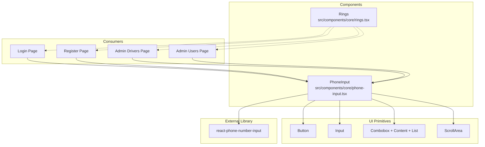
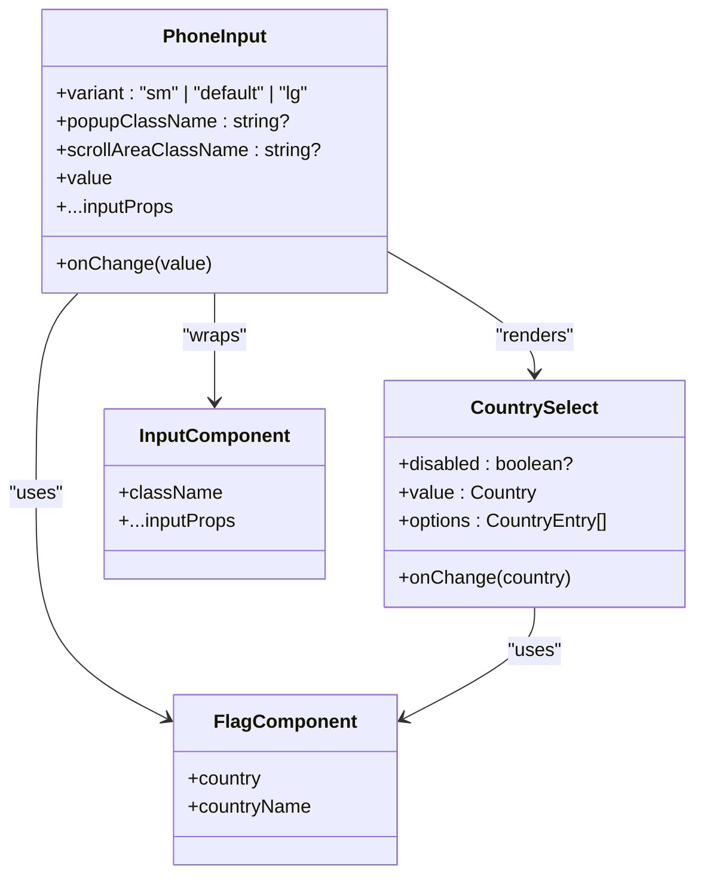
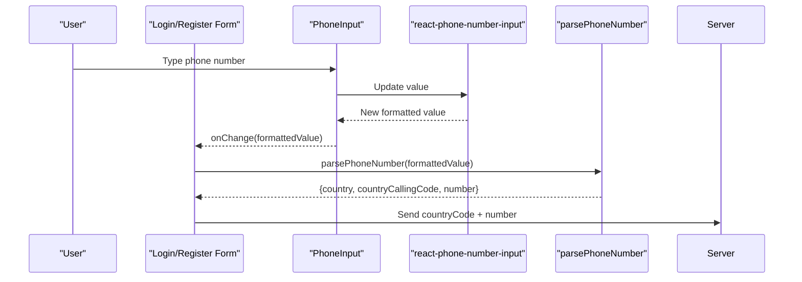
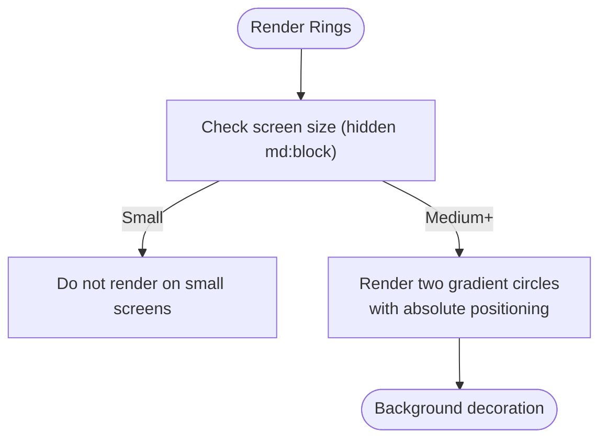
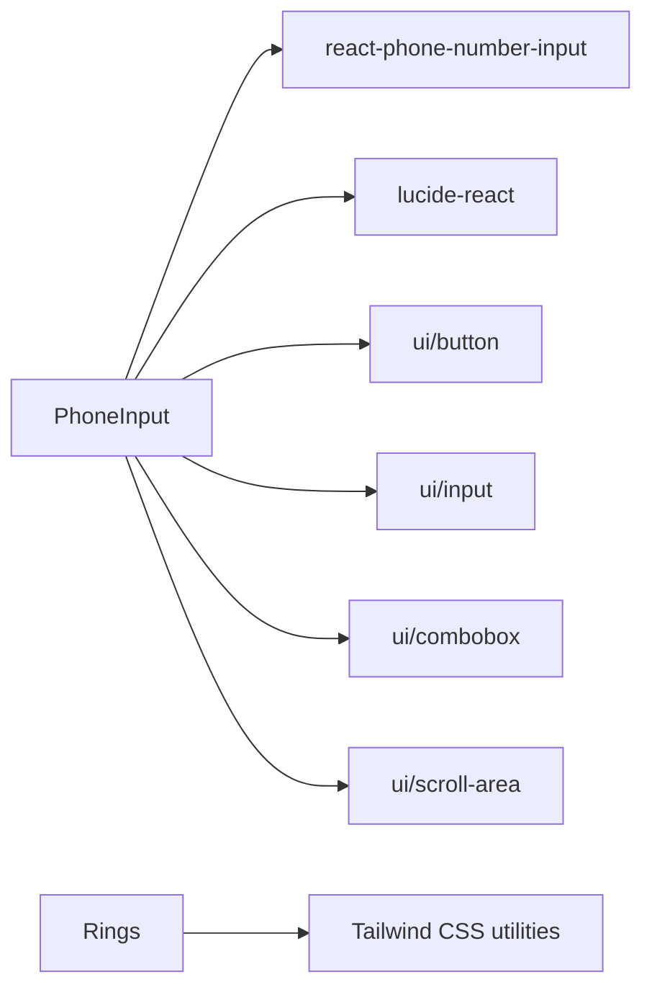

# Utility Components

<cite>
**Referenced Files in This Document**
- [phone-input.tsx](file://src/components/core/phone-input.tsx)
- [rings.tsx](file://src/components/core/rings.tsx)
- [login.tsx](file://src/app/auth/login/login.tsx)
- [register.tsx](file://src/app/auth/register/register.tsx)
- [drivers/page.tsx](file://src/app/admin/(view)/drivers/page.tsx)
- [users/page.tsx](file://src/app/admin/(view)/users/page.tsx)
- [package.json](file://package.json)
</cite>

## Table of Contents
1. [Introduction](#introduction)
2. [Project Structure](#project-structure)
3. [Core Components](#core-components)
4. [Architecture Overview](#architecture-overview)
5. [Detailed Component Analysis](#detailed-component-analysis)
6. [Dependency Analysis](#dependency-analysis)
7. [Performance Considerations](#performance-considerations)
8. [Troubleshooting Guide](#troubleshooting-guide)
9. [Conclusion](#conclusion)

## Introduction
This document provides a focused guide to two utility components used across the application:
- PhoneInput: an international phone number input with country selection, formatting, and validation support.
- Rings: a decorative background component that renders layered gradient circles for visual depth.

The goal is to explain how these components work, their configuration options, integration patterns, accessibility considerations, browser compatibility, and performance implications.

## Project Structure
Both components live under src/components/core and are consumed by authentication flows and admin pages. The PhoneInput wraps react-phone-number-input and integrates with the app’s UI primitives (Button, Input, Combobox, ScrollArea). The Rings component is a presentational layer built with Tailwind CSS utilities.

**Diagram sources**
- [phone-input.tsx:1-234](file://src/components/core/phone-input.tsx#L1-L234)
- [rings.tsx:1-15](file://src/components/core/rings.tsx#L1-L15)
- [login.tsx:1-325](file://src/app/auth/login/login.tsx#L1-L325)
- [register.tsx:1-219](file://src/app/auth/register/register.tsx#L1-L219)
- [drivers/page.tsx](file://src/app/admin/(view)/drivers/page.tsx#L1-L591)
- [users/page.tsx](file://src/app/admin/(view)/users/page.tsx#L1-L511)

**Section sources**
- [phone-input.tsx:1-234](file://src/components/core/phone-input.tsx#L1-L234)
- [rings.tsx:1-15](file://src/components/core/rings.tsx#L1-L15)

## Core Components
- PhoneInput: Provides a controlled international phone input with country selector, flag display, search, and size variants. It exposes props compatible with react-phone-number-input and adds variant styling and popup customization.
- Rings: Renders two large, semi-transparent gradient circles positioned absolutely behind content on medium and larger screens.

Key usage examples:
- Authentication forms use PhoneInput with defaultCountry derived from navigator.language and parsePhoneNumber for validation before submission.
- Admin driver creation uses PhoneInput to capture phone numbers.
- Rings is imported in layout files to provide ambient background decoration.

**Section sources**
- [login.tsx:1-325](file://src/app/auth/login/login.tsx#L1-L325)
- [register.tsx:1-219](file://src/app/auth/register/register.tsx#L1-L219)
- [drivers/page.tsx](file://src/app/admin/(view)/drivers/page.tsx#L300-L365)

## Architecture Overview
PhoneInput composes multiple internal pieces:
- A context provider supplies variant and popup customization.
- A custom input component adapts height based on variant.
- A custom country select implements searchable list with flags and calling codes.
- A flag renderer displays country flags or a fallback icon.

Rings is a pure presentational component using absolute positioning and Tailwind gradients.

**Diagram sources**
- [phone-input.tsx:30-231](file://src/components/core/phone-input.tsx#L30-L231)

**Section sources**
- [phone-input.tsx:1-234](file://src/components/core/phone-input.tsx#L1-L234)

## Detailed Component Analysis

### PhoneInput
Purpose:
- Accepts international phone numbers with automatic formatting and validation helpers via react-phone-number-input.
- Provides a searchable country selector with flags and calling code display.
- Supports size variants and popup customization.

Prop interface highlights:
- value: Controlled phone value type provided by react-phone-number-input.
- onChange: Callback receiving the current phone value.
- defaultCountry: ISO country code to preselect.
- variant: Size variant ("sm", "default", "lg") affecting input height.
- popupClassName: Additional classes for the country dropdown container.
- scrollAreaClassName: Additional classes for the scrollable list area.
- All other standard HTML input attributes are supported except overridden ones.

International formatting and validation:
- Formatting is handled by react-phone-number-input; consumers typically parse the value with parsePhoneNumber to extract country and number parts before submission.
- Validation can be performed client-side using parsePhoneNumber and then enforced server-side as needed.

Country code selection:
- A combobox-based picker shows countries with flags and calling codes.
- Search filters by country label.
- Selected country is displayed alongside its calling code.

Accessibility:
- Uses semantic elements and aria attributes where appropriate.
- Screen reader text is provided for the selected country via a visually hidden span.
- Keyboard navigation is supported through the underlying combobox primitives.

Integration examples:
- Login page sets defaultCountry from navigator.language and parses the phone value before sending OTP.
- Register page follows the same pattern.
- Admin driver creation captures phone via PhoneInput and includes it in registration payload.

**Diagram sources**
- [phone-input.tsx:56-87](file://src/components/core/phone-input.tsx#L56-L87)
- [login.tsx:196-222](file://src/app/auth/login/login.tsx#L196-L222)
- [register.tsx:53-83](file://src/app/auth/register/register.tsx#L53-L83)

**Section sources**
- [phone-input.tsx:1-234](file://src/components/core/phone-input.tsx#L1-L234)
- [login.tsx:1-325](file://src/app/auth/login/login.tsx#L1-L325)
- [register.tsx:1-219](file://src/app/auth/register/register.tsx#L1-L219)
- [drivers/page.tsx](file://src/app/admin/(view)/drivers/page.tsx#L300-L365)

### Rings
Purpose:
- Decorative background element that adds layered gradient circles behind content on medium and larger screens.

Behavior and configuration:
- Hidden on small screens; visible on md and above.
- Two overlapping circles with different opacities and sizes, positioned absolutely at bottom-left relative to parent.
- Responsive sizing and spacing via Tailwind breakpoints.

Use cases:
- Ambient visual enhancement in layouts and pages.
- Not intended for loading states or progress indicators; consider Spinner or Progress components for those purposes.

Customization:
- To change colors, adjust gradient tokens or replace with custom classes.
- To alter timing or animation, add motion or CSS animations around the circles.

Accessibility:
- Uses pointer-events-none so it does not interfere with interactions.
- No interactive semantics required since it is purely decorative.

Browser compatibility:
- Relies on Tailwind CSS utilities including gradients and responsive classes.
- Works in modern browsers supporting CSS gradients and flexbox/grid.

Performance:
- Static DOM nodes with no JS runtime overhead.
- Minimal impact on rendering; suitable for broad usage.

[No sources needed since this diagram shows conceptual workflow, not actual code structure]

**Section sources**
- [rings.tsx:1-15](file://src/components/core/rings.tsx#L1-L15)

## Dependency Analysis
External dependencies relevant to PhoneInput:
- react-phone-number-input: International phone number parsing, formatting, and country data.
- lucide-react: Fallback globe icon when a flag is unavailable.
- Internal UI primitives: Button, Input, Combobox, ScrollArea.

Rings has no external runtime dependencies beyond React and Tailwind CSS utilities.

**Diagram sources**
- [phone-input.tsx:1-234](file://src/components/core/phone-input.tsx#L1-L234)
- [rings.tsx:1-15](file://src/components/core/rings.tsx#L1-L15)
- [package.json:1-68](file://package.json#L1-L68)

**Section sources**
- [package.json:1-68](file://package.json#L1-L68)
- [phone-input.tsx:1-234](file://src/components/core/phone-input.tsx#L1-L234)
- [rings.tsx:1-15](file://src/components/core/rings.tsx#L1-L15)

## Performance Considerations
- PhoneInput:
  - Country list filtering uses memoization to avoid unnecessary re-renders during search.
  - Smart caret is disabled to prevent cursor jumps during editing.
  - Rendering cost scales with the number of countries; consider limiting initial load if needed.
- Rings:
  - Purely static markup; negligible CPU/GPU cost.
  - If animated in the future, prefer transform and opacity changes to minimize layout thrash.

[No sources needed since this section provides general guidance]

## Troubleshooting Guide
Common issues and resolutions:
- PhoneInput value undefined:
  - Ensure you pass a controlled value and onChange handler.
  - When clearing the field, set the value to undefined or empty string consistently.
- Invalid phone format:
  - Use parsePhoneNumber before submission to validate and split into country and number.
  - Show user-friendly error messages when parsing fails.
- Default country not applied:
  - Set defaultCountry based on navigator.language and update key prop if the country changes dynamically.
- Dropdown not scrolling properly:
  - Adjust scrollAreaClassName to ensure viewport height constraints are respected.
- Rings not visible:
  - Verify parent container has sufficient height and overflow settings; Rings uses absolute positioning.

**Section sources**
- [login.tsx:174-222](file://src/app/auth/login/login.tsx#L174-L222)
- [register.tsx:28-83](file://src/app/auth/register/register.tsx#L28-L83)
- [phone-input.tsx:117-215](file://src/components/core/phone-input.tsx#L117-L215)

## Conclusion
PhoneInput offers robust international phone input capabilities with accessible country selection and flexible styling. Rings provides a lightweight, non-interactive background effect suitable for aesthetic enhancements. Both components integrate cleanly with the existing UI system and follow best practices for performance and accessibility.

[No sources needed since this section summarizes without analyzing specific files]