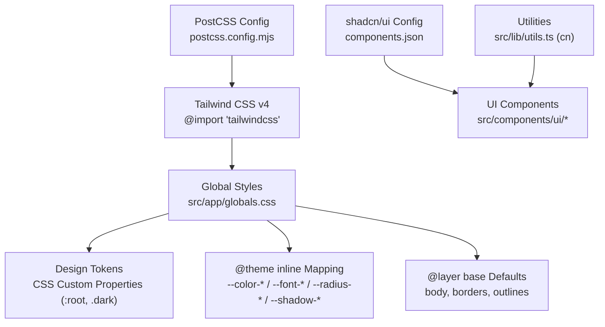
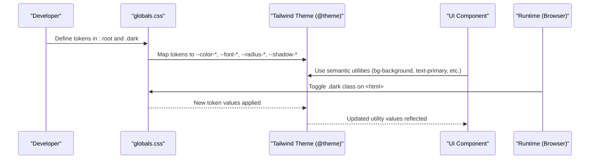
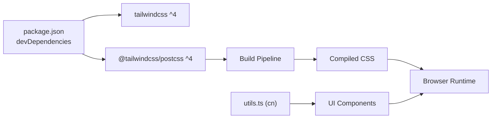

# Theming & Styling

<cite>
**Referenced Files in This Document**
- [globals.css](file://src/app/globals.css)
- [postcss.config.mjs](file://postcss.config.mjs)
- [components.json](file://components.json)
- [package.json](file://package.json)
- [button.tsx](file://src/components/ui/button.tsx)
- [card.tsx](file://src/components/ui/card.tsx)
- [sonner.tsx](file://src/components/ui/sonner.tsx)
- [map.tsx](file://src/components/ui/map.tsx)
- [utils.ts](file://src/lib/utils.ts)
</cite>

## Table of Contents
1. [Introduction](#introduction)
2. [Project Structure](#project-structure)
3. [Core Components](#core-components)
4. [Architecture Overview](#architecture-overview)
5. [Detailed Component Analysis](#detailed-component-analysis)
6. [Dependency Analysis](#dependency-analysis)
7. [Performance Considerations](#performance-considerations)
8. [Troubleshooting Guide](#troubleshooting-guide)
9. [Conclusion](#conclusion)
10. [Appendices](#appendices)

## Introduction
This document explains the theming and styling architecture, focusing on Tailwind CSS v4 configuration, design tokens (CSS custom properties), color schemes, typography system, responsive behavior, component styling patterns, and theme customization approaches. It also clarifies how shadcn/ui themes integrate with custom overrides and provides guidelines for adding new colors, fonts, and spacing values.

## Project Structure
The project uses a modern Tailwind CSS v4 setup driven by PostCSS. The global stylesheet defines design tokens via CSS custom properties, maps them to Tailwind’s theme namespace, and applies base styles. UI components are built using shadcn/ui conventions and utility-first classes, with variants composed through class-variance-authority and merged via tailwind-merge.

**Diagram sources**
- [postcss.config.mjs:1-8](file://postcss.config.mjs#L1-L8)
- [globals.css:1-198](file://src/app/globals.css#L1-L198)
- [components.json:1-30](file://components.json#L1-L30)
- [utils.ts:1-7](file://src/lib/utils.ts#L1-L7)

**Section sources**
- [postcss.config.mjs:1-8](file://postcss.config.mjs#L1-L8)
- [globals.css:1-198](file://src/app/globals.css#L1-L198)
- [components.json:1-30](file://components.json#L1-L30)
- [package.json:49-57](file://package.json#L49-L57)

## Core Components
- Global theme entrypoint:
  - Imports Tailwind CSS v4 and declares a dark variant.
  - Defines design tokens as CSS custom properties for light and dark modes.
  - Maps tokens into Tailwind’s theme namespace via @theme inline.
  - Applies base layer defaults for body, borders, and outlines.
- shadcn/ui integration:
  - Configured to use CSS variables and Radix Luma style.
  - Base color set to neutral; aliases point to local directories.
- Utility helpers:
  - cn merges class names deterministically using clsx and tailwind-merge.

Key responsibilities:
- Centralize all visual tokens in one place (globals.css).
- Expose tokens to Tailwind utilities so components remain declarative.
- Keep shadcn/ui components agnostic of implementation details, relying on tokens.

**Section sources**
- [globals.css:1-198](file://src/app/globals.css#L1-L198)
- [components.json:1-30](file://components.json#L1-L30)
- [utils.ts:1-7](file://src/lib/utils.ts#L1-L7)

## Architecture Overview
The theming pipeline flows from CSS custom properties into Tailwind’s theme, then into component classes. Dark mode is toggled via a root-level class, which swaps token values. Components consume semantic tokens (e.g., background, foreground, primary) rather than hard-coded colors.

**Diagram sources**
- [globals.css:1-198](file://src/app/globals.css#L1-L198)

## Detailed Component Analysis

### Design Tokens and Color System
- Token categories:
  - Semantic colors: background, foreground, card, popover, primary, secondary, muted, accent, destructive, border, input, ring, chart series, sidebar palette.
  - Typography: font-sans, font-serif, font-mono.
  - Radius: single source variable mapped to sm/md/lg/xl radii.
  - Shadows: layered shadow tokens for consistent elevation.
  - Tracking: letter-spacing scale centered around a normal value.
- Light vs dark:
  - Separate blocks define token values per mode.
  - Dark variant is enabled via a custom variant selector.
- Tailwind mapping:
  - @theme inline binds CSS variables to Tailwind’s theme keys, enabling utilities like bg-background, text-primary, rounded-lg, shadow-md, tracking-wide.

Guidelines:
- Always update tokens in :root or .dark.
- Avoid hard-coded colors in components; prefer semantic tokens.
- For charts, extend chart-N tokens if needed.

**Section sources**
- [globals.css:5-121](file://src/app/globals.css#L5-L121)
- [globals.css:123-181](file://src/app/globals.css#L123-L181)
- [globals.css:183-198](file://src/app/globals.css#L183-L198)

### Typography System
- Fonts:
  - Sans and serif both reference Outfit; mono references JetBrains Mono.
- Tracking:
  - Scale derived from a central tracking-normal variable.
- Usage:
  - Components can rely on default font families and tracking utilities exposed by the theme.

Guidelines:
- To add a new font family, define a new CSS variable and map it in @theme inline.
- Adjust tracking scale by updating the base variable.

**Section sources**
- [globals.css:38-40](file://src/app/globals.css#L38-L40)
- [globals.css:157-181](file://src/app/globals.css#L157-L181)

### Responsive Breakpoints
- No explicit breakpoints are defined in the project files examined.
- Tailwind v4 provides sensible defaults; any custom breakpoints should be added in the Tailwind configuration or via CSS media queries where appropriate.

Recommendation:
- If you need custom breakpoints, configure them at the Tailwind level and reference them consistently across components.

[No sources needed since this section provides general guidance]

### Component Styling Patterns
- Button:
  - Uses class-variance-authority to compose variants (default, accent, outline, secondary, ghost, destructive, link) and sizes.
  - Relies on semantic tokens (bg-accent-foreground, text-muted-foreground, border-border, etc.).
  - Integrates focus-visible rings and aria-invalid states for accessibility.
- Card:
  - Composes layout and spacing with utility classes and data attributes for size variants.
  - Uses semantic tokens for backgrounds, text, and shadows.

Patterns:
- Prefer semantic tokens over literal values.
- Use data-slot and data-variant attributes for targeted styling when necessary.
- Merge user-provided className with generated classes via cn.

**Section sources**
- [button.tsx:1-69](file://src/components/ui/button.tsx#L1-L69)
- [card.tsx:1-101](file://src/components/ui/card.tsx#L1-L101)
- [utils.ts:1-7](file://src/lib/utils.ts#L1-L7)

### Theme Customization Approaches
- next-themes integration:
  - Some components (e.g., Sonner) read the active theme via useTheme and pass it to third-party libraries.
- MapLibre map:
  - Detects document.documentElement class changes to switch between light/dark basemap styles.

Approach:
- Keep theme state centralized (e.g., next-themes provider at app root).
- Components that depend on theme should observe document class or use provided hooks.

**Section sources**
- [sonner.tsx:1-77](file://src/components/ui/sonner.tsx#L1-L77)
- [map.tsx:29-83](file://src/components/ui/map.tsx#L29-L83)

### Relationship Between shadcn/ui Themes and Custom Overrides
- shadcn/ui config:
  - Style preset: radix-luma.
  - CSS variables enabled; baseColor neutral.
  - Aliases map ui components to src/components/ui.
- Custom overrides:
  - All shadcn/ui components derive their appearance from the tokens defined in globals.css.
  - Override tokens to re-theme entire component sets consistently.

Best practice:
- Do not edit shadcn-generated components directly for theme changes; instead, adjust tokens in globals.css.

**Section sources**
- [components.json:1-30](file://components.json#L1-L30)
- [globals.css:123-181](file://src/app/globals.css#L123-L181)

## Dependency Analysis
- Build-time:
  - Tailwind CSS v4 is used via @tailwindcss/postcss plugin.
- Runtime:
  - Utilities merge class strings efficiently.
  - Components consume Tailwind utilities bound to theme tokens.

**Diagram sources**
- [package.json:49-57](file://package.json#L49-L57)
- [postcss.config.mjs:1-8](file://postcss.config.mjs#L1-L8)
- [utils.ts:1-7](file://src/lib/utils.ts#L1-L7)

**Section sources**
- [package.json:49-57](file://package.json#L49-L57)
- [postcss.config.mjs:1-8](file://postcss.config.mjs#L1-L8)

## Performance Considerations
- Token-driven styling reduces duplication and improves maintainability.
- Using semantic tokens ensures minimal CSS churn when switching themes.
- Prefer utility classes and avoid heavy custom CSS; keep overrides scoped and minimal.
- When extending third-party libraries (e.g., Sonner), pass tokens via CSS variables to leverage runtime updates without rebuilds.

[No sources needed since this section provides general guidance]

## Troubleshooting Guide
- Colors not updating in dark mode:
  - Ensure the root element has the correct class for dark mode and that tokens are defined under both :root and .dark.
- Tokens not available in Tailwind utilities:
  - Verify @theme inline mappings exist for each token you intend to use.
- Conflicting class names:
  - Use cn to merge classes deterministically and prevent conflicts.
- Third-party library theming:
  - Pass theme-aware CSS variables to libraries (e.g., Sonner) and ensure they consume those variables.

**Section sources**
- [globals.css:123-181](file://src/app/globals.css#L123-L181)
- [utils.ts:1-7](file://src/lib/utils.ts#L1-L7)
- [sonner.tsx:58-65](file://src/components/ui/sonner.tsx#L58-L65)

## Conclusion
The project’s theming system centers on a small set of well-defined CSS custom properties, mapped into Tailwind’s theme for consistent usage across components. shadcn/ui components inherit these tokens, enabling cohesive re-theming. By following the guidelines below, teams can safely extend the design system while preserving consistency and performance.

[No sources needed since this section summarizes without analyzing specific files]

## Appendices

### How to Add a New Color
- Define a new CSS variable in :root and .dark (e.g., --brand).
- Map it in @theme inline as --color-brand: var(--brand).
- Use the new token in components via bg-brand, text-brand, border-brand, etc.

**Section sources**
- [globals.css:5-121](file://src/app/globals.css#L5-L121)
- [globals.css:123-181](file://src/app/globals.css#L123-L181)

### How to Add a New Font Family
- Declare a new CSS variable (e.g., --font-display).
- Map it in @theme inline as --font-display: var(--font-display).
- Apply via font-display utility or set it as a component default.

**Section sources**
- [globals.css:38-40](file://src/app/globals.css#L38-L40)
- [globals.css:157-181](file://src/app/globals.css#L157-L181)

### How to Add Spacing Values
- Extend the spacing scale by defining new CSS variables and mapping them in @theme inline (e.g., --spacing-xl).
- Reference them via spacing utilities if configured, or apply directly via CSS where needed.

[No sources needed since this section provides general guidance]

### Guidelines for Custom Overrides
- Prefer overriding tokens in globals.css over writing ad-hoc CSS.
- Keep overrides localized to specific components only when necessary.
- Validate contrast and accessibility after changes.

[No sources needed since this section provides general guidance]