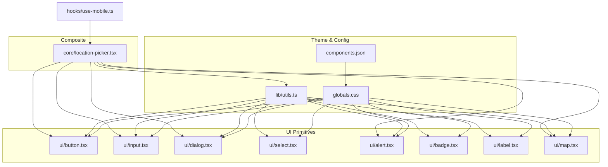
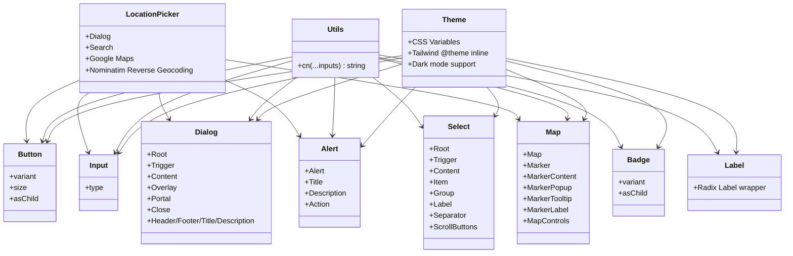
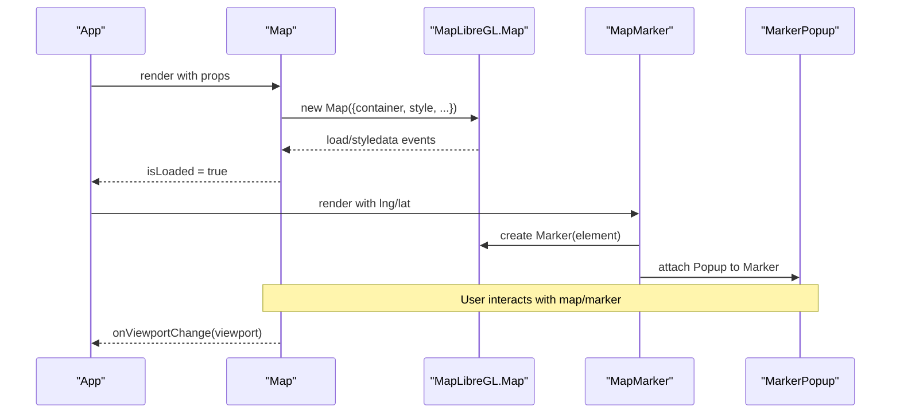
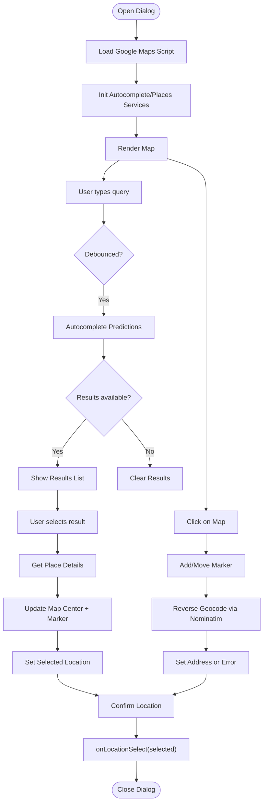
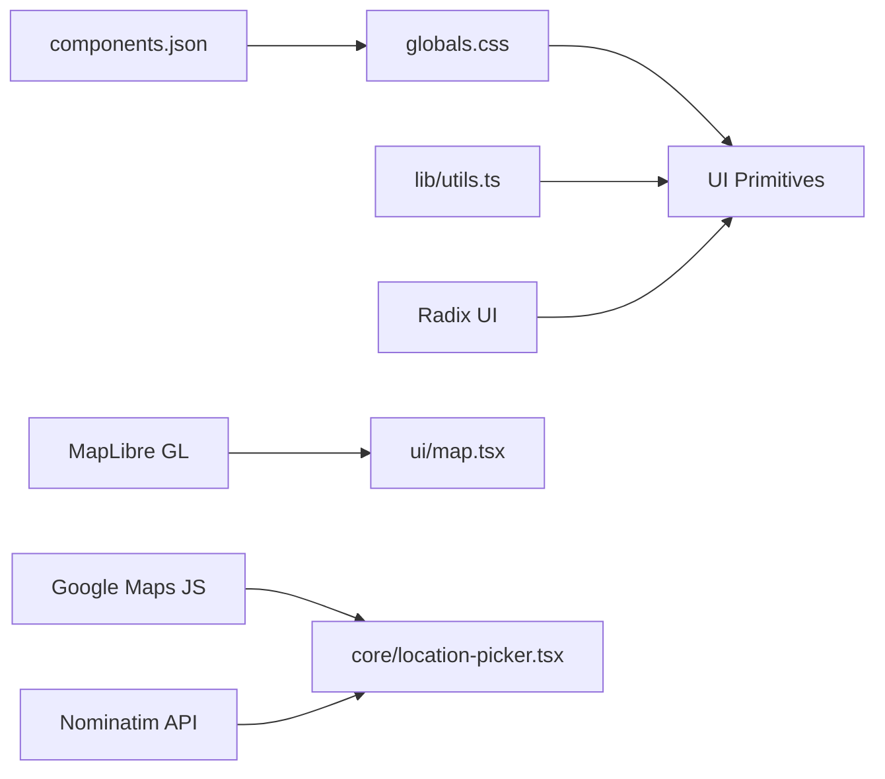

# UI Component System

<cite>
**Referenced Files in This Document**
- [components.json](file://components.json)
- [globals.css](file://src/app/globals.css)
- [utils.ts](file://src/lib/utils.ts)
- [button.tsx](file://src/components/ui/button.tsx)
- [input.tsx](file://src/components/ui/input.tsx)
- [dialog.tsx](file://src/components/ui/dialog.tsx)
- [card.tsx](file://src/components/ui/card.tsx)
- [select.tsx](file://src/components/ui/select.tsx)
- [alert.tsx](file://src/components/ui/alert.tsx)
- [badge.tsx](file://src/components/ui/badge.tsx)
- [label.tsx](file://src/components/ui/label.tsx)
- [map.tsx](file://src/components/ui/map.tsx)
- [location-picker.tsx](file://src/components/core/location-picker.tsx)
- [use-mobile.ts](file://src/hooks/use-mobile.ts)
</cite>

## Table of Contents
1. Introduction
2. Project Structure
3. Core Components
4. Architecture Overview
5. Detailed Component Analysis
6. Dependency Analysis
7. Performance Considerations
8. Troubleshooting Guide
9. Conclusion
10. Appendices

## Introduction
This document describes the UI component system built on shadcn/ui and Radix UI. It covers architecture, design tokens, theming, custom components (location picker and map integration), usage patterns, props documentation, customization options, responsive design, accessibility compliance, and guidelines for creating new components following established patterns.

## Project Structure
The UI layer is organized into:
- Base primitives and utilities under src/components/ui
- Business-facing composite components under src/components/core
- Shared hooks for responsiveness under src/hooks
- Global theme and CSS variables under src/app/globals.css
- shadcn configuration under components.json

**Diagram sources**
- [components.json:1-30](file://components.json#L1-L30)
- [globals.css:1-198](file://src/app/globals.css#L1-L198)
- [utils.ts:1-7](file://src/lib/utils.ts#L1-L7)
- [button.tsx:1-69](file://src/components/ui/button.tsx#L1-L69)
- [input.tsx:1-20](file://src/components/ui/input.tsx#L1-L20)
- [dialog.tsx:1-171](file://src/components/ui/dialog.tsx#L1-L171)
- [select.tsx:1-213](file://src/components/ui/select.tsx#L1-L213)
- [alert.tsx:1-86](file://src/components/ui/alert.tsx#L1-L86)
- [badge.tsx:1-50](file://src/components/ui/badge.tsx#L1-L50)
- [label.tsx:1-24](file://src/components/ui/label.tsx#L1-L24)
- [map.tsx:1-800](file://src/components/ui/map.tsx#L1-L800)
- [location-picker.tsx:1-501](file://src/components/core/location-picker.tsx#L1-L501)
- [use-mobile.ts:1-23](file://src/hooks/use-mobile.ts#L1-L23)

**Section sources**
- [components.json:1-30](file://components.json#L1-L30)
- [globals.css:1-198](file://src/app/globals.css#L1-L198)
- [utils.ts:1-7](file://src/lib/utils.ts#L1-L7)

## Core Components
The system provides a set of accessible, theme-aware primitives that compose higher-level features.

- Button
  - Variants: default, accent, outline, secondary, ghost, destructive, link
  - Sizes: default, xs, sm, lg, icon, icon-xs, icon-sm, icon-lg
  - Props: className, variant, size, asChild, plus standard button attributes
  - Accessibility: focus-visible ring, aria-invalid states, keyboard support via native button
  - Source: [button.tsx:1-69](file://src/components/ui/button.tsx#L1-L69)

- Input
  - Styling: rounded, border, focus ring, disabled state, placeholder color
  - Props: className, type, plus standard input attributes
  - Accessibility: proper focus styles, aria-invalid support
  - Source: [input.tsx:1-20](file://src/components/ui/input.tsx#L1-L20)

- Dialog
  - Parts: Root, Trigger, Portal, Close, Overlay, Content, Header, Footer, Title, Description
  - Behavior: portal rendering, overlay backdrop, close button, animations
  - Props: showCloseButton, overlayClassName, plus Radix Dialog props
  - Accessibility: focus trapping, role semantics via Radix primitives
  - Source: [dialog.tsx:1-171](file://src/components/ui/dialog.tsx#L1-L171)

- Select
  - Parts: Root, Group, Value, Trigger, Content, Label, Item, Separator, ScrollUp/Down buttons
  - Behavior: popper positioning, viewport sizing, item alignment
  - Props: size (trigger), position, align, plus Radix Select props
  - Accessibility: keyboard navigation, item indicators, screen reader text
  - Source: [select.tsx:1-213](file://src/components/ui/select.tsx#L1-L213)

- Alert
  - Variants: default, info, success, warning, destructive
  - Parts: Alert, Title, Description, Action
  - Props: variant, className, plus div attributes
  - Accessibility: role="alert", semantic structure
  - Source: [alert.tsx:1-86](file://src/components/ui/alert.tsx#L1-L86)

- Badge
  - Variants: default, secondary, destructive, outline, ghost, link
  - Props: variant, asChild, className, plus span attributes
  - Accessibility: focus-visible ring, aria-invalid support
  - Source: [badge.tsx:1-50](file://src/components/ui/badge.tsx#L1-L50)

- Label
  - Wraps Radix Label with consistent spacing and disabled behavior
  - Props: className, plus Radix Label props
  - Accessibility: associates with inputs via htmlFor or nesting
  - Source: [label.tsx:1-24](file://src/components/ui/label.tsx#L1-L24)

- Card
  - Parts: Card, Header, Title, Description, Action, Content, Footer
  - Props: size ("default" | "sm"), className, plus div attributes
  - Accessibility: semantic grouping for content sections
  - Source: [card.tsx:1-101](file://src/components/ui/card.tsx#L1-L101)

**Section sources**
- [button.tsx:1-69](file://src/components/ui/button.tsx#L1-L69)
- [input.tsx:1-20](file://src/components/ui/input.tsx#L1-L20)
- [dialog.tsx:1-171](file://src/components/ui/dialog.tsx#L1-L171)
- [select.tsx:1-213](file://src/components/ui/select.tsx#L1-L213)
- [alert.tsx:1-86](file://src/components/ui/alert.tsx#L1-L86)
- [badge.tsx:1-50](file://src/components/ui/badge.tsx#L1-L50)
- [label.tsx:1-24](file://src/components/ui/label.tsx#L1-L24)
- [card.tsx:1-101](file://src/components/ui/card.tsx#L1-L101)

## Architecture Overview
The UI system follows a layered approach:
- Theme layer: CSS variables and Tailwind theme mapping
- Primitive layer: shadcn/Radix-based components with consistent styling
- Composite layer: business components composed from primitives
- Utility layer: shared helpers (e.g., cn) and hooks (e.g., useIsMobile)

**Diagram sources**
- [globals.css:1-198](file://src/app/globals.css#L1-L198)
- [utils.ts:1-7](file://src/lib/utils.ts#L1-L7)
- [button.tsx:1-69](file://src/components/ui/button.tsx#L1-L69)
- [input.tsx:1-20](file://src/components/ui/input.tsx#L1-L20)
- [dialog.tsx:1-171](file://src/components/ui/dialog.tsx#L1-L171)
- [select.tsx:1-213](file://src/components/ui/select.tsx#L1-L213)
- [alert.tsx:1-86](file://src/components/ui/alert.tsx#L1-L86)
- [badge.tsx:1-50](file://src/components/ui/badge.tsx#L1-L50)
- [label.tsx:1-24](file://src/components/ui/label.tsx#L1-L24)
- [map.tsx:1-800](file://src/components/ui/map.tsx#L1-L800)
- [location-picker.tsx:1-501](file://src/components/core/location-picker.tsx#L1-L501)

## Detailed Component Analysis

### Design Tokens and Theming
- Token source: CSS custom properties define colors, radii, shadows, fonts, and tracking.
- Mapping to Tailwind: @theme inline maps CSS variables to Tailwind color tokens and other design tokens.
- Dark mode: .dark overrides token values; components respond via data-slot and Tailwind classes.
- Configuration: components.json sets style, RSC, TSX, Tailwind CSS path, baseColor, aliases, and registries.

Key token categories:
- Colors: background, foreground, card, popover, primary, secondary, muted, accent, destructive, border, input, ring, chart series, sidebar palette
- Typography: font-sans, font-serif, font-mono, tracking scales
- Radius: radius, radius-sm/md/lg/xl
- Shadows: shadow-2xs through shadow-2xl
- Spacing: spacing scale

Customization points:
- Override CSS variables in :root or .dark
- Extend Tailwind theme via globals.css @theme block
- Adjust component variants using cva where applicable

**Section sources**
- [globals.css:1-198](file://src/app/globals.css#L1-L198)
- [components.json:1-30](file://components.json#L1-L30)

### Map Integration (MapLibre GL)
The map component wraps MapLibre GL with React-friendly APIs, context sharing, and composable marker/popup/tooltip elements.

Core concepts:
- Map: initializes MapLibre instance, manages loading, controlled/uncontrolled viewport, theme switching, projection
- Marker: creates markers with draggable support and event callbacks
- MarkerContent: renders custom content inside marker element via portal
- MarkerPopup: persistent popup attached to marker
- MarkerTooltip: hover tooltip attached to marker
- MapControls: zoom, compass, locate, fullscreen controls

Props overview (selected):
- Map
  - theme: "light" | "dark" (auto-detected if omitted)
  - styles: { light?: string|StyleSpec; dark?: string|StyleSpec }
  - projection: MapLibre ProjectionSpecification
  - viewport: { center, zoom, bearing, pitch }
  - onViewportChange(viewport): callback for viewport changes
  - loading: boolean to show loader
  - Plus all MapLibre MapOptions except container/style
- MapMarker
  - longitude, latitude
  - children: MarkerContent/MarkerPopup/MarkerTooltip/MarkerLabel
  - onClick, onMouseEnter, onMouseLeave
  - onDragStart, onDrag, onDragEnd (when draggable=true)
  - Draggable and other MarkerOptions
- MarkerPopup
  - children, className, closeButton, plus PopupOptions
- MarkerTooltip
  - children, className, plus PopupOptions
- MarkerLabel
  - children, className, position: "top" | "bottom"
- MapControls
  - position, showZoom, showCompass, showLocate, showFullscreen, className, onLocate

Accessibility:
- Focusable control buttons with aria-labels
- Keyboard navigable controls
- Screen-reader friendly labels and descriptions

Responsive considerations:
- Fullscreen control toggles immersive view
- Controls positioned via utility classes

**Diagram sources**
- [map.tsx:1-800](file://src/components/ui/map.tsx#L1-L800)

**Section sources**
- [map.tsx:1-800](file://src/components/ui/map.tsx#L1-L800)

### Location Picker (Google Maps + Nominatim)
A dialog-driven location selection tool combining Google Places Autocomplete, interactive map, and reverse geocoding via Nominatim.

Key behaviors:
- Opens a Dialog containing search input, results dropdown, and map
- Dynamically loads Google Maps script once per session
- Initializes Places services and map when dialog opens
- Supports click-to-select and draggable marker
- Debounced autocomplete search and result selection
- Reverse geocodes coordinates to display address
- Emits selected location via onLocationSelect callback

Props:
- onLocationSelect(locationData): callback invoked with { lat, lng, address? }
- defaultLocation: initial center/fallback location
- initialLocation: pre-selected location

States and UX:
- Loading indicators during address fetch
- Error alerts for failed reverse geocoding
- Clear search action and reset on close

**Diagram sources**
- [location-picker.tsx:1-501](file://src/components/core/location-picker.tsx#L1-L501)

**Section sources**
- [location-picker.tsx:1-501](file://src/components/core/location-picker.tsx#L1-L501)

### Responsive Design Implementation
- Mobile breakpoint hook: useIsMobile returns boolean based on max-width 767px
- Usage pattern: conditionally render layouts or adjust sizes based on mobile state
- Tailwind responsive prefixes used across components for layout and typography adjustments

**Section sources**
- [use-mobile.ts:1-23](file://src/hooks/use-mobile.ts#L1-L23)

## Dependency Analysis
- Theme dependency chain: components.json configures Tailwind CSS path and aliases; globals.css defines tokens and maps them to Tailwind; components consume tokens via Tailwind classes.
- Utility dependency: cn merges class names deterministically; used by all UI primitives.
- Radix dependency: Dialog, Select, Label wrap Radix primitives to provide accessible, unstyled foundations.
- External libraries:
  - MapLibre GL for open-source mapping
  - Google Maps JS API for location picker (dynamic script injection)
  - Nominatim OpenStreetMap for reverse geocoding

**Diagram sources**
- [components.json:1-30](file://components.json#L1-L30)
- [globals.css:1-198](file://src/app/globals.css#L1-L198)
- [utils.ts:1-7](file://src/lib/utils.ts#L1-L7)
- [map.tsx:1-800](file://src/components/ui/map.tsx#L1-L800)
- [location-picker.tsx:1-501](file://src/components/core/location-picker.tsx#L1-L501)

**Section sources**
- [components.json:1-30](file://components.json#L1-L30)
- [globals.css:1-198](file://src/app/globals.css#L1-L198)
- [utils.ts:1-7](file://src/lib/utils.ts#L1-L7)
- [map.tsx:1-800](file://src/components/ui/map.tsx#L1-L800)
- [location-picker.tsx:1-501](file://src/components/core/location-picker.tsx#L1-L501)

## Performance Considerations
- Map initialization and style switching:
  - Avoid unnecessary re-renders by memoizing contexts and refs
  - Use controlled viewport only when needed; skip updates during internal moves
  - Defer heavy operations until styledata/load events complete
- Google Maps dynamic loading:
  - Ensure single script injection and reuse existing instance
  - Debounce search input to reduce API calls
  - Handle errors gracefully to prevent repeated retries
- Class merging:
  - Use cn consistently to minimize redundant class strings
- Memory management:
  - Remove event listeners and destroy map instances on cleanup

[No sources needed since this section provides general guidance]

## Troubleshooting Guide
Common issues and resolutions:
- Map does not load or appears blank
  - Verify container ref exists before instantiation
  - Check network requests for style JSON and tiles
  - Ensure theme class toggling triggers style update
- Marker interactions not firing
  - Confirm marker element has correct event listeners
  - Validate draggable prop and drag callbacks
- Location picker search fails
  - Validate Google Maps API key and enabled libraries
  - Inspect PlacesServiceStatus and handle non-OK statuses
  - Check CORS and rate limits for Nominatim
- Dialog focus trap not working
  - Ensure Dialog.Trigger and Dialog.Close are used correctly
  - Verify no custom overlays intercept focus

**Section sources**
- [map.tsx:1-800](file://src/components/ui/map.tsx#L1-L800)
- [location-picker.tsx:1-501](file://src/components/core/location-picker.tsx#L1-L501)
- [dialog.tsx:1-171](file://src/components/ui/dialog.tsx#L1-L171)

## Conclusion
The UI system combines shadcn/ui primitives, Radix UI accessibility, and a robust theming layer to deliver consistent, customizable components. The map integration and location picker demonstrate how to compose complex features while maintaining performance and accessibility. Following the provided patterns ensures maintainability and scalability as the component library grows.

[No sources needed since this section summarizes without analyzing specific files]

## Appendices

### Component Usage Patterns
- Compose dialogs with Dialog parts for modals and forms
- Use Select for dropdowns with keyboard navigation
- Apply Alert variants for contextual feedback
- Wrap content in Card sections for structured layouts
- Leverage Badge for status indicators

**Section sources**
- [dialog.tsx:1-171](file://src/components/ui/dialog.tsx#L1-L171)
- [select.tsx:1-213](file://src/components/ui/select.tsx#L1-L213)
- [alert.tsx:1-86](file://src/components/ui/alert.tsx#L1-L86)
- [card.tsx:1-101](file://src/components/ui/card.tsx#L1-L101)
- [badge.tsx:1-50](file://src/components/ui/badge.tsx#L1-L50)

### Guidelines for Creating New Components
- Follow the primitive pattern:
  - Accept className and forward props
  - Use data-slot attributes for testability and styling hooks
  - Integrate with cn for class merging
- Themed components:
  - Consume CSS variables via Tailwind tokens
  - Support dark mode through existing variable overrides
- Accessible components:
  - Prefer Radix primitives for complex interactions
  - Provide aria attributes and keyboard support
- Composition:
  - Keep small, focused components
  - Build feature components by composing primitives
- Testing:
  - Use data-slot selectors for stable tests
  - Assert focus management and aria states

**Section sources**
- [utils.ts:1-7](file://src/lib/utils.ts#L1-L7)
- [globals.css:1-198](file://src/app/globals.css#L1-L198)
- [button.tsx:1-69](file://src/components/ui/button.tsx#L1-L69)
- [dialog.tsx:1-171](file://src/components/ui/dialog.tsx#L1-L171)
- [select.tsx:1-213](file://src/components/ui/select.tsx#L1-L213)